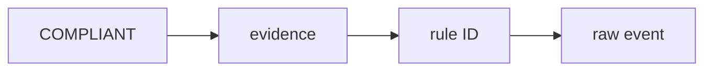

# ENSFácil

[Español](README.md)

Compliance with the Spanish National Security Framework (Esquema Nacional de
Seguridad, RD 311/2022) inside the Wazuh dashboard.

Agents observe each machine and emit technical facts. The plugin checks them
against the policy the organization declares on screen and produces reports
that an auditor can follow from start to finish:



[[_TOC_]]

## Controls

| Control | Name | Levels | Reinforcements |
|---|---|---|---|
| `mp.info.6` | Backups | LOW+ | R1 (MEDIUM+), R2 (HIGH) |
| `op.acc.1` | Identification | LOW+ | R1 (MEDIUM+) |
| `op.acc.2` | Access requirements | LOW+ | R1 (HIGH only) |
| `op.acc.3` | Segregation of duties | MEDIUM+ | R1 (HIGH only) |
| `op.acc.4` | Access rights management | LOW+ | no reinforcements |

Each control has its own deployment repository, with one variant per machine
type: Linux, LDAP directory server and Windows.

---

## Installation and deployment

This `README.md` is the entry point of ENSFácil. Choose the path that matches your environment.

### What do you need to do?

| | Need | Guide |
|---|---|---|
| 1 | Install from scratch | [Full installation from scratch](docs/deployment/01-installation-from-scratch.en.md) |
| 2 | Update an existing environment | [Updating an existing environment](docs/deployment/02-updating-an-existing-environment.en.md) |
| 3 | Check compatibility with another Wazuh version | [Version compatibility](docs/deployment/03-version-compatibility.en.md) |
| 4 | Diagnose a problem or roll back | [Troubleshooting and rollback](docs/deployment/04-troubleshooting-and-rollback.en.md) |

> [!note]
> A deployment from scratch must be possible using only GitLab and this documentation, without copying files from another ENSFácil server.

---

## Operation after deployment

Once ENSFácil is installed following the guides above, agents must deploy the runbooks of the controls that apply to each system.

Each control repository includes its guides in `docs/deployment/`: installation in `01-installation.md`, what must be declared for the control and how each piece of evidence is checked in `02-compliance.md`, and uninstallation and troubleshooting in `03-uninstall-and-troubleshooting.md`.

> [!important]
> The compliance policy is declared on the ENSFácil Configuration screen. Empty parameters are decisions not yet declared and must not be read as default values.

To check the consistency between the plugin, the rules and the runbooks:

```bash
cd /opt/ensfacil/repo
python3 tests/check-consistency.py
```

---

## When something does not add up

| Symptom | Usual cause |
|---|---|
| `Permission denied (publickey)` | the key is not registered in the right account, or `IdentitiesOnly` is missing |
| `detected dubious ownership` | the repository was cloned with `sudo`; fix it with `chown -R $USER:$USER` |
| The installer runs but nothing changes | the repository update did not arrive; check the hash before installing |
| After deploying, the previous version is still shown | browser cache; open a private window |
| A configured parameter shows as not configured | the agent runs an older version; compare the installed library and the repository one with `md5sum` |
| The control card does not appear in Configuration | its configuration block has not been seeded; see the installation or update guide |
| `inject-control.py` reports that the `active` document does not exist | the configuration has never been saved; save it once in ENSFácil > Configuration and seed again |

Consistency check between the plugin and the runbooks:

```bash
cd /opt/ensfacil/repo && python3 tests/check-consistency.py
```

It verifies that every rule referenced by the plugin is deployed on the
manager, that the rule copies do not diverge and that the evidence listens to
the events the agents emit.

---

## How the engine decides

> [!important]
> What cannot be proven is not compliant. The burden of proof lies with the
> audited party.

Measurement and verdict are separate layers: the evidence states whether it
could be observed —and, if not, why— and the requirement states whether that
proves compliance. The cause tells who has to fix it:

| Cause | Where it is fixed |
|---|---|
| `CONFIGURATION` | the policy has not been declared, on the Configuration screen |
| `COLLECTION` | the agent does not report, in the Wazuh deployment |
| `EVIDENCE` | the data arrives incomplete, in the collector |

The agent observes and the engine judges. Evidence in the current model
declares a judgment primitive and the parameter it is checked against; the
agent only emits the fact. That is why a change on screen changes the verdict
without running anything again on the server.

---

## Development

This repository contains the ENSFácil code and the integration package needed to add it to a compatible tree of the official Wazuh Dashboard plugin. The reproducible build procedure is documented in the deployment guides above.

```
dashboard/ens/     ENS module (React + TypeScript)
  catalog/         control and requirement definitions
  configuration/   configurable parameters
  core/            engine: evidence, evaluation, consolidation
  controls/ reports/ evidences/    the three tabs
integration/       Wazuh Dashboard integration package
agent/rules/       Wazuh rules per control
config/            configuration blocks and inject-control.py
tests/             engine suites and consistency check
```

Rule ID ranges in use:

| Control | Reserved band | In use |
|---|---|---|
| `mp.info.6` | 106600–106799 | 106600–106723 |
| `op.acc.1` | 106800–106899 | 106800–106891 |
| `op.acc.2` | 106900–106999 | 106900–106974 |
| `op.acc.3` | 107000–107099 | 107000–107050 |
| `op.acc.4` | 107100–107199 | 107100–107150 |

---

## License

Proprietary software of Quersystem. See [LICENSE](LICENSE).
