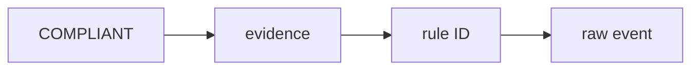

# ENSFácil

[Español](README.md)

Compliance with the Spanish National Security Framework (Esquema Nacional de
Seguridad, RD 311/2022) inside the Wazuh dashboard.

Agents observe each machine and emit technical facts. The plugin checks them
against the policy the organization declares on screen and produces reports
that an auditor can follow from start to finish:



[[_TOC_]]

## How ENSFácil is deployed

Four steps, in this order. Each one is detailed in the
[installation-from-scratch guide](docs/deployment/01-installation-from-scratch.en.md),
and the links to every runbook and its guides are in the
[runbooks and registers table](docs/deployment/05-runbooks-and-registers.en.md).

1. **Manager.** Wazuh installed and validated; then the `install-manager.sh` of
   each of the 17 Linux runbooks (rules and `<localfile>`; op.exp.7, op.exp.8
   and op.exp.9 also leave a collector on the manager itself), and finally the
   ENSFácil plugin installed in the dashboard, next to the Wazuh plugin and without modifying it.
   Wazuh in containers? → [Manager in a container](docs/deployment/06-wazuh-in-docker.en.md).
2. **Machines.** On each agent, the runbooks of its platform (Linux, Zimbra
   LDAP, Zimbra MTA or Windows), following the `01-installation` guide **of
   each runbook**.
3. **Configuration in the dashboard.** In ENSFácil > Configuration, the
   parameters of each control, and on the machines or the manager, the
   [organization's registers](docs/deployment/05-runbooks-and-registers.en.md#registers-the-organization-creates),
   following the `02-compliance` guide **of each runbook** (it is not in this
   repository: each runbook has its own, linked from the table).
4. **Measure.** After the collectors' first pass (hourly), the panel judges each
   control; whatever cannot be demonstrated shows `NO_EVALUABLE` with its cause
   and says where to fix it.

## Controls

ENSFácil evaluates 17 controls. «Levels» are the system categories in which
Annex II requires the control; «not required» marks a reinforcement the ENS
defines but does not require in any category, which comes out `NO_APLICA`.

| Control | Name | Levels | Reinforcements | Where it is measured |
|---|---|---|---|---|
| `mp.info.6` | Backups | LOW+ | R1 (MEDIUM+), R2 (HIGH) | machines |
| `op.acc.1` | Identification | LOW+ | R1 (MEDIUM+) | machines |
| `op.acc.2` | Access requirements | LOW+ | R1 (HIGH) | machines |
| `op.acc.3` | Segregation of duties and tasks | MEDIUM+ | R1 (HIGH); R2–R3 not required | machines |
| `op.acc.4` | Access rights management process | LOW+ | no reinforcements | machines |
| `op.acc.5` | Authentication mechanism (external users) | LOW+ | R1–R4 (LOW+), R5 (MEDIUM+); R6–R7 not required | machines |
| `op.acc.6` | Authentication mechanism (organization users) | LOW+ | R1–R4, R8–R9 (LOW+), R5 (MEDIUM+), R6–R7 (HIGH) | machines |
| `op.exp.1` | Asset inventory | LOW+ | R1–R4 not required | machines |
| `op.exp.2` | Security configuration | LOW+ | no reinforcements | machines |
| `op.exp.3` | Security configuration management | LOW+ | R1 (MEDIUM+), R2–R3 (HIGH); R4–R5 not required | machines |
| `op.exp.4` | Security maintenance and updates | LOW+ | R1 (MEDIUM+), R2 (HIGH); R3–R4 not required | machines |
| `op.exp.5` | Change management | MEDIUM+ | R1 (HIGH) | machines |
| `op.exp.6` | Malware protection | LOW+ | R1–R2 (MEDIUM+), R3–R4 (HIGH); R5 not required | machines |
| `op.exp.7` | Incident management | LOW+ | R1–R2 (MEDIUM+), R3 (HIGH); R4 not required | manager |
| `op.exp.8` | Activity logging | LOW+ (by the Traceability level) | R1–R4 (MEDIUM+), R5 (HIGH) | machines and manager |
| `op.exp.9` | Incident management records | LOW+ | no reinforcements | manager |
| `op.exp.10` | Cryptographic key protection | LOW+ | R1 (MEDIUM+); R2 not required | machines |

Each control has its own deployment repository (runbook) in GitLab, with one
variant per machine type. The repository is named exactly as the control and
the subgroup gives the platform or role: `linux/op.acc.1`,
`zimbra/zimbra-ldap/op.acc.1` and `windows/op.acc.1` are three runbooks of the
same control.

| GitLab group | Controls |
|---|---|
| `quersystem/ens-controls-runbook/linux` | all 17 (mp.info.6 for machines that back up to a Proxmox Backup Server) |
| `quersystem/ens-controls-runbook/zimbra/zimbra-ldap` | op.acc.1 to op.acc.6 and op.exp.1 to op.exp.10 |
| `quersystem/ens-controls-runbook/zimbra/zimbra-mta` | mp.info.6 (`zmbackup` backups of Zimbra 10 Network Edition) |
| `quersystem/ens-controls-runbook/windows` | op.acc.1 to op.acc.4 |

What each Linux runbook installs:

| Runbook | On the manager (`install-manager.sh`) | On each agent (`install.sh`) |
|---|---|---|
| `linux/mp.info.6` | rules and `<localfile>` of the `ens-copias` group | collector that measures the organization's backup procedure on the Proxmox Backup Server (it only backs up in `copiar` mode) |
| `linux/op.acc.1` | rules and `<localfile>` of the `ens` group | collector |
| `linux/op.acc.2` | same | collector |
| `linux/op.acc.3` | same | collector |
| `linux/op.acc.4` | same | collector |
| `linux/op.acc.5` | same | collector |
| `linux/op.acc.6` | same | collector |
| `linux/op.exp.1` | same | collector |
| `linux/op.exp.2` | same | collector |
| `linux/op.exp.3` | same | collector |
| `linux/op.exp.4` | same; the Vulnerability Detector bridge is optional and not installed by default (see its guide) | collector |
| `linux/op.exp.5` | rules and `<localfile>` of the `ens` group | collector and auditd rules |
| `linux/op.exp.6` | same | collector |
| `linux/op.exp.7` | rules, manager collector with its cron and `<localfile>` in the manager's `ossec.conf` | nothing: it only checks that the agent sends its active response log |
| `linux/op.exp.8` | rules, `<localfile>` of the `ens` group, manager collector with its cron and `<localfile>` in the manager's `ossec.conf` | collector and auditd rules |
| `linux/op.exp.9` | rules, manager collector with its cron and `<localfile>` in the manager's `ossec.conf` | nothing: it only checks that active response, FIM and dpkg are forwarded |
| `linux/op.exp.10` | rules and `<localfile>` of the `ens` group | collector and auditd rules |

> [!important]
> The `install.sh` scripts that write auditd rules (op.acc.2, op.acc.3,
> op.acc.4, op.exp.3, op.exp.4, op.exp.5, op.exp.8 and op.exp.10) leave them in `/etc/audit/rules.d/` but do not load them. Run
> `sudo augenrules --load` at the end; without that step the evidence that
> depends on auditd is not measured.

---

## Requirements and tested versions

### Tested on

| Component | Version | Where |
|---|---|---|
| Wazuh server operating system | Ubuntu 22.04 LTS | Quersystem lab (server in use) |
| Wazuh server operating system | Ubuntu Server 24.04.4 LTS | from-scratch install of the [installation guide](docs/deployment/01-installation-from-scratch.en.md#81-environment-used-to-validate-this-guide) |
| Wazuh manager, indexer and dashboard | 4.14.7 (package install) | Quersystem lab |
| OpenSearch Dashboards | 2.19.5 (the one shipped with dashboard 4.14.7) | Quersystem lab |
| Node.js to build the plugin | 18.19.0 (with Yarn Classic 1.22.22) | Quersystem lab |
| Wazuh agent on Linux | 4.14.5 and 4.14.7 (Ubuntu 22.04 and 24.04) | Quersystem lab |
| Wazuh agent on Windows | 4.14.5 (Windows Server 2022 Standard, evaluation edition) | Quersystem lab |
| `wazuh/wazuh-manager` image | 4.14.0, 4.14.1 and 4.14.7: `wazuh-logtest` and `install-manager.sh` (manager side only, no indexer or agents) | test container |
| `wazuh/wazuh-dashboard` image | 4.14.7: only the `build.number` check | test container |

### Requirements

- **Wazuh 4.14.7** installed and validated (manager, indexer and dashboard)
  before installing ENSFácil. ENSFácil is its own plugin (`ensfacil`) that is
  installed next to the Wazuh plugin without modifying it; this version is
  built for the Wazuh 4.14.7 dashboard (OpenSearch Dashboards 2.19.5). See the
  [version compatibility](docs/deployment/03-version-compatibility.en.md).
- **Agent inventory:** Wazuh agent monitoring enabled (the
  `wazuh-monitoring-*` index), readable by the users of ENSFácil.
- **Who changes the configuration:** users with the `ensfacil_admin` role
  (created by `config/create-admin-role.sh`) or `all_access`.
- **Ubuntu Server** with `sudo`, network connectivity and authorised SSH access
  to the GitLab repositories.
- Tools the installation guide checks before starting: `git`, `curl`, `wget`
  and `python3` (the latter also for `tests/check-consistency.py`).
- **To build the plugin:** an OpenSearch Dashboards 2.19.5 source tree,
  Node.js 18.19.0 and Yarn Classic 1.22.22 (`config/build-plugin.sh`). Node.js
  18.19.0 also ships inside the `wazuh-dashboard` package.
- **On every measured machine:** a Wazuh agent in the control's group and the
  runbook for its platform. Each runbook's requirements (`cron`, `auditd`,
  specific packages) are in its own README.
- The detail of what each step needs is in the
  [installation from scratch guide](docs/deployment/01-installation-from-scratch.md).

### Not tested

- Wazuh versions other than 4.14.7 (each dashboard version needs its own
  plugin zip): not tested.
- **Wazuh in Docker.** Only the manager from the official images is tested
  (versions in the table above). The full `docker compose` deployment with
  indexer and agents, the dashboard image with the plugin, the host cron and a
  multi-node cluster are untested; see
  [Manager in a container](docs/deployment/06-wazuh-in-docker.md).
- Server distributions other than Ubuntu: not tested.

---

## Installation and deployment

This `README.md` is the entry point of ENSFácil. Choose the path that matches your environment.

### What do you need to do?

| | Need | Guide |
|---|---|---|
| 1 | Install from scratch | [Full installation from scratch](docs/deployment/01-installation-from-scratch.en.md) |
| 2 | Update an existing environment or add new controls | [Updating an existing environment](docs/deployment/02-updating-an-existing-environment.en.md) |
| 3 | Check compatibility with another Wazuh version | [Version compatibility](docs/deployment/03-version-compatibility.en.md) |
| 4 | Diagnose a problem or roll back | [Troubleshooting and rollback](docs/deployment/04-troubleshooting-and-rollback.en.md) |
| 5 | Find a control's runbook, its guides and the registers it needs | [Runbooks and the organization's registers](docs/deployment/05-runbooks-and-registers.en.md) |
| 6 | Install with the official Wazuh Docker images | [Manager in a container](docs/deployment/06-wazuh-in-docker.en.md) |

> [!note]
> A deployment from scratch must be possible using only GitLab and this documentation, without copying files from another ENSFácil server.

> [!important]
> Mandatory order when adding controls: first deploy the plugin version that
> contains them, then seed their configuration. The installed plugin validates
> the configuration document with its own rules, which do not know the new
> controls or parameter types: seeding first can leave the whole dashboard
> unable to load.

---

## Operation after deployment

Once ENSFácil is installed following the guides above, agents must deploy the runbooks of the controls that apply to each system.

Each control repository (runbook) includes its guides in its own `docs/deployment/`: installation in `01-installation.md`, what must be declared for the control and how each piece of evidence is checked in `02-compliance.md`, and uninstallation and troubleshooting in `03-uninstall-and-troubleshooting.md`. Those guides live on GitLab, in each runbook, not in this repository: the direct links are in the [runbook table](docs/deployment/05-runbooks-and-registers.en.md#runbooks-per-control).

> [!important]
> The compliance policy is declared on the ENSFácil Configuration screen. Empty parameters are decisions not yet declared and must not be read as default values.

### The manager in the scope

The ENS scope is defined by the Wazuh `ens` group, and the manager (agent
`000`) does not belong to any group. That is why the dashboard adds it to the
scope by itself, and only because some controls are measured on it:

| Control | Measurement planes (`measurementPlanes`) | Manager row (`000`) | Each machine row |
|---|---|---|---|
| `op.exp.7` | manager only | evaluated | not evaluated |
| `op.exp.9` | manager only | evaluated | not evaluated |
| `op.exp.8` | machines and manager | evaluated (central plane and the server itself) | evaluated; what is measured only on the manager comes out `NO_APLICA` |
| the rest | machines only | not evaluated | evaluated |

Manager facts arrive with `agent.id=000`. In the view of a machine, op.exp.7
and op.exp.9 appear with the result of the manager row, because they are
controls of the organization, not of the machine. In the manager view only
op.exp.7, op.exp.8 and op.exp.9 appear.

### Traceability dimension level

op.exp.8 applies by the level of the Traceability (T) dimension, not by the
system category. Configuration > Global configuration has an optional
**Traceability level (T)** field: if left empty, op.exp.8 is evaluated with the
global ENS level, like every other control. No other control reads it.

To check the consistency between the plugin, the rules and the runbooks:

```bash
cd /opt/ensfacil/repo
python3 tests/check-consistency.py
```

---

## When something does not add up

| Symptom | Usual cause |
|---|---|
| `Permission denied (publickey)` | the key is not registered in the right account, or `IdentitiesOnly` is missing |
| `detected dubious ownership` | the repository was cloned with `sudo`; fix it with `chown -R $USER:$USER` |
| The installer runs but nothing changes | the repository update did not arrive; check the hash before installing |
| After deploying, the previous version is still shown | the plugin was installed without bumping the dashboard `build.number`; deploy with `config/deploy-plugin.sh` (see the update guide) |
| «No se pudo cargar el entorno ENS» | a parameter with a value the plugin does not accept (for example `value: null`); validate the document with `config/validate-configuration.ts` and fix the parameter it reports |
| A configured parameter shows as not configured | the agent runs an older version; compare the installed library and the repository one with `md5sum` |
| The control card does not appear in Configuration | its configuration block has not been seeded, or the deployed plugin predates the control; see the update guide |
| `inject-control.py` reports that the `active` document does not exist | the configuration has never been saved; save it once in ENSFácil > Configuration and seed again |
| «Sin datos del recolector desde …» on a control | the collector of that control has not sent a heartbeat for more than 24 h on that machine: agent stopped, cron removed or machine down |
| op.exp.7, op.exp.8 or op.exp.9 without data on the manager | that runbook's `install-manager.sh` is missing, or its cron has not run yet (hourly) |
| `install-manager.sh` refuses to touch `agent.conf` | the `agent.conf` of the `ens` group (or the `ens-copias` one, for mp.info.6) has more than one `<agent_config>` block; merge them into one |

Consistency check between the plugin and the runbooks:

```bash
cd /opt/ensfacil/repo && python3 tests/check-consistency.py
```

It verifies that every rule referenced by the plugin is deployed on the
manager, that the rule copies do not diverge and that the evidence listens to
the events the agents emit.

---

## How the engine decides

> [!important]
> What cannot be proven is not compliant. The burden of proof lies with the
> audited party.

Measurement and verdict are separate layers: the evidence states whether it
could be observed —and, if not, why— and the requirement states whether that
proves compliance. The cause tells who has to fix it:

| Cause | Where it is fixed |
|---|---|
| `CONFIGURATION` | the policy has not been declared, on the Configuration screen |
| `COLLECTION` | the agent does not report, in the Wazuh deployment |
| `EVIDENCE` | the data arrives incomplete, in the collector |

When the collector itself declares why it could not measure (the `causa`
field of its fact), that cause reaches the evidence and the requirement
unchanged: a register the organization does not keep comes out as
`CONFIGURATION`, not as a collection failure.

**Data not renewed.** State is judged with the last run of each collector. If
the last heartbeat of a control on a machine is older than 24 hours, that
control is not judged with that data: its evidence comes out `NO_EVALUABLE`
with cause `COLLECTION` and the reason «Sin datos del recolector desde <UTC
date>», and its requirements do not count as compliant. What the machine said
days ago does not prove how it is today. Old facts remain visible in the
traceability view.

The agent observes and the engine judges. Evidence in the current model
declares a judgment primitive and the parameter it is checked against; the
agent only emits the fact. That is why a change on screen changes the verdict
without running anything again on the server.

---

## Development

This repository is the `ensfacil` OpenSearch Dashboards plugin: it is built inside an OpenSearch Dashboards 2.19.5 source tree with `config/build-plugin.sh` and installed with `config/deploy-plugin.sh`, without touching the Wazuh plugin.

```
public/            the browser app: tabs, search, agent inventory
public/ens/        ENS module (React + TypeScript)
  catalog/         control and requirement definitions
  configuration/   configurable parameters
  core/            engine: evidence, evaluation, consolidation
  controls/ reports/ evidences/    the three tabs
server/            configuration routes (/api/ensfacil/configuration)
common/            shared constants
agent/rules/       Wazuh rules per control
config/            configuration blocks and manager tools:
                   build-plugin.sh, deploy-plugin.sh, create-admin-role.sh,
                   inject-control.py, set-parameters.py, validate-configuration.ts
tests/             engine suites and consistency check
```

Tests (Python 3 and Node.js 18 or later; the script tests also need `bash`, `zip` and `unzip`):

```bash
python3 tests/check-consistency.py
for t in tests/*.test.ts; do timeout 180 npx --yes tsx "$t" >/dev/null 2>&1 && echo "OK   $t" || echo "FAIL $t"; done
for s in tests/*.test.sh; do bash "$s" >/dev/null 2>&1 && echo "OK   $s" || echo "FAIL $s"; done
```

`tests/mp-info-6-rules.test.sh` tests the mp.info.6 rules with `wazuh-logtest` in a `wazuh/wazuh-manager` container (Docker); without Docker it skips that part with a warning and runs only the static checks.

Rule ID ranges in use. Those of op.exp.7 and op.exp.9, and those of the
central plane of op.exp.8, arrive with agent `000` (the manager):

| Control | Reserved band | In use |
|---|---|---|
| `mp.info.6` | 106600–106799 | 106600–106799 |
| `op.acc.1` | 106800–106899 | 106800–106891 |
| `op.acc.2` | 106900–106999 | 106900–106974 |
| `op.acc.3` | 107000–107099 | 107000–107050 |
| `op.acc.4` | 107100–107199 | 107100–107150 |
| `op.acc.5` | 110000–110099 | 110000–110099 |
| `op.acc.6` | 110100–110199 | 110100–110199 |
| `op.exp.1` | 110200–110299 | 110200–110299 |
| `op.exp.2` | 110300–110399 | 110300–110391 |
| `op.exp.3` | 110400–110499 | 110400–110499 |
| `op.exp.4` | 110500–110599 | 110500–110595 |
| `op.exp.5` | 110600–110699 | 110600–110699 |
| `op.exp.6` | 110700–110799 | 110700–110799 |
| `op.exp.7` | 110800–110899 | 110800–110899 |
| `op.exp.8` | 110900–110999 | 110900–110999 |
| `op.exp.9` | 111000–111099 | 111000–111099 |
| `op.exp.10` | 111100–111199 | 111100–111199 |

The 107200–109999 band is not used: on some managers other integrations
occupy it. Before deploying on a manager with its own rules, check that none
of these bands is in use.

---

## License

Proprietary software of Quersystem. See [LICENSE](LICENSE).
