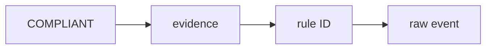

# ENSFácil

[Español](README.md)

Compliance with the Spanish National Security Framework (Esquema Nacional de
Seguridad, RD 311/2022) inside the Wazuh dashboard.

Agents observe each machine and emit technical facts. The plugin checks them
against the policy the organization declares on screen and produces reports
that an auditor can follow from start to finish:



[[_TOC_]]

## How ENSFácil is deployed

Four steps, in this order. Each one is detailed in the
[installation-from-scratch guide](docs/deployment/01-installation-from-scratch.en.md),
and the links to every runbook and its guides are in the
[runbooks and registers table](docs/deployment/05-runbooks-and-registers.en.md).

1. **Manager.** Wazuh installed and validated; then the `install-manager.sh` of each of the 22 Linux runbooks (rules and `<localfile>` entries). Those of op.exp.7, op.exp.8, op.exp.9, op.mon.1, op.mon.2, op.mon.3, op.nub.1 and op.cont.3 also install a collector on the manager; op.cont.2 is documentation only. Finally, the ENSFácil plugin in the dashboard, from its release. For Wazuh in Docker: [Wazuh in Docker](docs/deployment/06-wazuh-in-docker.en.md).
2. **Machines.** On each agent, first the [initial setup](https://gitlab.com/quersystem/ens-controls-runbook/initial-setup) (enrolment on the manager, `ens` group and the plugin's ENS scope), once; then the runbooks of its platform (Linux, Zimbra LDAP, Zimbra MTA or Windows), following the `01-installation` guide **of each runbook**.
3. **Configuration in the dashboard.** In ENSFácil > Configuration: each control's common settings, templates and assignment («Controles» tab) and what belongs to each agent («Agentes» tab; [Configuration by controls and templates](docs/deployment/09-configuration-by-system.en.md)). On the machines or the manager, the [organization's registers](docs/deployment/05-runbooks-and-registers.en.md#registers-the-organization-creates), following the `02-compliance` guide **of each runbook** (linked from the table).
4. **Measure.** After the collectors' first pass (hourly; op.mon.2 and op.cont.3, every 6 h), the panel judges each control; whatever cannot be demonstrated shows `NO_EVALUABLE` with its cause and where to fix it.

## Controls

ENSFácil evaluates 23 controls, in Annex II order (operational framework,
section 4, and protection measures, section 5). «Axis» says whether Annex II
applies the control by the system category or by the level of one or more
dimensions (with several, the highest). «Levels» are the levels at which it is
required; «not required» marks a reinforcement the ENS defines but does not
require at any level, which comes out `NO_APLICA`.

| Control | Annex II | Name | Axis | Levels | Reinforcements | Where it is measured |
|---|---|---|---|---|---|---|
| `op.acc.1` | 4.2.1 | Identification | T·A level | LOW+ | R1 (MEDIUM+) | machines |
| `op.acc.2` | 4.2.2 | Access requirements | C·I·T·A level | LOW+ | R1 (HIGH) | machines |
| `op.acc.3` | 4.2.3 | Segregation of duties and tasks | C·I·T·A level | MEDIUM+ | R1 (HIGH); R2–R3 not required | machines |
| `op.acc.4` | 4.2.4 | Access rights management process | C·I·T·A level | LOW+ | no reinforcements | machines |
| `op.acc.5` | 4.2.5 | Authentication mechanism (external users) | C·I·T·A level | LOW+ | R1–R4 (LOW+), R5 (MEDIUM+); R6–R7 not required | machines |
| `op.acc.6` | 4.2.6 | Authentication mechanism (organization users) | C·I·T·A level | LOW+ | R1–R4, R8–R9 (LOW+), R5 (MEDIUM+), R6–R7 (HIGH) | machines |
| `op.exp.1` | 4.3.1 | Asset inventory | category | LOW+ | R1–R4 not required | machines |
| `op.exp.2` | 4.3.2 | Security configuration | category | LOW+ | no reinforcements | machines |
| `op.exp.3` | 4.3.3 | Security configuration management | category | LOW+ | R1 (MEDIUM+), R2–R3 (HIGH); R4–R5 not required | machines |
| `op.exp.4` | 4.3.4 | Security maintenance and updates | category | LOW+ | R1 (MEDIUM+), R2 (HIGH); R3–R4 not required | machines |
| `op.exp.5` | 4.3.5 | Change management | category | MEDIUM+ | R1 (HIGH) | machines |
| `op.exp.6` | 4.3.6 | Malware protection | category | LOW+ | R1–R2 (MEDIUM+), R3–R4 (HIGH); R5 not required | machines |
| `op.exp.7` | 4.3.7 | Incident management | category | LOW+ | R1–R2 (MEDIUM+), R3 (HIGH); R4 not required | manager |
| `op.exp.8` | 4.3.8 | Activity logging | T level | LOW+ | R1–R4 (MEDIUM+), R5 (HIGH) | machines and manager |
| `op.exp.9` | 4.3.9 | Incident management records | category | LOW+ | no reinforcements | manager |
| `op.exp.10` | 4.3.10 | Cryptographic key protection | category | LOW+ | R1 (MEDIUM+); R2 not required | machines |
| `op.nub.1` | 4.5.1 | Protection of cloud services | category | LOW+ | R1 (MEDIUM+), R2 (HIGH) | manager |
| `op.cont.2` | 4.6.2 | Continuity plan | D level | HIGH | R1–R2 not required | manager; the plugin judges it from the configuration (documentation-only runbook) |
| `op.cont.3` | 4.6.3 | Periodic tests | D level | HIGH | no reinforcements | manager |
| `op.mon.1` | 4.7.1 | Intrusion detection | category | LOW+ | R1 (MEDIUM+), R2 (HIGH); R3 not required | manager |
| `op.mon.2` | 4.7.2 | Metrics system | category | LOW+ | R1–R2 (MEDIUM+) | manager |
| `op.mon.3` | 4.7.3 | Monitoring | category | LOW+ | R1–R2 (MEDIUM+), R3–R6 (HIGH); R7 not required | machines and manager |
| `mp.info.6` | 5.7.6 | Backups | D level | LOW+ | R1 (MEDIUM+), R2 (HIGH) | machines |

Each control has a runbook in GitLab, with one variant per machine type. The repository is named as the control and the subgroup gives the platform or role: `linux/op.acc.1`, `zimbra/zimbra-ldap/op.acc.1` and `windows/op.acc.1`.

| GitLab group | Controls |
|---|---|
| `quersystem/ens-controls-runbook/linux` | 23; the op.cont.2 one is documentation only, with no collector or rules (mp.info.6 for machines that back up to a Proxmox Backup Server) |
| `quersystem/ens-controls-runbook/zimbra/zimbra-ldap` | op.acc.1 to op.acc.6 and op.exp.1 to op.exp.10 |
| `quersystem/ens-controls-runbook/zimbra/zimbra-mta` | mp.info.6 (`zmbackup` backups of Zimbra 10 Network Edition) |
| `quersystem/ens-controls-runbook/windows` | op.acc.1 to op.acc.4 |

Content of each runbook and registers it asks of the organization: [Runbooks and the organization's registers](docs/deployment/05-runbooks-and-registers.en.md#runbooks-per-control).

> [!important]
> The `install.sh` scripts that write auditd rules (op.acc.2, op.acc.3, op.acc.4, op.exp.3, op.exp.4, op.exp.5, op.exp.8 and op.exp.10) do not load them: run `sudo augenrules --load` at the end; without it, the evidence that depends on auditd is not measured.

---

## Requirements and tested versions

### Tested on

| Component | Version | Where |
|---|---|---|
| Wazuh server operating system | Ubuntu 22.04 LTS | Quersystem lab (server in use) |
| Wazuh server operating system | Ubuntu Server 24.04.4 LTS | from-scratch install of the [installation guide](docs/deployment/01-installation-from-scratch.en.md#81-environment-used-to-validate-this-guide) |
| Wazuh manager, indexer and dashboard | 4.14.7 (package install) | Quersystem lab |
| OpenSearch Dashboards | 2.19.5 (the one shipped with dashboard 4.14.7) | Quersystem lab |
| Node.js to build the plugin | 18.19.0 (with Yarn Classic 1.22.22) | Quersystem lab |
| Wazuh agent on Linux | 4.14.5 and 4.14.7 (Ubuntu 22.04 and 24.04) | Quersystem lab |
| Wazuh agent on Windows | 4.14.5 (Windows Server 2022 Standard, evaluation edition) | Quersystem lab |
| `wazuh/wazuh-manager` image | 4.14.0 and 4.14.1: `wazuh-logtest` with the rules; 4.14.7: `install-manager.sh` with `ENSFACIL_SYSTEMCTL` and the manager collectors, without indexer or agents | test container |
| `wazuh/wazuh-indexer`, `wazuh/wazuh-manager` and `wazuh/wazuh-dashboard` images | 4.14.7, official *single-node* deployment of `wazuh-docker`: dashboard image with ENSFácil 1.1.0, start-up, role, seeding and validation ([Wazuh in Docker, section 1](docs/deployment/06-wazuh-in-docker.en.md#1-verification-status)) | `docker compose` on a laptop |

### Requirements

- **Wazuh 4.14.7** installed and validated (manager, indexer and dashboard)
  before installing ENSFácil. Plugin `ensfacil`, built for the Wazuh 4.14.7 dashboard (OpenSearch Dashboards 2.19.5). See the
  [version compatibility](docs/deployment/03-version-compatibility.en.md).
- **Agent inventory:** Wazuh agent monitoring enabled (the
  `wazuh-monitoring-*` index), readable by the users of ENSFácil.
- **Who changes the configuration:** users with the `ensfacil_admin` role
  (created by `config/create-admin-role.sh`) or `all_access`.
- **Package installation:** Ubuntu Server with `sudo`, network connectivity
  and authorised SSH access to the GitLab repositories. **Docker:** a host with
  Docker and the `compose` plugin, with the official `wazuh-docker` deployment;
  a user allowed to run `docker`; authorised SSH access to GitLab to clone the
  repository; Internet access so that `npx` can download `tsx`; and `unzip` on
  the host
  ([Wazuh in Docker](docs/deployment/06-wazuh-in-docker.en.md#2-prerequisites)).
- Tools the installation guide checks before starting: `git`, `curl`, `wget`
  and `python3` (the latter also for `tests/check-consistency.py`).
- **To download a release:** a GitLab account with access to the project or,
  from the server, a deploy token with `read_package_registry`
  ([guide 07](docs/deployment/07-installing-from-a-release.en.md)).
- **To build the plugin** (only if it is not installed from a release): an
  OpenSearch Dashboards 2.19.5 source tree, Node.js 18.19.0 and Yarn Classic
  1.22.22 (`config/build-plugin.sh`), or Docker with the CI builder image
  ([guide 08](docs/deployment/08-building-from-source.en.md)). Node.js 18.19.0
  also ships inside the `wazuh-dashboard` package.
- **On every measured machine:** a Wazuh agent in the control's group and the
  runbook for its platform. Each runbook's requirements (`cron`, `auditd`,
  specific packages) are in its own README.

### Not tested

- Wazuh versions other than 4.14.7 (each dashboard version needs its own
  plugin zip): not tested.
- **Wazuh in Docker.** The plugin side is verified with the official
  *single-node* deployment. Not tested: the manager side inside the
  `docker compose` deployment (installers, host cron, `<localfile>` entries in
  `wazuh_manager.conf`, agents), a multi-node cluster and the plugin in a real
  customer deployment
  ([Wazuh in Docker, section 1](docs/deployment/06-wazuh-in-docker.en.md#1-verification-status)).
- Server distributions other than Ubuntu: not tested.

---

## Installation

### The plugin: two paths

| Path | When | Guide |
|---|---|---|
| From a release (recommended) | install or update the plugin without building | [Installing from a release](docs/deployment/07-installing-from-a-release.en.md) |
| Build from source | a version with no release, the evaluation of another Wazuh version or development | [Building from source](docs/deployment/08-building-from-source.en.md) |

From a release, on the Wazuh Dashboard server, with the four release files in
one folder:

```bash
sha256sum -c SHA256SUMS
sudo bash deploy-plugin.sh ensfacil-1.3.0-osd-2.19.5.zip
```

Expected result: `OK` for the three files and `dashboard: active` at the end
of the deployment. Replace `1.3.0` with the release's version.

Commands of the package installation (`deploy-plugin.sh` uses `systemctl`, `sudo -u wazuh-dashboard` and `https://localhost:443`). In Docker, the release zip is installed in a custom dashboard image ([Wazuh in Docker, section 3](docs/deployment/06-wazuh-in-docker.en.md#3-build-the-dashboard-image-with-ensfácil)).

The `ensfacil_admin` role is only required if a user without `all_access` must save the configuration ([guide 07, section 9](docs/deployment/07-installing-from-a-release.en.md#9-create-the-ensfacil_admin-role)).

The manager rules, the runbooks on each machine and the configuration are installed separately ([how ENSFácil is deployed](#how-ensfácil-is-deployed)).

### Where the releases are

- In GitLab, under *Deploy → Releases* of the `quersystem/plugin-wazuh-ens`
  project: every version, `ENSFácil X.Y.Z`, with its notes and its four files
  (the zip, `deploy-plugin.sh`, `create-admin-role.sh` and `SHA256SUMS`).
- The same files, under *Deploy → Package registry → ensfacil*.
- From a server, through the package API, with a deploy token
  ([guide 07, section 6](docs/deployment/07-installing-from-a-release.en.md#6-download-from-the-server-with-a-deploy-token)).

The project is private: a GitLab account with access is required.

Change version (from the integrated version, to a newer release or back to the previous one) or uninstall: [guide 07, section 15](docs/deployment/07-installing-from-a-release.en.md#15-change-version-or-uninstall). Data is kept: the configuration, its history and the facts live in the indexer.

### Guide by task

| | Task | Guide |
|---|---|---|
| 1 | Install from scratch | [Full installation from scratch](docs/deployment/01-installation-from-scratch.en.md) |
| 2 | Update an existing environment or add new controls | [Updating an existing environment](docs/deployment/02-updating-an-existing-environment.en.md) |
| 3 | Check compatibility with another Wazuh version | [Version compatibility](docs/deployment/03-version-compatibility.en.md) |
| 4 | Diagnose a problem or roll back | [Troubleshooting and rollback](docs/deployment/04-troubleshooting-and-rollback.en.md) |
| 5 | Find a control's runbook, its guides and the registers it needs | [Runbooks and the organization's registers](docs/deployment/05-runbooks-and-registers.en.md) |
| 6 | Install, update or remove ENSFácil with the official Wazuh Docker images | [Wazuh in Docker](docs/deployment/06-wazuh-in-docker.en.md) |
| 7 | Install or update the plugin from a release | [Installing from a release](docs/deployment/07-installing-from-a-release.en.md) |
| 8 | Build the plugin and run the tests | [Building from source](docs/deployment/08-building-from-source.en.md) |
| 9 | Declare common settings, templates and their assignment to agents, or convert an earlier configuration | [Configuration by controls and templates](docs/deployment/09-configuration-by-system.en.md) |

> [!important]
> When adding controls, first deploy the plugin version that contains them, then seed their configuration ([Installing from a release, section 11](docs/deployment/07-installing-from-a-release.en.md#11-update-to-a-newer-release)).

---

## Operation after deployment

After installing ENSFácil, deploy on each system the runbooks of the controls that apply to it.

Guides of each runbook, in its own `docs/deployment/` (GitLab, not this repository): `01-installation.md` installation; `02-compliance.md` what is declared for the control and how each piece of evidence is checked; `03-uninstall-and-troubleshooting.md` uninstallation and troubleshooting. Links in the [runbook table](docs/deployment/05-runbooks-and-registers.en.md#runbooks-per-control).

> [!important]
> The compliance policy is declared on the Configuration screen. An empty parameter is an undeclared decision, not a default value.

### Where ENSFácil opens

Dashboard menu, «Security operations». From 1.2.0, also an «ENSFácil» card on the OpenSearch Dashboards home page (`/app/home`) when the dashboard includes the `home` plugin; on the Wazuh home page it is only in the menu.

The **Vista general** (overview) tab shows every machine in scope and every control at once: the per-machine summary, the controls × machines matrix, the work queue and the 30-day trend ([installation from scratch, section 14.7](docs/deployment/01-installation-from-scratch.en.md#147-check-the-overview-and-the-detail-of-a-control)).

### The manager in the scope

The ENS scope comes from the configuration: every machine in the inventory,
those in some Wazuh groups (usually the `ens` group) or a list of agents
([the ENS scope](https://gitlab.com/quersystem/ens-controls-runbook/initial-setup/-/blob/main/docs/deployment/03-ens-scope.en.md)).
The manager (agent `000`) does not belong to any group. That is why the
dashboard adds it to the scope by itself, and only because some controls are
measured on it:

| Control | Measurement planes (`measurementPlanes`) | Manager row (`000`) | Each machine row |
|---|---|---|---|
| `op.cont.2`, `op.cont.3` | manager only | evaluated | not evaluated |
| `op.exp.7`, `op.exp.9` | manager only | evaluated | not evaluated |
| `op.mon.1`, `op.mon.2`, `op.nub.1` | manager only | evaluated | not evaluated |
| `op.exp.8` | machines and manager | evaluated (central plane and the server itself) | evaluated; what is measured only on the manager comes out `NO_APLICA` |
| `op.mon.3` | machines and manager | evaluated (central collection, correlation, exposure surface and the rest) | its log sources are evaluated |
| the rest | machines only | not evaluated | evaluated |

Manager facts arrive with `agent.id=000`. In the view of a machine, the controls measured only on the manager show the result of its row (they are controls of the organization). In the manager view the nine with a row on it are measured: op.cont.2, op.cont.3, op.exp.7, op.exp.8, op.exp.9, op.mon.1, op.mon.2, op.mon.3 and op.nub.1; the rest appear last, in grey, with «No se mide en esta máquina» and the reason. The Vista general tab shows every control on every machine ([installation from scratch, section 14.7](docs/deployment/01-installation-from-scratch.en.md#147-check-the-overview-and-the-detail-of-a-control)).

### Dimension levels

Annex II applies some controls by the level of a security dimension, not by the system category. Configuration > General has an optional field per dimension: **Confidencialidad (C)** (confidentiality), **Integridad (I)** (integrity), **Trazabilidad (T)** (traceability), **Autenticidad (A)** (authenticity) and **Disponibilidad (D)** (availability). An empty field equals the ENS level; a control with several dimensions is evaluated with the highest of them.

| Dimensions | Controls |
|---|---|
| C, I, T and A | op.acc.2 to op.acc.6 |
| T and A | op.acc.1 |
| T | op.exp.8 |
| D | mp.info.6, op.cont.2 and op.cont.3 (these two only with D at ALTO) |
| none | the rest, by the category (ENS level) |

The ENS level is the system category, the highest of its dimensions: the screen does not save a dimension above it and `config/validate-configuration.ts` reports it. With no dimension declared, the results are the same as with 1.3.0.

### ENS norm and application criterion

Only the «Ficha del Control» sheet of the auditor's templates reproduces the BOE; parameters, evidences, thresholds, non-compliance conditions and report fields are interpretation. The control detail, the Controls view and the PDF report label each text with its provenance:

| Label | Meaning |
|---|---|
| «Norma ENS» | literal text of the requirement (Annex II of RD 311/2022) |
| «Criterio de aplicación» | how ENSFácil or the auditor's template reads and measures it, with no normative value |

The catalog keeps the literal in `description` and the interpretation in `interpretation`. Each control also declares its Annex II section (`annexSection`) and the template it comes from (`source`: v2.0 of 15/10/2026; op.acc.2 stays on v1.0 until its v2.0 arrives). The detail header and the report header show the three.

### mp.info.6 and the auditor's template

mp.info.6 was not built from the auditor's template and keeps what is deployed: parameters P-01 to P-14, its seven evidences and the requirements `mp.info.6.2.a` to `mp.info.6.2.d`, which the PBS and Zimbra collectors report. The control detail and its report show «Correspondencia con la plantilla del auditor»: which ENSFácil parameter and evidence cover each P-xx and EV-xx of the template, with the coverage (equivalent, partial or not measured yet). Not measured today: P-09 (test register), EV-03 (coverage against the scope), EV-07 (mass deletion of backups) and EV-11 (repository encryption). The table is in `common/ens/catalog/template-correspondence.ts`.

`mp.info.6.2` stays split into its letters a) to d): each letter is one requirement in the control percentage (the base counts five requirements, not two). The ids `.2.a` to `.2.d` do not exist in the BOE; the text of each is the literal of its letter.

### op.exp.10: key reads

op.exp.10 EV-01 records reads, writes, permission changes and deletions of the key stores with auditd rules that include read permission (`-w <path> -p rwa`), on Linux and on the LDAP server: reads audited with auditd; FIM only detects integrity changes. This is the EV-01 correction of the v2.0 template. Without auditd, EV-01 stays `NO_EVALUABLE` with its reason. Windows (read SACL and event 4663) is left for a later phase: there is no `op.exp.10-windows` runbook.

---

## When something does not add up

| Symptom | Usual cause |
|---|---|
| `Permission denied (publickey)` | the key is not registered in the right account, or `IdentitiesOnly` is missing |
| `detected dubious ownership` | the repository was cloned with `sudo`; fix it with `chown -R $USER:$USER` |
| The installer runs but nothing changes | the repository update did not arrive; check the hash before installing |
| After deploying, the previous version is still shown | the plugin was installed without bumping the dashboard `build.number`; deploy with `config/deploy-plugin.sh` (see the update guide) |
| «No se pudo cargar el entorno ENS» | a parameter with a value the plugin does not accept (for example `value: null`); validate the document with `config/validate-configuration.ts` and fix the parameter it reports |
| A configured parameter shows as not configured | the agent runs an older version; compare the installed library and the repository one with `md5sum` |
| The control card does not appear in Configuration | its configuration block has not been seeded, or the deployed plugin predates the control; see the update guide |
| `inject-control.py` reports that the `active` document does not exist | the configuration has never been saved; save it once in ENSFácil > Configuration and seed again |
| «Sin datos del recolector desde …» on a control | the collector of that control has not sent a heartbeat for more than 24 h on that machine: agent stopped, cron removed or machine down |
| a control with a collector on the manager (op.exp.7, op.exp.8, op.exp.9, op.mon.1, op.mon.2, op.mon.3, op.nub.1 or op.cont.3) without data on the manager row | that runbook's `install-manager.sh` is missing, or its cron has not run yet (hourly; op.mon.2 and op.cont.3, every 6 h). op.cont.2 has no collector: it is evaluated from the screen tables. In Docker, check the `<localfile>` entries in `wazuh_manager.conf` and the host cron ([Wazuh in Docker, section 13](docs/deployment/06-wazuh-in-docker.en.md#13-manager-side)) |
| `install-manager.sh` refuses to touch `agent.conf` | the `agent.conf` of the `ens` group (or the `ens-copias` one, for mp.info.6) has more than one `<agent_config>` block; merge them into one |

Consistency check between the plugin and the runbooks:

```bash
cd /opt/ensfacil/repo && python3 tests/check-consistency.py
```

Expected result: `consistency OK`.

It verifies that every rule referenced by the plugin is in the `manager/`
folder of some runbook cloned next to the repository, that the rule copies do
not diverge and that the evidence listens to the events the agents emit. It
reads the runbook clones, not the rules installed on the manager.

---

## How the engine decides

> [!important]
> What cannot be proven is not compliant. The burden of proof lies with the
> audited party.

Measurement and verdict are separate layers: the evidence states whether it
could be observed —and, if not, why— and the requirement states whether that
proves compliance. The cause tells who has to fix it:

| Cause | Where it is fixed |
|---|---|
| `CONFIGURATION` | the policy has not been declared, on the Configuration screen |
| `COLLECTION` | the agent does not report, in the Wazuh deployment |
| `EVIDENCE` | the data arrives incomplete, in the collector |

If the collector declares why it could not measure (the `causa` field of its fact), that cause reaches the evidence and the requirement unchanged: a register the organization does not keep comes out as `CONFIGURATION`, not as a collection failure.

**Data not renewed.** State is judged with the last run of each collector. If the last heartbeat of a control on a machine is older than 24 hours, its evidence comes out `NO_EVALUABLE` with cause `COLLECTION` and the reason «Sin datos del recolector desde <UTC date>», and its requirements do not count as compliant. Old facts remain visible in the traceability view.

**The whole window.** The plugin server evaluates each control with every fact of the evaluation window (30 days), with the permissions of the viewing user. Each user's first load reads the whole window and answers in parts («Calculando la evaluación»); after that, the result is served at once and recomputed in the background when new facts arrive. Technical detail: [`server/README.md`](server/README.md).

The agent observes and the engine judges: evidence declares a judgment primitive and the parameter it is checked against, and the agent only emits the fact. A change on screen changes the verdict without running anything again on the server.

---

## Development

This repository is the `ensfacil` OpenSearch Dashboards plugin: it is built inside an OpenSearch Dashboards 2.19.5 source tree with `config/build-plugin.sh` and installed with `config/deploy-plugin.sh`, without touching the Wazuh plugin.

```
public/            the browser app: tabs, search, agent inventory
public/ens/        ENS screens (React + TypeScript): dashboard/ overview/
                   controls/ reports/ evidences/ configuration/
public/evaluation/ evaluation client: probe, reload and partial first load
common/ens/        what the browser and the server share
  catalog/         control and requirement definitions
  configuration/   configurable parameters, templates and per-system resolution
  core/            engine: evidence, evaluation, consolidation
server/            configuration routes (/api/ensfacil/configuration) and
                   evaluation routes (/api/ensfacil/evaluation; see server/README.md)
agent/rules/       Wazuh rules per control
config/            configuration blocks and manager tools:
                   build-plugin.sh, deploy-plugin.sh, create-admin-role.sh,
                   inject-control.py, set-parameters.py, validate-configuration.ts
tests/             engine suites and consistency check
```

Tests (Python 3 and Node.js 18 or later; the script tests also need `bash`, `zip` and `unzip`). The first command installs into `node_modules/` the `package.json` dependencies the engine imports (`re2js`):

```bash
npx --yes yarn@1.22.22 install --frozen-lockfile --ignore-scripts --non-interactive
python3 tests/check-consistency.py
for p in config/test_*.py; do python3 "$p" >/dev/null 2>&1 && echo "OK   $p" || echo "FAIL $p"; done
for t in tests/*.test.ts; do timeout 180 npx --yes tsx "$t" >/dev/null 2>&1 && echo "OK   $t" || echo "FAIL $t"; done
for s in tests/*.test.sh; do bash "$s" >/dev/null 2>&1 && echo "OK   $s" || echo "FAIL $s"; done
```

`tests/mp-info-6-rules.test.sh` tests the mp.info.6 rules with `wazuh-logtest` in a `wazuh/wazuh-manager` container (Docker); without Docker it skips that part with a warning and runs only the static checks.

How to build with the CI image and run the tests like CI: [Building from source](docs/deployment/08-building-from-source.en.md).

Rule ID ranges in use. Those of op.exp.7, op.exp.9, op.mon.1, op.mon.2,
op.nub.1 and op.cont.3, and those of the central plane of op.exp.8 and op.mon.3,
arrive with agent `000` (the manager). op.cont.2 has no rules:

| Control | Reserved band | In use |
|---|---|---|
| `mp.info.6` | 106600–106799 | 106600–106799 |
| `op.acc.1` | 106800–106899 | 106800–106891 |
| `op.acc.2` | 106900–106999 | 106900–106974 |
| `op.acc.3` | 107000–107099 | 107000–107050 |
| `op.acc.4` | 107100–107199 | 107100–107150 |
| `op.acc.5` | 110000–110099 | 110000–110099 |
| `op.acc.6` | 110100–110199 | 110100–110199 |
| `op.exp.1` | 110200–110299 | 110200–110299 |
| `op.exp.2` | 110300–110399 | 110300–110391 |
| `op.exp.3` | 110400–110499 | 110400–110499 |
| `op.exp.4` | 110500–110599 | 110500–110595 |
| `op.exp.5` | 110600–110699 | 110600–110699 |
| `op.exp.6` | 110700–110799 | 110700–110799 |
| `op.exp.7` | 110800–110899 | 110800–110899 |
| `op.exp.8` | 110900–110999 | 110900–110999 |
| `op.exp.9` | 111000–111099 | 111000–111099 |
| `op.exp.10` | 111100–111199 | 111100–111199 |
| `op.mon.1` | 111200–111299 | 111200–111299 |
| `op.mon.2` | 111300–111399 | 111300–111399 |
| `op.mon.3` | 111400–111499 | 111400–111499 |
| `op.nub.1` | 111500–111599 | 111500–111599 |
| `op.cont.3` | 111700–111799 | 111700–111799 |

The 107200–109999 band is not used: on some managers other integrations
occupy it. The 111600–111699 band is free. Before deploying on a manager with its own rules, check that none
of these bands is in use.

---

## Contributing

The workflow (branch, MR, pipeline and review), the commit style, the product
rules, what CI does and how a version is released are in
[CONTRIBUTING.en.md](CONTRIBUTING.en.md).

## Versions

ENSFácil follows [semantic versioning](https://semver.org/). The changes in each
version are in the [changelog](CHANGELOG.en.md), and every `vX.Y.Z` tag
publishes its release in GitLab. The 1.x series is for Wazuh 4.14.7
(OpenSearch Dashboards 2.19.5).

---

## License

Proprietary software of Quersystem. See [LICENSE](LICENSE).
