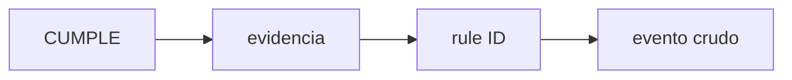

# ENSFácil

[English](README.en.md)

Cumplimiento del Esquema Nacional de Seguridad (RD 311/2022) dentro del
dashboard de Wazuh.

Los agentes observan cada máquina y emiten hechos técnicos. El plugin los
contrasta con la política que la organización declara en pantalla y genera
informes que un auditor puede recorrer de principio a fin:



[[_TOC_]]

## Controles

| Control | Nombre | Niveles | Refuerzos |
|---|---|---|---|
| `mp.info.6` | Copias de seguridad | BAJO+ | R1 (MEDIO+), R2 (ALTO) |
| `op.acc.1` | Identificación | BAJO+ | R1 (MEDIO+) |
| `op.acc.2` | Requisitos de acceso | BAJO+ | R1 (solo ALTO) |
| `op.acc.3` | Segregación de funciones | MEDIO+ | R1 (solo ALTO) |
| `op.acc.4` | Gestión de derechos de acceso | BAJO+ | sin refuerzos |

Cada control tiene su propio repositorio de despliegue, con una variante por
tipo de máquina: Linux, servidor de directorio LDAP y Windows.

---

## Instalación y despliegue

Este `README.md` es el punto de entrada de ENSFácil. Elige la ruta que corresponda a tu entorno.

### ¿Qué necesitas hacer?

| | Necesidad | Guía |
|---|---|---|
| 1 | Instalar desde cero | [Instalación completa desde cero](docs/deployment/01-installation-from-scratch.md) |
| 2 | Actualizar un entorno existente | [Actualización de un entorno existente](docs/deployment/02-updating-an-existing-environment.md) |
| 3 | Comprobar compatibilidad con otra versión de Wazuh | [Compatibilidad de versiones](docs/deployment/03-version-compatibility.md) |
| 4 | Diagnosticar un problema o volver atrás | [Diagnóstico y rollback](docs/deployment/04-troubleshooting-and-rollback.md) |

> [!note]
> El despliegue desde cero debe poder completarse utilizando GitLab y esta documentación, sin copiar ficheros desde otro servidor ENSFácil.

---

## Operación después del despliegue

Una vez instalado ENSFácil mediante las guías anteriores, los agentes deben desplegar los runbooks de los controles que correspondan a cada sistema.

Cada repositorio de control incluye sus guías en `docs/deployment/`: la instalación en `01-installation.md`, lo que hay que declarar en el control y cómo se comprueba cada evidencia en `02-compliance.md`, y la desinstalación y resolución de problemas en `03-uninstall-and-troubleshooting.md`.

> [!important]
> La política de cumplimiento se declara desde la pantalla de Configuración de ENSFácil. Los parámetros vacíos representan decisiones todavía no declaradas y no deben interpretarse como valores por defecto.

Para comprobar la coherencia entre el plugin, las reglas y los runbooks:

```bash
cd /opt/ensfacil/repo
python3 tests/check-consistency.py
```

---

## Cuando algo no cuadra

| Síntoma | Causa habitual |
|---|---|
| `Permission denied (publickey)` | la clave no está registrada en la cuenta correcta, o falta `IdentitiesOnly` |
| `detected dubious ownership` | el repositorio se clonó con `sudo`; corregir con `chown -R $USER:$USER` |
| El instalador se ejecuta pero nada cambia | la actualización del repositorio no llegó; comprobar el hash antes de instalar |
| Se despliega y sigue viéndose la versión anterior | caché del navegador; abrir una ventana de incógnito |
| Un parámetro configurado aparece como no configurado | el agente ejecuta una versión anterior; comparar con `md5sum` la librería instalada y la del repositorio |
| La tarjeta del control no aparece en Configuración | falta sembrar su bloque de configuración; revisar la guía de instalación o actualización |

Comprobación de coherencia entre el plugin y los runbooks:

```bash
cd /opt/ensfacil/repo && python3 tests/check-consistency.py
```

Verifica que toda regla acreditada por el plugin está desplegada en el manager,
que las copias de las reglas no divergen y que las evidencias escuchan los
eventos que los agentes emiten.

---

## Cómo decide el motor

> [!important]
> Lo que no se puede demostrar, no cumple. La carga de la prueba corresponde al
> auditado.

Medida y veredicto son capas distintas: la evidencia indica si se pudo observar
—y con qué causa, si no— y el requisito indica si eso acredita cumplimiento.
La causa determina a quién corresponde la corrección:

| Causa | Dónde se corrige |
|---|---|
| `CONFIGURATION` | falta declarar la política, en la pantalla de Configuración |
| `COLLECTION` | el agente no reporta, en el despliegue de Wazuh |
| `EVIDENCE` | el dato llega incompleto, en el recolector |

El agente observa y el motor juzga. Las evidencias del modelo actual declaran
una primitiva de juicio y el parámetro contra el que se contrastan; el agente
solo emite el hecho. Por eso un cambio en la pantalla modifica el veredicto sin
necesidad de volver a ejecutar nada en el servidor.

---

## Desarrollo

Este repositorio contiene el código de ENSFácil y el paquete de integración necesario para incorporarlo a un árbol compatible del plugin oficial de Wazuh Dashboard. El procedimiento reproducible de construcción está documentado en las guías de despliegue anteriores.

```
dashboard/ens/     módulo ENS (React + TypeScript)
  catalog/         definición de controles y requisitos
  configuration/   parámetros configurables
  core/            motor: evidencias, evaluación, consolidación
  controls/ reports/ evidences/    las tres pestañas
integration/       paquete de integración con Wazuh Dashboard
agent/rules/       reglas Wazuh por control
config/            bloques de configuración e inject-control.py
tests/             suites del motor y comprobación de coherencia
```

Rangos de rule ID en uso:

| Control | Banda reservada | En uso |
|---|---|---|
| `mp.info.6` | 106600–106799 | 106600–106723 |
| `op.acc.1` | 106800–106899 | 106800–106891 |
| `op.acc.2` | 106900–106999 | 106900–106974 |
| `op.acc.3` | 107000–107099 | 107000–107050 |
| `op.acc.4` | 107100–107199 | 107100–107150 |

---

## Licencia

Software propietario de Quersystem. Consulta [LICENSE](LICENSE).
