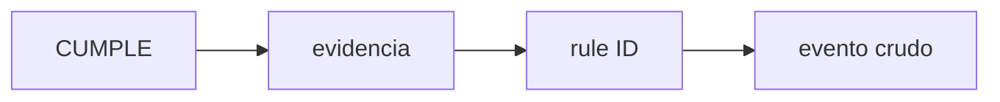

# ENSFácil

[English](README.en.md)

Cumplimiento del Esquema Nacional de Seguridad (RD 311/2022) dentro del
dashboard de Wazuh.

Los agentes observan cada máquina y emiten hechos técnicos. El plugin los
contrasta con la política que la organización declara en pantalla y genera
informes que un auditor puede recorrer de principio a fin:



[[_TOC_]]

## Cómo se despliega ENSFácil

Cuatro pasos, en este orden. El detalle de cada uno está en la
[guía de instalación desde cero](docs/deployment/01-installation-from-scratch.md),
y los enlaces a cada runbook y a sus guías, en la
[tabla de runbooks y registros](docs/deployment/05-runbooks-and-registers.md).

1. **Manager.** Wazuh instalado y validado; después, el `install-manager.sh` de cada uno de los 22 runbooks Linux (reglas y `<localfile>`). Los de op.exp.7, op.exp.8, op.exp.9, op.mon.1, op.mon.2, op.mon.3, op.nub.1 y op.cont.3 instalan además un recolector en el manager; op.cont.2 es solo documentación. Por último, el plugin ENSFácil en el dashboard, desde su release. Con Wazuh en Docker: [Wazuh en Docker](docs/deployment/06-wazuh-in-docker.md).
2. **Máquinas.** En cada agente, primero la [configuración inicial](https://gitlab.com/quersystem/ens-controls-runbook/initial-setup) (alta en el manager, grupo `ens` y alcance ENS del plugin), una sola vez; después, los runbooks de su plataforma (Linux, Zimbra LDAP, Zimbra MTA o Windows), según la guía `01-installation` **de cada runbook**.
3. **Configuración en el dashboard.** En ENSFácil > Configuración: ajustes comunes, plantillas y asignación de cada control (pestaña «Controles»), lo propio de cada agente (pestaña «Agentes») y, una sola vez, los datos que piden varios controles (General > «Datos de la organización»; [Configuración por controles y plantillas](docs/deployment/09-configuration-by-system.md)). En las máquinas o en el manager, los [registros de la organización](docs/deployment/05-runbooks-and-registers.md#registros-que-crea-la-organización), según la guía `02-compliance` **de cada runbook** (enlazada en la tabla).
4. **Medir.** Tras la primera pasada de los recolectores (cada hora; op.mon.2 y op.cont.3, cada 6 h), el panel juzga cada control; lo no demostrado sale `NO_EVALUABLE` con su causa y el lugar donde se corrige.

## Controles

El catálogo de ENSFácil tiene 34 controles, en el orden del Anexo II (marco
operacional, apartado 4, y medidas de protección, apartado 5): 23 se evalúan y
11 son documentales hasta que exista su recolector. «Eje» indica si el Anexo II
aplica el control por la categoría del sistema o por el nivel de una o varias
dimensiones (con varias, la más alta). «Niveles» son los niveles en los que se
exige; «no exigible» indica un refuerzo que el ENS define pero no exige en
ningún nivel, que sale `NO_APLICA`.

| Control | Anexo II | Nombre | Eje | Niveles | Refuerzos | Dónde se mide |
|---|---|---|---|---|---|---|
| `op.acc.1` | 4.2.1 | Identificación | nivel T·A | BAJO+ | R1 (MEDIO+) | máquinas |
| `op.acc.2` | 4.2.2 | Requisitos de acceso | nivel C·I·T·A | BAJO+ | R1 (ALTO) | máquinas |
| `op.acc.3` | 4.2.3 | Segregación de funciones y tareas | nivel C·I·T·A | MEDIO+ | R1 (ALTO); R2–R3 no exigibles | máquinas |
| `op.acc.4` | 4.2.4 | Proceso de gestión de derechos de acceso | nivel C·I·T·A | BAJO+ | sin refuerzos | máquinas |
| `op.acc.5` | 4.2.5 | Mecanismo de autenticación (usuarios externos) | nivel C·I·T·A | BAJO+ | R1–R4 (BAJO+), R5 (MEDIO+); R6–R7 no exigibles | máquinas |
| `op.acc.6` | 4.2.6 | Mecanismo de autenticación (usuarios de la organización) | nivel C·I·T·A | BAJO+ | R1–R4, R8–R9 (BAJO+), R5 (MEDIO+), R6–R7 (ALTO) | máquinas |
| `op.exp.1` | 4.3.1 | Inventario de activos | categoría | BAJO+ | R1–R4 no exigibles | máquinas |
| `op.exp.2` | 4.3.2 | Configuración de seguridad | categoría | BAJO+ | sin refuerzos | máquinas |
| `op.exp.3` | 4.3.3 | Gestión de la configuración de seguridad | categoría | BAJO+ | R1 (MEDIO+), R2–R3 (ALTO); R4–R5 no exigibles | máquinas |
| `op.exp.4` | 4.3.4 | Mantenimiento y actualizaciones de seguridad | categoría | BAJO+ | R1 (MEDIO+), R2 (ALTO); R3–R4 no exigibles | máquinas |
| `op.exp.5` | 4.3.5 | Gestión de cambios | categoría | MEDIO+ | R1 (ALTO) | máquinas |
| `op.exp.6` | 4.3.6 | Protección frente a código dañino | categoría | BAJO+ | R1–R2 (MEDIO+), R3–R4 (ALTO); R5 no exigible | máquinas |
| `op.exp.7` | 4.3.7 | Gestión de incidentes | categoría | BAJO+ | R1–R2 (MEDIO+), R3 (ALTO); R4 no exigible | manager |
| `op.exp.8` | 4.3.8 | Registro de la actividad | nivel T | BAJO+ | R1–R4 (MEDIO+), R5 (ALTO) | máquinas y manager |
| `op.exp.9` | 4.3.9 | Registro de la gestión de incidentes | categoría | BAJO+ | sin refuerzos | manager |
| `op.exp.10` | 4.3.10 | Protección de claves criptográficas | categoría | BAJO+ | R1 (MEDIO+); R2 no exigible | máquinas |
| `op.nub.1` | 4.5.1 | Protección de servicios en la nube | categoría | BAJO+ | R1 (MEDIO+), R2 (ALTO) | manager |
| `op.cont.2` | 4.6.2 | Plan de continuidad | nivel D | ALTO | R1–R2 no exigibles | manager; lo juzga el plugin con la configuración (runbook solo de documentación) |
| `op.cont.3` | 4.6.3 | Pruebas periódicas | nivel D | ALTO | sin refuerzos | manager |
| `op.mon.1` | 4.7.1 | Detección de intrusión | categoría | BAJO+ | R1 (MEDIO+), R2 (ALTO); R3 no exigible | manager |
| `op.mon.2` | 4.7.2 | Sistema de métricas | categoría | BAJO+ | R1–R2 (MEDIO+) | manager |
| `op.mon.3` | 4.7.3 | Vigilancia | categoría | BAJO+ | R1–R2 (MEDIO+), R3–R6 (ALTO); R7 no exigible | máquinas y manager |
| `mp.eq.2` | 5.3.2 | Bloqueo de puesto de trabajo | nivel A | MEDIO+ | R1 (ALTO) | documental, medición en preparación (oleada A) |
| `mp.eq.3` | 5.3.3 | Protección de dispositivos portátiles | categoría | BAJO+ | R1–R2 (ALTO) | documental, medición en preparación (oleada B) |
| `mp.eq.4` | 5.3.4 | Otros dispositivos conectados a la red | nivel C | BAJO+ | R1 (MEDIO+); R2 no exigible | documental, medición en preparación (oleada C) |
| `mp.com.1` | 5.4.1 | Perímetro seguro | categoría | BAJO+ | sin refuerzos | documental, medición en preparación (oleada C) |
| `mp.com.3` | 5.4.3 | Protección de la integridad y de la autenticidad | nivel I·A | BAJO+ | R1–R2 (MEDIO+), R3–R4 (ALTO); R5 no exigible | documental, medición en preparación (oleada B) |
| `mp.com.4` | 5.4.4 | Separación de flujos de información en la red | categoría | MEDIO+ | uno de R1 (solo MEDIO), R2 o R3; R4 (ALTO) | documental, medición en preparación (oleada C) |
| `mp.sw.2` | 5.6.2 | Aceptación y puesta en servicio | categoría | BAJO+ | R1 (MEDIO+); R2 no exigible | documental, medición en preparación (oleada A) |
| `mp.info.6` | 5.7.6 | Copias de seguridad | nivel D | BAJO+ | R1 (MEDIO+), R2 (ALTO) | máquinas |
| `mp.s.1` | 5.8.1 | Protección del correo electrónico | categoría | BAJO+ | sin refuerzos | documental, medición en preparación (oleada A) |
| `mp.s.2` | 5.8.2 | Protección de servicios y aplicaciones web | categoría | BAJO+ | uno de R1 o R2 (BAJO y MEDIO); R2 y R3 (ALTO) | documental, medición en preparación (oleada B) |
| `mp.s.3` | 5.8.3 | Protección de la navegación web | categoría | BAJO+ | R1 (ALTO); R2 no exigible | documental, medición en preparación (oleada C) |
| `mp.s.4` | 5.8.4 | Protección frente a la denegación de servicio | nivel D | MEDIO+ | R1 (ALTO); R2 no exigible | documental, medición en preparación (oleada C) |

Los 11 controles «documental, medición en preparación» llegan con el paquete v2.0 del auditor y están en el catálogo en estado `DRAFT`: se ven en Controles y en Vista general, se configuran, se pueden declarar en la Declaración de Aplicabilidad (op.mon.2 P-01) y su informe recoge los parámetros. Ningún recolector emite todavía sus evidencias, así que no entran en el índice ni se juzgan como incumplimiento: Controles y Vista general muestran «Sin medición todavía» y el detalle indica, por evidencia, la fuente de datos que necesitará («Fuente necesaria: registro del cortafuegos perimetral»). La medición llega por oleadas: A (mp.s.1, mp.sw.2, mp.eq.2), sin fuentes nuevas; B (mp.com.3, mp.eq.3, mp.s.2), con los registros de los servicios; C (mp.com.1, mp.com.4, mp.s.3, mp.eq.4, mp.s.4), con fuentes que hoy no llegan a Wazuh (cortafuegos, proxy, red o métricas). Un control pasa a evaluarse cuando su runbook emite y sus reglas están desplegadas.

Cada control tiene un runbook en GitLab, con una variante por tipo de máquina. El repositorio se llama como el control y el subgrupo indica la plataforma o el rol: `linux/op.acc.1`, `zimbra/zimbra-ldap/op.acc.1` y `windows/op.acc.1`.

| Grupo de GitLab | Controles |
|---|---|
| `quersystem/ens-controls-runbook/linux` | 23; el de op.cont.2 es solo documentación, sin recolector ni reglas (mp.info.6 para máquinas que copian en un Proxmox Backup Server) |
| `quersystem/ens-controls-runbook/zimbra/zimbra-ldap` | op.acc.1 a op.acc.6 y op.exp.1 a op.exp.10 |
| `quersystem/ens-controls-runbook/zimbra/zimbra-mta` | mp.info.6 (copias de `zmbackup` de Zimbra 10 Network Edition) |
| `quersystem/ens-controls-runbook/windows` | op.acc.1 a op.acc.4 |

Contenido de cada runbook y registros que pide a la organización: [Runbooks y registros de la organización](docs/deployment/05-runbooks-and-registers.md#runbooks-por-control).

> [!important]
> Los `install.sh` que escriben reglas de auditd (op.acc.2, op.acc.3, op.acc.4, op.exp.3, op.exp.4, op.exp.5, op.exp.8 y op.exp.10) no las cargan: ejecutar `sudo augenrules --load` al terminar; sin ello, las evidencias que dependen de auditd quedan sin medir.

---

## Requisitos y versiones probadas

### Probado en

| Componente | Versión | Dónde |
|---|---|---|
| Sistema del servidor Wazuh | Ubuntu 22.04 LTS | laboratorio de Quersystem (servidor en uso) |
| Sistema del servidor Wazuh | Ubuntu Server 24.04.4 LTS | instalación desde cero de la [guía de instalación](docs/deployment/01-installation-from-scratch.md#81-entorno-utilizado-para-validar-esta-guía) |
| Wazuh manager, indexer y dashboard | 4.14.7 (instalación por paquetes) | laboratorio de Quersystem |
| OpenSearch Dashboards | 2.19.5 (el del dashboard 4.14.7) | laboratorio de Quersystem |
| Node.js para compilar el plugin | 18.19.0 (con Yarn Classic 1.22.22) | laboratorio de Quersystem |
| Agente Wazuh en Linux | 4.14.5 y 4.14.7 (Ubuntu 22.04 y 24.04) | laboratorio de Quersystem |
| Agente Wazuh en Windows | 4.14.5 (Windows Server 2022 Standard, edición de evaluación) | laboratorio de Quersystem |
| Imagen `wazuh/wazuh-manager` | 4.14.0 y 4.14.1: `wazuh-logtest` con las reglas; 4.14.7: `install-manager.sh` con `ENSFACIL_SYSTEMCTL` y recolectores del manager, sin indexer ni agentes | contenedor de prueba |
| Imágenes `wazuh/wazuh-indexer`, `wazuh/wazuh-manager` y `wazuh/wazuh-dashboard` | 4.14.7, despliegue *single-node* oficial de `wazuh-docker`: imagen del dashboard con ENSFácil 1.1.0, arranque, rol, siembra y validación ([Wazuh en Docker, apartado 1](docs/deployment/06-wazuh-in-docker.md#1-estado-de-la-verificación)) | `docker compose` en un portátil |

### Requisitos

- **Wazuh 4.14.7** instalado y validado (manager, indexer y dashboard) antes de
  instalar ENSFácil. Plugin `ensfacil`, compilado para el dashboard de Wazuh 4.14.7 (OpenSearch Dashboards 2.19.5). Ver la
  [compatibilidad de versiones](docs/deployment/03-version-compatibility.md).
- **Inventario de agentes:** la monitorización de agentes de Wazuh activa (el
  índice `wazuh-monitoring-*`), legible para los usuarios que usan ENSFácil.
- **Quién cambia la configuración:** usuarios con el rol `ensfacil_admin` (lo
  crea `config/create-admin-role.sh`) o `all_access`.
- **Instalación por paquetes:** Ubuntu Server con `sudo`, conectividad de red
  y acceso por SSH autorizado a los repositorios de GitLab. **Docker:** un host
  con Docker y el plugin `compose`, con el despliegue oficial de `wazuh-docker`;
  un usuario con permiso para ejecutar `docker`; acceso por SSH autorizado a
  GitLab para clonar el repositorio; acceso a Internet para que `npx` descargue
  `tsx`; y `unzip` en el host
  ([Wazuh en Docker](docs/deployment/06-wazuh-in-docker.md#2-requisitos-previos)).
- Herramientas que la guía de instalación comprueba antes de empezar: `git`,
  `curl`, `wget` y `python3` (este último también para `tests/check-consistency.py`).
- **Para descargar una release:** una cuenta de GitLab con acceso al proyecto
  o, desde el servidor, un token de despliegue con `read_package_registry`
  ([guía 07](docs/deployment/07-installing-from-a-release.md)).
- **Para compilar el plugin** (solo si no se instala desde una release): un
  código fuente de OpenSearch Dashboards 2.19.5, Node.js 18.19.0 y Yarn Classic
  1.22.22 (`config/build-plugin.sh`), o Docker con la imagen de compilación de
  CI ([guía 08](docs/deployment/08-building-from-source.md)). El Node.js 18.19.0
  también viene dentro del paquete `wazuh-dashboard`.
- **En cada máquina medida:** agente de Wazuh en el grupo del control y el
  runbook de su plataforma. Los requisitos de cada runbook (`cron`, `auditd`,
  paquetes concretos) están en su propio README.

### Sin probar

- Otras versiones de Wazuh distintas de 4.14.7 (cada versión del dashboard
  necesita su propio zip del plugin): sin probar.
- **Wazuh en Docker.** Está verificado el lado del plugin con el despliegue
  *single-node* oficial. Sin probar: el lado del manager dentro del despliegue
  con `docker compose` (instaladores, cron del host, `<localfile>` en
  `wazuh_manager.conf`, agentes), un clúster de varios nodos y el plugin en un
  despliegue real de cliente
  ([Wazuh en Docker, apartado 1](docs/deployment/06-wazuh-in-docker.md#1-estado-de-la-verificación)).
- Otras distribuciones del servidor distintas de Ubuntu: sin probar.

---

## Instalación

### El plugin: dos caminos

| Camino | Cuándo | Guía |
|---|---|---|
| Desde una release (recomendado) | instalar o actualizar el plugin sin compilar | [Instalar desde una release](docs/deployment/07-installing-from-a-release.md) |
| Compilar desde el código fuente | una versión sin release, la evaluación de otra versión de Wazuh o el desarrollo | [Compilar desde el código fuente](docs/deployment/08-building-from-source.md) |

Desde una release, en el servidor de Wazuh Dashboard, con los cuatro ficheros de
la release en una carpeta:

```bash
sha256sum -c SHA256SUMS
sudo bash deploy-plugin.sh ensfacil-1.4.0-osd-2.19.5.zip
```

Resultado esperado: `OK` en los tres ficheros y `dashboard: active` al final
del despliegue. Sustituir `1.4.0` por la versión de la release.

Órdenes de la instalación por paquetes (`deploy-plugin.sh` usa `systemctl`, `sudo -u wazuh-dashboard` y `https://localhost:443`). En Docker, el zip de la release se instala en una imagen propia del dashboard ([Wazuh en Docker, apartado 3](docs/deployment/06-wazuh-in-docker.md#3-construir-la-imagen-del-dashboard-con-ensfácil)).

El rol `ensfacil_admin` solo es necesario si un usuario sin `all_access` debe guardar la configuración ([guía 07, apartado 9](docs/deployment/07-installing-from-a-release.md#9-crear-el-rol-ensfacil_admin)).

Las reglas del manager, los runbooks de cada máquina y la configuración se instalan aparte ([cómo se despliega ENSFácil](#cómo-se-despliega-ensfácil)).

### Dónde están las releases

- En GitLab, en *Deploy → Releases* del proyecto `quersystem/plugin-wazuh-ens`:
  cada versión, `ENSFácil X.Y.Z`, con sus notas y sus cuatro ficheros (el zip,
  `deploy-plugin.sh`, `create-admin-role.sh` y `SHA256SUMS`).
- Los mismos ficheros, en *Deploy → Package registry → ensfacil*.
- Desde un servidor, por la API de paquetes, con un token de despliegue
  ([guía 07, apartado 6](docs/deployment/07-installing-from-a-release.md#6-descargar-desde-el-servidor-con-un-token-de-despliegue)).

El proyecto es privado: hace falta una cuenta de GitLab con acceso.

Cambiar de versión (desde la versión integrada, a una release más nueva o a la anterior) o desinstalar: [guía 07, apartado 15](docs/deployment/07-installing-from-a-release.md#15-cambiar-de-versión-o-desinstalar). Los datos se conservan: la configuración, su historial y los hechos están en el indexer.

### Guía según la tarea

| | Tarea | Guía |
|---|---|---|
| 1 | Instalar desde cero | [Instalación completa desde cero](docs/deployment/01-installation-from-scratch.md) |
| 2 | Actualizar un entorno existente o añadir controles nuevos | [Actualización de un entorno existente](docs/deployment/02-updating-an-existing-environment.md) |
| 3 | Comprobar compatibilidad con otra versión de Wazuh | [Compatibilidad de versiones](docs/deployment/03-version-compatibility.md) |
| 4 | Diagnosticar un problema o volver atrás | [Diagnóstico y rollback](docs/deployment/04-troubleshooting-and-rollback.md) |
| 5 | Encontrar el runbook de un control, sus guías y los registros que pide | [Runbooks y registros de la organización](docs/deployment/05-runbooks-and-registers.md) |
| 6 | Instalar, actualizar o retirar ENSFácil con las imágenes oficiales de Wazuh en Docker | [Wazuh en Docker](docs/deployment/06-wazuh-in-docker.md) |
| 7 | Instalar o actualizar el plugin desde una release | [Instalar desde una release](docs/deployment/07-installing-from-a-release.md) |
| 8 | Compilar el plugin y pasar las pruebas | [Compilar desde el código fuente](docs/deployment/08-building-from-source.md) |
| 9 | Declarar los ajustes comunes, las plantillas y su asignación a los agentes, o convertir una configuración anterior | [Configuración por controles y plantillas](docs/deployment/09-configuration-by-system.md) |
| 10 | Valorar la madurez de cada control y registrar procedimientos, revisiones y realimentación | [Valoración de la madurez](docs/deployment/10-maturity-assessment.md) |
| 11 | Generar, congelar y exportar el informe anual del artículo 32 y declarar las medidas sin motor | [Informe anual del artículo 32](docs/deployment/11-annual-report-art-32.md) |

> [!important]
> Al añadir controles, desplegar primero la versión del plugin que los contiene y sembrar después su configuración ([Instalar desde una release, apartado 11](docs/deployment/07-installing-from-a-release.md#11-actualizar-a-una-release-nueva)).

---

## Operación después del despliegue

Tras instalar ENSFácil, desplegar en cada sistema los runbooks de los controles que le correspondan.

Guías de cada runbook, en su `docs/deployment/` (GitLab, no este repositorio): `01-installation.md` instalación; `02-compliance.md` lo que se declara en el control y cómo se comprueba cada evidencia; `03-uninstall-and-troubleshooting.md` desinstalación y problemas. Enlaces en la [tabla de runbooks](docs/deployment/05-runbooks-and-registers.md#runbooks-por-control).

> [!important]
> La política de cumplimiento se declara en la pantalla de Configuración. Un parámetro vacío es una decisión no declarada, no un valor por defecto.

### Dónde se abre ENSFácil

Menú del dashboard, «Security operations». Desde la 1.2.0, también una tarjeta «ENSFácil» en la portada de OpenSearch Dashboards (`/app/home`) si el dashboard incluye el plugin `home`; en la portada de Wazuh solo está en el menú.

La pestaña **Vista general** muestra todas las máquinas del alcance y todos los controles a la vez: el resumen por máquina, la matriz controles × máquinas, la cola de trabajo y la tendencia de 30 días ([instalación desde cero, apartado 14.7](docs/deployment/01-installation-from-scratch.md#147-comprobar-la-vista-general-y-el-detalle-de-un-control)).

### El manager en el alcance

El alcance ENS sale de la configuración: todas las máquinas del inventario, las
de unos grupos de Wazuh (lo habitual, el grupo `ens`) o una lista de agentes
([el alcance ENS](https://gitlab.com/quersystem/ens-controls-runbook/initial-setup/-/blob/main/docs/deployment/03-ens-scope.md)).
El manager (agente `000`) no pertenece a ningún grupo. Por eso el panel lo añade
al alcance por sí solo, y únicamente porque hay controles que se miden en él:

| Control | Planos de medida (`measurementPlanes`) | Fila del manager (`000`) | Fila de cada máquina |
|---|---|---|---|
| `op.cont.2`, `op.cont.3` | solo manager | se evalúan | no se evalúan |
| `op.exp.7`, `op.exp.9` | solo manager | se evalúan | no se evalúan |
| `op.mon.1`, `op.mon.2`, `op.nub.1` | solo manager | se evalúan | no se evalúan |
| `op.exp.8` | máquinas y manager | se evalúa (plano central y el propio servidor) | se evalúa; lo que solo se mide en el manager sale `NO_APLICA` |
| `op.mon.3` | máquinas y manager | se evalúa (recolección central, correlación, superficie de exposición y lo demás) | se evalúan sus fuentes de registros |
| los demás | solo máquinas | no se evalúan | se evalúan |

Los hechos del manager llegan con `agent.id=000`. En la vista de una máquina, los controles que solo se miden en el manager muestran el resultado de su fila (son controles de la organización). En la vista del manager se miden los nueve que tienen fila en él: op.cont.2, op.cont.3, op.exp.7, op.exp.8, op.exp.9, op.mon.1, op.mon.2, op.mon.3 y op.nub.1; los demás aparecen al final, en gris, con «No se mide en esta máquina» y el motivo. La pestaña Vista general muestra todos los controles en todas las máquinas ([instalación desde cero, apartado 14.7](docs/deployment/01-installation-from-scratch.md#147-comprobar-la-vista-general-y-el-detalle-de-un-control)).

### Niveles de las dimensiones

El Anexo II aplica algunos controles por el nivel de una dimensión de seguridad y no por la categoría del sistema. Configuración > General tiene un campo opcional por dimensión: **Confidencialidad (C)**, **Integridad (I)**, **Trazabilidad (T)**, **Autenticidad (A)** y **Disponibilidad (D)**. Un campo vacío equivale al nivel ENS; un control con varias dimensiones se evalúa con la más alta de ellas. El detalle y el informe de esos controles muestran el nivel con el que se evalúan como «Nivel aplicable» con su dimensión, por ejemplo «Nivel aplicable: ALTO (Disponibilidad)»; los demás, «Nivel ENS».

| Dimensiones | Controles |
|---|---|
| C, I, T y A | op.acc.2 a op.acc.6 |
| T y A | op.acc.1 |
| I y A | mp.com.3 |
| C | mp.eq.4 |
| T | op.exp.8 |
| A | mp.eq.2 |
| D | mp.info.6, mp.s.4, op.cont.2 y op.cont.3 (estos dos, solo con D en ALTO) |
| ninguna | el resto, por la categoría (nivel ENS) |

El nivel ENS es la categoría del sistema, el más alto de sus dimensiones: la pantalla no guarda una dimensión por encima de él y `config/validate-configuration.ts` lo señala. Sin ninguna dimensión declarada, los resultados son los mismos que con la 1.3.0; un documento que ya declaraba T o D puede cambiar de veredicto al actualizar ([guía de actualización, apartado 5.1](docs/deployment/02-updating-an-existing-environment.md#51-antes-de-actualizar-a-la-140)). Si una dimensión supera el nivel ENS, Controles y el panel muestran «Niveles incoherentes» con un enlace a General.

### Norma ENS y criterio de aplicación

Solo la «Ficha del Control» de las plantillas del auditor reproduce el BOE; parámetros, evidencias, umbrales, condiciones de incumplimiento y campos del informe son interpretación. El detalle de cada control, la vista Controles y el informe PDF marcan cada texto con su procedencia:

| Etiqueta | Qué es |
|---|---|
| «Norma ENS» | texto literal del requisito (Anexo II del RD 311/2022) |
| «Criterio de aplicación» | cómo lo lee y lo mide ENSFácil o la plantilla del auditor, sin valor normativo |

El catálogo guarda el literal en `description` y la interpretación en `interpretation`. Cada control declara además su apartado del Anexo II (`annexSection`) y la plantilla de la que sale (`source`: v2.0 del 15/10/2026; op.acc.2 sigue en la v1.0, sin fecha, hasta recibir su v2.0). El encabezado del detalle y el del informe muestran los tres datos.

### mp.info.6 frente a la plantilla del auditor

mp.info.6 no se construyó con la plantilla del auditor y conserva lo desplegado: sus parámetros P-01 a P-14, sus siete evidencias y los requisitos `mp.info.6.2.a` a `mp.info.6.2.d`, que son los que informan los recolectores del PBS y de Zimbra. El detalle del control y su informe muestran «Correspondencia con la plantilla del auditor»: qué parámetro y qué evidencia de ENSFácil cubren cada P-xx y EV-xx de la plantilla, con la cobertura (equivalente, parcial o no se mide todavía); el propio `mp.info.6.2` es parcial: b) se acredita con la retención y d) con los permisos, sin observar los accesos. Sin medir hoy: P-09 (registro de pruebas), EV-03 (cobertura frente al alcance), EV-07 (borrado masivo de copias) y EV-11 (cifrado del repositorio). La tabla está en `common/ens/catalog/template-correspondence.ts`.

`mp.info.6.2` se mantiene partido en sus letras a) a d): cada letra es un requisito en el porcentaje del control (la base cuenta cinco requisitos, no dos). Los identificadores `.2.a` a `.2.d` no existen en el BOE; el texto de cada uno es el literal de su letra.

### op.exp.10: lecturas de las claves

EV-01 de op.exp.10 registra las lecturas, escrituras, cambios de permisos y borrados de los almacenes de claves con reglas de auditd con permiso de lectura (`-w <ruta> -p rwa`), en Linux y en el servidor LDAP, y con una SACL de lectura y el evento 4663 en Windows (runbook `windows/op.exp.10`, regla 111109). FIM solo detecta cambios de integridad. Es la corrección de EV-01 en la plantilla v2.0. Sin vigilancia de lectura, EV-01 queda `NO_EVALUABLE` con su motivo.

---

## Cuando algo no cuadra

| Síntoma | Causa habitual |
|---|---|
| `Permission denied (publickey)` | la clave no está registrada en la cuenta correcta, o falta `IdentitiesOnly` |
| `detected dubious ownership` | el repositorio se clonó con `sudo`; corregir con `chown -R $USER:$USER` |
| El instalador se ejecuta pero nada cambia | la actualización del repositorio no llegó; comprobar el hash antes de instalar |
| Se despliega y sigue viéndose la versión anterior | el plugin se instaló sin subir el `build.number` del dashboard; desplegar con `config/deploy-plugin.sh` (ver la guía de actualización) |
| «No se pudo cargar el entorno ENS» | un parámetro con un valor que el plugin no acepta (por ejemplo `value: null`); validar el documento con `config/validate-configuration.ts` y corregir el parámetro que indique |
| Un parámetro configurado aparece como no configurado | el agente ejecuta una versión anterior; comparar con `md5sum` la librería instalada y la del repositorio |
| La tarjeta del control no aparece en Configuración | falta sembrar su bloque de configuración, o el plugin desplegado es anterior al control; revisar la guía de actualización |
| `inject-control.py` muestra `ERROR: document 'active' does not exist in index …` | la configuración no se ha guardado nunca; hacer un primer guardado en ENSFácil > Configuración y repetir la siembra |
| «Sin datos del recolector desde …» en un control | el recolector de ese control lleva más de 24 h sin latir en esa máquina: agente parado, cron retirado o máquina caída |
| un control con recolector en el manager (op.exp.7, op.exp.8, op.exp.9, op.mon.1, op.mon.2, op.mon.3, op.nub.1 u op.cont.3) sin datos en la fila del manager | falta `install-manager.sh` de ese runbook, o su cron no se ha ejecutado todavía (cada hora; op.mon.2 y op.cont.3, cada 6 h). op.cont.2 no tiene recolector: se evalúa con las tablas de la pantalla. En Docker, revisar los `<localfile>` de `wazuh_manager.conf` y el cron del host ([Wazuh en Docker, apartado 13](docs/deployment/06-wazuh-in-docker.md#13-lado-del-manager)) |
| `install-manager.sh` se niega a tocar `agent.conf` | el `agent.conf` del grupo `ens` (o el de `ens-copias`, en mp.info.6) tiene más de un bloque `<agent_config>`; fusionarlos en uno |

Comprobación de coherencia entre el plugin y los runbooks:

```bash
cd /opt/ensfacil/repo && python3 tests/check-consistency.py
```

Resultado esperado: `consistency OK`.

Verifica que toda regla acreditada por el plugin está en el `manager/` de
algún runbook clonado junto al repositorio, que las copias de las reglas no
divergen y que las evidencias escuchan los eventos que los agentes emiten. Lee
los clones de los runbooks, no las reglas instaladas en el manager.

---

## Cómo decide el motor

> [!important]
> Lo que no se puede demostrar, no cumple. La carga de la prueba corresponde al
> auditado.

Medida y veredicto son capas distintas: la evidencia indica si se pudo observar
—y con qué causa, si no— y el requisito indica si eso acredita cumplimiento.
La causa determina a quién corresponde la corrección:

| Causa | Dónde se corrige |
|---|---|
| `CONFIGURATION` | falta declarar la política, en la pantalla de Configuración |
| `COLLECTION` | el agente no reporta, en el despliegue de Wazuh |
| `EVIDENCE` | el dato llega incompleto, en el recolector |

Si el recolector declara por qué no pudo medir (campo `causa` de su hecho), esa causa llega intacta a la evidencia y al requisito: un registro que la organización no mantiene sale como `CONFIGURATION`, no como fallo de recogida.

**Datos sin renovar.** El estado se juzga con la última pasada de cada recolector. Si el último latido de un control en una máquina tiene más de 24 horas, sus evidencias salen `NO_EVALUABLE` con causa `COLLECTION` y el motivo «Sin datos del recolector desde <fecha UTC>», y sus requisitos no cuentan como cumplidos. Los hechos antiguos siguen visibles en la trazabilidad.

**Toda la ventana.** El servidor del plugin evalúa cada control con todos los hechos de la ventana de evaluación (30 días), con los permisos del usuario que mira. La primera carga de cada usuario lee la ventana entera y responde por partes («Calculando la evaluación»); después, el resultado se sirve al instante y se recalcula en segundo plano cuando llegan hechos nuevos. Detalle técnico: [`server/README.md`](server/README.md).

El agente observa y el motor juzga: las evidencias declaran una primitiva de juicio y el parámetro contra el que se contrastan, y el agente solo emite el hecho. Un cambio en la pantalla modifica el veredicto sin volver a ejecutar nada en el servidor.

---

## Desarrollo

Este repositorio es el plugin `ensfacil` de OpenSearch Dashboards: se compila dentro de un código fuente de OpenSearch Dashboards 2.19.5 con `config/build-plugin.sh` y se instala con `config/deploy-plugin.sh`, sin tocar el plugin de Wazuh.

```
public/            la app del navegador: pestañas, búsqueda, inventario de agentes
public/ens/        pantallas ENS (React + TypeScript): dashboard/ overview/
                   controls/ reports/ evidences/ configuration/
public/evaluation/ cliente de la evaluación: sondeo, recarga y carga por partes
common/ens/        lo que comparten navegador y servidor
  catalog/         definición de controles y requisitos
  configuration/   parámetros configurables, plantillas y resolución por sistema
  core/            motor: evidencias, evaluación, consolidación
server/            rutas de configuración (/api/ensfacil/configuration) y de
                   evaluación (/api/ensfacil/evaluation; ver server/README.md)
agent/rules/       reglas Wazuh por control
config/            bloques de configuración y herramientas del manager:
                   build-plugin.sh, deploy-plugin.sh, create-admin-role.sh,
                   inject-control.py, set-parameters.py, validate-configuration.ts
tests/             suites del motor y comprobación de coherencia
```

Pruebas (Python 3 y Node.js 18 o superior; las de los scripts, `bash`, `zip` y `unzip`). La primera orden instala en `node_modules/` las dependencias de `package.json`, que el motor importa (`re2js`):

```bash
npx --yes yarn@1.22.22 install --frozen-lockfile --ignore-scripts --non-interactive
python3 tests/check-consistency.py
for p in config/test_*.py; do python3 "$p" >/dev/null 2>&1 && echo "OK   $p" || echo "FAIL $p"; done
for t in tests/*.test.ts; do timeout 180 npx --yes tsx "$t" >/dev/null 2>&1 && echo "OK   $t" || echo "FAIL $t"; done
for s in tests/*.test.sh; do bash "$s" >/dev/null 2>&1 && echo "OK   $s" || echo "FAIL $s"; done
```

`tests/mp-info-6-rules.test.sh` prueba las reglas de mp.info.6 con `wazuh-logtest` en un contenedor `wazuh/wazuh-manager` (Docker); sin Docker, salta esa parte con un aviso y hace solo las comprobaciones estáticas.

Cómo compilar con la imagen de CI y pasar las pruebas como CI: [Compilar desde el código fuente](docs/deployment/08-building-from-source.md).

Rangos de rule ID en uso. Los de op.exp.7, op.exp.9, op.mon.1, op.mon.2,
op.nub.1 y op.cont.3, y los del plano central de op.exp.8 y op.mon.3, llegan con
el agente `000` (el manager). op.cont.2 no tiene reglas:

| Control | Banda reservada | En uso |
|---|---|---|
| `mp.info.6` | 106600–106799 | 106600–106799 |
| `op.acc.1` | 106800–106899 | 106800–106891 |
| `op.acc.2` | 106900–106999 | 106900–106974 |
| `op.acc.3` | 107000–107099 | 107000–107050 |
| `op.acc.4` | 107100–107199 | 107100–107150 |
| `op.acc.5` | 110000–110099 | 110000–110099 |
| `op.acc.6` | 110100–110199 | 110100–110199 |
| `op.exp.1` | 110200–110299 | 110200–110299 |
| `op.exp.2` | 110300–110399 | 110300–110391 |
| `op.exp.3` | 110400–110499 | 110400–110499 |
| `op.exp.4` | 110500–110599 | 110500–110595 |
| `op.exp.5` | 110600–110699 | 110600–110699 |
| `op.exp.6` | 110700–110799 | 110700–110799 |
| `op.exp.7` | 110800–110899 | 110800–110899 |
| `op.exp.8` | 110900–110999 | 110900–110999 |
| `op.exp.9` | 111000–111099 | 111000–111099 |
| `op.exp.10` | 111100–111199 | 111100–111199 |
| `op.mon.1` | 111200–111299 | 111200–111299 |
| `op.mon.2` | 111300–111399 | 111300–111399 |
| `op.mon.3` | 111400–111499 | 111400–111499 |
| `op.nub.1` | 111500–111599 | 111500–111599 |
| `op.cont.3` | 111700–111799 | 111700–111799 |
| `mp.eq.2` | 111800–111899 | — |
| `mp.eq.3` | 111900–111999 | — |
| `mp.eq.4` | 112000–112099 | — |
| `mp.com.1` | 112100–112199 | — |
| `mp.com.3` | 112200–112299 | — |
| `mp.com.4` | 112300–112399 | — |
| `mp.sw.2` | 112400–112499 | — |
| `mp.s.1` | 112500–112599 | — |
| `mp.s.2` | 112600–112699 | — |
| `mp.s.3` | 112700–112799 | — |
| `mp.s.4` | 112800–112899 | — |

La banda 107200–109999 no se usa: en algunos managers la ocupan otras
integraciones. La 111600–111699 queda libre. Las bandas 111800–112899 están reservadas para los 11 controles
documentales, una por control en el orden del Anexo II, sin ninguna regla desplegada todavía; la siguiente libre es
112900. Antes de desplegar en un manager con reglas propias, comprobar
que ninguna de estas bandas está en uso.

---

## Contribuir

El flujo de trabajo (rama, MR, pipeline y revisión), el estilo de los commits,
las reglas del producto, lo que hace CI y cómo se publica una versión están en
[CONTRIBUTING.md](CONTRIBUTING.md).

## Versiones

ENSFácil sigue el [versionado semántico](https://semver.org/lang/es/). Los cambios
de cada versión están en el [registro de cambios](CHANGELOG.md), y cada etiqueta
`vX.Y.Z` publica su release en GitLab. La serie 1.x es para Wazuh 4.14.7
(OpenSearch Dashboards 2.19.5).

---

## Licencia

Software propietario de Quersystem. Véase [LICENSE](LICENSE).
