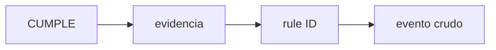

# ENSFácil

[English](README.en.md)

Cumplimiento del Esquema Nacional de Seguridad (RD 311/2022) dentro del
dashboard de Wazuh.

Los agentes observan cada máquina y emiten hechos técnicos. El plugin los
contrasta con la política que la organización declara en pantalla y genera
informes que un auditor puede recorrer de principio a fin:



[[_TOC_]]

## Cómo se despliega ENSFácil

Cuatro pasos, en este orden. El detalle de cada uno está en la
[guía de instalación desde cero](docs/deployment/01-installation-from-scratch.md),
y los enlaces a cada runbook y a sus guías, en la
[tabla de runbooks y registros](docs/deployment/05-runbooks-and-registers.md).

1. **Manager.** Wazuh instalado y validado; después, el `install-manager.sh` de
   cada uno de los 22 runbooks Linux (reglas y `<localfile>`; op.exp.7, op.exp.8,
   op.exp.9, op.mon.1, op.mon.2, op.mon.3, op.nub.1 y op.cont.3 dejan además un
   recolector en el propio manager; el runbook de op.cont.2 es solo documentación), y por último el
   plugin ENSFácil instalado en el dashboard desde su release, junto al de Wazuh y sin modificarlo.
   ¿Wazuh en contenedores? → [Manager en contenedor](docs/deployment/06-wazuh-in-docker.md).
2. **Máquinas.** En cada agente, primero la
   [configuración inicial](https://gitlab.com/quersystem/ens-controls-runbook/initial-setup) (darlo de alta en el manager, el grupo `ens` y el
   alcance ENS del plugin), una sola vez; después, los runbooks de su plataforma
   (Linux, Zimbra LDAP, Zimbra MTA o Windows), siguiendo la guía
   `01-installation` **de cada runbook**.
3. **Configuración en el dashboard.** En ENSFácil > Configuración, los
   parámetros de cada control, y en las máquinas o en el manager, los
   [registros de la organización](docs/deployment/05-runbooks-and-registers.md#registros-que-crea-la-organización),
   siguiendo la guía `02-compliance` **de cada runbook** (no está en este
   repositorio: cada runbook tiene la suya, enlazada en la tabla).
4. **Medir.** Tras la primera pasada de los recolectores (cada hora; los de
   op.mon.2 y op.cont.3, cada 6 h), el panel juzga cada control; lo que no se
   puede demostrar sale `NO_EVALUABLE` con su causa y dice dónde se corrige.

## Controles

ENSFácil evalúa 23 controles. «Niveles» son las categorías del sistema en las
que el Anexo II exige el control; «no exigible» indica un refuerzo que el ENS
define pero no exige en ninguna categoría, que sale `NO_APLICA`.

| Control | Nombre | Niveles | Refuerzos | Dónde se mide |
|---|---|---|---|---|
| `mp.info.6` | Copias de seguridad | BAJO+ | R1 (MEDIO+), R2 (ALTO) | máquinas |
| `op.acc.1` | Identificación | BAJO+ | R1 (MEDIO+) | máquinas |
| `op.acc.2` | Requisitos de acceso | BAJO+ | R1 (ALTO) | máquinas |
| `op.acc.3` | Segregación de funciones y tareas | MEDIO+ | R1 (ALTO); R2–R3 no exigibles | máquinas |
| `op.acc.4` | Proceso de gestión de derechos de acceso | BAJO+ | sin refuerzos | máquinas |
| `op.acc.5` | Mecanismo de autenticación (usuarios externos) | BAJO+ | R1–R4 (BAJO+), R5 (MEDIO+); R6–R7 no exigibles | máquinas |
| `op.acc.6` | Mecanismo de autenticación (usuarios de la organización) | BAJO+ | R1–R4, R8–R9 (BAJO+), R5 (MEDIO+), R6–R7 (ALTO) | máquinas |
| `op.cont.2` | Plan de continuidad | ALTO (por el nivel de Disponibilidad) | R1–R2 no exigibles | manager; lo juzga el plugin con la configuración (runbook solo de documentación) |
| `op.cont.3` | Pruebas periódicas | ALTO (por el nivel de Disponibilidad) | sin refuerzos | manager |
| `op.exp.1` | Inventario de activos | BAJO+ | R1–R4 no exigibles | máquinas |
| `op.exp.2` | Configuración de seguridad | BAJO+ | sin refuerzos | máquinas |
| `op.exp.3` | Gestión de la configuración de seguridad | BAJO+ | R1 (MEDIO+), R2–R3 (ALTO); R4–R5 no exigibles | máquinas |
| `op.exp.4` | Mantenimiento y actualizaciones de seguridad | BAJO+ | R1 (MEDIO+), R2 (ALTO); R3–R4 no exigibles | máquinas |
| `op.exp.5` | Gestión de cambios | MEDIO+ | R1 (ALTO) | máquinas |
| `op.exp.6` | Protección frente a código dañino | BAJO+ | R1–R2 (MEDIO+), R3–R4 (ALTO); R5 no exigible | máquinas |
| `op.exp.7` | Gestión de incidentes | BAJO+ | R1–R2 (MEDIO+), R3 (ALTO); R4 no exigible | manager |
| `op.exp.8` | Registro de la actividad | BAJO+ (por el nivel de Trazabilidad) | R1–R4 (MEDIO+), R5 (ALTO) | máquinas y manager |
| `op.exp.9` | Registro de la gestión de incidentes | BAJO+ | sin refuerzos | manager |
| `op.exp.10` | Protección de claves criptográficas | BAJO+ | R1 (MEDIO+); R2 no exigible | máquinas |
| `op.mon.1` | Detección de intrusión | BAJO+ | R1 (MEDIO+), R2 (ALTO); R3 no exigible | manager |
| `op.mon.2` | Sistema de métricas | BAJO+ | R1–R2 (MEDIO+) | manager |
| `op.mon.3` | Vigilancia | BAJO+ | R1–R2 (MEDIO+), R3–R6 (ALTO); R7 no exigible | máquinas y manager |
| `op.nub.1` | Protección de servicios en la nube | BAJO+ | R1 (MEDIO+), R2 (ALTO) | manager |

Cada control tiene su repositorio de despliegue (runbook) en GitLab, con una
variante por tipo de máquina. El repositorio se llama exactamente como el
control y el subgrupo dice la plataforma o el rol: `linux/op.acc.1`,
`zimbra/zimbra-ldap/op.acc.1` y `windows/op.acc.1` son tres runbooks del mismo
control.

| Grupo de GitLab | Controles |
|---|---|
| `quersystem/ens-controls-runbook/linux` | 23; el de op.cont.2 es solo documentación, sin recolector ni reglas (mp.info.6 para máquinas que copian en un Proxmox Backup Server) |
| `quersystem/ens-controls-runbook/zimbra/zimbra-ldap` | op.acc.1 a op.acc.6 y op.exp.1 a op.exp.10 |
| `quersystem/ens-controls-runbook/zimbra/zimbra-mta` | mp.info.6 (copias de `zmbackup` de Zimbra 10 Network Edition) |
| `quersystem/ens-controls-runbook/windows` | op.acc.1 a op.acc.4 |

Qué instala cada runbook Linux:

| Runbook | En el manager (`install-manager.sh`) | En cada agente (`install.sh`) |
|---|---|---|
| `linux/mp.info.6` | reglas y `<localfile>` del grupo `ens-copias` | recolector que mide las copias del procedimiento de la organización en el Proxmox Backup Server (solo copia en modo `copiar`) |
| `linux/op.acc.1` | reglas y `<localfile>` del grupo `ens` | recolector |
| `linux/op.acc.2` | ídem | recolector |
| `linux/op.acc.3` | ídem | recolector |
| `linux/op.acc.4` | ídem | recolector |
| `linux/op.acc.5` | ídem | recolector |
| `linux/op.acc.6` | ídem | recolector |
| `linux/op.exp.1` | ídem | recolector |
| `linux/op.exp.2` | ídem | recolector |
| `linux/op.exp.3` | ídem | recolector |
| `linux/op.exp.4` | ídem; el puente del Vulnerability Detector es opcional y no se instala por defecto (ver su guía) | recolector |
| `linux/op.exp.5` | reglas y `<localfile>` del grupo `ens` | recolector y reglas de auditd |
| `linux/op.exp.6` | ídem | recolector |
| `linux/op.exp.7` | reglas, recolector del manager con su cron y `<localfile>` en el `ossec.conf` del manager | nada: solo comprueba que el agente envía su log de respuesta activa |
| `linux/op.exp.8` | reglas, `<localfile>` del grupo `ens`, recolector del manager con su cron y `<localfile>` en el `ossec.conf` del manager | recolector y reglas de auditd |
| `linux/op.exp.9` | reglas, recolector del manager con su cron y `<localfile>` en el `ossec.conf` del manager | nada: solo comprueba el reenvío de respuesta activa, FIM y dpkg |
| `linux/op.exp.10` | reglas y `<localfile>` del grupo `ens` | recolector y reglas de auditd |
| `linux/op.cont.3` | reglas, recolector del manager con su cron (cada 6 h) y `<localfile>` en el `ossec.conf` del manager; las plantillas de los registros de pruebas y de deficiencias | nada: se mide entero en el manager |
| `linux/op.mon.1` | reglas, recolector del manager con su cron (cada hora) y `<localfile>` en el `ossec.conf` del manager | nada: se mide entero en el manager |
| `linux/op.mon.2` | reglas, recolector del manager con su cron (cada 6 h) y `<localfile>` en el `ossec.conf` del manager; la plantilla del registro de ciclos de métricas | nada: se mide entero en el manager |
| `linux/op.mon.3` | reglas, recolector del manager con su cron (cada hora), `<localfile>` en el `ossec.conf` del manager y en el `agent.conf` del grupo `ens`; la plantilla del registro de inspecciones | recolector (también en el servidor LDAP) |
| `linux/op.nub.1` | reglas, recolector del manager con su cron (cada hora) y `<localfile>` en el `ossec.conf` del manager | nada: se mide entero en el manager |

> [!important]
> Los `install.sh` que escriben reglas de auditd (op.acc.2, op.acc.3,
> op.acc.4, op.exp.3, op.exp.4, op.exp.5, op.exp.8 y op.exp.10) las dejan en `/etc/audit/rules.d/` pero no las cargan. Hay que
> ejecutar `sudo augenrules --load` al terminar; sin ese paso las evidencias
> que dependen de auditd quedan sin medir.

---

## Requisitos y versiones probadas

### Probado en

| Componente | Versión | Dónde |
|---|---|---|
| Sistema del servidor Wazuh | Ubuntu 22.04 LTS | laboratorio de Quersystem (servidor en uso) |
| Sistema del servidor Wazuh | Ubuntu Server 24.04.4 LTS | instalación desde cero de la [guía de instalación](docs/deployment/01-installation-from-scratch.md#81-entorno-utilizado-para-validar-esta-guía) |
| Wazuh manager, indexer y dashboard | 4.14.7 (instalación por paquetes) | laboratorio de Quersystem |
| OpenSearch Dashboards | 2.19.5 (el del dashboard 4.14.7) | laboratorio de Quersystem |
| Node.js para compilar el plugin | 18.19.0 (con Yarn Classic 1.22.22) | laboratorio de Quersystem |
| Agente Wazuh en Linux | 4.14.5 y 4.14.7 (Ubuntu 22.04 y 24.04) | laboratorio de Quersystem |
| Agente Wazuh en Windows | 4.14.5 (Windows Server 2022 Standard, edición de evaluación) | laboratorio de Quersystem |
| Imagen `wazuh/wazuh-manager` | 4.14.0, 4.14.1 y 4.14.7: `wazuh-logtest` e `install-manager.sh` (solo la parte del manager, sin indexer ni agentes) | contenedor de prueba |
| Imagen `wazuh/wazuh-dashboard` | 4.14.7: solo la comprobación del `build.number` | contenedor de prueba |

### Requisitos

- **Wazuh 4.14.7** instalado y validado (manager, indexer y dashboard) antes de
  instalar ENSFácil. ENSFácil es un plugin propio (`ensfacil`) que se instala
  junto al plugin de Wazuh sin modificarlo; esta versión se compila para el
  dashboard de Wazuh 4.14.7 (OpenSearch Dashboards 2.19.5). Ver la
  [compatibilidad de versiones](docs/deployment/03-version-compatibility.md).
- **Inventario de agentes:** la monitorización de agentes de Wazuh activa (el
  índice `wazuh-monitoring-*`), legible para los usuarios que usan ENSFácil.
- **Quién cambia la configuración:** usuarios con el rol `ensfacil_admin` (lo
  crea `config/create-admin-role.sh`) o `all_access`.
- **Ubuntu Server** con `sudo`, conectividad de red y acceso por SSH
  autorizado a los repositorios de GitLab.
- Herramientas que la guía de instalación comprueba antes de empezar: `git`,
  `curl`, `wget` y `python3` (este último también para `tests/check-consistency.py`).
- **Para descargar una release:** una cuenta de GitLab con acceso al proyecto
  o, desde el servidor, un token de despliegue con `read_package_registry`
  ([guía 07](docs/deployment/07-installing-from-a-release.md)).
- **Para compilar el plugin** (solo si no se instala desde una release): un
  código fuente de OpenSearch Dashboards 2.19.5, Node.js 18.19.0 y Yarn Classic
  1.22.22 (`config/build-plugin.sh`), o Docker con la imagen de compilación de
  CI ([guía 08](docs/deployment/08-building-from-source.md)). El Node.js 18.19.0
  también viene dentro del paquete `wazuh-dashboard`.
- **En cada máquina medida:** agente de Wazuh en el grupo del control y el
  runbook de su plataforma. Los requisitos de cada runbook (`cron`, `auditd`,
  paquetes concretos) están en su propio README.
- El detalle de lo que se necesita para cada paso está en la
  [guía de instalación desde cero](docs/deployment/01-installation-from-scratch.md).

### Sin probar

- Otras versiones de Wazuh distintas de 4.14.7 (cada versión del dashboard
  necesita su propio zip del plugin): sin probar.
- **Wazuh en Docker.** Solo está probado el manager de las imágenes oficiales
  (versiones de la tabla anterior). El despliegue completo con `docker compose`,
  indexer y agentes, la imagen del dashboard con el plugin, el cron del host y
  un clúster con varios nodos están sin probar; ver
  [Manager en contenedor](docs/deployment/06-wazuh-in-docker.md).
- Otras distribuciones del servidor distintas de Ubuntu: sin probar.

---

## Instalación

Este `README.md` es el punto de entrada de ENSFácil. Elige la ruta que corresponda a tu entorno.

### El plugin: dos caminos

| Camino | Cuándo | Guía |
|---|---|---|
| Desde una release (recomendado) | instalar o actualizar el plugin sin compilar | [Instalar desde una release](docs/deployment/07-installing-from-a-release.md) |
| Compilar desde el código fuente | una versión sin release, la evaluación de otra versión de Wazuh o el desarrollo | [Compilar desde el código fuente](docs/deployment/08-building-from-source.md) |

Desde una release, en el servidor de Wazuh Dashboard, con los cuatro ficheros de
la release en una carpeta:

```bash
sha256sum -c SHA256SUMS
sudo bash deploy-plugin.sh ensfacil-1.1.0-osd-2.19.5.zip
```

Qué tiene que salir: `OK` en los tres ficheros y `dashboard: active` al final del
despliegue. Cambia `1.1.0` por la versión de la release.

El rol `ensfacil_admin` es opcional por ahora: el usuario `admin` de Wazuh, con
`all_access`, ya guarda la configuración. `create-admin-role.sh` solo hace falta
para que la guarde otro usuario
([guía 07, apartado 9](docs/deployment/07-installing-from-a-release.md#9-crear-el-rol-ensfacil_admin)).

El plugin es solo una parte: las reglas del manager, los runbooks de cada máquina
y la configuración se instalan aparte ([cómo se despliega ENSFácil](#cómo-se-despliega-ensfácil)).

### Dónde están las releases

- En GitLab, en *Deploy → Releases* del proyecto `quersystem/plugin-wazuh-ens`:
  cada versión, `ENSFácil X.Y.Z`, con sus notas y sus cuatro ficheros (el zip,
  `deploy-plugin.sh`, `create-admin-role.sh` y `SHA256SUMS`).
- Los mismos ficheros, en *Deploy → Package registry → ensfacil*.
- Desde un servidor, por la API de paquetes, con un token de despliegue
  ([guía 07, apartado 6](docs/deployment/07-installing-from-a-release.md#6-descargar-desde-el-servidor-con-un-token-de-despliegue)).

El proyecto es privado: hace falta una cuenta de GitLab con acceso.

Para cambiar de versión (desde la versión integrada, a una release más nueva o a
la anterior) o desinstalar ENSFácil: [guía 07, apartado 15](docs/deployment/07-installing-from-a-release.md#15-cambiar-de-versión-o-desinstalar).
Los datos no se pierden: la configuración, su historial y los hechos están en el
indexer, no en el plugin.

### ¿Qué necesitas hacer?

| | Necesidad | Guía |
|---|---|---|
| 1 | Instalar desde cero | [Instalación completa desde cero](docs/deployment/01-installation-from-scratch.md) |
| 2 | Actualizar un entorno existente o añadir controles nuevos | [Actualización de un entorno existente](docs/deployment/02-updating-an-existing-environment.md) |
| 3 | Comprobar compatibilidad con otra versión de Wazuh | [Compatibilidad de versiones](docs/deployment/03-version-compatibility.md) |
| 4 | Diagnosticar un problema o volver atrás | [Diagnóstico y rollback](docs/deployment/04-troubleshooting-and-rollback.md) |
| 5 | Encontrar el runbook de un control, sus guías y los registros que pide | [Runbooks y registros de la organización](docs/deployment/05-runbooks-and-registers.md) |
| 6 | Instalar con las imágenes oficiales de Wazuh en Docker | [Manager en contenedor](docs/deployment/06-wazuh-in-docker.md) |
| 7 | Instalar o actualizar el plugin desde una release | [Instalar desde una release](docs/deployment/07-installing-from-a-release.md) |
| 8 | Compilar el plugin y pasar las pruebas | [Compilar desde el código fuente](docs/deployment/08-building-from-source.md) |

> [!note]
> El despliegue desde cero debe poder completarse utilizando GitLab y esta documentación, sin copiar ficheros desde otro servidor ENSFácil.

> [!important]
> Orden obligatorio al añadir controles: primero se despliega la versión del
> plugin que los contiene y después se siembra su configuración. El plugin
> instalado valida el documento de configuración con sus propias reglas, que no
> conocen los controles ni los tipos de parámetro nuevos: sembrar antes puede
> dejar el panel entero sin cargar.

---

## Operación después del despliegue

Una vez instalado ENSFácil mediante las guías anteriores, los agentes deben desplegar los runbooks de los controles que correspondan a cada sistema.

Cada repositorio de control (runbook) incluye sus guías en su propio `docs/deployment/`: la instalación en `01-installation.md`, lo que hay que declarar en el control y cómo se comprueba cada evidencia en `02-compliance.md`, y la desinstalación y resolución de problemas en `03-uninstall-and-troubleshooting.md`. Esas guías están en GitLab, en cada runbook, no en este repositorio: los enlaces directos están en la [tabla de runbooks](docs/deployment/05-runbooks-and-registers.md#runbooks-por-control).

> [!important]
> La política de cumplimiento se declara desde la pantalla de Configuración de ENSFácil. Los parámetros vacíos representan decisiones todavía no declaradas y no deben interpretarse como valores por defecto.

### El manager en el alcance

El alcance ENS sale de la configuración: todas las máquinas del inventario, las
de unos grupos de Wazuh (lo habitual, el grupo `ens`) o una lista de agentes
([el alcance ENS](https://gitlab.com/quersystem/ens-controls-runbook/initial-setup/-/blob/main/docs/deployment/03-ens-scope.md)).
El manager (agente `000`) no pertenece a ningún grupo. Por eso el panel lo añade
al alcance por sí solo, y únicamente porque hay controles que se miden en él:

| Control | Planos de medida (`measurementPlanes`) | Fila del manager (`000`) | Fila de cada máquina |
|---|---|---|---|
| `op.cont.2`, `op.cont.3` | solo manager | se evalúan | no se evalúan |
| `op.exp.7`, `op.exp.9` | solo manager | se evalúan | no se evalúan |
| `op.mon.1`, `op.mon.2`, `op.nub.1` | solo manager | se evalúan | no se evalúan |
| `op.exp.8` | máquinas y manager | se evalúa (plano central y el propio servidor) | se evalúa; lo que solo se mide en el manager sale `NO_APLICA` |
| `op.mon.3` | máquinas y manager | se evalúa (recolección central, correlación, superficie de exposición y lo demás) | se evalúan sus fuentes de registros |
| los demás | solo máquinas | no se evalúan | se evalúan |

Los hechos del manager llegan con `agent.id=000`. En la vista de una máquina,
los controles que solo se miden en el manager aparecen con el resultado de su
fila, porque son controles de la organización y no de la máquina. En la vista
del manager solo aparecen los nueve que se miden en él: op.cont.2, op.cont.3,
op.exp.7, op.exp.8, op.exp.9, op.mon.1, op.mon.2, op.mon.3 y op.nub.1.

### Nivel de la dimensión Trazabilidad

op.exp.8 se aplica por el nivel de la dimensión de Trazabilidad (T), no por la
categoría del sistema. En Configuración > Configuración global hay un campo
opcional **Nivel de Trazabilidad (T)**: si se deja vacío, op.exp.8 se evalúa con
el nivel ENS global, como los demás controles. Ningún otro control lo lee.

### Nivel de la dimensión Disponibilidad

op.cont.2 y op.cont.3 se aplican por el nivel de la dimensión de Disponibilidad
(D), y solo con D en ALTO. En Configuración > Configuración global hay un campo
opcional **Nivel de Disponibilidad (D)**: si se deja vacío, los dos se evalúan
con el nivel ENS global. Ningún otro control lo lee.

Para comprobar la coherencia entre el plugin, las reglas y los runbooks:

```bash
cd /opt/ensfacil/repo
python3 tests/check-consistency.py
```

---

## Cuando algo no cuadra

| Síntoma | Causa habitual |
|---|---|
| `Permission denied (publickey)` | la clave no está registrada en la cuenta correcta, o falta `IdentitiesOnly` |
| `detected dubious ownership` | el repositorio se clonó con `sudo`; corregir con `chown -R $USER:$USER` |
| El instalador se ejecuta pero nada cambia | la actualización del repositorio no llegó; comprobar el hash antes de instalar |
| Se despliega y sigue viéndose la versión anterior | el plugin se instaló sin subir el `build.number` del dashboard; desplegar con `config/deploy-plugin.sh` (ver la guía de actualización) |
| «No se pudo cargar el entorno ENS» | un parámetro con un valor que el plugin no acepta (por ejemplo `value: null`); validar el documento con `config/validate-configuration.ts` y corregir el parámetro que indique |
| Un parámetro configurado aparece como no configurado | el agente ejecuta una versión anterior; comparar con `md5sum` la librería instalada y la del repositorio |
| La tarjeta del control no aparece en Configuración | falta sembrar su bloque de configuración, o el plugin desplegado es anterior al control; revisar la guía de actualización |
| `inject-control.py` indica que no existe el documento `active` | la configuración no se ha guardado nunca; hacer un primer guardado en ENSFácil > Configuración y repetir la siembra |
| «Sin datos del recolector desde …» en un control | el recolector de ese control lleva más de 24 h sin latir en esa máquina: agente parado, cron retirado o máquina caída |
| un control medido en el manager (op.exp.7, op.exp.8, op.exp.9, op.mon.1, op.mon.2, op.mon.3, op.nub.1 u op.cont.3) sin datos | falta `install-manager.sh` de ese runbook, o su cron no se ha ejecutado todavía (cada hora; op.mon.2 y op.cont.3, cada 6 h) |
| `install-manager.sh` se niega a tocar `agent.conf` | el `agent.conf` del grupo `ens` (o el de `ens-copias`, en mp.info.6) tiene más de un bloque `<agent_config>`; fusionarlos en uno |

Comprobación de coherencia entre el plugin y los runbooks:

```bash
cd /opt/ensfacil/repo && python3 tests/check-consistency.py
```

Verifica que toda regla acreditada por el plugin está desplegada en el manager,
que las copias de las reglas no divergen y que las evidencias escuchan los
eventos que los agentes emiten.

---

## Cómo decide el motor

> [!important]
> Lo que no se puede demostrar, no cumple. La carga de la prueba corresponde al
> auditado.

Medida y veredicto son capas distintas: la evidencia indica si se pudo observar
—y con qué causa, si no— y el requisito indica si eso acredita cumplimiento.
La causa determina a quién corresponde la corrección:

| Causa | Dónde se corrige |
|---|---|
| `CONFIGURATION` | falta declarar la política, en la pantalla de Configuración |
| `COLLECTION` | el agente no reporta, en el despliegue de Wazuh |
| `EVIDENCE` | el dato llega incompleto, en el recolector |

Cuando el propio recolector declara por qué no pudo medir (el campo `causa` de
su hecho), esa causa llega intacta a la evidencia y al requisito: un registro
que la organización no mantiene sale como `CONFIGURATION`, no como un fallo de
recogida.

**Datos sin renovar.** El estado se juzga con la última pasada de cada
recolector. Si el último latido de un control en una máquina tiene más de
24 horas, ese control no se juzga con esos datos: sus evidencias salen
`NO_EVALUABLE` con causa `COLLECTION` y el motivo «Sin datos del recolector
desde <fecha UTC>», y sus requisitos no cuentan como cumplidos. Lo que dijo la
máquina hace días no prueba cómo está hoy. Los hechos antiguos siguen visibles
en la trazabilidad.

El agente observa y el motor juzga. Las evidencias del modelo actual declaran
una primitiva de juicio y el parámetro contra el que se contrastan; el agente
solo emite el hecho. Por eso un cambio en la pantalla modifica el veredicto sin
necesidad de volver a ejecutar nada en el servidor.

---

## Desarrollo

Este repositorio es el plugin `ensfacil` de OpenSearch Dashboards: se compila dentro de un código fuente de OpenSearch Dashboards 2.19.5 con `config/build-plugin.sh` y se instala con `config/deploy-plugin.sh`, sin tocar el plugin de Wazuh.

```
public/            la app del navegador: pestañas, búsqueda, inventario de agentes
public/ens/        módulo ENS (React + TypeScript)
  catalog/         definición de controles y requisitos
  configuration/   parámetros configurables
  core/            motor: evidencias, evaluación, consolidación
  controls/ reports/ evidences/    las tres pestañas
server/            rutas de configuración (/api/ensfacil/configuration)
common/            constantes compartidas
agent/rules/       reglas Wazuh por control
config/            bloques de configuración y herramientas del manager:
                   build-plugin.sh, deploy-plugin.sh, create-admin-role.sh,
                   inject-control.py, set-parameters.py, validate-configuration.ts
tests/             suites del motor y comprobación de coherencia
```

Pruebas (Python 3 y Node.js 18 o superior; las de los scripts, `bash`, `zip` y `unzip`):

```bash
python3 tests/check-consistency.py
for t in tests/*.test.ts; do timeout 180 npx --yes tsx "$t" >/dev/null 2>&1 && echo "OK   $t" || echo "FAIL $t"; done
for s in tests/*.test.sh; do bash "$s" >/dev/null 2>&1 && echo "OK   $s" || echo "FAIL $s"; done
```

`tests/mp-info-6-rules.test.sh` prueba las reglas de mp.info.6 con `wazuh-logtest` en un contenedor `wazuh/wazuh-manager` (Docker); sin Docker, salta esa parte con un aviso y hace solo las comprobaciones estáticas.

Cómo compilar con la imagen de CI y pasar las pruebas como CI: [Compilar desde el código fuente](docs/deployment/08-building-from-source.md).

Rangos de rule ID en uso. Los de op.exp.7, op.exp.9, op.mon.1, op.mon.2,
op.nub.1 y op.cont.3, y los del plano central de op.exp.8 y op.mon.3, llegan con
el agente `000` (el manager). op.cont.2 no tiene reglas:

| Control | Banda reservada | En uso |
|---|---|---|
| `mp.info.6` | 106600–106799 | 106600–106799 |
| `op.acc.1` | 106800–106899 | 106800–106891 |
| `op.acc.2` | 106900–106999 | 106900–106974 |
| `op.acc.3` | 107000–107099 | 107000–107050 |
| `op.acc.4` | 107100–107199 | 107100–107150 |
| `op.acc.5` | 110000–110099 | 110000–110099 |
| `op.acc.6` | 110100–110199 | 110100–110199 |
| `op.exp.1` | 110200–110299 | 110200–110299 |
| `op.exp.2` | 110300–110399 | 110300–110391 |
| `op.exp.3` | 110400–110499 | 110400–110499 |
| `op.exp.4` | 110500–110599 | 110500–110595 |
| `op.exp.5` | 110600–110699 | 110600–110699 |
| `op.exp.6` | 110700–110799 | 110700–110799 |
| `op.exp.7` | 110800–110899 | 110800–110899 |
| `op.exp.8` | 110900–110999 | 110900–110999 |
| `op.exp.9` | 111000–111099 | 111000–111099 |
| `op.exp.10` | 111100–111199 | 111100–111199 |
| `op.mon.1` | 111200–111299 | 111200–111299 |
| `op.mon.2` | 111300–111399 | 111300–111399 |
| `op.mon.3` | 111400–111499 | 111400–111499 |
| `op.nub.1` | 111500–111599 | 111500–111599 |
| `op.cont.3` | 111700–111799 | 111700–111799 |

La banda 107200–109999 no se usa: en algunos managers la ocupan otras
integraciones. La 111600–111699 queda libre. Antes de desplegar en un manager con reglas propias, comprobar
que ninguna de estas bandas está en uso.

---

## Contribuir

El flujo de trabajo (rama, MR, pipeline y revisión), el estilo de los commits,
las reglas del producto, lo que hace CI y cómo se publica una versión están en
[CONTRIBUTING.md](CONTRIBUTING.md).

## Versiones

ENSFácil sigue el [versionado semántico](https://semver.org/lang/es/). Los cambios
de cada versión están en el [registro de cambios](CHANGELOG.md), y cada etiqueta
`vX.Y.Z` publica su release en GitLab. La serie 1.x es para Wazuh 4.14.7
(OpenSearch Dashboards 2.19.5).

---

## Licencia

Software propietario de Quersystem. Consulta [LICENSE](LICENSE).
