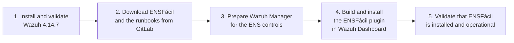

# Complete installation of ENSFácil from scratch
[Español](01-installation-from-scratch.md)

[[_TOC_]]

## 1. Objective

This guide describes the procedure for deploying ENSFácil starting from a
clean machine, without depending on any previously prepared ENSFácil server.

The goal is for the environment to be reproducible using only the project's
authorized GitLab repositories, the project documentation, and the versioned
artifacts required for the deployment.

## 2. Starting point

This path starts from an Ubuntu Server installation that has only:

- administrative access via `sudo`;
- network connectivity;
- Internet access when needed;
- authorized access to the project's GitLab repositories.

It is not assumed that Wazuh, ENSFácil, the Wazuh Dashboard build tree,
Node.js, Yarn, the ENS rules, the `ens` group, or ENSFácil's initial
configuration are already installed or prepared.

## 3. Expected outcome

By the end of this guide, Wazuh and ENSFácil must be installed, integrated,
and validated, including the manager rules, the integration with Wazuh
Dashboard, the compiled and installed plugin, and the initial configuration
required for ENSFácil to function.

## 4. Reproducibility principle

An installation is considered reproducible when it can be completed from a
clean machine using only GitLab and this documentation.

It must not be necessary to manually copy files from another ENSFácil server
or depend on a previously configured machine.

## 5. Versions and compatibility

ENSFácil must be deployed only on version combinations that have been
validated.

The combination used during this guide's initial validation is:

| Component | Version |
|---|---|
| Wazuh | `4.14.7` |
| OpenSearch Dashboards | `2.19.5` |
| Node.js for building | `18.19.0` |

The compatibility matrix is maintained in:

[`docs/deployment/03-version-compatibility.en.md`](03-version-compatibility.en.md)

> [!note]
> A new Wazuh version must not be considered compatible automatically. Before using it, ENSFácil's integration points must be checked, the plugin must be recompiled, and the validations defined for the deployment must be run.

## 6. Complete installation flow

The installation of ENSFácil is organized into five main blocks:



1. Install and validate Wazuh 4.14.7.
2. Download ENSFácil and the runbooks from GitLab.
3. Prepare Wazuh Manager for the ENS controls.
4. Build and install the ENSFácil plugin in Wazuh Dashboard.
5. Validate that ENSFácil is installed and operational.

The following sections develop the commands and checks required for each
block.

## 7. Validation rule

A step is not considered complete simply because the command finished
without errors.

Each phase must include an objective check that confirms the expected
result exists and works.

> [!important]
> If a validation fails, the deployment must stop at that point. Later phases will not proceed until the cause has been identified and resolved.

Whenever applicable, each phase will document:

- prerequisites;
- commands that must be run;
- expected result;
- validation check;
- recommended actions if the validation fails;
- rollback procedure when there is a risk of modifying an operational
  environment.

## 8. Prepare and validate the base machine

### 8.1 Environment used to validate this guide

This guide's initial installation has been validated on the following lab
environment:

| Resource | Value |
|---|---|
| Operating system | Ubuntu Server `24.04.4 LTS` |
| Architecture | `x86_64` |
| CPU | 4 logical CPUs |
| Memory | 7.8 GiB of RAM |
| Disk | 80 GB virtual disk |
| Network | Internet connectivity |
| Access | administrative access via `sudo` |

> [!note]
> These values describe the validation environment and must not be interpreted as ENSFácil's minimum requirements.

The lab's network topology is likewise not a product requirement. The
machine used during validation has a NAT interface and a lab network
interface.

### 8.2 Preliminary checks

Before starting the deployment, check the operating system, architecture,
available resources, connectivity, and basic tools:

```bash
cat /etc/os-release
uname -m
nproc
free -h
df -h /
ip -br addr
ip route
getent hosts gitlab.com
curl -Is --max-time 10 https://gitlab.com | head -1
command -v sudo apt git curl wget python3
```

> [!warning]
> The installation must not continue if administrative access does not exist or if the machine does not have the connectivity needed to obtain the deployment's repositories and packages.

## 9. Install and validate Wazuh 4.14.7

ENSFácil requires a functional, validated installation of Wazuh before
continuing with the plugin integration.

If Wazuh 4.14.7 is not yet installed, first follow the [Wazuh 4.14.7 installation guide](https://gitlab.com/quersystem/wazuh-4-installation-and-sizing-guide), completing steps 1 through 4.

After completing steps 1 through 4 of the Wazuh guide, return to this
procedure and check that the core platform is installed and operational
before continuing with ENSFácil.

### 9.1 Validate the Wazuh installation

Check the installed versions:

```bash
dpkg-query -W -f='${Package} ${Version}\n' wazuh-manager wazuh-indexer wazuh-dashboard
```

Check that the main services are active:

```bash
sudo systemctl is-active wazuh-manager wazuh-indexer wazuh-dashboard filebeat
```

All four services must return `active` before continuing.

For the combination validated in this guide, `wazuh-manager`,
`wazuh-indexer`, and `wazuh-dashboard` must correspond to Wazuh `4.14.7`
(packages `4.14.7-1`). In addition, the four services above must be in
`active` state, and access to the Dashboard must have been validated per
step 4 of the Wazuh installation guide.

> [!warning]
> If any of these checks fails, do not continue with the ENSFácil installation until the cause is resolved.

## 10. Configure authorized access to GitLab

Before cloning ENSFácil and the runbooks, check that the server has
authorized access to the project's repositories on GitLab.

### 10.1 Validate access to the main repository

Check that Git can access ENSFácil's main repository over SSH:

```bash
git ls-remote git@gitlab.com:quersystem/plugin-wazuh-ens.git HEAD
```

The check must return a hash followed by `HEAD`. If Git prompts for
authentication and cannot access the repository, do not continue until
authorized access is available.

### 10.2 Clone the ENSFácil repository

Create ENSFácil's base directory and assign it to the administrative user
who will perform the deployment:

```bash
sudo mkdir -p /opt/ensfacil
sudo chown "$USER":root /opt/ensfacil
sudo chmod 755 /opt/ensfacil
git clone git@gitlab.com:quersystem/plugin-wazuh-ens.git /opt/ensfacil/repo
```

After cloning, check the repository and its remote:

```bash
git -C /opt/ensfacil/repo remote -v
git -C /opt/ensfacil/repo branch --show-current
git -C /opt/ensfacil/repo status --short
```

### 10.3 Clone the ENS runbooks

On the Wazuh Manager server, clone the seventeen Linux runbooks used by ENSFácil under `/opt/ensfacil`. This location keeps the control repositories next to the main repository, which is where the project consistency check looks for them (`tests/check-consistency.py` reads them as sibling directories of `/opt/ensfacil/repo`):

```bash
cat > /opt/ensfacil/runbooks.txt <<'EOF'
mp.info.6
op.acc.1
op.acc.2
op.acc.3
op.acc.4
op.acc.5
op.acc.6
op.exp.1
op.exp.2
op.exp.3
op.exp.4
op.exp.5
op.exp.6
op.exp.7
op.exp.8
op.exp.9
op.exp.10
EOF

cd /opt/ensfacil
BASE=git@gitlab.com:quersystem/ens-controls-runbook/linux
while read -r r; do
  git clone "$BASE/$r.git" || break
done < /opt/ensfacil/runbooks.txt
# mp.info.6 also has a Zimbra runbook; it shares the rules and the
# consistency check compares it too.
git clone git@gitlab.com:quersystem/ens-controls-runbook/zimbra/zimbra-mta/mp.info.6.git zimbra-mta/mp.info.6
```

The file `/opt/ensfacil/runbooks.txt` is reused in the following steps.

> [!note]
> Each runbook is named exactly as its control, and the subgroup gives the platform or role. The variants for the Zimbra LDAP directory server (`quersystem/ens-controls-runbook/zimbra/zimbra-ldap`) and for Windows (`quersystem/ens-controls-runbook/windows`) have the same names as the Linux ones and are cloned on the corresponding machines following their own guide. On the manager the Linux runbooks are enough: the rules are the same, byte for byte.

### 10.4 Validate the cloned runbooks

Check that the seventeen repositories exist and point to the expected remote:

```bash
while read -r r; do
  printf '%-48s %s\n' "$r" "$(git -C "/opt/ensfacil/$r" remote get-url origin 2>&1)"
done < /opt/ensfacil/runbooks.txt
```

All seventeen repositories must return a URL under `git@gitlab.com:quersystem/ens-controls-runbook/linux/` before continuing.

## 11. Create and validate the ENS group

Before installing the control rules, create the shared `ens` group on Wazuh Manager:

```bash
sudo /var/ossec/bin/agent_groups -a -g ens -q
```

Check that Wazuh has created the shared structure of the group:

```bash
sudo test -d /var/ossec/etc/shared/ens && echo "GRUPO_ENS=OK"
sudo test -f /var/ossec/etc/shared/ens/agent.conf && echo "AGENT_CONF_ENS=OK"
sudo grep -c "<agent_config" /var/ossec/etc/shared/ens/agent.conf
```

> [!warning]
> The ENS rule installation must not continue if the `ens` group or its `agent.conf` do not exist.

> [!important]
> The `agent.conf` of the `ens` group must have **a single `<agent_config>` block** (the last check must return `0` or `1`). The `install-manager.sh` of every control refuses to modify an `agent.conf` with more than one block. Any additional setting for the group (for example a `<syscheck>`) goes inside the existing block, never in a second `<agent_config>`. After editing it by hand, validate it with `sudo /var/ossec/bin/verify-agent-conf -f /var/ossec/etc/shared/ens/agent.conf`.

## 12. Install and validate the ENS rules on the Manager

With the `ens` group created and the runbooks cloned, back up the manager configuration and run the Manager installers. The process stops at the first one that fails:

```bash
sudo mkdir -p /opt/ensfacil/artifacts
sudo chown "$USER":root /opt/ensfacil/artifacts
sudo tar czf "/opt/ensfacil/artifacts/manager-$(date +%Y%m%d-%H%M%S).tar.gz" \
  -C /var/ossec etc/rules etc/decoders etc/shared/ens etc/ossec.conf

(
while read -r r; do
  echo "===== $r ====="
  sudo bash "/opt/ensfacil/$r/install-manager.sh" || { echo "ERROR: $r"; exit 1; }
done < /opt/ensfacil/runbooks.txt
)
```

The `install-manager.sh` of op.exp.7, op.exp.8 and op.exp.9 also installs a collector that runs on the manager itself every hour, without any credential (it only reads local files), and adds its `<localfile>` to the manager's `ossec.conf`, because the `agent.conf` of the `ens` group does not apply to the manager. Its facts arrive with `agent.id=000`.

### 12.1 Validate the rule installation

Each `install-manager.sh` runs a blocking check with `wazuh-logtest`. The installation is considered correct when the following rules are validated:

| Control | Rule | Control | Rule |
|---|---|---|---|
| `mp.info.6` | `106601` | `op.exp.3` | `110401` |
| `op.acc.1` | `106873` | `op.exp.4` | `110505` |
| `op.acc.2` | `106902` | `op.exp.5` | `110601` |
| `op.acc.3` | `107001` | `op.exp.6` | `110701` |
| `op.acc.4` | `107106` | `op.exp.7` | `110801` |
| `op.acc.5` | `110001` | `op.exp.8` | `110901` |
| `op.acc.6` | `110101` | `op.exp.9` | `111001` |
| `op.exp.1` | `110205` | `op.exp.10` | `111197` |
| `op.exp.2` | `110304` | | |

For mp.info.6, `install-manager.sh` of both runbooks (Proxmox and Zimbra) checks with `wazuh-logtest` that `106601` (`backup_run`) matches. Afterwards, in the index, the rule to look for is `106797` (`collector_run`), the heartbeat the collector emits on every run even before any backup exists.

After running the installers, also check that Wazuh Manager stays active, that its configuration is valid and that the plugin and the runbooks are consistent:

```bash
sudo systemctl is-active wazuh-manager
sudo /var/ossec/bin/wazuh-analysisd -t && echo "CONFIG_MANAGER=OK"
cd /opt/ensfacil/repo && python3 tests/check-consistency.py | tail -1
```

> [!warning]
> The result must be `active`, `CONFIG_MANAGER=OK` and `coherencia OK`. If any installer fails, does not confirm its expected rule or the Manager does not stay active, stop the deployment before continuing.

> [!important]
> If an `install-manager.sh` fails **after** copying its rules, running it again detects no changes and **does not restart** the manager, so the new rules may not be loaded even though the installer finishes cleanly. In that case, restart by hand and confirm the control's rule with `wazuh-logtest`:
>
> ```bash
> sudo systemctl restart wazuh-manager
> sudo /var/ossec/bin/wazuh-logtest
> ```

## 13. Build and install the ENSFácil plugin

The plugin must be built with Node.js `18.19.0` and Yarn Classic `1.22.22`.

### 13.1 Prepare Node.js and Yarn

Before preparing the build tree, check the available versions:

```bash
curl -o- https://raw.githubusercontent.com/nvm-sh/nvm/v0.40.7/install.sh | bash

export NVM_DIR="$HOME/.nvm"
[ -s "$NVM_DIR/nvm.sh" ] && . "$NVM_DIR/nvm.sh"

nvm install 18.19.0
nvm use 18.19.0
npm install --global yarn@1.22.22
```

Validate the versions before continuing:

```bash
node --version
yarn --version
```

The expected result is Node.js `v18.19.0` and Yarn `1.22.22`. If the versions do not match, do not continue with the build.

> [!note]
> Wazuh Dashboard 4.14.7 ships its own Node.js `18.19.0` in `/usr/share/wazuh-dashboard/node/bin/node`. If you prefer not to install Node.js with nvm, that binary can be used by putting `/usr/share/wazuh-dashboard/node/bin` first in the `PATH`; Yarn Classic `1.22.22` still has to be in the `PATH` (the procedure is shown in section 13.5).

### 13.2 Prepare the Wazuh Dashboard 4.14.7 tree

Clone the validated Wazuh Dashboard version into the build directory:

```bash
sudo mkdir -p /opt/ensfacil/build
sudo chown "$USER":root /opt/ensfacil/build
git clone --branch v4.14.7 --depth 1 https://github.com/wazuh/wazuh-dashboard.git /opt/ensfacil/build
```

Check that exactly the expected version was obtained:

```bash
git -C /opt/ensfacil/build rev-parse HEAD
git -C /opt/ensfacil/build describe --tags --exact-match HEAD
```

The tag must be `v4.14.7`.

Install the dependencies and prepare the OpenSearch Dashboards tree:

```bash
cd /opt/ensfacil/build
yarn osd bootstrap
```

The process must end showing `bootstrap complete`. Dependency warnings that do not stop the process are not a failure on their own.

### 13.3 Add the official Wazuh 4.14.7 plugin

Clone the same version of the official Wazuh plugins repository:

```bash
git clone --branch v4.14.7 --depth 1 https://github.com/wazuh/wazuh-dashboard-plugins.git /opt/ensfacil/build/plugins/wazuh-dashboard-plugins
```

Check the version obtained:

```bash
git -C /opt/ensfacil/build/plugins/wazuh-dashboard-plugins describe --tags --exact-match HEAD
```

The result must be `v4.14.7`.

Copy the main plugin into the build tree:

```bash
cp -a /opt/ensfacil/build/plugins/wazuh-dashboard-plugins/plugins/main /opt/ensfacil/build/plugins/main
```

Install the dependencies declared by the plugin using its lockfile:

```bash
cd /opt/ensfacil/build/plugins/main
YARN_IGNORE_ENGINES=1 yarn install --frozen-lockfile
```

The installation must finish without errors before continuing.

### 13.4 Integrate ENSFácil into the Wazuh plugin

Define the paths used during the integration:

```bash
REPO=/opt/ensfacil/repo
TARGET=/opt/ensfacil/build/plugins/main
PKG=$REPO/integration/wazuh-dashboard
```

First validate the integrity of the integration package:

```bash
( cd "$PKG" && sha256sum -c SHA256SUMS )
```

Add the ENS core to the plugin:

```bash
mkdir -p "$TARGET/public/components/overview"
cp -a "$REPO/dashboard/ens" "$TARGET/public/components/overview/"
```

Check compatibility before making changes:

```bash
"$PKG/check-integration.sh" "$TARGET"
```

For a clean Wazuh 4.14.7 installation, `PATCHES_APLICABLES=10`, `FICHEROS_AUSENTES=7`, no conflicts, and `RESULTADO=COMPATIBLE` must appear.

Apply the ENSFácil integration:

```bash
"$PKG/apply-integration.sh" "$TARGET"
```

The process must end with `RESULTADO=INTEGRACION_APLICADA` and `REJECTS=0`.

Check the integration state again:

```bash
"$PKG/check-integration.sh" "$TARGET"
```

After the integration, `PATCHES_YA_APLICADOS=10`, `FICHEROS_YA_PRESENTES=7`, no conflicts and `RESULTADO=COMPATIBLE` must appear.

### 13.5 Build and validate the plugin

Select the validated Node.js version and build the plugin. The full build takes several minutes; keep its output in a file under `/opt/ensfacil/artifacts`:

```bash
nvm use 18.19.0
cd /opt/ensfacil/build/plugins/main

YARN_IGNORE_ENGINES=1 node ../../scripts/plugin_helpers build \
  --opensearch-dashboards-version=2.19.5 2>&1 | tee /opt/ensfacil/artifacts/build.log
```

If the build runs as `root` (for example, because the tree belongs to `root`), two more things are needed: the `--allow-root` option and `yarn` in `root`'s `PATH`. Without `yarn`, the process builds the whole bundle and dies at the last step with `ENOENT: yarn install --production`. With the Node.js shipped with Wazuh Dashboard:

```bash
cd /opt/ensfacil/build/plugins/main
YARN_BIN=$(dirname "$(command -v yarn)")    # yarn directory of the deploying user
P=/usr/share/wazuh-dashboard/node/bin:$YARN_BIN:/usr/local/sbin:/usr/local/bin:/usr/sbin:/usr/bin:/sbin:/bin

sudo env PATH="$P" YARN_IGNORE_ENGINES=1 node ../../scripts/plugin_helpers build \
  --allow-root --opensearch-dashboards-version=2.19.5 > /opt/ensfacil/artifacts/build.log 2>&1
```

> [!warning]
> Do not redirect the output of a build run as `root` to a file in `/tmp` created by another user: with the kernel's `protected_regular` protection, `root` cannot write to it and the build ends immediately with exit code 1 and no useful message. Use `/opt/ensfacil/artifacts`.

The build must end by generating the file `build/wazuh-2.19.5.zip`.

Validate that the artifact exists, that the ZIP has no errors and that it carries the code of this version:

```bash
test -f build/wazuh-2.19.5.zip && echo "ZIP_GENERADO=OK"
unzip -t build/wazuh-2.19.5.zip | tail -1
sha256sum build/wazuh-2.19.5.zip
unzip -p build/wazuh-2.19.5.zip "*.js" | grep -c "op.exp.10"
```

The `unzip -t` result must report that no errors were detected and the last count must be greater than `0`. The SHA-256 hash can be kept as an integrity reference of the generated artifact.

> [!warning]
> If the ZIP does not exist or the integrity check fails, do not continue with the installation on Wazuh Dashboard.

### 13.6 Install the plugin on Wazuh Dashboard

Install the artifact with `config/deploy-plugin.sh`. The script stops the dashboard, removes only the `wazuh` plugin (with exact paths, keeping `wazuhCore` and `wazuhCheckUpdates`), installs the ZIP and **bumps the dashboard `build.number`** before starting it:

```bash
ZIP=/opt/ensfacil/build/plugins/main/build/wazuh-2.19.5.zip
sudo -u wazuh-dashboard test -r "$ZIP" && echo "ZIP_ACCESIBLE=OK"

sudo bash /opt/ensfacil/repo/config/deploy-plugin.sh "$ZIP"
```

> [!important]
> Without bumping `build.number`, the browser keeps using the files of the previous version even though the new plugin is installed: the bundle URL depends on that number, not on the plugin, and not even a forced reload changes it. That is why the installation is done with the script and not by hand. The script keeps a copy of `package.json` next to the original (`package.json.antes-<date>`).

> [!warning]
> Do not use wildcards such as `wazuh*` if the plugin is ever removed by hand, as they could also delete `wazuhCore` and `wazuhCheckUpdates`.

Check that the service is active again and list the installed plugins:

```bash
sudo systemctl is-active wazuh-dashboard
sudo -u wazuh-dashboard /usr/share/wazuh-dashboard/bin/opensearch-dashboards-plugin list
```

Wazuh Dashboard must return `active` and the `wazuh` plugin must appear installed before continuing.

## 14. Initialize and seed the ENS configuration

The tools in `config/` talk to the indexer using the **indexer administrator certificate**, which exists on every manager under `/etc/wazuh-indexer/certs/`. No password needs to be known or typed. They run with `sudo` because the certificate key is readable only by `root`:

```bash
CERT="OS_CERT=/etc/wazuh-indexer/certs/admin.pem OS_KEY=/etc/wazuh-indexer/certs/admin-key.pem"
IDX=https://127.0.0.1:9200
```

> [!note]
> If the indexer is not on the same machine, export `ENS_OS_URL` with its URL and use that indexer's administrator certificate. The tools also accept `OS_USER` and `OS_PASS`, but this is not recommended: it forces the password to be typed in the session.

### 14.1 Create the active configuration

On a clean installation, the `wazuh-ens-configuration` index may exist without the `active` document yet.

In Wazuh Dashboard, go to ENSFácil > Configuration and save the configuration once.

> [!important]
> Just opening the screen is not enough: the first save creates the `active` document that the engine and the configuration tools will use.

After saving, check from the server that the document exists:

```bash
sudo curl -sk --cert /etc/wazuh-indexer/certs/admin.pem --key /etc/wazuh-indexer/certs/admin-key.pem \
  "$IDX/wazuh-ens-configuration/_doc/active?filter_path=found,_source.documentType&pretty"
```

| Check | Expected result |
|---|---|
| `found` | `true` |
| `_source.documentType` | `ACTIVE_CONFIGURATION` |

> [!warning]
> If the document does not exist yet, do not seed the controls until the first save from the Configuration screen has completed correctly.

### 14.2 Back up the document before changing it

Before every seeding or parameter change, keep a copy of the `active` document:

```bash
BACKUP_DOC=/opt/ensfacil/artifacts/active-$(date +%Y%m%d-%H%M%S).json
sudo curl -sk --cert /etc/wazuh-indexer/certs/admin.pem --key /etc/wazuh-indexer/certs/admin-key.pem \
  "$IDX/wazuh-ens-configuration/_doc/active" | sudo tee "$BACKUP_DOC" >/dev/null
sudo python3 -c "import json,sys; d=json.load(open(sys.argv[1])); print('COPIA_OK' if d.get('found') else 'COPIA_FALLIDA')" "$BACKUP_DOC"
```

Restoring this copy is described in the [troubleshooting and rollback guide](04-troubleshooting-and-rollback.en.md#8-restore-the-ens-configuration).

### 14.3 Seed the ENS controls

> [!important]
> Seed only once the plugin is deployed (section 13.6). The installed plugin version must know the controls being seeded.

Seed the seventeen controls. First in dry-run mode (without `--apply`), which shows the plan without writing anything:

```bash
cd /opt/ensfacil/repo/config
CONTROLS="mp.info.6 op.acc.1 op.acc.2 op.acc.3 op.acc.4 op.acc.5 op.acc.6 op.exp.1 op.exp.2 op.exp.3 op.exp.4 op.exp.5 op.exp.6 op.exp.7 op.exp.8 op.exp.9 op.exp.10"

for c in $CONTROLS; do
  echo "===== $c ====="
  sudo env $CERT python3 inject-control.py "$c" || break
done
```

Review the plan of each control (new parameters, values that are kept and, if it appears, the line `YA NO EXISTEN en el bloque y se pierden`). If it is correct, apply it:

```bash
for c in $CONTROLS; do
  echo "===== $c ====="
  sudo env $CERT python3 inject-control.py "$c" --apply || break
done
```

| Check | Expected result |
|---|---|
| Output of each control | `== APLICADO ==` |

The operation merges the existing configuration and adds the required blocks without removing previously configured values.

> [!note]
> Evidence that depends on required parameters without a value stays `NO_EVALUABLE`, with cause `CONFIGURATION`, and the requirements it supports are not credited until those parameters are declared. Missing information must not be read as compliance.

### 14.4 Validate the whole document

A parameter with a value the plugin does not accept does not only degrade its control: it prevents the whole ENS environment from loading and the dashboard shows «No se pudo cargar el entorno ENS». After every seeding or parameter change, validate the complete document with the same validator the plugin uses (`config/validate-configuration.ts`). It needs Node.js 18 or later and Internet access so that `npx` can download `tsx`:

```bash
sudo curl -sk --cert /etc/wazuh-indexer/certs/admin.pem --key /etc/wazuh-indexer/certs/admin-key.pem \
  "$IDX/wazuh-ens-configuration/_doc/active" -o /opt/ensfacil/artifacts/active-now.json

cd /opt/ensfacil/repo
npx --yes tsx config/validate-configuration.ts /opt/ensfacil/artifacts/active-now.json
```

The result must be `ESTRUCTURA VÁLIDA` with the seventeen controls listed. If the manager has no Node.js with `npx` or no Internet access, copy `active-now.json` to a workstation that has the plugin repository and run the same command there (or `docker run --rm -v "$PWD":/w -w /w node:22-alpine npx --yes tsx config/validate-configuration.ts active-now.json`).

> [!warning]
> If the validation fails, restore the copy from section 14.2 before anyone opens the dashboard, and fix the reported parameter.

### 14.5 Declare the policy

Parameter values are decisions of the person in charge and are declared in ENSFácil > Configuration. The global configuration card also holds the ENS level and, when relevant, the **Traceability level (T)**, used only by op.exp.8 (empty = the global ENS level).

To declare values from the server (reproducible environments, or when the policy is already decided in writing), use `config/set-parameters.py` with a JSON file:

```json
{
  "op.exp.8": {
    "P-05": ["ntp1.example.invalid | NTS", "ntp2.example.invalid | NTS"]
  }
}
```

```bash
cd /opt/ensfacil/repo/config
sudo env $CERT python3 set-parameters.py /path/policy.json            # plan
sudo env $CERT python3 set-parameters.py /path/policy.json --apply    # write
```

> [!important]
> `set-parameters.py` replaces the **whole** value of every parameter it names: a list or table is not extended, it is replaced. To add a row, pass the complete list (the rows already there plus the new one). Parameters the file does not name are left untouched. If the file names a parameter the control does not declare, the tool stops without writing anything.

> [!note]
> An empty parameter is the **absent** `value` key, never `null`. To empty a parameter, do it from the Configuration screen.

After declaring values, repeat the validation of section 14.4.

### 14.6 Check the dashboard

Open ENSFácil and check that:

- the seventeen controls appear;
- besides the machines in the `ens` group, the scope includes the manager (agent `000`), because op.exp.7, op.exp.8 and op.exp.9 are measured on it;
- after the first hourly run of the manager collectors, op.exp.7, op.exp.8 and op.exp.9 show data on the manager row.

Agents are added afterwards, installing on each machine the runbooks that apply to it according to their own guide (`docs/deployment/01-installation.md` of each runbook). The op.exp.5, op.exp.8 and op.exp.10 runbooks write auditd rules that must be loaded with `sudo augenrules --load` at the end.
