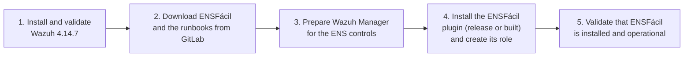

# Complete installation of ENSFácil from scratch
[Español](01-installation-from-scratch.md)

[[_TOC_]]

## 1. Objective

This guide describes the procedure for deploying ENSFácil starting from a
clean machine, without depending on any previously prepared ENSFácil server.

The goal is for the environment to be reproducible using only the project's
authorized GitLab repositories, the project documentation, and the versioned
artifacts required for the deployment.

## 2. Starting point

This path starts from an Ubuntu Server installation that has only:

- administrative access via `sudo`;
- network connectivity;
- Internet access when needed;
- authorized access to the project's GitLab repositories.

It is not assumed that Wazuh, ENSFácil, the OpenSearch Dashboards build tree,
Node.js, Yarn, the ENS rules, the `ens` group, or ENSFácil's initial
configuration are already installed or prepared.

> [!important]
> This guide applies to the package installation of Wazuh, with the indexer on
> the same machine (all-in-one installation). For the official Wazuh Docker
> images, the procedure is in [Wazuh in Docker](06-wazuh-in-docker.en.md): the
> plugin installation, the role, the seeding and the validation are done there
> differently, and the manager side runs without `systemctl`, `hostname`, cron
> or `git`.
>
> The links to every runbook and its guides (`01-installation`, `02-compliance`,
> `03-uninstall-and-troubleshooting`), and the registers the organization
> creates, are in [Runbooks and the organization's registers](05-runbooks-and-registers.en.md).

## 3. Expected outcome

By the end of this guide, Wazuh and ENSFácil must be installed and validated:
the manager rules, the `ensfacil` plugin installed in Wazuh
Dashboard next to the official Wazuh plugin (which is not modified), the
`ensfacil_admin` role and the initial configuration required for ENSFácil to
function.

## 4. Reproducibility principle

An installation is considered reproducible when it can be completed from a
clean machine using only GitLab and this documentation.

It must not be necessary to manually copy files from another ENSFácil server
or depend on a previously configured machine.

## 5. Versions and compatibility

ENSFácil must be deployed only on version combinations that have been
validated.

The combinations used to validate this guide are:

| Component | Version |
|---|---|
| ENSFácil | `1.0.0` (initial validation) and `1.1.0` |
| Wazuh | `4.14.7` |
| OpenSearch Dashboards | `2.19.5` |
| Node.js for building | `18.19.0` |

The compatibility matrix is maintained in:

[`docs/deployment/03-version-compatibility.en.md`](03-version-compatibility.en.md)

> [!note]
> A new Wazuh version must not be considered compatible automatically. ENSFácil does not modify the Wazuh plugin, but it is built for an exact OpenSearch Dashboards version: if the new Wazuh Dashboard version ships another one, the plugin must be rebuilt and validated before upgrading.

## 6. Complete installation flow

The installation of ENSFácil is organized into five main blocks:



1. Install and validate Wazuh 4.14.7.
2. Download ENSFácil and the runbooks from GitLab.
3. Prepare Wazuh Manager for the ENS controls.
4. Install the ENSFácil plugin in Wazuh Dashboard, from a release or built, and create the `ensfacil_admin` role.
5. Validate that ENSFácil is installed and operational.

The following sections develop the commands and checks required for each
block.

## 7. Validation rule

A step is not considered complete simply because the command finished
without errors.

Each phase must include an objective check that confirms the expected
result exists and works.

> [!important]
> If a validation fails, the deployment must stop at that point. Later phases will not proceed until the cause has been identified and resolved.

Whenever applicable, each phase will document:

- prerequisites;
- commands that must be run;
- expected result;
- validation check;
- recommended actions if the validation fails;
- rollback procedure when there is a risk of modifying an operational
  environment.

## 8. Prepare and validate the base machine

### 8.1 Environment used to validate this guide

This guide's initial installation has been validated on the following lab
environment:

| Resource | Value |
|---|---|
| Operating system | Ubuntu Server `24.04.4 LTS` |
| Architecture | `x86_64` |
| CPU | 4 logical CPUs |
| Memory | 7.8 GiB of RAM |
| Disk | 80 GB virtual disk |
| Network | Internet connectivity |
| Access | administrative access via `sudo` |

> [!note]
> These values describe the validation environment and must not be interpreted as ENSFácil's minimum requirements.

The lab's network topology is likewise not a product requirement. The
machine used during validation has a NAT interface and a lab network
interface.

### 8.2 Preliminary checks

Before starting the deployment, check the operating system, architecture,
available resources, connectivity, and basic tools:

```bash
cat /etc/os-release
uname -m
nproc
free -h
df -h /
ip -br addr
ip route
getent hosts gitlab.com
curl -Is --max-time 10 https://gitlab.com | head -1
command -v sudo apt git curl wget python3
```

> [!warning]
> The installation must not continue if administrative access does not exist or if the machine does not have the connectivity needed to obtain the deployment's repositories and packages.

## 9. Install and validate Wazuh 4.14.7

ENSFácil requires a functional, validated installation of Wazuh before
installing the plugin.

If Wazuh 4.14.7 is not yet installed, first follow the [Wazuh 4.14.7 installation guide](https://gitlab.com/quersystem/wazuh-4-installation-and-sizing-guide), completing steps 1 through 4.

After completing steps 1 through 4 of the Wazuh guide, return to this
procedure and check that the core platform is installed and operational
before continuing with ENSFácil.

### 9.1 Validate the Wazuh installation

Check the installed versions:

```bash
dpkg-query -W -f='${Package} ${Version}\n' wazuh-manager wazuh-indexer wazuh-dashboard
```

Check that the main services are active:

```bash
sudo systemctl is-active wazuh-manager wazuh-indexer wazuh-dashboard filebeat
```

Expected result: `active` for the four services.

For the combination validated in this guide, `wazuh-manager`,
`wazuh-indexer`, and `wazuh-dashboard` must correspond to Wazuh `4.14.7`
(packages `4.14.7-1`). In addition, the four services above must be in
`active` state, and access to the Dashboard must have been validated per
step 4 of the Wazuh installation guide.

> [!warning]
> If any of these checks fails, do not continue with the ENSFácil installation until the cause is resolved.

## 10. Configure authorized access to GitLab

Before cloning ENSFácil and the runbooks, check that the server has
authorized access to the project's repositories on GitLab.

### 10.1 Validate access to the main repository

Check that Git can access ENSFácil's main repository over SSH:

```bash
git ls-remote git@gitlab.com:quersystem/plugin-wazuh-ens.git HEAD
```

Expected result: a hash followed by `HEAD`. If Git prompts for
authentication and cannot access the repository, do not continue until
authorized access is available.

### 10.2 Clone the ENSFácil repository

Create ENSFácil's base directory and assign it to the administrative user
who will perform the deployment:

```bash
sudo mkdir -p /opt/ensfacil
sudo chown "$USER":root /opt/ensfacil
sudo chmod 755 /opt/ensfacil
git clone git@gitlab.com:quersystem/plugin-wazuh-ens.git /opt/ensfacil/repo
```

After cloning, check the repository and its remote:

```bash
git -C /opt/ensfacil/repo remote -v
git -C /opt/ensfacil/repo branch --show-current
git -C /opt/ensfacil/repo status --short
```

Expected result: the remote `git@gitlab.com:quersystem/plugin-wazuh-ens.git`, the `main` branch and no local change.

### 10.3 Clone the ENS runbooks

On the Wazuh Manager server, clone the 22 Linux runbooks that get installed and that ENSFácil uses under `/opt/ensfacil`. This location keeps the control repositories next to the main repository, which is where the project consistency check looks for them (`tests/check-consistency.py` reads them as sibling directories of `/opt/ensfacil/repo`):

```bash
cat > /opt/ensfacil/runbooks.txt <<'EOF'
mp.info.6
op.acc.1
op.acc.2
op.acc.3
op.acc.4
op.acc.5
op.acc.6
op.exp.1
op.exp.2
op.exp.3
op.exp.4
op.exp.5
op.exp.6
op.exp.7
op.exp.8
op.exp.9
op.exp.10
op.mon.1
op.mon.2
op.mon.3
op.nub.1
op.cont.3
EOF

cd /opt/ensfacil
BASE=git@gitlab.com:quersystem/ens-controls-runbook/linux
while read -r r; do
  git clone "$BASE/$r.git" || break
done < /opt/ensfacil/runbooks.txt
# mp.info.6 also has a Zimbra runbook; it shares the rules and the
# consistency check compares it too.
git clone git@gitlab.com:quersystem/ens-controls-runbook/zimbra/zimbra-mta/mp.info.6.git zimbra-mta/mp.info.6
```

The file `/opt/ensfacil/runbooks.txt` is reused in the following steps. The op.cont.2 runbook (`linux/op.cont.2`) is documentation only and is not cloned on the manager: it installs nothing, because the plugin judges that control from the Configuración screen.

> [!note]
> Each runbook is named exactly as its control, and the subgroup gives the platform or role. The variants for the Zimbra LDAP directory server (`quersystem/ens-controls-runbook/zimbra/zimbra-ldap`) and for Windows (`quersystem/ens-controls-runbook/windows`) have the same names as the Linux ones and are cloned on the corresponding machines following their own guide. On the manager the Linux runbooks are enough: the rules are the same, byte for byte.

### 10.4 Validate the cloned runbooks

Check that the 22 cloned repositories exist and point to the expected remote:

```bash
while read -r r; do
  printf '%-48s %s\n' "$r" "$(git -C "/opt/ensfacil/$r" remote get-url origin 2>&1)"
done < /opt/ensfacil/runbooks.txt
```

Expected result: the 22 repositories with a URL under `git@gitlab.com:quersystem/ens-controls-runbook/linux/`.

## 11. Create and validate the ENS group

> [!note]
> This section creates the groups on the manager. How agents are added to them,
> how to check that the configuration reaches them and the plugin's ENS scope
> are explained once, in the [ENSFácil initial setup](https://gitlab.com/quersystem/ens-controls-runbook/initial-setup).

Before installing the control rules, create the shared `ens` group on Wazuh Manager and the `ens-copias` group, mp.info.6's own, which only holds the machines whose backups are measured:

```bash
sudo /var/ossec/bin/agent_groups -a -g ens -q
sudo /var/ossec/bin/agent_groups -a -g ens-copias -q
```

Check that Wazuh has created the shared structure of the group:

```bash
sudo test -d /var/ossec/etc/shared/ens && echo "GRUPO_ENS=OK"
sudo test -f /var/ossec/etc/shared/ens/agent.conf && echo "AGENT_CONF_ENS=OK"
sudo grep -c "<agent_config" /var/ossec/etc/shared/ens/agent.conf
sudo test -f /var/ossec/etc/shared/ens-copias/agent.conf && echo "AGENT_CONF_ENS_COPIAS=OK"
sudo grep -c "<agent_config" /var/ossec/etc/shared/ens-copias/agent.conf
```

Expected result: `GRUPO_ENS=OK`, `AGENT_CONF_ENS=OK`, `1`, `AGENT_CONF_ENS_COPIAS=OK` and `1`.

> [!warning]
> The ENS rule installation must not continue if the `ens` and `ens-copias` groups or their `agent.conf` do not exist: without `ens-copias`, the mp.info.6 `install-manager.sh`, the first one in the loop, stops.

> [!important]
> The `agent.conf` of each group must have **a single `<agent_config>` block**: that is why both `grep -c` checks return `1`. The `install-manager.sh` of every control refuses to modify an `agent.conf` with no block or with more than one. Any additional setting for the group, for example a `<syscheck>`, goes inside the existing block, never in a second `<agent_config>`. After a manual edit, validate the file with `sudo /var/ossec/bin/verify-agent-conf -f /var/ossec/etc/shared/ens/agent.conf`.

## 12. Install and validate the ENS rules on the Manager

With the `ens` and `ens-copias` groups created and the runbooks cloned, back up the manager configuration and run the Manager installers. The process stops at the first one that fails:

```bash
sudo mkdir -p /opt/ensfacil/artifacts
sudo chown "$USER":root /opt/ensfacil/artifacts
sudo tar czf "/opt/ensfacil/artifacts/manager-$(date +%Y%m%d-%H%M%S).tar.gz" \
  -C /var/ossec etc/rules etc/decoders etc/shared/ens etc/shared/ens-copias etc/ossec.conf

(
while read -r r; do
  echo "===== $r ====="
  sudo bash "/opt/ensfacil/$r/install-manager.sh" || { echo "ERROR: $r"; exit 1; }
done < /opt/ensfacil/runbooks.txt
)
```

The `install-manager.sh` of op.exp.7, op.exp.8 and op.exp.9 also installs a collector that runs on the manager itself every hour, without any credential (it only reads local files), and adds its `<localfile>` to the manager's `ossec.conf`, because the `agent.conf` of the `ens` group does not apply to the manager. Its facts arrive with `agent.id=000`.

Those of op.mon.1, op.mon.2, op.mon.3, op.nub.1 and op.cont.3 (release 1.1.0) do the same: each installs its collector in `/usr/local/bin/` (`ens_opmon1_collect.sh`, `ens_opmon2_collect.sh`, `ens_opmon3_collect.sh`, `ens_opnub1_collect.sh`, `ens_opcont3_collect.sh`), its `<localfile>` in the manager's `ossec.conf` and a cron in `/etc/cron.d`. They need `jq` and honour `ENSFACIL_SYSTEMCTL`. The cron runs hourly for op.mon.1, op.mon.3 and op.nub.1, and every 6 hours for op.mon.2 and op.cont.3; op.mon.1 and op.nub.1 do their full pass every 6 hours, and op.mon.3 does it every 6 hours (the surface every 12). op.mon.3 also has an agent collector: its `install.sh`, on each machine of the `ens` group, installs `ens_opmon3_agent_collect.sh` with an hourly cron. op.cont.2 has no collector and no rules (its runbook is documentation only): the plugin evaluates it from the tables of the Configuración screen. op.cont.2 and op.cont.3 apply only with Availability (D) at ALTO; at MEDIO they show «No aplica».

### 12.1 Validate the rule installation

Each `install-manager.sh` runs a blocking check with `wazuh-logtest`. The installation is considered correct when the following rules are validated:

| Control | Rule | Control | Rule |
|---|---|---|---|
| `mp.info.6` | `106601` | `op.exp.3` | `110401` |
| `op.acc.1` | `106873` | `op.exp.4` | `110505` |
| `op.acc.2` | `106902` | `op.exp.5` | `110601` |
| `op.acc.3` | `107001` | `op.exp.6` | `110701` |
| `op.acc.4` | `107106` | `op.exp.7` | `110801` |
| `op.acc.5` | `110001` | `op.exp.8` | `110901` |
| `op.acc.6` | `110101` | `op.exp.9` | `111001` |
| `op.exp.1` | `110205` | `op.exp.10` | `111197` |
| `op.exp.2` | `110304` | `op.mon.1` | `111201` |
| `op.mon.2` | `111301` | `op.mon.3` | `111401` |
| `op.nub.1` | `111501` | `op.cont.3` | `111701` |

For mp.info.6, `install-manager.sh` of both runbooks (Proxmox and Zimbra) checks with `wazuh-logtest` that `106601` (`backup_run`) matches. Afterwards, in the index, the rule to look for is `106797` (`collector_run`), the heartbeat the collector emits on every run even before any backup exists.

After running the installers, also check that Wazuh Manager stays active, that its configuration is valid and that the plugin and the runbooks are consistent:

```bash
sudo systemctl is-active wazuh-manager
sudo /var/ossec/bin/wazuh-analysisd -t && echo "CONFIG_MANAGER=OK"
cd /opt/ensfacil/repo && python3 tests/check-consistency.py | tail -1
```

Expected result: `active`, `CONFIG_MANAGER=OK` and `coherencia OK`. `check-consistency.py` compares the rules the plugin accredits with those of the runbooks cloned in `/opt/ensfacil`, not with the manager's.

> [!warning]
> If any installer fails, does not confirm its expected rule or the Manager does not stay active, stop the deployment before continuing.

> [!important]
> If an `install-manager.sh` fails **after** copying its rules, running it again detects no changes and **does not restart** the manager, so the new rules may not be loaded even though the installer finishes cleanly. In that case, restart by hand and confirm the control's rule with `wazuh-logtest`:
>
> ```bash
> sudo systemctl restart wazuh-manager
> sudo /var/ossec/bin/wazuh-logtest
> ```

## 13. Install the plugin

ENSFácil is a Wazuh Dashboard plugin of its own, with the id `ensfacil`. It is installed **next to** the official Wazuh plugin, which is neither modified nor removed.

### 13.1 Choose where the zip comes from

There are two ways to get the plugin zip. Both end the same way, in section 13.4.

| Option | When | Guide |
|---|---|---|
| A. From a release (default) | a release exists for the installed Wazuh version | [Installing from a release](07-installing-from-a-release.en.md) |
| B. Build from source | a version with no release, the evaluation of another Wazuh version or the plugin's development | [Building from source](08-building-from-source.en.md) |

> [!note]
> A zip built for another OpenSearch Dashboards version does not install. Wazuh 4.14.7 needs a zip for OpenSearch Dashboards `2.19.5`.

### 13.2 Option A: from a release

Download the four release files to `/opt/ensfacil/releases/<version>`, in the browser or from the server with a deploy token ([guide 07, sections 4 to 6](07-installing-from-a-release.en.md#4-prepare-the-folder-on-the-server)), and verify their integrity:

```bash
V=1.2.0
R=/opt/ensfacil/releases/$V
cd "$R"
sha256sum -c SHA256SUMS
```

Expected result: `OK` for the three files. If any reports `FAILED`, stop the procedure.

Continue with section 13.4 with:

```bash
ZIP=$R/ensfacil-$V-osd-2.19.5.zip
DEPLOY=$R/deploy-plugin.sh
```

### 13.3 Option B: build from source

Build and validate the zip with [guide 08](08-building-from-source.en.md): with Node.js 18.19.0, Yarn Classic 1.22.22 and the OpenSearch Dashboards 2.19.5 tree in `/opt/ensfacil/build` (section 3), or with the CI builder image (section 4). Validate the zip before continuing (section 5).

Continue with section 13.4 with these paths. If the zip was built with the image on another machine, copy the zip to the server and set its path in `ZIP`:

```bash
ZIP=/opt/ensfacil/build/plugins/ensfacil/build/ensfacil-2.19.5.zip
DEPLOY=/opt/ensfacil/repo/config/deploy-plugin.sh
```

### 13.4 Install the plugin on Wazuh Dashboard

Install the zip with `deploy-plugin.sh`, with `ZIP` and `DEPLOY` from section 13.2 or 13.3:

```bash
sudo -u wazuh-dashboard test -r "$ZIP" && echo "ZIP_ACCESIBLE=OK"

sudo bash "$DEPLOY" "$ZIP"
```

The script stops the dashboard, removes the previous `ensfacil` version if there is one, installs the zip, **bumps the dashboard `build.number`** and starts it. It only touches `ensfacil`: the Wazuh plugin (`wazuh`, `wazuhCore`, `wazuhCheckUpdates`) stays as it is.

Expected result: at the end of the deployment, `dashboard: active` and, under `plugins:`, `ensfacil` next to `wazuh`, `wazuhCore` and `wazuhCheckUpdates`.

If something fails, the script states how to return to the previous state and exits with an error. The exit codes and the backups it keeps are in [troubleshooting, section 4.1](04-troubleshooting-and-rollback.en.md#41-if-deploy-pluginsh-fails-halfway).

> [!important]
> Without bumping `build.number`, the browser keeps using the files of the previous version even though the new plugin is installed: the bundle URL depends on that number, not on the plugin, and not even a forced reload changes it. That is why the installation is done with the script and not by hand. The script keeps a copy of `package.json` next to the original (`package.json.antes-<date>`).

Check:

```bash
sudo systemctl is-active wazuh-dashboard
sudo -u wazuh-dashboard /usr/share/wazuh-dashboard/bin/opensearch-dashboards-plugin list
curl -sk -o /dev/null -w '%{http_code}\n' https://localhost/api/ensfacil/configuration
```

Expected result:

| Check | Expected result |
|---|---|
| service | `active` |
| plugins | `ensfacil@1.2.0` (the installed version) and `wazuh@4.14.7-01`, among others |
| `/api/ensfacil/configuration` | `401`: the plugin route exists and asks for a session. A `404` means the plugin did not load ([troubleshooting](04-troubleshooting-and-rollback.en.md)) |

### 13.5 Create the ensfacil_admin role

> [!note]
> This step is only required if a user without `all_access` must save the
> configuration or view its history. The Wazuh `admin` user has `all_access`
> and can save the configuration without this role.

Only users with the security plugin role `ensfacil_admin` or `all_access` can save the ENS configuration and see its history. The others see the configuration, but get a 403 error when they save: «Hace falta el rol ensfacil_admin o all_access para cambiar la configuración ENS o ver su historial.» ("The ensfacil_admin or all_access role is needed to change the ENS configuration or see its history.").

`config/create-admin-role.sh` creates the role and, if asked, assigns it. It uses the indexer administrator certificate, with no password, and verifies the indexer's certificate against its CA: by default `/etc/wazuh-indexer/certs/root-ca.pem`, the all-in-one one; another one is set with `OS_CA`. By default it connects to `https://127.0.0.1:9200`, the name for which the Wazuh all-in-one installation issues the indexer certificate: with `localhost`, the verification fails. In Docker, the procedure is in [Wazuh in Docker, section 5](06-wazuh-in-docker.en.md#5-create-the-ensfacil_admin-role).

With option A, the release folder also carries this script (`$R/create-admin-role.sh`), from the release's version and verified with `SHA256SUMS`. That script can be used instead of the repository's: the options are the same.

> [!note]
> The role grants no permission by itself: it is a mark that ENSFácil looks for among the user's roles. To see the data, each user also needs their usual Wazuh role, with read access to `wazuh-alerts-*` and `wazuh-monitoring-*`.

First in test mode, which changes nothing. Replace `<usuario>` with the dashboard user who will administer ENSFácil:

```bash
sudo bash /opt/ensfacil/repo/config/create-admin-role.sh --dry-run --mapear <usuario>
```

The following result corresponds to a role that is not yet assigned to any user.

Expected result:

```text
== modo prueba: no se envía ningún cambio
== rol ensfacil_admin
PUT _plugins/_security/api/roles/ensfacil_admin {"description":"ENSFácil: puede cambiar la configuración ENS y ver su historial","cluster_permissions":[],"index_permissions":[],"tenant_permissions":[]}
== asignación de ensfacil_admin
PUT _plugins/_security/api/rolesmapping/ensfacil_admin {"users":["<usuario>"]}
```

If the role is already assigned to other users, the last line is a `PATCH` that adds `<usuario>` without removing anyone.

Then, the real run:

```bash
sudo bash /opt/ensfacil/repo/config/create-admin-role.sh --mapear <usuario>
```

Expected result: `-> 200` or `-> 201` after each request and, at the end, `usuarios con el rol ensfacil_admin: <usuario>`.

- The run can be repeated: the role is written the same way and only the missing users are added.
- Several users: `--mapear <usuario1> --mapear <usuario2>`.
- Without `--mapear`, the script only creates the role.
- If the user had a session open and still gets the 403 error, the user must log out and log in again.

### 13.6 Check ENSFácil in the browser

Log in to Wazuh Dashboard and check that:

- in the menu, under «Security operations», «ENSFácil» appears;
- on the OpenSearch Dashboards home page (`/app/home`), the «ENSFácil» card opens the application; the Wazuh home page does not accept other plugins' cards, so there ENSFácil is only in the menu;
- it opens on the Panel tab, with the tabs Panel, Vista general, Configuración, Controles, Detalle del control, Informes, Evidencias and Eventos;
- there is a «Máquina» selector to see all the machines in scope or a single one.

On a new installation, continue with section 14: the ENS configuration is created by the first save.

## 14. Initialize and seed the ENS configuration

The tools in `config/` connect to the indexer with the **indexer administrator certificate**, which in the all-in-one installation is in `/etc/wazuh-indexer/certs/`. No password needs to be known or typed. They run with `sudo` because the certificate key is readable only by `root`:

```bash
CERT="OS_CERT=/etc/wazuh-indexer/certs/admin.pem OS_KEY=/etc/wazuh-indexer/certs/admin-key.pem"
IDX=https://127.0.0.1:9200
```

> [!note]
> If the indexer is not on the same machine, export `ENS_OS_URL` with its URL and use that indexer's administrator certificate. The tools also accept `OS_USER` and `OS_PASS`, but this is not recommended: it forces the password to be typed in the session. In Docker, the steps of this section are in [Wazuh in Docker, sections 6 to 10](06-wazuh-in-docker.en.md#6-first-save-of-the-configuration).

> [!note]
> `inject-control.py` and `set-parameters.py` do not verify the indexer certificate, so they accept `127.0.0.1` or `localhost`. `create-admin-role.sh` does verify it against the CA (section 13.5) and needs the name the certificate is issued for.

### 14.1 Create the active configuration

On a clean installation, the `wazuh-ens-configuration` index may exist without the `active` document yet.

In Wazuh Dashboard, go to ENSFácil > Configuración and save the configuration once, with a user who has the `ensfacil_admin` or `all_access` role (section 13.5). With another user, the save returns the 403 error.

> [!important]
> Just opening the screen is not enough: the first save creates the `active` document that the engine and the configuration tools will use.

After saving, check from the server that the document exists:

```bash
sudo curl -sk --cert /etc/wazuh-indexer/certs/admin.pem --key /etc/wazuh-indexer/certs/admin-key.pem \
  "$IDX/wazuh-ens-configuration/_doc/active?filter_path=found,_source.documentType&pretty"
```

| Check | Expected result |
|---|---|
| `found` | `true` |
| `_source.documentType` | `ACTIVE_CONFIGURATION` |

> [!warning]
> If the document does not exist yet, do not seed the controls until the first save from the Configuration screen has completed correctly.

### 14.2 Back up the document before changing it

Before every seeding or parameter change, keep a copy of the `active` document:

```bash
BACKUP_DOC=/opt/ensfacil/artifacts/active-$(date +%Y%m%d-%H%M%S).json
sudo curl -sk --cert /etc/wazuh-indexer/certs/admin.pem --key /etc/wazuh-indexer/certs/admin-key.pem \
  "$IDX/wazuh-ens-configuration/_doc/active" | sudo tee "$BACKUP_DOC" >/dev/null
sudo python3 -c "import json,sys; d=json.load(open(sys.argv[1])); print('COPIA_OK' if d.get('found') else 'COPIA_FALLIDA')" "$BACKUP_DOC"
```

Restoring this copy is described in the [troubleshooting and rollback guide](04-troubleshooting-and-rollback.en.md#7-restore-the-ens-configuration).

### 14.3 Seed the ENS controls

> [!important]
> Seed only once the plugin is deployed (section 13.4). The reason is in [Installing from a release, section 11](07-installing-from-a-release.en.md#11-update-to-a-newer-release).

Seed the 23 controls. First in dry-run mode (without `--apply`), which shows the plan without writing anything:

```bash
cd /opt/ensfacil/repo/config
CONTROLS="mp.info.6 op.acc.1 op.acc.2 op.acc.3 op.acc.4 op.acc.5 op.acc.6 op.exp.1 op.exp.2 op.exp.3 op.exp.4 op.exp.5 op.exp.6 op.exp.7 op.exp.8 op.exp.9 op.exp.10 op.mon.1 op.mon.2 op.mon.3 op.nub.1 op.cont.2 op.cont.3"

for c in $CONTROLS; do
  echo "===== $c ====="
  sudo env $CERT python3 inject-control.py "$c" || break
done
```

Review the plan of each control (new parameters, values that are kept and, if it appears, the line `YA NO EXISTEN en el bloque y se pierden`). If it is correct, apply it:

```bash
for c in $CONTROLS; do
  echo "===== $c ====="
  sudo env $CERT python3 inject-control.py "$c" --apply || break
done
```

| Check | Expected result |
|---|---|
| Output of each control | `== APLICADO ==` |

The operation merges the existing configuration and adds the required blocks without removing previously configured values.

> [!note]
> Evidence that depends on required parameters without a value stays `NO_EVALUABLE`, with cause `CONFIGURATION`, and the requirements it supports are not credited until those parameters are declared. Missing information must not be read as compliance.

### 14.4 Validate the whole document

A parameter with a value the plugin does not accept does not only degrade its control: it prevents the whole ENS environment from loading and the dashboard shows «No se pudo cargar el entorno ENS». After every seeding or parameter change, validate the complete document with the same validator the plugin uses (`config/validate-configuration.ts`). It needs Node.js 18 or later and Internet access so that `npx` can download `tsx` and `yarn` can install into `node_modules/` the plugin dependencies the validator imports (`re2js`):

```bash
sudo curl -sk --cert /etc/wazuh-indexer/certs/admin.pem --key /etc/wazuh-indexer/certs/admin-key.pem \
  "$IDX/wazuh-ens-configuration/_doc/active" -o /opt/ensfacil/artifacts/active-now.json

cd /opt/ensfacil/repo
npx --yes yarn@1.22.22 install --frozen-lockfile --ignore-scripts --non-interactive
npx --yes tsx config/validate-configuration.ts /opt/ensfacil/artifacts/active-now.json
```

Expected result: `Done` after the installation; then `controles (23): …`, `ESTRUCTURA VÁLIDA: el plugin cargará esta configuración.` and `AJUSTES DE AGENTES Y PLANTILLAS VÁLIDOS.` ([Configuration by controls and templates, section 11.2](09-configuration-by-system.en.md#112-validate-the-document)). If the manager has no Node.js with `npx` or no Internet access, copy `active-now.json` to the root of a clone of the plugin repository on another machine and run the same command there or, with Docker, `docker run --rm -v <repo>:/w -w /w node:22-alpine sh -c 'npx --yes yarn@1.22.22 install --frozen-lockfile --ignore-scripts --non-interactive && npx --yes tsx config/validate-configuration.ts /w/active-now.json'`. The validator imports the plugin engine: it needs the whole repository, not only `config/`.

> [!warning]
> If the validation fails, restore the copy from section 14.2 before anyone opens the dashboard, and fix the reported parameter.

### 14.5 Declare the policy

Parameter values are decisions of the person in charge and are declared in ENSFácil > Configuration: on the «Controles» tab, each control's common settings, its templates (built-in for Linux, Servidor LDAP, Windows and Manager Wazuh, and custom ones) and the template assigned to each agent; on the «Agentes» tab, what belongs to each machine in scope. The complete procedure, with system type detection, templates, the value applied to each agent and the conversion of a 1.2.0 configuration, is in [Configuration by controls and templates](09-configuration-by-system.en.md). Configuration > General also holds the ENS level, the **Traceability level (T)**, used only by op.exp.8, and the **Availability level (D)**, used by op.cont.2 and op.cont.3. If T or D is not declared, the global ENS level applies. op.cont.2 and op.cont.3 only apply with D at ALTO: with the ENS level at MEDIO and D not declared, they show «No aplica» (not applicable).

To declare values from the server (reproducible environments, or when the policy is already decided in writing), use `config/set-parameters.py` with a JSON file:

```json
{
  "op.exp.8": {
    "P-05": ["ntp1.example.invalid | NTS", "ntp2.example.invalid | NTS"]
  }
}
```

```bash
cd /opt/ensfacil/repo/config
sudo env $CERT python3 set-parameters.py /path/policy.json            # plan
sudo env $CERT python3 set-parameters.py /path/policy.json --apply    # write
```

> [!important]
> `set-parameters.py` replaces the **whole** value of every parameter it names: a list or table is not extended, it is replaced. To add a row, pass the complete list (the rows already there plus the new one). Parameters the file does not name are left untouched. If the file names a parameter the control does not declare, the tool stops without writing anything.

> [!note]
> An empty parameter is the **absent** `value` key, never `null`. To empty a parameter, do it from the Configuration screen.

An agent's template and own settings are declared with the `agents` section of the same file: [Configuration by controls and templates, section 11.1](09-configuration-by-system.en.md#111-declare-an-agents-template-and-settings-with-set-parameterspy).

After declaring values, repeat the validation of section 14.4.

### 14.6 Check the dashboard

Open ENSFácil and check that:

- the 23 controls appear;
- besides the machines in the `ens` group, the scope includes the manager (agent `000`), because nine controls are evaluated on it: op.cont.2, op.cont.3, op.exp.7, op.exp.8, op.exp.9, op.mon.1, op.mon.2, op.mon.3 and op.nub.1. The eight other than op.cont.2 have a collector on the manager; op.cont.2 is evaluated from the tables of the Configuración screen;
- after the first run of the manager collectors (hourly or every 6 hours, depending on the control), those controls show data on the manager row.

The evaluation runs on the plugin server with every fact of the 30-day window. Each user's first load answers in parts: the notice «Calculando la evaluación» (computing the evaluation), with how many rows (control × machine) are ready, the status of the controls already computed and «Calculando…» on the rest.

Expected result: the first controls appear within a few seconds and, once all are computed, the dashboard figures; the daily evolution reads «Calculando la serie…» until it is computed. In the lab, the complete result takes about 20 s; after that, the screens answer at once.

### 14.7 Check the overview and the detail of a control

Open the **Vista general** tab with «Todas las máquinas» in the selector. The screen makes one evaluation request for the whole scope and a separate one for the trend. On the first load, while controls are missing, it shows «Calculando la evaluación: X de N filas (control × máquina) listas» with the missing controls, «…» on their matrix rows, and leaves the per-machine figures and the work queue for the end; the trend reads «Calculando la serie de 30 días» until it is ready.

| Section | What it shows | Expected result |
|---|---|---|
| Máquinas | One row per machine in scope (the manager last): measured controls by status, requirements not met and how many of them not demonstrated, last data received (the latest of the last fact and the last collector heartbeat) and its three worst controls. | A machine with no data for more than 24 h shows in red. Clicking its name selects it in the selector; clicking one of its worst controls opens that control's detail on that machine. |
| Controles × máquinas | The 23 controls by the machines in scope. In «Cumplimiento», each cell is the control's percentage on that machine and, in red, the requirements not met; hatched, «not measured on this machine»; «en el manager», an organization control whose result is in column `000`. In «Frescura de la recogida», the last data of that control on that machine. | Clicking a cell opens the Control detail of that control on that machine. A control measured on a machine with nothing received in the window says «nunca», in red. The «Máquinas» column, next to the control, says how many machines comply, how many do not and how many have no data. With many machines the table scrolls horizontally and the control column stays fixed; each header shows the machine id and name. |
| Cola de trabajo | The non-conformities of every control, grouped by who has to act: audited system, organization, ENS owner, Wazuh operation, evidence producer, ENSFácil product. With a machine selected, only its own. | Each row gives the control, the requirement and the first sentence of the failing evidence, without the «Resuelta por la política…» template. Clicking the control opens its detail. |
| Tendencia de 30 días | The average compliance index of each day, with the first and last day, and below it the status of each control each day, with its legend. | Each day is evaluated with the facts known up to that day. A control whose status changed in the window shows in bold, with its first and last status. |

Switch machine in the selector with the Vista general open.

Expected result: the view is not reloaded and keeps the selected view («Cumplimiento» or «Frescura de la recogida»); the selected machine is highlighted and the work queue shows only its items. Only the trend is computed again, because it belongs to that machine.

Then open **Detalle del control** and select the manager (`000`) in the selector.

Expected result: the list shows the 23 controls. The 14 measured only on machines (mp.info.6, op.acc.1-6, op.exp.1-6 and op.exp.10) appear last, in grey, with «No se mide en esta máquina» and the reason, and without a score. At level BAJO, a line reads «Nivel BAJO: 4 controles no aplican (…)», with a link to Configuración. A catalog control that is not in the active configuration shows «No está en la configuración activa» and the «Añadir con valores por defecto» button.

Open op.acc.1 with the manager selected.

Expected result: the detail is neither empty nor says «Todo lo aplicable … conforme»; it shows «op.acc.1 no se mide en 000 · …», the reason and the buttons «Ver todas las máquinas» and, if the control declares the machines it is measured on (mp.info.6 P-04), «Configurar P-04».

Switch to another machine with the detail open.

Expected result: the tab is not remounted. While the new machine's result arrives, a progress bar and the notice «Cargando … Mientras tanto se muestra el resultado de …» state which machine and which time the visible result belongs to. If the evaluation fails, the error notice appears above the last result, with «Reintentar»; the page does not disappear. A machine in the address that is not in the ENS scope only shows the selector's notice, with «Quitar la máquina y ver todas».

Review a non-conformity card.

Expected result: the headline is the failing evidence, its status and the first sentence of its reason, in normal weight; a headline longer than 200 characters is cut at a space with «…» and continues below. Below it come the rest of the reason in normal text, lists as lists (only once, and after the sentence that introduces them), what follows «Además» set apart, the other evidences of the requirement with their status and the conforming ones folded. Each cited parameter is a badge with the value that applies to that machine and its origin (the machine's own, a template or the organization); clicking it opens Configuración on that parameter. Clicking an evidence opens Evidencias filtered by that control, with the filter visible and «Quitar filtro». The specific action appears under the non-conformity class. «Ver detalle» shows the full reason.

Click **Configurar este control** in the detail header.

Expected result: Configuración opens on that control (on the selected machine's page if the control has per-system or per-platform parameters) with «Volver al detalle de …» at the top, which returns to the same control and the same machine. The open detail is kept in the URL (`control=`): switching tabs and back, or reloading the page, opens it again.

Agents are added afterwards, installing on each machine the runbooks that apply to it according to their own guide (`docs/deployment/01-installation.md` **of each runbook**, linked from the [runbook table](05-runbooks-and-registers.en.md#runbooks-per-control)); the machines whose backups are measured also go into the `ens-copias` group and into mp.info.6 P-04. The op.acc.2, op.acc.3, op.acc.4, op.exp.3, op.exp.4, op.exp.5, op.exp.8 and op.exp.10 runbooks write auditd rules that are loaded with `sudo augenrules --load` at the end.
