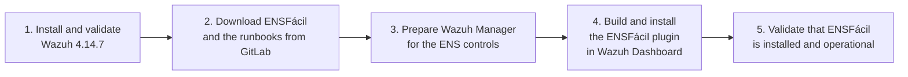

# Complete installation of ENSFácil from scratch
[Español](01-installation-from-scratch.md)

[[_TOC_]]

## 1. Objective

This guide describes the procedure for deploying ENSFácil starting from a
clean machine, without depending on any previously prepared ENSFácil server.

The goal is for the environment to be reproducible using only the project's
authorized GitLab repositories, the project documentation, and the versioned
artifacts required for the deployment.

## 2. Starting point

This path starts from an Ubuntu Server installation that has only:

- administrative access via `sudo`;
- network connectivity;
- Internet access when needed;
- authorized access to the project's GitLab repositories.

It is not assumed that Wazuh, ENSFácil, the Wazuh Dashboard build tree,
Node.js, Yarn, the ENS rules, the `ens` group, or ENSFácil's initial
configuration are already installed or prepared.

## 3. Expected outcome

By the end of this guide, Wazuh and ENSFácil must be installed, integrated,
and validated, including the manager rules, the integration with Wazuh
Dashboard, the compiled and installed plugin, and the initial configuration
required for ENSFácil to function.

## 4. Reproducibility principle

An installation is considered reproducible when it can be completed from a
clean machine using only GitLab and this documentation.

It must not be necessary to manually copy files from another ENSFácil server
or depend on a previously configured machine.

## 5. Versions and compatibility

ENSFácil must be deployed only on version combinations that have been
validated.

The combination used during this guide's initial validation is:

| Component | Version |
|---|---|
| Wazuh | `4.14.7` |
| OpenSearch Dashboards | `2.19.5` |
| Node.js for building | `18.19.0` |

The compatibility matrix is maintained in:

[`docs/deployment/03-version-compatibility.en.md`](03-version-compatibility.en.md)

> [!note]
> A new Wazuh version must not be considered compatible automatically. Before using it, ENSFácil's integration points must be checked, the plugin must be recompiled, and the validations defined for the deployment must be run.

## 6. Complete installation flow

The installation of ENSFácil is organized into five main blocks:



1. Install and validate Wazuh 4.14.7.
2. Download ENSFácil and the runbooks from GitLab.
3. Prepare Wazuh Manager for the ENS controls.
4. Build and install the ENSFácil plugin in Wazuh Dashboard.
5. Validate that ENSFácil is installed and operational.

The following sections develop the commands and checks required for each
block.

## 7. Validation rule

A step is not considered complete simply because the command finished
without errors.

Each phase must include an objective check that confirms the expected
result exists and works.

> [!important]
> If a validation fails, the deployment must stop at that point. Later phases will not proceed until the cause has been identified and resolved.

Whenever applicable, each phase will document:

- prerequisites;
- commands that must be run;
- expected result;
- validation check;
- recommended actions if the validation fails;
- rollback procedure when there is a risk of modifying an operational
  environment.

## 8. Prepare and validate the base machine

### 8.1 Environment used to validate this guide

This guide's initial installation has been validated on the following lab
environment:

| Resource | Value |
|---|---|
| Operating system | Ubuntu Server `24.04.4 LTS` |
| Architecture | `x86_64` |
| CPU | 4 logical CPUs |
| Memory | 7.8 GiB of RAM |
| Disk | 80 GB virtual disk |
| Network | Internet connectivity |
| Access | administrative access via `sudo` |

> [!note]
> These values describe the validation environment and must not be interpreted as ENSFácil's minimum requirements.

The lab's network topology is likewise not a product requirement. The
machine used during validation has a NAT interface and a lab network
interface.

### 8.2 Preliminary checks

Before starting the deployment, check the operating system, architecture,
available resources, connectivity, and basic tools:

```bash
cat /etc/os-release
uname -m
nproc
free -h
df -h /
ip -br addr
ip route
getent hosts gitlab.com
curl -Is --max-time 10 https://gitlab.com | head -1
command -v sudo apt git curl wget python3
```

> [!warning]
> The installation must not continue if administrative access does not exist or if the machine does not have the connectivity needed to obtain the deployment's repositories and packages.

## 9. Install and validate Wazuh 4.14.7

ENSFácil requires a functional, validated installation of Wazuh before
continuing with the plugin integration.

If Wazuh 4.14.7 is not yet installed, first follow the [Wazuh 4.14.7 installation guide](https://gitlab.com/quersystem/wazuh-4-installation-and-sizing-guide), completing steps 1 through 4.

After completing steps 1 through 4 of the Wazuh guide, return to this
procedure and check that the core platform is installed and operational
before continuing with ENSFácil.

### 9.1 Validate the Wazuh installation

Check the installed versions:

```bash
dpkg-query -W -f='${Package} ${Version}\n' wazuh-manager wazuh-indexer wazuh-dashboard
```

Check that the main services are active:

```bash
sudo systemctl is-active wazuh-manager wazuh-indexer wazuh-dashboard filebeat
```

All four services must return `active` before continuing.

For the combination validated in this guide, `wazuh-manager`,
`wazuh-indexer`, and `wazuh-dashboard` must correspond to Wazuh `4.14.7`
(packages `4.14.7-1`). In addition, the four services above must be in
`active` state, and access to the Dashboard must have been validated per
step 4 of the Wazuh installation guide.

> [!warning]
> If any of these checks fails, do not continue with the ENSFácil installation until the cause is resolved.

## 10. Configure authorized access to GitLab

Before cloning ENSFácil and the runbooks, check that the server has
authorized access to the project's repositories on GitLab.

### 10.1 Validate access to the main repository

Check that Git can access ENSFácil's main repository over SSH:

```bash
git ls-remote git@gitlab.com:quersystem/plugin-wazuh-ens.git HEAD
```

The check must return a hash followed by `HEAD`. If Git prompts for
authentication and cannot access the repository, do not continue until
authorized access is available.

### 10.2 Clone the ENSFácil repository

Create ENSFácil's base directory and assign it to the administrative user
who will perform the deployment:

```bash
sudo mkdir -p /opt/ensfacil
sudo chown "$USER":root /opt/ensfacil
sudo chmod 755 /opt/ensfacil
git clone git@gitlab.com:quersystem/plugin-wazuh-ens.git /opt/ensfacil/repo
```

After cloning, check the repository and its remote:

```bash
git -C /opt/ensfacil/repo remote -v
git -C /opt/ensfacil/repo branch --show-current
git -C /opt/ensfacil/repo status --short
```

### 10.3 Clone the ENS runbooks

On the Wazuh Manager server, clone the five runbooks used by ENSFácil into
the administrative user's home directory:

```bash
cd ~
BASE=git@gitlab.com:quersystem/ens-controls-runbook/linux
git clone $BASE/op.acc.1-identification.git
git clone $BASE/op.acc.2-access-requirements.git
git clone $BASE/op.acc.3-segregation-of-duties-and-tasks.git
git clone $BASE/op.acc.4-access-rights-management-process.git
git clone $BASE/mp.info.6-proxmox-backup-runbook.git
```

### 10.4 Validate the cloned runbooks

Check that the five repositories exist and point to the expected remote:

```bash
for r in op.acc.1-identification op.acc.2-access-requirements op.acc.3-segregation-of-duties-and-tasks op.acc.4-access-rights-management-process mp.info.6-proxmox-backup-runbook; do
  echo "=== $r ==="
  git -C "$HOME/$r" remote get-url origin
done
```

All five repositories must return a URL under
`git@gitlab.com:quersystem/ens-controls-runbook/linux/` before continuing.

## 11. Create and validate the ENS group

Before installing the control rules, create the shared `ens` group in Wazuh
Manager:

```bash
sudo /var/ossec/bin/agent_groups -a -g ens -q
```

Check that Wazuh has created the group's shared structure:

```bash
sudo test -d /var/ossec/etc/shared/ens && echo "GRUPO_ENS=OK"
sudo test -f /var/ossec/etc/shared/ens/agent.conf && echo "AGENT_CONF_ENS=OK"
```

> [!warning]
> Installation of the ENS rules must not continue if the `ens` group or its `agent.conf` does not exist.

## 12. Install and validate the ENS rules on the Manager

With the `ens` group created and the five runbooks cloned, run their
Manager installers. The process must stop if any of them fails:

```bash
(
for r in op.acc.1-identification op.acc.2-access-requirements op.acc.3-segregation-of-duties-and-tasks op.acc.4-access-rights-management-process mp.info.6-proxmox-backup-runbook; do
  sudo bash "$HOME/$r/install-manager.sh" || { echo "ERROR: $r"; exit 1; }
done
)
```

### 12.1 Validate the rule installation

Each `install-manager.sh` performs a blocking check with `wazuh-logtest`.
The installation is considered correct when the following rules are
validated:

| Control | Rule |
|---|---|
| `op.acc.1` | `106873` |
| `op.acc.2` | `106902` |
| `op.acc.3` | `107001` |
| `op.acc.4` | `107106` |
| `mp.info.6` | `106650` |

After running the five installers, also check that Wazuh Manager remains
active:

```bash
sudo systemctl is-active wazuh-manager
```

> [!warning]
> The result must be `active`. If any installer fails, does not confirm its expected rule, or the Manager does not remain active, stop the deployment before continuing.

## 13. Build and install the ENSFácil plugin

The plugin must be built with Node.js `18.19.0` and Yarn Classic `1.22.22`.

### 13.1 Prepare Node.js and Yarn

Before preparing the build tree, check the available versions:

```bash
curl -o- https://raw.githubusercontent.com/nvm-sh/nvm/v0.40.7/install.sh | bash

export NVM_DIR="$HOME/.nvm"
[ -s "$NVM_DIR/nvm.sh" ] && . "$NVM_DIR/nvm.sh"

nvm install 18.19.0
nvm use 18.19.0
npm install --global yarn@1.22.22
```

Validate the versions before continuing:

```bash
node --version
yarn --version
```

The expected result is Node.js `v18.19.0` and Yarn `1.22.22`. If the
versions do not match, do not continue with the build.

### 13.2 Prepare the Wazuh Dashboard 4.14.7 tree

Clone the validated version of Wazuh Dashboard into the build directory:

```bash
sudo mkdir -p /opt/ensfacil/build
sudo chown "$USER":root /opt/ensfacil/build
git clone --branch v4.14.7 --depth 1 https://github.com/wazuh/wazuh-dashboard.git /opt/ensfacil/build
```

Check that exactly the expected version has been obtained:

```bash
git -C /opt/ensfacil/build rev-parse HEAD
git -C /opt/ensfacil/build describe --tags --exact-match HEAD
```

The tag must be `v4.14.7`.

Install the dependencies and prepare the OpenSearch Dashboards tree:

```bash
cd /opt/ensfacil/build
yarn osd bootstrap
```

The process must finish showing `bootstrap complete`. Dependency warnings
that do not stop the process are not, by themselves, considered a failure.

### 13.3 Add the official Wazuh 4.14.7 plugin

Clone the same version of Wazuh's official plugins repository:

```bash
git clone --branch v4.14.7 --depth 1 https://github.com/wazuh/wazuh-dashboard-plugins.git /opt/ensfacil/build/plugins/wazuh-dashboard-plugins
```

Check the version obtained:

```bash
git -C /opt/ensfacil/build/plugins/wazuh-dashboard-plugins describe --tags --exact-match HEAD
```

The result must be `v4.14.7`.

Copy the main plugin into the build tree:

```bash
cp -a /opt/ensfacil/build/plugins/wazuh-dashboard-plugins/plugins/main /opt/ensfacil/build/plugins/main
```

Install the dependencies declared by the plugin using its lockfile:

```bash
cd /opt/ensfacil/build/plugins/main
YARN_IGNORE_ENGINES=1 yarn install --frozen-lockfile
```

The installation must finish with no errors before continuing.

### 13.4 Integrate ENSFácil into the Wazuh plugin

Define the paths used during the integration:

```bash
REPO=/opt/ensfacil/repo
TARGET=/opt/ensfacil/build/plugins/main
PKG=$REPO/integration/wazuh-dashboard
```

First validate the integrity of the integration package:

```bash
( cd "$PKG" && sha256sum -c SHA256SUMS )
```

Add the ENS core to the plugin:

```bash
mkdir -p "$TARGET/public/components/overview"
cp -a "$REPO/dashboard/ens" "$TARGET/public/components/overview/"
```

Check compatibility before making changes:

```bash
"$PKG/check-integration.sh" "$TARGET"
```

For a clean installation of Wazuh 4.14.7, `PATCHES_APLICABLES=10`,
`FICHEROS_AUSENTES=7`, no conflicts, and `RESULTADO=COMPATIBLE` must appear.

Apply the ENSFácil integration:

```bash
"$PKG/apply-integration.sh" "$TARGET"
```

The process must finish with `RESULTADO=INTEGRACION_APLICADA` and
`REJECTS=0`.

Check the integration status again:

```bash
"$PKG/check-integration.sh" "$TARGET"
```

After the integration, `PATCHES_YA_APLICADOS=10`, `FICHEROS_YA_PRESENTES=7`,
no conflicts, and `RESULTADO=COMPATIBLE` must appear.

### 13.5 Build and validate the plugin

Select the validated Node.js version and build the plugin:

```bash
nvm use 18.19.0
cd /opt/ensfacil/build/plugins/main

YARN_IGNORE_ENGINES=1 node ../../scripts/plugin_helpers build \
  --opensearch-dashboards-version=2.19.5
```

The build must finish by generating the file `build/wazuh-2.19.5.zip`.

Validate that the artifact exists and that the ZIP contains no errors:

```bash
test -f build/wazuh-2.19.5.zip && echo "ZIP_GENERADO=OK"
unzip -t build/wazuh-2.19.5.zip | tail -1
sha256sum build/wazuh-2.19.5.zip
```

The result of `unzip -t` must indicate that no errors were detected. The
SHA-256 hash can be kept as an integrity reference for the generated
artifact.

> [!warning]
> If the ZIP does not exist or the integrity check fails, do not continue with the installation on Wazuh Dashboard.

### 13.6 Install the plugin on Wazuh Dashboard

Define the generated artifact and check that the service user can read it:

```bash
ZIP=/opt/ensfacil/build/plugins/main/build/wazuh-2.19.5.zip
sudo -u wazuh-dashboard test -r "$ZIP" && echo "ZIP_ACCESIBLE=OK"
```

Stop Wazuh Dashboard, replace only the `wazuh` plugin, and install the
compiled artifact:

```bash
sudo systemctl stop wazuh-dashboard

sudo -u wazuh-dashboard /usr/share/wazuh-dashboard/bin/opensearch-dashboards-plugin remove wazuh || true
sudo rm -rf /usr/share/wazuh-dashboard/plugins/wazuh
sudo rm -rf /usr/share/wazuh-dashboard/plugins/.plugin.installing

sudo -u wazuh-dashboard /usr/share/wazuh-dashboard/bin/opensearch-dashboards-plugin \
  install "file://$ZIP"

sudo systemctl start wazuh-dashboard
```

> [!warning]
> Do not use wildcards such as `wazuh*` when removing the plugin, as they could also delete `wazuhCore` and `wazuhCheckUpdates`.

Check that the service is active again and query the plugin inventory:

```bash
sudo systemctl is-active wazuh-dashboard
sudo -u wazuh-dashboard /usr/share/wazuh-dashboard/bin/opensearch-dashboards-plugin list
```

Wazuh Dashboard must return `active` and the `wazuh` plugin must appear
installed before continuing.

## 14. Seed the initial configuration

### 14.1 Seed the ENS controls

The initial configuration must be seeded so that the controls appear on
ENSFácil's Configuration screen.

```bash
cd /opt/ensfacil/repo/config
export OS_USER=admin
read -rsp "Clave del indexer: " OS_PASS && export OS_PASS && echo

for c in mp.info.6 op.acc.1 op.acc.2 op.acc.3 op.acc.4; do
  python3 inject-control.py "$c" --apply || exit 1
done
```

The operation merges the existing configuration and adds the blocks needed
for the ENS controls.
