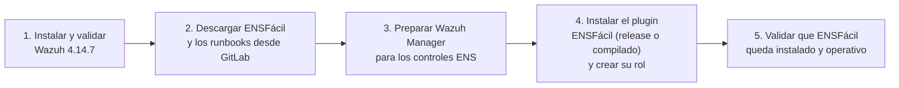

# Instalación completa de ENSFácil desde cero
[English](01-installation-from-scratch.en.md)

[[_TOC_]]

## 1. Objetivo

Esta guía describe el procedimiento para desplegar ENSFácil partiendo de una
máquina limpia, sin depender de ningún servidor ENSFácil previamente preparado.

El objetivo es que el entorno pueda reproducirse utilizando únicamente los
repositorios autorizados de GitLab, la documentación del proyecto y los
artefactos versionados necesarios para el despliegue.

## 2. Punto de partida

Esta ruta parte de una instalación de Ubuntu Server que dispone únicamente de:

- acceso administrativo mediante `sudo`;
- conectividad de red;
- acceso a Internet cuando sea necesario;
- acceso autorizado a los repositorios GitLab del proyecto.

No se presupone que estén previamente instalados o preparados Wazuh, ENSFácil,
el árbol de compilación de OpenSearch Dashboards, Node.js, Yarn, las reglas ENS,
el grupo `ens` ni la configuración inicial de ENSFácil.

> [!important]
> **¿Wazuh corre en contenedores** (imágenes oficiales `wazuh/wazuh-manager` y
> `wazuh/wazuh-dashboard`)? El orden de esta guía vale, pero varios pasos se
> hacen de otra forma (sin `systemctl`, sin `hostname`, sin cron, sin `git`):
> seguir además [Wazuh en Docker](06-wazuh-in-docker.md).
>
> Los enlaces a cada runbook y a sus guías (`01-installation`, `02-compliance`,
> `03-uninstall-and-troubleshooting`), y los registros que crea la organización,
> están en [Runbooks y registros de la organización](05-runbooks-and-registers.md).

## 3. Resultado esperado

Al finalizar esta guía deben quedar instalados y validados Wazuh y ENSFácil:
las reglas del manager, el plugin `ensfacil` instalado en Wazuh
Dashboard junto al plugin oficial de Wazuh (que no se modifica), el rol
`ensfacil_admin` y la configuración inicial necesaria para que ENSFácil pueda
funcionar.

## 4. Principio de reproducibilidad

Una instalación se considera reproducible cuando puede completarse desde una
máquina limpia utilizando únicamente GitLab y esta documentación.

No debe ser necesario copiar manualmente ficheros desde otro servidor ENSFácil
ni depender de una máquina previamente configurada.

## 5. Versiones y compatibilidad

ENSFácil debe desplegarse únicamente sobre combinaciones de versiones que hayan sido validadas.

La combinación utilizada durante la validación inicial de esta guía es:

| Componente | Versión |
|---|---|
| ENSFácil | `1.0.0` |
| Wazuh | `4.14.7` |
| OpenSearch Dashboards | `2.19.5` |
| Node.js para compilación | `18.19.0` |

La matriz de compatibilidad se mantiene en:

[`docs/deployment/03-version-compatibility.md`](03-version-compatibility.md)

> [!note]
> Una nueva versión de Wazuh no debe considerarse compatible automáticamente. ENSFácil no modifica el plugin de Wazuh, pero se compila para una versión exacta de OpenSearch Dashboards: si la versión nueva de Wazuh Dashboard lleva otra, hay que recompilar el plugin y validarlo antes de actualizar.

## 6. Flujo completo de instalación

La instalación de ENSFácil se organiza en cinco bloques principales:



1. Instalar y validar Wazuh 4.14.7.
2. Descargar ENSFácil y los runbooks desde GitLab.
3. Preparar Wazuh Manager para los controles ENS.
4. Instalar el plugin ENSFácil en Wazuh Dashboard, desde una release o compilado, y crear el rol `ensfacil_admin`.
5. Validar que ENSFácil queda instalado y operativo.

Los apartados siguientes desarrollan los comandos y comprobaciones necesarios para cada bloque.

## 7. Regla de validación

Un paso no se considera terminado únicamente porque el comando haya finalizado sin errores.

Cada fase debe incluir una comprobación objetiva que confirme que el resultado esperado existe y funciona.

> [!important]
> Si una validación falla, el despliegue debe detenerse en ese punto. No se continuará con las fases posteriores hasta identificar y resolver la causa.

Siempre que corresponda, cada fase documentará:

- prerrequisitos;
- comandos que deben ejecutarse;
- resultado esperado;
- comprobación de validación;
- acciones recomendadas si la validación falla;
- procedimiento de vuelta atrás cuando exista riesgo de modificar un entorno operativo.

## 8. Preparar y validar la máquina base

### 8.1 Entorno utilizado para validar esta guía

La instalación inicial de esta guía se ha validado sobre el siguiente entorno de laboratorio:

| Recurso | Valor |
|---|---|
| Sistema operativo | Ubuntu Server `24.04.4 LTS` |
| Arquitectura | `x86_64` |
| CPU | 4 CPU lógicas |
| Memoria | 7,8 GiB de RAM |
| Disco | 80 GB de disco virtual |
| Red | conectividad a Internet |
| Acceso | acceso administrativo mediante `sudo` |

> [!note]
> Estos valores describen el entorno de validación y no deben interpretarse como requisitos mínimos de ENSFácil.

La topología de red del laboratorio tampoco es un requisito del producto. La máquina utilizada durante la validación dispone de una interfaz NAT y una interfaz de red de laboratorio.

### 8.2 Comprobaciones previas

Antes de comenzar el despliegue, comprobar el sistema operativo, arquitectura, recursos disponibles, conectividad y herramientas básicas:

```bash
cat /etc/os-release
uname -m
nproc
free -h
df -h /
ip -br addr
ip route
getent hosts gitlab.com
curl -Is --max-time 10 https://gitlab.com | head -1
command -v sudo apt git curl wget python3
```

> [!warning]
> La instalación no debe continuar si no existe acceso administrativo o si la máquina no dispone de la conectividad necesaria para obtener los repositorios y paquetes del despliegue.

## 9. Instalar y validar Wazuh 4.14.7

ENSFácil necesita una instalación funcional y validada de Wazuh antes de instalar el plugin.

Si Wazuh 4.14.7 todavía no está instalado, seguir primero la [Guía de instalación de Wazuh 4.14.7](https://gitlab.com/quersystem/wazuh-4-installation-and-sizing-guide), completando los pasos 1 a 4.

Después de completar los pasos 1 a 4 de la guía de Wazuh, volver a este procedimiento y comprobar que la plataforma central está instalada y operativa antes de continuar con ENSFácil.

### 9.1 Validar la instalación de Wazuh

Comprobar las versiones instaladas:

```bash
dpkg-query -W -f='${Package} ${Version}\n' wazuh-manager wazuh-indexer wazuh-dashboard
```

Comprobar que los servicios principales están activos:

```bash
sudo systemctl is-active wazuh-manager wazuh-indexer wazuh-dashboard filebeat
```

Los cuatro servicios deben devolver `active` antes de continuar.

Para la combinación validada en esta guía, `wazuh-manager`, `wazuh-indexer` y `wazuh-dashboard` deben corresponder a Wazuh `4.14.7` (paquetes `4.14.7-1`). Además, los cuatro servicios anteriores deben estar en estado `active` y el acceso al Dashboard debe haber sido validado según el paso 4 de la guía de instalación de Wazuh.

> [!warning]
> Si alguna de estas comprobaciones falla, no continuar con la instalación de ENSFácil hasta resolver la causa.

## 10. Configurar el acceso autorizado a GitLab

Antes de clonar ENSFácil y los runbooks, comprobar que el servidor dispone de acceso autorizado a los repositorios del proyecto en GitLab.

### 10.1 Validar el acceso al repositorio principal

Comprobar que Git puede acceder mediante SSH al repositorio principal de ENSFácil:

```bash
git ls-remote git@gitlab.com:quersystem/plugin-wazuh-ens.git HEAD
```

La comprobación debe devolver un hash seguido de `HEAD`. Si Git solicita autenticación y no puede acceder al repositorio, no continuar hasta disponer de acceso autorizado.

### 10.2 Clonar el repositorio de ENSFácil

Crear el directorio base de ENSFácil y asignarlo al usuario administrativo que realizará el despliegue:

```bash
sudo mkdir -p /opt/ensfacil
sudo chown "$USER":root /opt/ensfacil
sudo chmod 755 /opt/ensfacil
git clone git@gitlab.com:quersystem/plugin-wazuh-ens.git /opt/ensfacil/repo
```

Después de la clonación, comprobar el repositorio y su remoto:

```bash
git -C /opt/ensfacil/repo remote -v
git -C /opt/ensfacil/repo branch --show-current
git -C /opt/ensfacil/repo status --short
```

### 10.3 Clonar los runbooks ENS

En el servidor Wazuh Manager, clonar los 22 runbooks Linux que se instalan y que usa ENSFácil bajo `/opt/ensfacil`. Esta ubicación mantiene los repositorios de controles junto al repositorio principal, que es donde los busca la comprobación de coherencia del proyecto (`tests/check-consistency.py` los lee como directorios hermanos de `/opt/ensfacil/repo`):

```bash
cat > /opt/ensfacil/runbooks.txt <<'EOF'
mp.info.6
op.acc.1
op.acc.2
op.acc.3
op.acc.4
op.acc.5
op.acc.6
op.exp.1
op.exp.2
op.exp.3
op.exp.4
op.exp.5
op.exp.6
op.exp.7
op.exp.8
op.exp.9
op.exp.10
op.mon.1
op.mon.2
op.mon.3
op.nub.1
op.cont.3
EOF

cd /opt/ensfacil
BASE=git@gitlab.com:quersystem/ens-controls-runbook/linux
while read -r r; do
  git clone "$BASE/$r.git" || break
done < /opt/ensfacil/runbooks.txt
# mp.info.6 tiene además un runbook para Zimbra; comparte las reglas y la
# comprobación de coherencia lo compara también.
git clone git@gitlab.com:quersystem/ens-controls-runbook/zimbra/zimbra-mta/mp.info.6.git zimbra-mta/mp.info.6
```

El fichero `/opt/ensfacil/runbooks.txt` se reutiliza en los pasos siguientes. El runbook de op.cont.2 (`linux/op.cont.2`) es solo documentación y no se clona en el manager: no instala nada, porque el plugin juzga ese control con la pantalla de Configuración.

> [!note]
> Cada runbook se llama exactamente como su control, y el subgrupo dice la plataforma o el rol. Las variantes para el servidor de directorio LDAP de Zimbra (`quersystem/ens-controls-runbook/zimbra/zimbra-ldap`) y para Windows (`quersystem/ens-controls-runbook/windows`) se llaman igual que las de Linux y se clonan en las máquinas correspondientes siguiendo su propia guía. En el manager basta con los runbooks Linux: las reglas son las mismas, byte a byte.

### 10.4 Validar los runbooks clonados

Comprobar que los 22 repositorios clonados existen y apuntan al remoto esperado:

```bash
while read -r r; do
  printf '%-48s %s\n' "$r" "$(git -C "/opt/ensfacil/$r" remote get-url origin 2>&1)"
done < /opt/ensfacil/runbooks.txt
```

Los 22 repositorios deben devolver una URL bajo `git@gitlab.com:quersystem/ens-controls-runbook/linux/` antes de continuar.

## 11. Crear y validar el grupo ENS

> [!note]
> Este apartado crea los grupos en el manager. Cómo se meten los agentes en
> ellos, cómo se comprueba que les llega la configuración y el alcance ENS del
> plugin están, una sola vez, en la [configuración inicial de ENSFácil](https://gitlab.com/quersystem/ens-controls-runbook/initial-setup).

Antes de instalar las reglas de los controles, crear el grupo compartido `ens` en Wazuh Manager y el grupo `ens-copias`, el propio de mp.info.6, en el que solo van las máquinas cuyas copias se miden:

```bash
sudo /var/ossec/bin/agent_groups -a -g ens -q
sudo /var/ossec/bin/agent_groups -a -g ens-copias -q
```

Comprobar que Wazuh ha creado la estructura compartida del grupo:

```bash
sudo test -d /var/ossec/etc/shared/ens && echo "GRUPO_ENS=OK"
sudo test -f /var/ossec/etc/shared/ens/agent.conf && echo "AGENT_CONF_ENS=OK"
sudo grep -c "<agent_config" /var/ossec/etc/shared/ens/agent.conf
sudo test -f /var/ossec/etc/shared/ens-copias/agent.conf && echo "AGENT_CONF_ENS_COPIAS=OK"
sudo grep -c "<agent_config" /var/ossec/etc/shared/ens-copias/agent.conf
```

> [!warning]
> La instalación de las reglas ENS no debe continuar si los grupos `ens` y `ens-copias` o sus `agent.conf` no existen: sin `ens-copias`, el `install-manager.sh` de mp.info.6, el primero del bucle, se detiene.

> [!important]
> El `agent.conf` de cada grupo debe tener **un único bloque `<agent_config>`** (las dos comprobaciones `grep -c` deben devolver `1`: con `0`, sin bloque, los instaladores también se niegan). Los `install-manager.sh` de todos los controles se niegan a modificar un `agent.conf` con más de un bloque. Cualquier ajuste adicional del grupo (por ejemplo un `<syscheck>`) se añade dentro del bloque existente, nunca en un segundo `<agent_config>`. Después de editarlo a mano, validarlo con `sudo /var/ossec/bin/verify-agent-conf -f /var/ossec/etc/shared/ens/agent.conf`.

## 12. Instalar y validar las reglas ENS en el Manager

Con los grupos `ens` y `ens-copias` creados y los runbooks clonados, hacer una copia de la configuración del manager y ejecutar los instaladores del Manager. El proceso se detiene en el primero que falle:

```bash
sudo mkdir -p /opt/ensfacil/artifacts
sudo chown "$USER":root /opt/ensfacil/artifacts
sudo tar czf "/opt/ensfacil/artifacts/manager-$(date +%Y%m%d-%H%M%S).tar.gz" \
  -C /var/ossec etc/rules etc/decoders etc/shared/ens etc/shared/ens-copias etc/ossec.conf

(
while read -r r; do
  echo "===== $r ====="
  sudo bash "/opt/ensfacil/$r/install-manager.sh" || { echo "ERROR: $r"; exit 1; }
done < /opt/ensfacil/runbooks.txt
)
```

`install-manager.sh` de op.exp.7, op.exp.8 y op.exp.9 instala además un recolector que se ejecuta en el propio manager cada hora, sin ninguna credencial (solo lee ficheros locales), y añade su `<localfile>` al `ossec.conf` del manager, porque el `agent.conf` del grupo `ens` no se aplica al manager. Sus hechos llegan con `agent.id=000`.

Los de op.mon.1, op.mon.2, op.mon.3, op.nub.1 y op.cont.3 (versión 1.1.0) hacen lo mismo: cada uno instala su recolector en `/usr/local/bin/` (`ens_opmon1_collect.sh`, `ens_opmon2_collect.sh`, `ens_opmon3_collect.sh`, `ens_opnub1_collect.sh`, `ens_opcont3_collect.sh`), su `<localfile>` en el `ossec.conf` del manager y un cron en `/etc/cron.d`. Necesitan `jq` y respetan `ENSFACIL_SYSTEMCTL`. La cadencia del cron es horaria en op.mon.1, op.mon.3 y op.nub.1, y cada 6 horas en op.mon.2 y op.cont.3; op.mon.1 y op.nub.1 hacen su pasada completa cada 6 horas, y op.mon.3 la hace cada 6 horas (la superficie, cada 12). op.mon.3 tiene además un recolector de agente: su `install.sh`, en cada máquina del grupo `ens`, instala `ens_opmon3_agent_collect.sh` con un cron horario. op.cont.2 no tiene runbook ni reglas: el plugin lo juzga a partir de las tablas de la pantalla. op.cont.2 y op.cont.3 solo aplican con Disponibilidad (D) en ALTO; en MEDIO muestran «No aplica».

### 12.1 Validar la instalación de las reglas

Cada `install-manager.sh` realiza una comprobación bloqueante con `wazuh-logtest`. La instalación se considera correcta cuando se validan las siguientes reglas:

| Control | Regla | Control | Regla |
|---|---|---|---|
| `mp.info.6` | `106601` | `op.exp.3` | `110401` |
| `op.acc.1` | `106873` | `op.exp.4` | `110505` |
| `op.acc.2` | `106902` | `op.exp.5` | `110601` |
| `op.acc.3` | `107001` | `op.exp.6` | `110701` |
| `op.acc.4` | `107106` | `op.exp.7` | `110801` |
| `op.acc.5` | `110001` | `op.exp.8` | `110901` |
| `op.acc.6` | `110101` | `op.exp.9` | `111001` |
| `op.exp.1` | `110205` | `op.exp.10` | `111197` |
| `op.exp.2` | `110304` | `op.mon.1` | `111201` |
| `op.mon.2` | `111301` | `op.mon.3` | `111401` |
| `op.nub.1` | `111501` | `op.cont.3` | `111701` |

En mp.info.6, `install-manager.sh` de los dos runbooks (Proxmox y Zimbra) comprueba con `wazuh-logtest` que casa `106601` (`backup_run`). Después, en el índice, la regla que hay que buscar es `106797` (`collector_run`), el latido que el recolector emite en cada pasada aunque todavía no haya ninguna copia.

Después de ejecutar los instaladores, comprobar también que Wazuh Manager permanece activo, que su configuración es válida y que el plugin y los runbooks son coherentes:

```bash
sudo systemctl is-active wazuh-manager
sudo /var/ossec/bin/wazuh-analysisd -t && echo "CONFIG_MANAGER=OK"
cd /opt/ensfacil/repo && python3 tests/check-consistency.py | tail -1
```

> [!warning]
> El resultado debe ser `active`, `CONFIG_MANAGER=OK` y `coherencia OK`. Si cualquiera de los instaladores falla, no confirma su regla esperada o el Manager no queda activo, detener el despliegue antes de continuar.

> [!important]
> Si un `install-manager.sh` falla **después** de copiar sus reglas, al volver a ejecutarlo no detecta cambios y **no reinicia** el manager, así que las reglas nuevas pueden no estar cargadas aunque el instalador termine bien. En ese caso, reiniciar a mano y confirmar la regla del control con `wazuh-logtest`:
>
> ```bash
> sudo systemctl restart wazuh-manager
> sudo /var/ossec/bin/wazuh-logtest
> ```

## 13. Instalar el plugin

ENSFácil es un plugin propio de Wazuh Dashboard, con el identificador `ensfacil`. Se instala **junto** al plugin oficial de Wazuh, que no se modifica ni se retira.

### 13.1 Elegir de dónde sale el zip

Hay dos formas de conseguir el zip del plugin. Las dos terminan igual, en el apartado 13.4.

| Opción | Cuándo | Guía |
|---|---|---|
| A. Desde una release (por defecto) | hay una release para tu versión de Wazuh | [Instalar desde una release](07-installing-from-a-release.md) |
| B. Compilar desde el código fuente | una versión sin release, la evaluación de otra versión de Wazuh o el desarrollo del plugin | [Compilar desde el código fuente](08-building-from-source.md) |

> [!note]
> Un zip compilado para otra versión de OpenSearch Dashboards no se instala. Para Wazuh 4.14.7 hace falta un zip para OpenSearch Dashboards `2.19.5`.

### 13.2 Opción A: desde una release

Descarga los cuatro ficheros de la release en `/opt/ensfacil/releases/<versión>`, desde el navegador o desde el servidor con un token de despliegue ([guía 07, apartados 4 a 6](07-installing-from-a-release.md#4-preparar-la-carpeta-en-el-servidor)). Después, compruébalos:

```bash
V=1.1.0
R=/opt/ensfacil/releases/$V
cd "$R"
sha256sum -c SHA256SUMS
```

Qué tiene que salir: `OK` en los tres ficheros. Si alguno dice `FAILED`, no sigas.

Sigue en el apartado 13.4 con:

```bash
ZIP=$R/ensfacil-$V-osd-2.19.5.zip
DEPLOY=$R/deploy-plugin.sh
```

### 13.3 Opción B: compilar desde el código fuente

Compila y valida el zip con la [guía 08](08-building-from-source.md): con Node.js 18.19.0, Yarn Classic 1.22.22 y el árbol de OpenSearch Dashboards 2.19.5 en `/opt/ensfacil/build` (apartado 3), o con la imagen de compilación de CI (apartado 4). Valida el zip antes de seguir (apartado 5).

Sigue en el apartado 13.4 con estas rutas. Si compilaste con la imagen en otro equipo, copia el zip al servidor y pon su ruta en `ZIP`:

```bash
ZIP=/opt/ensfacil/build/plugins/ensfacil/build/ensfacil-2.19.5.zip
DEPLOY=/opt/ensfacil/repo/config/deploy-plugin.sh
```

### 13.4 Instalar el plugin en Wazuh Dashboard

Instala el zip con `deploy-plugin.sh`, con `ZIP` y `DEPLOY` del apartado 13.2 o del 13.3:

```bash
sudo -u wazuh-dashboard test -r "$ZIP" && echo "ZIP_ACCESIBLE=OK"

sudo bash "$DEPLOY" "$ZIP"
```

El script para el dashboard, retira la versión anterior de `ensfacil` si la hay, instala el zip, **sube el `build.number` del dashboard** y lo arranca. Solo toca `ensfacil`: el plugin de Wazuh (`wazuh`, `wazuhCore`, `wazuhCheckUpdates`) se queda como está.

Qué tiene que salir, al final: `dashboard: active` y, en `plugins:`, `ensfacil` junto a `wazuh`, `wazuhCore` y `wazuhCheckUpdates`.

Si algo falla, el script dice cómo volver a como estaba y sale con error. Los códigos de salida y las copias que guarda están en el [diagnóstico, apartado 4.1](04-troubleshooting-and-rollback.md#41-si-deploy-pluginsh-falla-a-medias).

> [!important]
> Sin subir el `build.number`, el navegador sigue usando los ficheros de la versión anterior aunque el plugin nuevo esté instalado: la URL de los bundles depende de ese número, no del plugin, y ni una recarga forzada la cambia. Por eso la instalación se hace con el script y no a mano. El script guarda una copia de `package.json` junto al original (`package.json.antes-<fecha>`).

Comprobar:

```bash
sudo systemctl is-active wazuh-dashboard
sudo -u wazuh-dashboard /usr/share/wazuh-dashboard/bin/opensearch-dashboards-plugin list
curl -sk -o /dev/null -w '%{http_code}\n' https://localhost/api/ensfacil/configuration
```

Qué tiene que salir:

| Comprobación | Resultado esperado |
|---|---|
| servicio | `active` |
| plugins | `ensfacil@1.1.0` y `wazuh@4.14.7-01`, entre otros |
| `/api/ensfacil/configuration` | `401`: la ruta del plugin existe y pide sesión. Un `404` significa que el plugin no ha cargado ([diagnóstico](04-troubleshooting-and-rollback.md)) |

### 13.5 Crear el rol ensfacil_admin

> [!note]
> Opcional por ahora. El usuario `admin` de Wazuh, que tiene `all_access`, ya
> puede guardar la configuración sin este rol. Solo hace falta si otro usuario,
> sin `all_access`, tiene que guardarla o ver su historial.

Guardar la configuración ENS y ver su historial solo lo pueden hacer los usuarios con el rol `ensfacil_admin` o `all_access` del plugin de seguridad. Los demás ven la configuración, pero al guardar reciben un error 403: «Hace falta el rol ensfacil_admin o all_access para cambiar la configuración ENS o ver su historial.».

`config/create-admin-role.sh` crea el rol y, si se le pide, lo asigna. Usa el certificado de administrador del indexer, sin contraseña, y comprueba el certificado del indexer contra su CA (`/etc/wazuh-indexer/certs/root-ca.pem`; otra, con `OS_CA`). Habla con `https://127.0.0.1:9200`, el nombre para el que Wazuh hace ese certificado: con `localhost` la comprobación falla.

Con la opción A, la carpeta de la release trae también este script (`$R/create-admin-role.sh`), de la versión de la release y comprobado con `SHA256SUMS`. Puedes usar ese en lugar del del repositorio: las opciones son las mismas.

> [!note]
> El rol no da ningún permiso por sí mismo: es una marca que ENSFácil busca entre los roles del usuario. Para ver los datos, cada usuario necesita además su rol habitual de Wazuh, con lectura de `wazuh-alerts-*` y `wazuh-monitoring-*`.

Primero en modo prueba, que no cambia nada. Sustituir `<usuario>` por el usuario del dashboard que administrará ENSFácil:

```bash
sudo bash /opt/ensfacil/repo/config/create-admin-role.sh --dry-run --mapear <usuario>
```

Qué tiene que salir, si el rol no está asignado todavía a nadie:

```text
== modo prueba: no se envía ningún cambio
== rol ensfacil_admin
PUT _plugins/_security/api/roles/ensfacil_admin {"description":"ENSFácil: puede cambiar la configuración ENS y ver su historial","cluster_permissions":[],"index_permissions":[],"tenant_permissions":[]}
== asignación de ensfacil_admin
PUT _plugins/_security/api/rolesmapping/ensfacil_admin {"users":["<usuario>"]}
```

Si el rol ya está asignado a otros usuarios, la última línea es un `PATCH` que añade `<usuario>` sin quitar a nadie.

Después, de verdad:

```bash
sudo bash /opt/ensfacil/repo/config/create-admin-role.sh --mapear <usuario>
```

Qué tiene que salir: `-> 200` o `-> 201` después de cada petición y, al final, `usuarios con el rol ensfacil_admin: <usuario>`.

- Se puede repetir: el rol se escribe igual y solo se añaden los usuarios que falten.
- Varios usuarios: `--mapear <usuario1> --mapear <usuario2>`.
- Sin `--mapear`, el script solo crea el rol.
- Si el usuario tenía la sesión abierta y sigue recibiendo el 403, que cierre la sesión y vuelva a entrar.

### 13.6 Comprobar ENSFácil en el navegador

Entrar en Wazuh Dashboard y comprobar que:

- en el menú, dentro de «Security operations», aparece «ENSFácil»;
- se abre en la pestaña Panel, con las pestañas Panel, Configuración, Controles, Detalle del control, Informes, Evidencias y Eventos;
- hay un selector «Máquina» para ver todas las máquinas del alcance o una sola.

En una instalación nueva, seguir con el apartado 14: la configuración ENS se crea con el primer guardado.

## 14. Inicializar y sembrar la configuración ENS

Las herramientas de `config/` hablan con el indexer usando el **certificado de administrador del indexer**, que existe en todo manager en `/etc/wazuh-indexer/certs/`. No hace falta conocer ni escribir ninguna contraseña. Se ejecutan con `sudo` porque la clave del certificado solo es legible por `root`:

```bash
CERT="OS_CERT=/etc/wazuh-indexer/certs/admin.pem OS_KEY=/etc/wazuh-indexer/certs/admin-key.pem"
IDX=https://127.0.0.1:9200
```

> [!note]
> Si el indexer no está en la misma máquina, exportar `ENS_OS_URL` con su URL y usar el certificado de administrador de ese indexer. Las herramientas admiten también `OS_USER` y `OS_PASS`, pero no se recomienda: obliga a escribir la contraseña en la sesión.

### 14.1 Crear la configuración activa

En una instalación limpia, el índice `wazuh-ens-configuration` puede existir todavía sin el documento `active`.

Acceder desde Wazuh Dashboard a ENSFácil > Configuración y realizar un primer guardado de la configuración, con un usuario que tenga el rol `ensfacil_admin` o `all_access` (apartado 13.5). Con otro usuario, el guardado devuelve el error 403.

> [!important]
> Abrir únicamente la pantalla no es suficiente: el primer guardado crea el documento `active` que utilizarán el motor y las herramientas de configuración.

Después del guardado, comprobar desde el servidor que el documento existe:

```bash
sudo curl -sk --cert /etc/wazuh-indexer/certs/admin.pem --key /etc/wazuh-indexer/certs/admin-key.pem \
  "$IDX/wazuh-ens-configuration/_doc/active?filter_path=found,_source.documentType&pretty"
```

| Comprobación | Resultado esperado |
|---|---|
| `found` | `true` |
| `_source.documentType` | `ACTIVE_CONFIGURATION` |

> [!warning]
> Si el documento todavía no existe, no ejecutar la siembra de controles hasta completar correctamente el primer guardado desde la pantalla de Configuración.

### 14.2 Copiar el documento antes de modificarlo

Antes de cada siembra o cambio de parámetros, guardar una copia del documento `active`:

```bash
BACKUP_DOC=/opt/ensfacil/artifacts/active-$(date +%Y%m%d-%H%M%S).json
sudo curl -sk --cert /etc/wazuh-indexer/certs/admin.pem --key /etc/wazuh-indexer/certs/admin-key.pem \
  "$IDX/wazuh-ens-configuration/_doc/active" | sudo tee "$BACKUP_DOC" >/dev/null
sudo python3 -c "import json,sys; d=json.load(open(sys.argv[1])); print('COPIA_OK' if d.get('found') else 'COPIA_FALLIDA')" "$BACKUP_DOC"
```

La restauración de esta copia se describe en la [guía de diagnóstico y rollback](04-troubleshooting-and-rollback.md#7-restaurar-la-configuración-ens).

### 14.3 Sembrar los controles ENS

> [!important]
> Sembrar solo con el plugin ya desplegado (apartado 13.4). La versión instalada del plugin tiene que conocer los controles que se siembran.

Sembrar los 23 controles. Primero en modo de prueba (sin `--apply`), que muestra el plan sin escribir nada:

```bash
cd /opt/ensfacil/repo/config
CONTROLS="mp.info.6 op.acc.1 op.acc.2 op.acc.3 op.acc.4 op.acc.5 op.acc.6 op.exp.1 op.exp.2 op.exp.3 op.exp.4 op.exp.5 op.exp.6 op.exp.7 op.exp.8 op.exp.9 op.exp.10 op.mon.1 op.mon.2 op.mon.3 op.nub.1 op.cont.2 op.cont.3"

for c in $CONTROLS; do
  echo "===== $c ====="
  sudo env $CERT python3 inject-control.py "$c" || break
done
```

Revisar el plan de cada control (parámetros nuevos, valores que se conservan y, si aparece, la línea `YA NO EXISTEN en el bloque y se pierden`). Si es correcto, aplicarlo:

```bash
for c in $CONTROLS; do
  echo "===== $c ====="
  sudo env $CERT python3 inject-control.py "$c" --apply || break
done
```

| Comprobación | Resultado esperado |
|---|---|
| Salida de cada control | `== APLICADO ==` |

La operación fusiona la configuración existente y añade los bloques necesarios sin eliminar los valores previamente configurados.

> [!note]
> Las evidencias que dependen de parámetros obligatorios todavía sin valor quedan en `NO_EVALUABLE`, con causa `CONFIGURATION`, y los requisitos que sostienen no se acreditan hasta declarar esos parámetros. La ausencia de información no debe interpretarse como cumplimiento.

### 14.4 Validar el documento entero

Un parámetro con un valor que el plugin no acepta no degrada solo su control: impide cargar el entorno ENS completo y el panel muestra «No se pudo cargar el entorno ENS». Después de cada siembra o cambio de parámetros, validar el documento completo con el mismo validador que usa el plugin (`config/validate-configuration.ts`). Necesita Node.js 18 o superior y acceso a Internet para que `npx` descargue `tsx`:

```bash
sudo curl -sk --cert /etc/wazuh-indexer/certs/admin.pem --key /etc/wazuh-indexer/certs/admin-key.pem \
  "$IDX/wazuh-ens-configuration/_doc/active" -o /opt/ensfacil/artifacts/active-now.json

cd /opt/ensfacil/repo
npx --yes tsx config/validate-configuration.ts /opt/ensfacil/artifacts/active-now.json
```

El resultado debe ser `ESTRUCTURA VÁLIDA` con los 23 controles listados. Si el manager no tiene Node.js con `npx` o no tiene salida a Internet, copiar el fichero `active-now.json` a un puesto que tenga el repositorio del plugin y ejecutar allí el mismo comando (o `docker run --rm -v "$PWD":/w -w /w node:22-alpine npx --yes tsx config/validate-configuration.ts active-now.json`).

> [!warning]
> Si la validación falla, restaurar la copia del apartado 14.2 antes de que nadie abra el panel, y corregir el parámetro indicado.

### 14.5 Declarar la política

Los valores de los parámetros son decisiones del responsable y se declaran en ENSFácil > Configuración. En la tarjeta de configuración global se declara también el nivel ENS y, si procede, el **Nivel de Trazabilidad (T)**, que solo usa op.exp.8 (vacío = el nivel ENS global).

Para declarar valores desde el servidor (entornos reproducibles, o cuando la política ya está decidida por escrito) se usa `config/set-parameters.py` con un fichero JSON:

```json
{
  "op.exp.8": {
    "P-05": ["ntp1.ejemplo.invalido | NTS", "ntp2.ejemplo.invalido | NTS"]
  }
}
```

```bash
cd /opt/ensfacil/repo/config
sudo env $CERT python3 set-parameters.py /ruta/politica.json            # plan
sudo env $CERT python3 set-parameters.py /ruta/politica.json --apply    # escribe
```

> [!important]
> `set-parameters.py` sustituye el valor **entero** de cada parámetro que nombra: una lista o tabla no se amplía, se reemplaza. Para añadir una fila hay que pasar la lista completa (las filas que ya había más la nueva). Los parámetros que el fichero no nombra no se tocan. Si el fichero nombra un parámetro que el control no declara, la herramienta se detiene sin escribir nada.

> [!note]
> Un parámetro vacío es la clave `value` **ausente**, nunca `null`. Para vaciar un parámetro, hacerlo desde la pantalla de Configuración.

Después de declarar valores, repetir la validación del apartado 14.4.

### 14.6 Comprobar el panel

Abrir ENSFácil y comprobar que:

- aparecen los 23 controles;
- el alcance incluye, además de las máquinas del grupo `ens`, el manager (agente `000`), porque op.exp.7, op.exp.8, op.exp.9, op.mon.1, op.mon.2, op.mon.3, op.nub.1 y op.cont.3 se miden en él;
- tras la primera ejecución de los recolectores del manager (horaria o cada 6 horas, según el control), esos controles muestran datos en la fila del manager.

Los agentes se incorporan después, instalando en cada máquina los runbooks que le correspondan según su propia guía (`docs/deployment/01-installation.md` **de cada runbook**, enlazada en la [tabla de runbooks](05-runbooks-and-registers.md#runbooks-por-control)); las máquinas cuyas copias se miden van además al grupo `ens-copias` y a P-04 de mp.info.6. Los runbooks de op.exp.5, op.exp.8 y op.exp.10 escriben reglas de auditd que hay que cargar con `sudo augenrules --load` al terminar.
