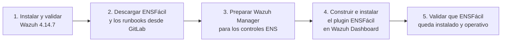

# Instalación completa de ENSFácil desde cero
[English](01-installation-from-scratch.en.md)

[[_TOC_]]

## 1. Objetivo

Esta guía describe el procedimiento para desplegar ENSFácil partiendo de una
máquina limpia, sin depender de ningún servidor ENSFácil previamente preparado.

El objetivo es que el entorno pueda reproducirse utilizando únicamente los
repositorios autorizados de GitLab, la documentación del proyecto y los
artefactos versionados necesarios para el despliegue.

## 2. Punto de partida

Esta ruta parte de una instalación de Ubuntu Server que dispone únicamente de:

- acceso administrativo mediante `sudo`;
- conectividad de red;
- acceso a Internet cuando sea necesario;
- acceso autorizado a los repositorios GitLab del proyecto.

No se presupone que estén previamente instalados o preparados Wazuh, ENSFácil,
el árbol de compilación de Wazuh Dashboard, Node.js, Yarn, las reglas ENS, el
grupo `ens` ni la configuración inicial de ENSFácil.

## 3. Resultado esperado

Al finalizar esta guía deben quedar instalados, integrados y validados Wazuh y
ENSFácil, incluyendo las reglas del manager, la integración con Wazuh Dashboard,
el plugin compilado e instalado y la configuración inicial necesaria para que
ENSFácil pueda funcionar.

## 4. Principio de reproducibilidad

Una instalación se considera reproducible cuando puede completarse desde una
máquina limpia utilizando únicamente GitLab y esta documentación.

No debe ser necesario copiar manualmente ficheros desde otro servidor ENSFácil
ni depender de una máquina previamente configurada.

## 5. Versiones y compatibilidad

ENSFácil debe desplegarse únicamente sobre combinaciones de versiones que hayan sido validadas.

La combinación utilizada durante la validación inicial de esta guía es:

| Componente | Versión |
|---|---|
| Wazuh | `4.14.7` |
| OpenSearch Dashboards | `2.19.5` |
| Node.js para compilación | `18.19.0` |

La matriz de compatibilidad se mantiene en:

[`docs/deployment/03-version-compatibility.md`](03-version-compatibility.md)

> [!note]
> Una nueva versión de Wazuh no debe considerarse compatible automáticamente. Antes de utilizarla deben comprobarse los puntos de integración de ENSFácil, recompilar el plugin y ejecutar las validaciones definidas para el despliegue.

## 6. Flujo completo de instalación

La instalación de ENSFácil se organiza en cinco bloques principales:



1. Instalar y validar Wazuh 4.14.7.
2. Descargar ENSFácil y los runbooks desde GitLab.
3. Preparar Wazuh Manager para los controles ENS.
4. Construir e instalar el plugin ENSFácil en Wazuh Dashboard.
5. Validar que ENSFácil queda instalado y operativo.

Los apartados siguientes desarrollan los comandos y comprobaciones necesarios para cada bloque.

## 7. Regla de validación

Un paso no se considera terminado únicamente porque el comando haya finalizado sin errores.

Cada fase debe incluir una comprobación objetiva que confirme que el resultado esperado existe y funciona.

> [!important]
> Si una validación falla, el despliegue debe detenerse en ese punto. No se continuará con las fases posteriores hasta identificar y resolver la causa.

Siempre que corresponda, cada fase documentará:

- prerrequisitos;
- comandos que deben ejecutarse;
- resultado esperado;
- comprobación de validación;
- acciones recomendadas si la validación falla;
- procedimiento de vuelta atrás cuando exista riesgo de modificar un entorno operativo.

## 8. Preparar y validar la máquina base

### 8.1 Entorno utilizado para validar esta guía

La instalación inicial de esta guía se ha validado sobre el siguiente entorno de laboratorio:

| Recurso | Valor |
|---|---|
| Sistema operativo | Ubuntu Server `24.04.4 LTS` |
| Arquitectura | `x86_64` |
| CPU | 4 CPU lógicas |
| Memoria | 7,8 GiB de RAM |
| Disco | 80 GB de disco virtual |
| Red | conectividad a Internet |
| Acceso | acceso administrativo mediante `sudo` |

> [!note]
> Estos valores describen el entorno de validación y no deben interpretarse como requisitos mínimos de ENSFácil.

La topología de red del laboratorio tampoco es un requisito del producto. La máquina utilizada durante la validación dispone de una interfaz NAT y una interfaz de red de laboratorio.

### 8.2 Comprobaciones previas

Antes de comenzar el despliegue, comprobar el sistema operativo, arquitectura, recursos disponibles, conectividad y herramientas básicas:

```bash
cat /etc/os-release
uname -m
nproc
free -h
df -h /
ip -br addr
ip route
getent hosts gitlab.com
curl -Is --max-time 10 https://gitlab.com | head -1
command -v sudo apt git curl wget python3
```

> [!warning]
> La instalación no debe continuar si no existe acceso administrativo o si la máquina no dispone de la conectividad necesaria para obtener los repositorios y paquetes del despliegue.

## 9. Instalar y validar Wazuh 4.14.7

ENSFácil necesita una instalación funcional y validada de Wazuh antes de continuar con la integración del plugin.

Si Wazuh 4.14.7 todavía no está instalado, seguir primero la [Guía de instalación de Wazuh 4.14.7](https://gitlab.com/quersystem/wazuh-4-installation-and-sizing-guide), completando los pasos 1 a 4.

Después de completar los pasos 1 a 4 de la guía de Wazuh, volver a este procedimiento y comprobar que la plataforma central está instalada y operativa antes de continuar con ENSFácil.

### 9.1 Validar la instalación de Wazuh

Comprobar las versiones instaladas:

```bash
dpkg-query -W -f='${Package} ${Version}\n' wazuh-manager wazuh-indexer wazuh-dashboard
```

Comprobar que los servicios principales están activos:

```bash
sudo systemctl is-active wazuh-manager wazuh-indexer wazuh-dashboard filebeat
```

Los cuatro servicios deben devolver `active` antes de continuar.

Para la combinación validada en esta guía, `wazuh-manager`, `wazuh-indexer` y `wazuh-dashboard` deben corresponder a Wazuh `4.14.7` (paquetes `4.14.7-1`). Además, los cuatro servicios anteriores deben estar en estado `active` y el acceso al Dashboard debe haber sido validado según el paso 4 de la guía de instalación de Wazuh.

> [!warning]
> Si alguna de estas comprobaciones falla, no continuar con la instalación de ENSFácil hasta resolver la causa.

## 10. Configurar el acceso autorizado a GitLab

Antes de clonar ENSFácil y los runbooks, comprobar que el servidor dispone de acceso autorizado a los repositorios del proyecto en GitLab.

### 10.1 Validar el acceso al repositorio principal

Comprobar que Git puede acceder mediante SSH al repositorio principal de ENSFácil:

```bash
git ls-remote git@gitlab.com:quersystem/plugin-wazuh-ens.git HEAD
```

La comprobación debe devolver un hash seguido de `HEAD`. Si Git solicita autenticación y no puede acceder al repositorio, no continuar hasta disponer de acceso autorizado.

### 10.2 Clonar el repositorio de ENSFácil

Crear el directorio base de ENSFácil y asignarlo al usuario administrativo que realizará el despliegue:

```bash
sudo mkdir -p /opt/ensfacil
sudo chown "$USER":root /opt/ensfacil
sudo chmod 755 /opt/ensfacil
git clone git@gitlab.com:quersystem/plugin-wazuh-ens.git /opt/ensfacil/repo
```

Después de la clonación, comprobar el repositorio y su remoto:

```bash
git -C /opt/ensfacil/repo remote -v
git -C /opt/ensfacil/repo branch --show-current
git -C /opt/ensfacil/repo status --short
```

### 10.3 Clonar los runbooks ENS

En el servidor Wazuh Manager, clonar los diecisiete runbooks Linux utilizados por ENSFácil bajo `/opt/ensfacil`. Esta ubicación mantiene los repositorios de controles junto al repositorio principal, que es donde los busca la comprobación de coherencia del proyecto (`tests/check-consistency.py` los lee como directorios hermanos de `/opt/ensfacil/repo`):

```bash
cat > /opt/ensfacil/runbooks.txt <<'EOF'
mp.info.6-proxmox-backup-runbook
op.acc.1-identification
op.acc.2-access-requirements
op.acc.3-segregation-of-duties-and-tasks
op.acc.4-access-rights-management-process
op.acc.5-external-users-authentication
op.acc.6-organization-users-authentication
op.exp.1-asset-inventory
op.exp.2-security-configuration
op.exp.3-security-configuration-management
op.exp.4-security-maintenance-and-updates
op.exp.5-change-management
op.exp.6-malware-protection
op.exp.7-incident-management
op.exp.8-activity-logging
op.exp.9-incident-management-records
op.exp.10-cryptographic-key-protection
EOF

cd /opt/ensfacil
BASE=git@gitlab.com:quersystem/ens-controls-runbook/linux
while read -r r; do
  git clone "$BASE/$r.git" || break
done < /opt/ensfacil/runbooks.txt
```

El fichero `/opt/ensfacil/runbooks.txt` se reutiliza en los pasos siguientes.

> [!note]
> Las variantes para el servidor de directorio LDAP de Zimbra (`quersystem/ens-controls-runbook/zimbra/zimbra-ldap`, sufijo `-ldap`) y para Windows (`quersystem/ens-controls-runbook/windows`, sufijo `-windows`) se clonan en las máquinas correspondientes siguiendo su propia guía. En el manager basta con los runbooks Linux: las reglas son las mismas, byte a byte.

### 10.4 Validar los runbooks clonados

Comprobar que los diecisiete repositorios existen y apuntan al remoto esperado:

```bash
while read -r r; do
  printf '%-48s %s\n' "$r" "$(git -C "/opt/ensfacil/$r" remote get-url origin 2>&1)"
done < /opt/ensfacil/runbooks.txt
```

Los diecisiete repositorios deben devolver una URL bajo `git@gitlab.com:quersystem/ens-controls-runbook/linux/` antes de continuar.

## 11. Crear y validar el grupo ENS

Antes de instalar las reglas de los controles, crear el grupo compartido `ens` en Wazuh Manager:

```bash
sudo /var/ossec/bin/agent_groups -a -g ens -q
```

Comprobar que Wazuh ha creado la estructura compartida del grupo:

```bash
sudo test -d /var/ossec/etc/shared/ens && echo "GRUPO_ENS=OK"
sudo test -f /var/ossec/etc/shared/ens/agent.conf && echo "AGENT_CONF_ENS=OK"
sudo grep -c "<agent_config" /var/ossec/etc/shared/ens/agent.conf
```

> [!warning]
> La instalación de las reglas ENS no debe continuar si el grupo `ens` o su `agent.conf` no existen.

> [!important]
> El `agent.conf` del grupo `ens` debe tener **un único bloque `<agent_config>`** (la última comprobación debe devolver `0` o `1`). Los `install-manager.sh` de todos los controles se niegan a modificar un `agent.conf` con más de un bloque. Cualquier ajuste adicional del grupo (por ejemplo un `<syscheck>`) se añade dentro del bloque existente, nunca en un segundo `<agent_config>`. Después de editarlo a mano, validarlo con `sudo /var/ossec/bin/verify-agent-conf -f /var/ossec/etc/shared/ens/agent.conf`.

## 12. Instalar y validar las reglas ENS en el Manager

Con el grupo `ens` creado y los runbooks clonados, hacer una copia de la configuración del manager y ejecutar los instaladores del Manager. El proceso se detiene en el primero que falle:

```bash
sudo mkdir -p /opt/ensfacil/artifacts
sudo chown "$USER":root /opt/ensfacil/artifacts
sudo tar czf "/opt/ensfacil/artifacts/manager-$(date +%Y%m%d-%H%M%S).tar.gz" \
  -C /var/ossec etc/rules etc/decoders etc/shared/ens etc/ossec.conf

(
while read -r r; do
  echo "===== $r ====="
  sudo bash "/opt/ensfacil/$r/install-manager.sh" || { echo "ERROR: $r"; exit 1; }
done < /opt/ensfacil/runbooks.txt
)
```

`install-manager.sh` de op.exp.7, op.exp.8 y op.exp.9 instala además un recolector que se ejecuta en el propio manager cada hora, sin ninguna credencial (solo lee ficheros locales), y añade su `<localfile>` al `ossec.conf` del manager, porque el `agent.conf` del grupo `ens` no se aplica al manager. Sus hechos llegan con `agent.id=000`.

### 12.1 Validar la instalación de las reglas

Cada `install-manager.sh` realiza una comprobación bloqueante con `wazuh-logtest`. La instalación se considera correcta cuando se validan las siguientes reglas:

| Control | Regla | Control | Regla |
|---|---|---|---|
| `mp.info.6` | `106797` | `op.exp.3` | `110401` |
| `op.acc.1` | `106873` | `op.exp.4` | `110505` |
| `op.acc.2` | `106902` | `op.exp.5` | `110601` |
| `op.acc.3` | `107001` | `op.exp.6` | `110701` |
| `op.acc.4` | `107106` | `op.exp.7` | `110801` |
| `op.acc.5` | `110001` | `op.exp.8` | `110901` |
| `op.acc.6` | `110101` | `op.exp.9` | `111001` |
| `op.exp.1` | `110205` | `op.exp.10` | `111197` |
| `op.exp.2` | `110304` | | |

En mp.info.6 la regla que se valida es la del latido del recolector (`106797`, `collector_run`), que llega en cada pasada. Cuando la máquina ya tiene una copia hecha, se valida además `106601` (`backup_run`).

Después de ejecutar los instaladores, comprobar también que Wazuh Manager permanece activo, que su configuración es válida y que el plugin y los runbooks son coherentes:

```bash
sudo systemctl is-active wazuh-manager
sudo /var/ossec/bin/wazuh-analysisd -t && echo "CONFIG_MANAGER=OK"
cd /opt/ensfacil/repo && python3 tests/check-consistency.py | tail -1
```

> [!warning]
> El resultado debe ser `active`, `CONFIG_MANAGER=OK` y `coherencia OK`. Si cualquiera de los instaladores falla, no confirma su regla esperada o el Manager no queda activo, detener el despliegue antes de continuar.

> [!important]
> Si un `install-manager.sh` falla **después** de copiar sus reglas, al volver a ejecutarlo no detecta cambios y **no reinicia** el manager, así que las reglas nuevas pueden no estar cargadas aunque el instalador termine bien. En ese caso, reiniciar a mano y confirmar la regla del control con `wazuh-logtest`:
>
> ```bash
> sudo systemctl restart wazuh-manager
> sudo /var/ossec/bin/wazuh-logtest
> ```

## 13. Construir e instalar el plugin ENSFácil

La compilación del plugin debe realizarse con Node.js `18.19.0` y Yarn Classic `1.22.22`.

### 13.1 Preparar Node.js y Yarn

Antes de preparar el árbol de compilación, comprobar las versiones disponibles:

```bash
curl -o- https://raw.githubusercontent.com/nvm-sh/nvm/v0.40.7/install.sh | bash

export NVM_DIR="$HOME/.nvm"
[ -s "$NVM_DIR/nvm.sh" ] && . "$NVM_DIR/nvm.sh"

nvm install 18.19.0
nvm use 18.19.0
npm install --global yarn@1.22.22
```

Validar las versiones antes de continuar:

```bash
node --version
yarn --version
```

El resultado esperado es Node.js `v18.19.0` y Yarn `1.22.22`. Si las versiones no coinciden, no continuar con la compilación.

> [!note]
> Wazuh Dashboard 4.14.7 incluye su propio Node.js `18.19.0` en `/usr/share/wazuh-dashboard/node/bin/node`. Si no se quiere instalar Node.js con nvm, puede usarse ese binario anteponiendo `/usr/share/wazuh-dashboard/node/bin` al `PATH`; Yarn Classic `1.22.22` tiene que estar igualmente en el `PATH` (el procedimiento se muestra en el apartado 13.5).

### 13.2 Preparar el árbol de Wazuh Dashboard 4.14.7

Clonar la versión validada de Wazuh Dashboard en el directorio de compilación:

```bash
sudo mkdir -p /opt/ensfacil/build
sudo chown "$USER":root /opt/ensfacil/build
git clone --branch v4.14.7 --depth 1 https://github.com/wazuh/wazuh-dashboard.git /opt/ensfacil/build
```

Comprobar que se ha obtenido exactamente la versión esperada:

```bash
git -C /opt/ensfacil/build rev-parse HEAD
git -C /opt/ensfacil/build describe --tags --exact-match HEAD
```

El tag debe ser `v4.14.7`.

Instalar las dependencias y preparar el árbol de OpenSearch Dashboards:

```bash
cd /opt/ensfacil/build
yarn osd bootstrap
```

El proceso debe finalizar mostrando `bootstrap complete`. Los avisos de dependencias que no detengan el proceso no se consideran por sí solos un fallo.

### 13.3 Incorporar el plugin oficial de Wazuh 4.14.7

Clonar la misma versión del repositorio oficial de plugins de Wazuh:

```bash
git clone --branch v4.14.7 --depth 1 https://github.com/wazuh/wazuh-dashboard-plugins.git /opt/ensfacil/build/plugins/wazuh-dashboard-plugins
```

Comprobar la versión obtenida:

```bash
git -C /opt/ensfacil/build/plugins/wazuh-dashboard-plugins describe --tags --exact-match HEAD
```

El resultado debe ser `v4.14.7`.

Copiar el plugin principal al árbol de compilación:

```bash
cp -a /opt/ensfacil/build/plugins/wazuh-dashboard-plugins/plugins/main /opt/ensfacil/build/plugins/main
```

Instalar las dependencias declaradas por el plugin utilizando su lockfile:

```bash
cd /opt/ensfacil/build/plugins/main
YARN_IGNORE_ENGINES=1 yarn install --frozen-lockfile
```

La instalación debe finalizar sin errores antes de continuar.

### 13.4 Integrar ENSFácil en el plugin Wazuh

Definir las rutas utilizadas durante la integración:

```bash
REPO=/opt/ensfacil/repo
TARGET=/opt/ensfacil/build/plugins/main
PKG=$REPO/integration/wazuh-dashboard
```

Validar primero la integridad del paquete de integración:

```bash
( cd "$PKG" && sha256sum -c SHA256SUMS )
```

Incorporar el núcleo ENS al plugin:

```bash
mkdir -p "$TARGET/public/components/overview"
cp -a "$REPO/dashboard/ens" "$TARGET/public/components/overview/"
```

Comprobar la compatibilidad antes de realizar cambios:

```bash
"$PKG/check-integration.sh" "$TARGET"
```

Para una instalación limpia de Wazuh 4.14.7 deben aparecer `PATCHES_APLICABLES=10`, `FICHEROS_AUSENTES=7`, ausencia de conflictos y `RESULTADO=COMPATIBLE`.

Aplicar la integración ENSFácil:

```bash
"$PKG/apply-integration.sh" "$TARGET"
```

El proceso debe finalizar con `RESULTADO=INTEGRACION_APLICADA` y `REJECTS=0`.

Comprobar nuevamente el estado de la integración:

```bash
"$PKG/check-integration.sh" "$TARGET"
```

Después de la integración deben aparecer `PATCHES_YA_APLICADOS=10`, `FICHEROS_YA_PRESENTES=7`, ausencia de conflictos y `RESULTADO=COMPATIBLE`.

### 13.5 Compilar y validar el plugin

Seleccionar la versión de Node.js validada y compilar el plugin. La compilación completa tarda varios minutos; conviene guardar su salida en un fichero de `/opt/ensfacil/artifacts`:

```bash
nvm use 18.19.0
cd /opt/ensfacil/build/plugins/main

YARN_IGNORE_ENGINES=1 node ../../scripts/plugin_helpers build \
  --opensearch-dashboards-version=2.19.5 2>&1 | tee /opt/ensfacil/artifacts/build.log
```

Si la compilación se ejecuta como `root` (por ejemplo, porque el árbol pertenece a `root`), hacen falta dos cosas más: la opción `--allow-root` y que `yarn` esté en el `PATH` de `root`. Sin `yarn`, el proceso compila el bundle entero y muere en el último paso con `ENOENT: yarn install --production`. Con el Node.js que incluye Wazuh Dashboard:

```bash
cd /opt/ensfacil/build/plugins/main
YARN_BIN=$(dirname "$(command -v yarn)")    # directorio de yarn del usuario que despliega
P=/usr/share/wazuh-dashboard/node/bin:$YARN_BIN:/usr/local/sbin:/usr/local/bin:/usr/sbin:/usr/bin:/sbin:/bin

sudo env PATH="$P" YARN_IGNORE_ENGINES=1 node ../../scripts/plugin_helpers build \
  --allow-root --opensearch-dashboards-version=2.19.5 > /opt/ensfacil/artifacts/build.log 2>&1
```

> [!warning]
> No redirigir la salida de una compilación como `root` a un fichero de `/tmp` creado por otro usuario: con la protección `protected_regular` del kernel, `root` no puede escribir en él y la compilación termina al instante con código 1 sin mensaje útil. Usar `/opt/ensfacil/artifacts`.

La compilación debe finalizar generando el fichero `build/wazuh-2.19.5.zip`.

Validar que el artefacto existe, que el ZIP no contiene errores y que lleva el código de esta versión:

```bash
test -f build/wazuh-2.19.5.zip && echo "ZIP_GENERADO=OK"
unzip -t build/wazuh-2.19.5.zip | tail -1
sha256sum build/wazuh-2.19.5.zip
unzip -p build/wazuh-2.19.5.zip "*.js" | grep -c "op.exp.10"
```

El resultado de `unzip -t` debe indicar que no se han detectado errores y el último recuento debe ser mayor que `0`. El hash SHA-256 puede conservarse como referencia de integridad del artefacto generado.

> [!warning]
> Si el ZIP no existe o la comprobación de integridad falla, no continuar con la instalación en Wazuh Dashboard.

### 13.6 Instalar el plugin en Wazuh Dashboard

Instalar el artefacto con `config/deploy-plugin.sh`. El script para el dashboard, retira únicamente el plugin `wazuh` (con rutas exactas, conservando `wazuhCore` y `wazuhCheckUpdates`), instala el ZIP y **sube el `build.number` del dashboard** antes de arrancarlo:

```bash
ZIP=/opt/ensfacil/build/plugins/main/build/wazuh-2.19.5.zip
sudo -u wazuh-dashboard test -r "$ZIP" && echo "ZIP_ACCESIBLE=OK"

sudo bash /opt/ensfacil/repo/config/deploy-plugin.sh "$ZIP"
```

> [!important]
> Sin subir el `build.number`, el navegador sigue usando los ficheros de la versión anterior aunque el plugin nuevo esté instalado: la URL de los bundles depende de ese número, no del plugin, y ni una recarga forzada la cambia. Por eso la instalación se hace con el script y no a mano. El script guarda una copia de `package.json` junto al original (`package.json.antes-<fecha>`).

> [!warning]
> No utilizar comodines como `wazuh*` si alguna vez se retira el plugin a mano, ya que podrían eliminar también `wazuhCore` y `wazuhCheckUpdates`.

Comprobar que el servicio vuelve a quedar activo y consultar el inventario de plugins:

```bash
sudo systemctl is-active wazuh-dashboard
sudo -u wazuh-dashboard /usr/share/wazuh-dashboard/bin/opensearch-dashboards-plugin list
```

Wazuh Dashboard debe devolver `active` y el plugin `wazuh` debe aparecer instalado antes de continuar.

## 14. Inicializar y sembrar la configuración ENS

Las herramientas de `config/` hablan con el indexer usando el **certificado de administrador del indexer**, que existe en todo manager en `/etc/wazuh-indexer/certs/`. No hace falta conocer ni escribir ninguna contraseña. Se ejecutan con `sudo` porque la clave del certificado solo es legible por `root`:

```bash
CERT="OS_CERT=/etc/wazuh-indexer/certs/admin.pem OS_KEY=/etc/wazuh-indexer/certs/admin-key.pem"
IDX=https://127.0.0.1:9200
```

> [!note]
> Si el indexer no está en la misma máquina, exportar `ENS_OS_URL` con su URL y usar el certificado de administrador de ese indexer. Las herramientas admiten también `OS_USER` y `OS_PASS`, pero no se recomienda: obliga a escribir la contraseña en la sesión.

### 14.1 Crear la configuración activa

En una instalación limpia, el índice `wazuh-ens-configuration` puede existir todavía sin el documento `active`.

Acceder desde Wazuh Dashboard a ENSFácil > Configuración y realizar un primer guardado de la configuración.

> [!important]
> Abrir únicamente la pantalla no es suficiente: el primer guardado crea el documento `active` que utilizarán el motor y las herramientas de configuración.

Después del guardado, comprobar desde el servidor que el documento existe:

```bash
sudo curl -sk --cert /etc/wazuh-indexer/certs/admin.pem --key /etc/wazuh-indexer/certs/admin-key.pem \
  "$IDX/wazuh-ens-configuration/_doc/active?filter_path=found,_source.documentType&pretty"
```

| Comprobación | Resultado esperado |
|---|---|
| `found` | `true` |
| `_source.documentType` | `ACTIVE_CONFIGURATION` |

> [!warning]
> Si el documento todavía no existe, no ejecutar la siembra de controles hasta completar correctamente el primer guardado desde la pantalla de Configuración.

### 14.2 Copiar el documento antes de modificarlo

Antes de cada siembra o cambio de parámetros, guardar una copia del documento `active`:

```bash
BACKUP_DOC=/opt/ensfacil/artifacts/active-$(date +%Y%m%d-%H%M%S).json
sudo curl -sk --cert /etc/wazuh-indexer/certs/admin.pem --key /etc/wazuh-indexer/certs/admin-key.pem \
  "$IDX/wazuh-ens-configuration/_doc/active" | sudo tee "$BACKUP_DOC" >/dev/null
sudo python3 -c "import json,sys; d=json.load(open(sys.argv[1])); print('COPIA_OK' if d.get('found') else 'COPIA_FALLIDA')" "$BACKUP_DOC"
```

La restauración de esta copia se describe en la [guía de diagnóstico y rollback](04-troubleshooting-and-rollback.md#8-restaurar-la-configuración-ens).

### 14.3 Sembrar los controles ENS

> [!important]
> Sembrar solo con el plugin ya desplegado (apartado 13.6). La versión instalada del plugin tiene que conocer los controles que se siembran.

Sembrar los diecisiete controles. Primero en modo de prueba (sin `--apply`), que muestra el plan sin escribir nada:

```bash
cd /opt/ensfacil/repo/config
CONTROLS="mp.info.6 op.acc.1 op.acc.2 op.acc.3 op.acc.4 op.acc.5 op.acc.6 op.exp.1 op.exp.2 op.exp.3 op.exp.4 op.exp.5 op.exp.6 op.exp.7 op.exp.8 op.exp.9 op.exp.10"

for c in $CONTROLS; do
  echo "===== $c ====="
  sudo env $CERT python3 inject-control.py "$c" || break
done
```

Revisar el plan de cada control (parámetros nuevos, valores que se conservan y, si aparece, la línea `YA NO EXISTEN en el bloque y se pierden`). Si es correcto, aplicarlo:

```bash
for c in $CONTROLS; do
  echo "===== $c ====="
  sudo env $CERT python3 inject-control.py "$c" --apply || break
done
```

| Comprobación | Resultado esperado |
|---|---|
| Salida de cada control | `== APLICADO ==` |

La operación fusiona la configuración existente y añade los bloques necesarios sin eliminar los valores previamente configurados.

> [!note]
> Las evidencias que dependen de parámetros obligatorios todavía sin valor quedan en `NO_EVALUABLE`, con causa `CONFIGURATION`, y los requisitos que sostienen no se acreditan hasta declarar esos parámetros. La ausencia de información no debe interpretarse como cumplimiento.

### 14.4 Validar el documento entero

Un parámetro con un valor que el plugin no acepta no degrada solo su control: impide cargar el entorno ENS completo y el panel muestra «No se pudo cargar el entorno ENS». Después de cada siembra o cambio de parámetros, validar el documento completo con el mismo validador que usa el plugin (`config/validate-configuration.ts`). Necesita Node.js 18 o superior y acceso a Internet para que `npx` descargue `tsx`:

```bash
sudo curl -sk --cert /etc/wazuh-indexer/certs/admin.pem --key /etc/wazuh-indexer/certs/admin-key.pem \
  "$IDX/wazuh-ens-configuration/_doc/active" -o /opt/ensfacil/artifacts/active-now.json

cd /opt/ensfacil/repo
npx --yes tsx config/validate-configuration.ts /opt/ensfacil/artifacts/active-now.json
```

El resultado debe ser `ESTRUCTURA VÁLIDA` con los diecisiete controles listados. Si el manager no tiene Node.js con `npx` o no tiene salida a Internet, copiar el fichero `active-now.json` a un puesto que tenga el repositorio del plugin y ejecutar allí el mismo comando (o `docker run --rm -v "$PWD":/w -w /w node:22-alpine npx --yes tsx config/validate-configuration.ts active-now.json`).

> [!warning]
> Si la validación falla, restaurar la copia del apartado 14.2 antes de que nadie abra el panel, y corregir el parámetro indicado.

### 14.5 Declarar la política

Los valores de los parámetros son decisiones del responsable y se declaran en ENSFácil > Configuración. En la tarjeta de configuración global se declara también el nivel ENS y, si procede, el **Nivel de Trazabilidad (T)**, que solo usa op.exp.8 (vacío = el nivel ENS global).

Para declarar valores desde el servidor (entornos reproducibles, o cuando la política ya está decidida por escrito) se usa `config/set-parameters.py` con un fichero JSON:

```json
{
  "op.exp.8": {
    "P-05": ["ntp1.ejemplo.invalido | NTS", "ntp2.ejemplo.invalido | NTS"]
  }
}
```

```bash
cd /opt/ensfacil/repo/config
sudo env $CERT python3 set-parameters.py /ruta/politica.json            # plan
sudo env $CERT python3 set-parameters.py /ruta/politica.json --apply    # escribe
```

> [!important]
> `set-parameters.py` sustituye el valor **entero** de cada parámetro que nombra: una lista o tabla no se amplía, se reemplaza. Para añadir una fila hay que pasar la lista completa (las filas que ya había más la nueva). Los parámetros que el fichero no nombra no se tocan. Si el fichero nombra un parámetro que el control no declara, la herramienta se detiene sin escribir nada.

> [!note]
> Un parámetro vacío es la clave `value` **ausente**, nunca `null`. Para vaciar un parámetro, hacerlo desde la pantalla de Configuración.

Después de declarar valores, repetir la validación del apartado 14.4.

### 14.6 Comprobar el panel

Abrir ENSFácil y comprobar que:

- aparecen los diecisiete controles;
- el alcance incluye, además de las máquinas del grupo `ens`, el manager (agente `000`), porque op.exp.7, op.exp.8 y op.exp.9 se miden en él;
- tras la primera ejecución horaria de los recolectores del manager, op.exp.7, op.exp.8 y op.exp.9 muestran datos en la fila del manager.

Los agentes se incorporan después, instalando en cada máquina los runbooks que le correspondan según su propia guía (`docs/deployment/01-installation.md` de cada runbook). Los runbooks de op.exp.5, op.exp.8 y op.exp.10 escriben reglas de auditd que hay que cargar con `sudo augenrules --load` al terminar.
