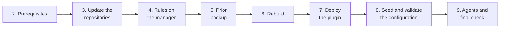

# Updating ENSFácil in an existing environment
[Español](02-updating-an-existing-environment.md)

[[_TOC_]]

## 1. Objective

This guide describes how to update ENSFácil when Wazuh and a previous version of the plugin are already installed and working, including the case where the new version brings new controls.

There are two cases:

| The environment has | What to follow |
|---|---|
| The `ensfacil` plugin (the «ENSFácil» app in the menu) | sections 2 to 9 |
| The integrated version (the modified Wazuh plugin, with the «ENS» app in the menu) | section 10, [Transition from the integrated version](#10-transition-from-the-integrated-version) |



> [!important]
> Order matters: the new plugin is deployed (section 7) **before** seeding the configuration of the new controls (section 8). The installed plugin validates the configuration document with its own rules, which do not know the new controls or parameter types: seeding first can leave the whole dashboard unable to load.

## 2. Prerequisites

The following conditions must be met before starting:

| Requirement |
|---|
| Wazuh Dashboard 4.14.7 installed and operational. |
| `ensfacil` plugin installed. If the environment has the integrated version, go to section 10. |
| OpenSearch Dashboards 2.19.5 tree in `/opt/ensfacil/build` ([installation guide, section 13.2](01-installation-from-scratch.en.md#132-prepare-the-opensearch-dashboards-2195-tree)), or the new zip already built. |
| ENSFácil repository in `/opt/ensfacil/repo` and runbooks in `/opt/ensfacil/<runbook>`. |
| Node.js 18.19.0 and Yarn Classic 1.22.22 ([installation guide, section 13.1](01-installation-from-scratch.en.md#131-prepare-nodejs-and-yarn)). |

Check the initial state:

```bash
sudo systemctl is-active wazuh-dashboard
sudo -u wazuh-dashboard /usr/share/wazuh-dashboard/bin/opensearch-dashboards-plugin list
git -C /opt/ensfacil/repo status --short
git -C /opt/ensfacil/repo branch --show-current
sudo mkdir -p /opt/ensfacil/artifacts && sudo chown "$USER":root /opt/ensfacil/artifacts
```

What you should see: `active`, `ensfacil@<version>` in the plugin list and no local changes in the repository.

> [!warning]
> Do not continue if Wazuh Dashboard is not active or if the repository has unidentified local changes.

## 3. Update the repositories

### 3.1 With GitLab access from the server

```bash
git -C /opt/ensfacil/repo pull --ff-only
git -C /opt/ensfacil/repo log -1 --oneline
```

### 3.2 Without GitLab access from the server

If the server cannot reach GitLab, the repository is carried in a `git bundle` from a workstation that can. On the workstation:

```bash
git -C plugin-wazuh-ens pull --ff-only
git -C plugin-wazuh-ens bundle create plugin-wazuh-ens.bundle main
git -C plugin-wazuh-ens rev-parse main          # note the hash
scp plugin-wazuh-ens/plugin-wazuh-ens.bundle <user>@<manager>:/opt/ensfacil/artifacts/
```

On the server:

```bash
B=/opt/ensfacil/artifacts/plugin-wazuh-ens.bundle
git -C /opt/ensfacil/repo bundle verify "$B"
git -C /opt/ensfacil/repo fetch "$B" main
git -C /opt/ensfacil/repo merge --ff-only FETCH_HEAD
git -C /opt/ensfacil/repo log -1 --oneline
```

The hash shown must match the one noted on the workstation. Runbooks are updated the same way, one bundle per repository.

> [!note]
> Keep the hash shown as the reference of the version being deployed.

### 3.3 New runbooks

If the version brings new controls, clone their runbooks next to the existing ones (or carry them by bundle with `git clone <bundle> /opt/ensfacil/<runbook>`) and add them to `/opt/ensfacil/runbooks.txt`. The full list of runbooks is in the [installation guide, section 10.3](01-installation-from-scratch.en.md#103-clone-the-ens-runbooks). mp.info.6 also has the Zimbra runbook (`zimbra/zimbra-mta/mp.info.6`), which the consistency check also reads: if it is missing, clone it into `/opt/ensfacil/zimbra-mta/mp.info.6` as in that section; it does not go into `runbooks.txt`.

## 4. Install the rules on the manager

mp.info.6 is installed in its own group, `ens-copias`. If the manager does not have it yet, create it first (`sudo /var/ossec/bin/agent_groups -a -g ens-copias -q`): without it, its `install-manager.sh` stops. If the `agent.conf` of the `ens` group still has the `<localfile>` of `/var/log/ensfacil/mp_info_6.json` from the previous version, remove it from there after the backup, or the agent will read the file twice.

Back up the manager configuration and run the `install-manager.sh` of every new or updated runbook. It is idempotent: a runbook without changes does not restart the manager.

```bash
sudo tar czf "/opt/ensfacil/artifacts/manager-$(date +%Y%m%d-%H%M%S).tar.gz" \
  -C /var/ossec etc/rules etc/decoders etc/shared/ens etc/shared/ens-copias etc/ossec.conf

sudo grep -c "<agent_config" /var/ossec/etc/shared/ens/agent.conf          # must be 1
sudo grep -c "<agent_config" /var/ossec/etc/shared/ens-copias/agent.conf   # must be 1

(
while read -r r; do
  echo "===== $r ====="
  sudo bash "/opt/ensfacil/$r/install-manager.sh" || { echo "ERROR: $r"; exit 1; }
done < /opt/ensfacil/runbooks.txt
)

sudo systemctl is-active wazuh-manager
cd /opt/ensfacil/repo && python3 tests/check-consistency.py | tail -1
```

The output must be `active` and `coherencia OK`. The rules each installer confirms are listed in the [installation guide, section 12.1](01-installation-from-scratch.en.md#121-validate-the-rule-installation).

> [!warning]
> If the `agent.conf` of the `ens` group (or the `ens-copias` one) has more than one `<agent_config>` block, the installers refuse to modify it: merge the blocks into one and validate it with `verify-agent-conf` before retrying. If an installer failed after copying its rules, the retry does not restart the manager: restart it by hand and check the rule with `wazuh-logtest`.

## 5. Create a prior backup

Back up the installed plugins, the deployed zip and the active configuration document before changing anything:

```bash
STAMP=$(date +%Y%m%d-%H%M%S)
BACKUP=/opt/ensfacil/artifacts/update-$STAMP
sudo mkdir -p "$BACKUP"

sudo tar -C /usr/share/wazuh-dashboard -czf "$BACKUP/plugins-antes.tgz" plugins

ZIP=/opt/ensfacil/build/plugins/ensfacil/build/ensfacil-2.19.5.zip
test -f "$ZIP" && sudo cp -a "$ZIP" "$BACKUP/"

sudo curl -sk --cert /etc/wazuh-indexer/certs/admin.pem --key /etc/wazuh-indexer/certs/admin-key.pem \
  https://127.0.0.1:9200/wazuh-ens-configuration/_doc/active | sudo tee "$BACKUP/active.json" >/dev/null

ls -l "$BACKUP"
echo "BACKUP=$BACKUP"
```

What you should see: `plugins-antes.tgz`, `ensfacil-2.19.5.zip` and `active.json` inside `$BACKUP`.

> [!important]
> `config/build-plugin.sh` deletes `/opt/ensfacil/build/plugins/ensfacil` before building: the previous zip is only kept if it is copied here. Keep the previous zip and `active.json` until every validation of the new version is complete.

## 6. Rebuild the plugin

If the new zip was received already built, skip this section and use that file in section 7.

```bash
export NVM_DIR="$HOME/.nvm"
[ -s "$NVM_DIR/nvm.sh" ] && . "$NVM_DIR/nvm.sh"
nvm use 18.19.0

YARN_BIN=$(dirname "$(command -v yarn)")
P=$YARN_BIN:/usr/local/sbin:/usr/local/bin:/usr/sbin:/usr/bin:/sbin:/bin

sudo env PATH="$P" bash /opt/ensfacil/repo/config/build-plugin.sh > /opt/ensfacil/artifacts/build.log 2>&1
tail -1 /opt/ensfacil/artifacts/build.log
```

What you should see: `/opt/ensfacil/build/plugins/ensfacil/build/ensfacil-2.19.5.zip`. The log is kept in `/opt/ensfacil/artifacts`, never in `/tmp` (see [the installation guide, section 13.3](01-installation-from-scratch.en.md#133-build-and-validate-the-plugin)).

Validate the new zip, including that it carries the new code (replace `op.exp.10` with the id of a control or a text that changed in this version):

```bash
ZIP=/opt/ensfacil/build/plugins/ensfacil/build/ensfacil-2.19.5.zip
unzip -t "$ZIP" | tail -1
bash /opt/ensfacil/repo/config/deploy-plugin.sh --solo-id "$ZIP"
unzip -p "$ZIP" "*/target/public/*.js" | grep -c "op.exp.10"
```

What you should see: `No errors detected…`, `ensfacil` and a number greater than `0`.

> [!warning]
> Do not continue if the zip does not exist, the integrity check reports errors or the count is `0`.

## 7. Deploy the updated version

```bash
ZIP=/opt/ensfacil/build/plugins/ensfacil/build/ensfacil-2.19.5.zip
sudo -u wazuh-dashboard test -r "$ZIP" && echo "ZIP_ACCESIBLE=OK"

sudo bash /opt/ensfacil/repo/config/deploy-plugin.sh "$ZIP"
```

`deploy-plugin.sh` replaces only the `ensfacil` plugin and bumps the dashboard `build.number` so browsers download the new version without having to clear their cache. The Wazuh plugin is not touched.

```bash
sudo systemctl is-active wazuh-dashboard
sudo -u wazuh-dashboard /usr/share/wazuh-dashboard/bin/opensearch-dashboards-plugin list
curl -sk -o /dev/null -w '%{http_code}\n' https://localhost/api/ensfacil/configuration
```

What you should see: `active`, `ensfacil@<new version>` and `wazuh@4.14.7-01` in the list, and `401`.

## 8. Seed and validate the configuration

With the new plugin deployed, seed the configuration blocks. The operation merges: it keeps the values already declared and adds the new parameters and controls. It uses the indexer administrator certificate, with no passwords:

```bash
cd /opt/ensfacil/repo/config
CERT="OS_CERT=/etc/wazuh-indexer/certs/admin.pem OS_KEY=/etc/wazuh-indexer/certs/admin-key.pem"
CONTROLS="mp.info.6 op.acc.1 op.acc.2 op.acc.3 op.acc.4 op.acc.5 op.acc.6 op.exp.1 op.exp.2 op.exp.3 op.exp.4 op.exp.5 op.exp.6 op.exp.7 op.exp.8 op.exp.9 op.exp.10"

for c in $CONTROLS; do echo "===== $c ====="; sudo env $CERT python3 inject-control.py "$c" || break; done
```

Review the plan (especially any `YA NO EXISTEN en el bloque y se pierden` line) and apply it:

```bash
for c in $CONTROLS; do echo "===== $c ====="; sudo env $CERT python3 inject-control.py "$c" --apply || break; done
```

Validate the whole document with the plugin validator:

```bash
sudo curl -sk --cert /etc/wazuh-indexer/certs/admin.pem --key /etc/wazuh-indexer/certs/admin-key.pem \
  https://127.0.0.1:9200/wazuh-ens-configuration/_doc/active -o /opt/ensfacil/artifacts/active-now.json
cd /opt/ensfacil/repo
npx --yes tsx config/validate-configuration.ts /opt/ensfacil/artifacts/active-now.json
```

The output must be `ESTRUCTURA VÁLIDA`. If it is invalid, restore `$BACKUP/active.json` as described in the [troubleshooting and rollback guide](04-troubleshooting-and-rollback.en.md#7-restore-the-ens-configuration). The alternatives for validating off the server and declaring values with `set-parameters.py` (which replaces the whole list of every parameter it names) are in the [installation guide, sections 14.4 and 14.5](01-installation-from-scratch.en.md#144-validate-the-whole-document).

If the version introduces op.exp.8, review the optional **Traceability level (T)** field in the global configuration.

## 9. Agents and final check

On each audited machine, update or install the runbooks that apply to it following their own guide. If any of them writes auditd rules (op.exp.5, op.exp.8, op.exp.10), load them at the end:

```bash
sudo augenrules --load
```

Check the consistency between the plugin and the runbooks:

```bash
cd /opt/ensfacil/repo
python3 tests/check-consistency.py | tail -1
```

The output must be `coherencia OK`.

Finally open ENSFácil in Wazuh Dashboard and confirm that:

- all controls appear, including the new ones;
- if there are controls measured on the manager (op.exp.7, op.exp.8, op.exp.9), the manager (agent `000`) appears in the scope and, after the first hourly run of its collectors, its row has data;
- no control shows «Sin datos del recolector desde …» on a machine that should be reporting.

If any validation fails, do not keep operating the new version and use the [troubleshooting and rollback](04-troubleshooting-and-rollback.en.md) procedure.

## 10. Transition from the integrated version

The integrated version of ENSFácil lived inside the Wazuh plugin: the official `wazuh` plugin was removed and a modified one, with the «ENS» app, was installed. ENSFácil is now a plugin of its own, `ensfacil`, and the Wazuh plugin is the official one again.

The integrated version is no longer maintained or distributed: this section only applies to an environment that still has it installed. Nothing from it is needed: ENSFácil is installed, the two are compared and the official `wazuh-dashboard` 4.14.7 package is reinstalled.

The configuration is not migrated: both versions use the same index, `wazuh-ens-configuration`, and the same format. The manager rules and the runbooks do not change either.

The transition has three steps: install ENSFácil next to the integrated version, compare the two, and go back to the official Wazuh plugin.

### 10.1 Install ENSFácil next to the integrated version

Follow sections 3 to 7 of this guide. `deploy-plugin.sh`, with the ENSFácil zip, only installs `ensfacil`: the integrated plugin (`wazuh`) stays as it is. Then create the `ensfacil_admin` role and assign it ([installation guide, section 13.5](01-installation-from-scratch.en.md#135-create-the-ensfacil_admin-role)).

What you should see: in the plugin list, `ensfacil` and `wazuh`; in the dashboard menu, two apps: «ENS» (the integrated one) and «ENSFácil» (the new one). Both read the same configuration and the same data.

> [!warning]
> While they coexist, save the configuration only from «ENSFácil». Both apps write the same document.

### 10.2 Compare the two versions

With the same machine and the same date range, compare screen by screen: Panel, Controles, Detalle del control, Informes, Evidencias, Eventos and Configuración. The percentages, the controls and the number of facts must match.

If something does not match, do not continue: write down the screen, the machine and the date range, and contact Quersystem.

### 10.3 Go back to the official Wazuh plugin

When both versions match, the official `wazuh-dashboard` 4.14.7 package is reinstalled. This brings back the official Wazuh plugin, removes the «ENS» app and leaves only «ENSFácil».

> [!important]
> Do this step in a test environment first. It needs the Wazuh package repository (or the downloaded `wazuh-dashboard` 4.14.7-1 package) and the ENSFácil zip installed in section 10.1.

Keep what is going to be replaced:

```bash
T=/opt/ensfacil/artifacts/transicion-$(date +%Y%m%d-%H%M%S)
sudo mkdir -p "$T"
sudo tar -C /usr/share/wazuh-dashboard -czf "$T/plugins-antes.tgz" plugins
sudo cp -a /usr/share/wazuh-dashboard/package.json "$T/package.json"
sudo cp -a /etc/wazuh-dashboard "$T/etc-wazuh-dashboard"
echo "T=$T"
```

Move the integrated plugin aside and reinstall the official package:

```bash
sudo systemctl stop wazuh-dashboard
sudo mv /usr/share/wazuh-dashboard/plugins/wazuh "$T/wazuh-integrado"
sudo apt-get install --reinstall -o Dpkg::Options::="--force-confold" wazuh-dashboard=4.14.7-1
```

`--force-confold` keeps the dashboard configuration (`/etc/wazuh-dashboard`) without asking. What you should see: the reinstallation ends without errors and `/usr/share/wazuh-dashboard/plugins/wazuh` exists again. If it fails, put the integrated plugin back (`sudo mv "$T/wazuh-integrado" /usr/share/wazuh-dashboard/plugins/wazuh`) and start the dashboard.

The reinstallation resets the dashboard `build.number` to its factory value, which browsers may have linked to files of the integrated version. That is why the previous `package.json` is restored and ENSFácil is deployed again, which bumps the number:

```bash
sudo cp -a "$T/package.json" /usr/share/wazuh-dashboard/package.json
sudo bash /opt/ensfacil/repo/config/deploy-plugin.sh /opt/ensfacil/build/plugins/ensfacil/build/ensfacil-2.19.5.zip
```

Check:

```bash
sudo systemctl is-active wazuh-dashboard
sudo -u wazuh-dashboard /usr/share/wazuh-dashboard/bin/opensearch-dashboards-plugin list
curl -sk -o /dev/null -w '%{http_code}\n' https://localhost/api/ensfacil/configuration
```

What you should see: `active`; in the list, `wazuh@4.14.7-01` (the official one) and `ensfacil@<version>`; and `401`. The menu no longer shows «ENS» and does show «ENSFácil», with the same configuration as before.

Saved links to the «ENS» app (`/app/ens#…`) stop working. The new address is `/app/ensfacil`.

To go back, see the [troubleshooting and rollback guide, section 6](04-troubleshooting-and-rollback.en.md#6-go-back-to-the-integrated-version).
