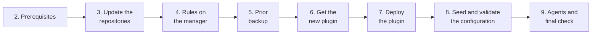

# Updating ENSFácil in an existing environment
[Español](02-updating-an-existing-environment.md)

[[_TOC_]]

## 1. Objective

Update of ENSFácil with Wazuh and a previous plugin version already installed, including a version with new controls.

There are two cases:

| The environment has | What to follow |
|---|---|
| The `ensfacil` plugin (the «ENSFácil» app in the menu) | sections 2 to 9 |
| The integrated version (the modified Wazuh plugin, with the «ENS» app in the menu) | section 10, [Transition from the integrated version](#10-transition-from-the-integrated-version) |



> [!important]
> The new plugin is deployed (section 7) **before** seeding the configuration of the new controls (section 8). The reason is in [Installing from a release, section 11](07-installing-from-a-release.en.md#11-update-to-a-newer-release).

> [!note]
> This guide applies to the package installation. For Wazuh in Docker, the plugin update is in [Wazuh in Docker, section 12.1](06-wazuh-in-docker.en.md#121-update-to-a-new-version).

## 2. Prerequisites

The following conditions must be met before starting:

| Requirement |
|---|
| Wazuh Dashboard 4.14.7 installed and operational. |
| `ensfacil` plugin installed. If the environment has the integrated version, go to section 10. |
| The release of the new version ([Installing from a release](07-installing-from-a-release.en.md)). Only for building: the OpenSearch Dashboards 2.19.5 tree in `/opt/ensfacil/build`, Node.js 18.19.0 and Yarn Classic 1.22.22 ([Building from source, section 3](08-building-from-source.en.md#3-build-with-the-opensearch-dashboards-tree)). |
| ENSFácil repository in `/opt/ensfacil/repo` and runbooks in `/opt/ensfacil/<runbook>`. |

Check the initial state:

```bash
sudo systemctl is-active wazuh-dashboard
sudo -u wazuh-dashboard /usr/share/wazuh-dashboard/bin/opensearch-dashboards-plugin list
git -C /opt/ensfacil/repo status --short
git -C /opt/ensfacil/repo branch --show-current
sudo mkdir -p /opt/ensfacil/artifacts && sudo chown "$USER":root /opt/ensfacil/artifacts
```

Expected result: `active`, `ensfacil@<version>` in the plugin list and no local changes in the repository.

> [!warning]
> Do not continue if Wazuh Dashboard is not active or if the repository has unidentified local changes.

## 3. Update the repositories

The repository is also needed with a release: the seeding (section 8) and the consistency check use its tools.

### 3.1 With GitLab access from the server

```bash
git -C /opt/ensfacil/repo pull --ff-only
git -C /opt/ensfacil/repo log -1 --oneline
```

Expected result: the latest `main` commit.

### 3.2 Without GitLab access from the server

If the server cannot reach GitLab, the repository is carried in a `git bundle` from a workstation that can. On the workstation:

```bash
git -C plugin-wazuh-ens pull --ff-only
git -C plugin-wazuh-ens bundle create plugin-wazuh-ens.bundle main
git -C plugin-wazuh-ens rev-parse main          # note the hash
scp plugin-wazuh-ens/plugin-wazuh-ens.bundle <user>@<manager>:/opt/ensfacil/artifacts/
```

On the server:

```bash
B=/opt/ensfacil/artifacts/plugin-wazuh-ens.bundle
git -C /opt/ensfacil/repo bundle verify "$B"
git -C /opt/ensfacil/repo fetch "$B" main
git -C /opt/ensfacil/repo merge --ff-only FETCH_HEAD
git -C /opt/ensfacil/repo log -1 --oneline
```

Expected result: the hash matches the one noted on the workstation. Runbooks are updated the same way, one bundle per repository.

> [!note]
> Keep the hash shown as the reference of the version being deployed.

### 3.3 New runbooks

If the version brings new controls, clone their runbooks next to the existing ones (or carry them by bundle with `git clone <bundle> /opt/ensfacil/<runbook>`) and add them to `/opt/ensfacil/runbooks.txt`. The full list of runbooks is in the [installation guide, section 10.3](01-installation-from-scratch.en.md#103-clone-the-ens-runbooks). mp.info.6 also has the Zimbra runbook (`zimbra/zimbra-mta/mp.info.6`), which the consistency check also reads: if it is missing, clone it into `/opt/ensfacil/zimbra-mta/mp.info.6` as in that section; it does not go into `runbooks.txt`.

## 4. Install the rules on the manager

mp.info.6 is installed in its own group, `ens-copias`. If the manager does not have it yet, create it first (`sudo /var/ossec/bin/agent_groups -a -g ens-copias -q`): without it, its `install-manager.sh` stops. If the `agent.conf` of the `ens` group still has the `<localfile>` of `/var/log/ensfacil/mp_info_6.json` from the previous version, remove it from there after the backup, or the agent will read the file twice.

Back up the manager configuration and run the `install-manager.sh` of every new or updated runbook. It is idempotent: a runbook without changes does not restart the manager.

```bash
sudo tar czf "/opt/ensfacil/artifacts/manager-$(date +%Y%m%d-%H%M%S).tar.gz" \
  -C /var/ossec etc/rules etc/decoders etc/shared/ens etc/shared/ens-copias etc/ossec.conf

sudo grep -c "<agent_config" /var/ossec/etc/shared/ens/agent.conf          # must be 1
sudo grep -c "<agent_config" /var/ossec/etc/shared/ens-copias/agent.conf   # must be 1

(
while read -r r; do
  echo "===== $r ====="
  sudo bash "/opt/ensfacil/$r/install-manager.sh" || { echo "ERROR: $r"; exit 1; }
done < /opt/ensfacil/runbooks.txt
)

sudo systemctl is-active wazuh-manager
cd /opt/ensfacil/repo && python3 tests/check-consistency.py | tail -1
```

Expected result: `active` and `consistency OK`. The rules each installer confirms are listed in the [installation guide, section 12.1](01-installation-from-scratch.en.md#121-validate-the-rule-installation).

> [!warning]
> If the `agent.conf` of the `ens` group (or the `ens-copias` one) has more than one `<agent_config>` block, the installers refuse to modify it: merge the blocks into one and validate it with `verify-agent-conf` before retrying. If an installer failed after copying its rules, the retry does not restart the manager: restart it by hand and check the rule with `wazuh-logtest`.

## 5. Create a prior backup

Back up the installed plugins, the deployed built zip (if there is one) and the active configuration document before changing anything:

```bash
STAMP=$(date +%Y%m%d-%H%M%S)
BACKUP=/opt/ensfacil/artifacts/update-$STAMP
sudo mkdir -p "$BACKUP"

sudo tar -C /usr/share/wazuh-dashboard -czf "$BACKUP/plugins-antes.tgz" plugins

ZIP=/opt/ensfacil/build/plugins/ensfacil/build/ensfacil-2.19.5.zip
test -f "$ZIP" && sudo cp -a "$ZIP" "$BACKUP/"

sudo curl -sk --cert /etc/wazuh-indexer/certs/admin.pem --key /etc/wazuh-indexer/certs/admin-key.pem \
  https://127.0.0.1:9200/wazuh-ens-configuration/_doc/active | sudo tee "$BACKUP/active.json" >/dev/null
sudo curl -sk --cert /etc/wazuh-indexer/certs/admin.pem --key /etc/wazuh-indexer/certs/admin-key.pem \
  https://127.0.0.1:9200/wazuh-ens-configuration/_doc/maturity | sudo tee "$BACKUP/maturity.json" >/dev/null

ls -l "$BACKUP"
echo "BACKUP=$BACKUP"
```

Expected result: `plugins-antes.tgz`, `active.json` and `maturity.json` (maturity recorded from 1.4.0; `"found":false` if there is none) inside `$BACKUP`, and `ensfacil-2.19.5.zip` if the deployed plugin was built on this server.

> [!important]
> If the deployed plugin comes from a release, its zip is already in its version's folder (`/opt/ensfacil/releases/<version>`), which is kept. If it was built, `config/build-plugin.sh` deletes `/opt/ensfacil/build/plugins/ensfacil` before building: the previous zip is only kept if it is copied here. Keep the previous zip and `active.json` until every validation of the new version is complete.

### 5.1 Before updating to 1.4.0

From 1.4.0, a dimension level declared in Configuration > General governs every control Annex II ties to that dimension, not only op.exp.8 and op.cont.2 and op.cont.3:

| Declared dimension | Controls it governs from 1.4.0 | In 1.3.0 |
|---|---|---|
| D (Availability) | mp.info.6, op.cont.2 and op.cont.3 | op.cont.2 and op.cont.3 |
| T (Traceability) | op.acc.1 (with A), op.acc.2 to op.acc.6 (with C, I and A) and op.exp.8 | op.exp.8 |
| C (Confidentiality), I (Integrity) and A (Authenticity) | op.acc.2 to op.acc.6; A also op.acc.1 | none |

A control with several dimensions is evaluated with the highest; an undeclared dimension is the ENS level. A document that declares T or D may change verdicts on update: with the ENS level at MEDIO and D at ALTO, mp.info.6 is evaluated at ALTO and requires R2 (EV-06); with T at ALTO, op.acc.1 to op.acc.6 move to ALTO. With no dimension declared, the results do not change.

A dimension above the ENS level is incoherent: the ENS level is the system category, the highest of its dimensions. 1.4.0 loads and evaluates such a document, but the General tab does not save until it is fixed, and Controles and the dashboard show «Niveles incoherentes» with a link to General.

Check the backed-up document with the validator of the already updated repository (section 3):

```bash
cd /opt/ensfacil/repo
npx --yes tsx config/validate-configuration.ts "$BACKUP/active.json"
```

Expected result: the `global level:` line with the ENS level and the five dimension levels. If a dimension exceeds the ENS level, the `INCOHERENT LEVELS` section appears and the command exits with code 1. Write down the declared levels and the dashboard state before deploying. After deploying, fix the incoherence in Configuration > General: raise the ENS level or lower the dimension.

## 6. Get the new plugin

By default, the new plugin is the release of the new version (section 6.1). To build it, follow section 6.2. Both end with the `ZIP` and `DEPLOY` variables that section 7 uses.

### 6.1 From the release (default)

Download the new release into its own folder and verify it as in [Installing from a release, sections 4 to 7](07-installing-from-a-release.en.md#4-prepare-the-folder-on-the-server), with the new version in `V`. With the token stored on the server, [section 6.3](07-installing-from-a-release.en.md#63-download-the-four-files) and the check of [section 7](07-installing-from-a-release.en.md#7-verify-the-files) of that guide are enough.

Read the release notes: new controls and compatible versions.

Then, with `V` and `R` from that guide:

```bash
ZIP=$R/ensfacil-$V-osd-2.19.5.zip
DEPLOY=$R/deploy-plugin.sh
```

> [!note]
> Retain the folder of the installed version; it is required for rollback ([troubleshooting and rollback, section 4](04-troubleshooting-and-rollback.en.md#4-reinstall-the-previous-ensfácil-version)).

### 6.2 Building from source

With the OpenSearch Dashboards tree and Node.js prepared ([Building from source, section 3](08-building-from-source.en.md#3-build-with-the-opensearch-dashboards-tree)):

```bash
export NVM_DIR="$HOME/.nvm"
[ -s "$NVM_DIR/nvm.sh" ] && . "$NVM_DIR/nvm.sh"
nvm use 18.19.0

YARN_BIN=$(dirname "$(command -v yarn)")
P=$YARN_BIN:/usr/local/sbin:/usr/local/bin:/usr/sbin:/usr/bin:/sbin:/bin

sudo env PATH="$P" bash /opt/ensfacil/repo/config/build-plugin.sh > /opt/ensfacil/artifacts/build.log 2>&1
tail -1 /opt/ensfacil/artifacts/build.log
```

Expected result: `/opt/ensfacil/build/plugins/ensfacil/build/ensfacil-2.19.5.zip`. The log is kept in `/opt/ensfacil/artifacts`, never in `/tmp` ([Building from source, section 3.3](08-building-from-source.en.md#33-build-the-plugin)). Alternatively, the zip is built with the CI builder image and copied to the server (section 4 of that guide).

Validate the new zip, including that it carries the new code (replace `op.exp.10` with the id of a control or a text that changed in this version):

```bash
ZIP=/opt/ensfacil/build/plugins/ensfacil/build/ensfacil-2.19.5.zip
DEPLOY=/opt/ensfacil/repo/config/deploy-plugin.sh
unzip -t "$ZIP" | tail -1
bash "$DEPLOY" --solo-id "$ZIP"
unzip -p "$ZIP" "*/target/public/*.js" | grep -c "op.exp.10"
```

Expected result: `No errors detected…`, `ensfacil` and a number greater than `0`.

> [!warning]
> Do not continue if the zip does not exist, the integrity check reports errors or the count is `0`.

## 7. Deploy the updated version

With `ZIP` and `DEPLOY` from section 6.1 or 6.2:

```bash
sudo -u wazuh-dashboard test -r "$ZIP" && echo "ZIP_ACCESIBLE=OK"

sudo bash "$DEPLOY" "$ZIP"
```

`deploy-plugin.sh` replaces only `ensfacil` and bumps the dashboard `build.number`. The Wazuh plugin is not touched.

Before stopping the dashboard, `deploy-plugin.sh` saves the installed `ensfacil` in `/var/backups/ensfacil/plugins-ensfacil-<date>.tgz`. The script creates the `ensfacil` subfolder (root, 0700) if it does not exist. After a successful deployment the last 3 copies are kept; a failed deployment deletes none. They are not stored next to the zip: the next build deletes `/opt/ensfacil/build/plugins/ensfacil`. To use another folder: `sudo env ENSFACIL_BACKUP_DIR=<folder> bash "$DEPLOY" "$ZIP"`, which saves in `<folder>/ensfacil/`. If something fails once the dashboard is stopped, the script prints how to return to the previous state and exits with an error ([troubleshooting guide, section 4.1](04-troubleshooting-and-rollback.en.md#41-if-deploy-pluginsh-fails-halfway)).

```bash
sudo systemctl is-active wazuh-dashboard
sudo -u wazuh-dashboard /usr/share/wazuh-dashboard/bin/opensearch-dashboards-plugin list
curl -sk -o /dev/null -w '%{http_code}\n' https://localhost/api/ensfacil/configuration
```

Expected result: `active`, `ensfacil@<new version>` and `wazuh@4.14.7-01` in the list, and `401`.

## 8. Seed and validate the configuration

With the new plugin deployed, seed the configuration blocks. The operation merges: it keeps the values already declared and adds the new parameters and controls. It uses the indexer administrator certificate, with no passwords:

```bash
cd /opt/ensfacil/repo/config
CERT="OS_CERT=/etc/wazuh-indexer/certs/admin.pem OS_KEY=/etc/wazuh-indexer/certs/admin-key.pem"
CONTROLS="mp.info.6 op.acc.1 op.acc.2 op.acc.3 op.acc.4 op.acc.5 op.acc.6 op.exp.1 op.exp.2 op.exp.3 op.exp.4 op.exp.5 op.exp.6 op.exp.7 op.exp.8 op.exp.9 op.exp.10 op.mon.1 op.mon.2 op.mon.3 op.nub.1 op.cont.2 op.cont.3"

for c in $CONTROLS; do echo "===== $c ====="; sudo env $CERT python3 inject-control.py "$c" || break; done
```

Review the plan (especially any `NO LONGER IN THE BLOCK and lost` line) and apply it:

```bash
for c in $CONTROLS; do echo "===== $c ====="; sudo env $CERT python3 inject-control.py "$c" --apply || break; done
```

Validate the whole document with the plugin validator:

```bash
sudo curl -sk --cert /etc/wazuh-indexer/certs/admin.pem --key /etc/wazuh-indexer/certs/admin-key.pem \
  https://127.0.0.1:9200/wazuh-ens-configuration/_doc/active -o /opt/ensfacil/artifacts/active-now.json
cd /opt/ensfacil/repo
npx --yes yarn@1.22.22 install --frozen-lockfile --ignore-scripts --non-interactive
npx --yes tsx config/validate-configuration.ts /opt/ensfacil/artifacts/active-now.json
```

Expected result: `Done` after installing the dependencies and `VALID STRUCTURE`. If the result is `INVALID STRUCTURE`, restore `$BACKUP/active.json` as described in the [troubleshooting and rollback guide](04-troubleshooting-and-rollback.en.md#7-restore-the-ens-configuration). The alternatives for validating off the server and declaring values with `set-parameters.py` (which replaces the whole list of every parameter it names) are in the [installation guide, sections 14.4 and 14.5](01-installation-from-scratch.en.md#144-validate-the-whole-document).

If the environment comes from 1.0.0, adjust the replicas of the configuration index. Since 1.1.0 the plugin creates `wazuh-ens-configuration` with `auto_expand_replicas: 0-1`, but does not change an existing index: the one created by 1.0.0 stays yellow on a single-node indexer. Adjust once, with the indexer admin certificate:

```bash
C=/etc/wazuh-indexer/certs
sudo curl -sk --cert $C/admin.pem --key $C/admin-key.pem -XPUT \
  https://127.0.0.1:9200/wazuh-ens-configuration/_settings \
  -H 'Content-Type: application/json' -d '{"index":{"auto_expand_replicas":"0-1"}}'; echo
sudo curl -sk --cert $C/admin.pem --key $C/admin-key.pem \
  "https://127.0.0.1:9200/_cat/indices/wazuh-ens-configuration?h=health,status,index,rep"
```

Expected result: `{"acknowledged":true}` and, from the second command, `green open wazuh-ens-configuration 0` (with several nodes, `green` with `1` replica). If it says `yellow`, wait a few seconds and repeat the second command until it says `green`. In an environment installed from scratch with 1.1.0 or later, this step is not required.

From 1.4.0, the data several controls ask for is declared only once in Configuración > General > «Datos de la organización». When updating from 1.3.0, each item whose controls have the same value moves to that section and is saved with the next change; a control without value takes the others' value and the notice says so («Se ha completado …»); items with different values between controls appear in «Valores distintos entre controles» and each control keeps its value until «Elegir este valor» is pressed ([Configuration by controls and templates, section 7.1](09-configuration-by-system.en.md#71-organisation-data)). Before that, back up the document (section 5).

From 1.3.0, the Configuration screen has three tabs, «Controles», «Agentes» and «General». When updating:

- from 1.2.0, the document is converted when it loads: the templates applied to each agent become the template assigned in each control, without changing any value, and the conversion is written with the next save or with «Guardar la conversión» ([Configuration by controls and templates, section 8](09-configuration-by-system.en.md#8-conversion-of-a-120-configuration)); before that, back up the document (section 5);
- the controls the document does not have yet appear on «Controles» as «Sin añadir» and are added with «Añadir con valores por defecto», with the same semantics as `inject-control.py` for a new control;
- from 1.1.0, the «Agentes» tab proposes to copy to each agent the rows of tables with a system column that name it («Repartir por agentes»), without deleting anything ([Configuration by controls and templates, section 9](09-configuration-by-system.en.md#9-distribution-of-common-rows-by-agents)); before distributing, back up the document (section 5).

From 1.2.0, the evaluation runs on the plugin server with every fact of the 30-day window; 1.1.0 evaluated in the browser with the newest 10,000 facts. After the update, some verdicts change: record the dashboard status beforehand. Each user's first load answers in parts («Calculando la evaluación»). To go back to an earlier version after the conversion or after «Repartir por agentes», restore the earlier version of the document ([Configuration by controls and templates, section 12](09-configuration-by-system.en.md#12-compatibility-and-rollback)).

In Configuration > General, review the optional dimension levels. From 1.4.0 there are five: **Confidencialidad (C)**, **Integridad (I)**, **Trazabilidad (T)**, **Autenticidad (A)** and **Disponibilidad (D)**; they are used by op.acc.2 to op.acc.6 (C, I, T and A), op.acc.1 (T and A), op.exp.8 (T) and mp.info.6, op.cont.2 and op.cont.3 (D), and with several dimensions the highest rules. If they are not declared, the global ENS level applies and the results do not change from 1.3.0; a document that already declared T or D may change ([section 5.1](#51-before-updating-to-140)). Before declaring a dimension, check that it does not exceed the ENS level: the screen does not save it. op.cont.2 and op.cont.3 only apply with D at ALTO: with the ENS level at MEDIO and D not declared, they show «No aplica» (not applicable).

From 1.4.0 the lists follow the Annex II order (op.acc, op.exp, op.nub, op.cont, op.mon and, last, mp.info.6), and the text of each requirement is the BOE literal labelled «Norma ENS»; the interpretation appears apart as «Criterio de aplicación».

## 9. Agents and final check

On each audited machine, update or install the runbooks that apply to it following their own guide. The op.acc.2, op.acc.3, op.acc.4, op.exp.3, op.exp.4, op.exp.5, op.exp.8 and op.exp.10 runbooks write auditd rules; if the machine has any of them, load the rules at the end:

```bash
sudo augenrules --load
```

Check the consistency between the plugin and the runbooks:

```bash
cd /opt/ensfacil/repo
python3 tests/check-consistency.py | tail -1
```

Expected result: `consistency OK`.

Finally open ENSFácil in Wazuh Dashboard and confirm that:

- all controls appear, including the new ones;
- the manager (agent `000`) appears in the scope, because op.cont.2, op.cont.3, op.exp.7, op.exp.8, op.exp.9, op.mon.1, op.mon.2, op.mon.3 and op.nub.1 are evaluated on it. After the first run of the manager collectors (hourly or every 6 hours, depending on the control), its row has data for the eight that have a collector; op.cont.2 is evaluated from the tables of the Configuración screen;
- no control shows «Sin datos del recolector desde …» on a machine that should be reporting.

If any validation fails, do not keep operating the new version and use the [troubleshooting and rollback](04-troubleshooting-and-rollback.en.md) procedure.

## 10. Transition from the integrated version

Only for an environment that still has the integrated version installed (modified `wazuh` plugin, «ENS» app). No file of the integrated version is needed.

The configuration, the manager rules and the runbooks do not change: both versions use the `wazuh-ens-configuration` index.

Steps: install ENSFácil next to the integrated version (10.1), compare (10.2) and reinstall the official `wazuh-dashboard` 4.14.7 package (10.3).

### 10.1 Install ENSFácil next to the integrated version

Follow sections 3 to 7 of this guide, with the release zip and the `deploy-plugin.sh` in its folder (section 6.1). `deploy-plugin.sh`, with the ENSFácil zip, only installs `ensfacil`: the integrated plugin (`wazuh`) stays as it is. The `ensfacil_admin` role is only required for users without `all_access`; the `admin` user has `all_access`. If required, create and assign the role with the `create-admin-role.sh` in the same folder ([Installing from a release, section 9](07-installing-from-a-release.en.md#9-create-the-ensfacil_admin-role); the details are in the [installation guide, section 13.5](01-installation-from-scratch.en.md#135-create-the-ensfacil_admin-role)).

Expected result: in the plugin list, `ensfacil` and `wazuh`; in the dashboard menu, two apps: «ENS» (the integrated one) and «ENSFácil» (the new one). Both read the same configuration and the same data.

> [!warning]
> While they coexist, save the configuration only from «ENSFácil». Both apps write the same document.

### 10.2 Compare the two versions

With the same machine and the same date range, compare screen by screen: Panel, Controles, Detalle del control, Informes, Evidencias, Eventos and Configuración. The percentages, the controls and the number of facts must match.

If any value does not match, stop the procedure, record the screen, the machine and the date range, and contact Quersystem.

### 10.3 Go back to the official Wazuh plugin

With both versions matching, reinstall the official `wazuh-dashboard` 4.14.7 package: the «ENS» app disappears and «ENSFácil» remains.

> [!important]
> Do this step in a test environment first. It needs the Wazuh package repository (or the downloaded `wazuh-dashboard` 4.14.7-1 package) and the folder of the ENSFácil release installed in section 10.1 (`/opt/ensfacil/releases/<version>`).

Before continuing, record the state of the data to compare it at the end: the
three values in [section 10.1 of Installing from a release](07-installing-from-a-release.en.md#101-the-data-is-still-there).

> [!warning]
> The Wazuh package repository may already offer a newer `wazuh-dashboard`
> (for example, 4.14.8-1). ENSFácil 1.x is for 4.14.7 only: always install
> `=4.14.7-1`. To prevent a general system upgrade from changing the version,
> hold the package with `sudo apt-mark hold wazuh-dashboard`. To upgrade Wazuh
> deliberately, with an ENSFácil release for the new version, release it first
> with `sudo apt-mark unhold wazuh-dashboard`.

Keep what is going to be replaced:

```bash
T=/opt/ensfacil/artifacts/transicion-$(date +%Y%m%d-%H%M%S)
sudo mkdir -p "$T"
sudo tar -C /usr/share/wazuh-dashboard -czf "$T/plugins-antes.tgz" plugins
sudo cp -a /usr/share/wazuh-dashboard/package.json "$T/package.json"
sudo cp -a /etc/wazuh-dashboard "$T/etc-wazuh-dashboard"
echo "T=$T"
```

Move the integrated plugin aside and reinstall the official package:

```bash
sudo systemctl stop wazuh-dashboard
sudo mv /usr/share/wazuh-dashboard/plugins/wazuh "$T/wazuh-integrado"
sudo apt-get install --reinstall -o Dpkg::Options::="--force-confold" wazuh-dashboard=4.14.7-1
```

`--force-confold` keeps the dashboard configuration (`/etc/wazuh-dashboard`) without asking. Expected result: the reinstallation ends without errors and `/usr/share/wazuh-dashboard/plugins/wazuh` exists again. If it fails, put the integrated plugin back (`sudo mv "$T/wazuh-integrado" /usr/share/wazuh-dashboard/plugins/wazuh`) and start the dashboard.

The reinstallation resets `build.number`. Restore the previous `package.json` and deploy ENSFácil again, which bumps the number:

```bash
V=1.2.0   # the ENSFácil version installed in section 10.1
R=/opt/ensfacil/releases/$V
sudo cp -a "$T/package.json" /usr/share/wazuh-dashboard/package.json
sudo bash "$R/deploy-plugin.sh" "$R/ensfacil-$V-osd-2.19.5.zip"
```

Check:

```bash
sudo systemctl is-active wazuh-dashboard
sudo -u wazuh-dashboard /usr/share/wazuh-dashboard/bin/opensearch-dashboards-plugin list
curl -sk -o /dev/null -w '%{http_code}\n' https://localhost/api/ensfacil/configuration
```

Expected result: `active`; in the list, `wazuh@4.14.7-01` (the official one) and `ensfacil@<version>`; and `401`. The menu no longer shows «ENS» and does show «ENSFácil», with the same configuration as before.

Then compare the data with the values recorded at the start: the
configuration (same `updatedAt`, same documents) must be the same, and the
facts the same or more.

Saved links to the «ENS» app (`/app/ens#…`) stop working. The new address is `/app/ensfacil`.

The rollback is in the [troubleshooting and rollback guide, section 6](04-troubleshooting-and-rollback.en.md#6-go-back-to-the-integrated-version).
