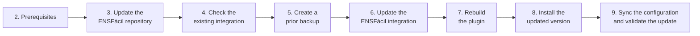

# Updating ENSFácil in an existing environment
[Español](02-updating-an-existing-environment.md)

[[_TOC_]]

## 1. Objective

This guide describes how to update ENSFácil when Wazuh and a previous
version of the plugin are already installed and running.

The procedure preserves the existing environment, applies only the
integration's pending changes, and generates a new plugin artifact before
deploying it.



## 2. Prerequisites

Before starting, these conditions must be met:

| Requirement |
|---|
| Wazuh Dashboard 4.14.7 installed. |
| Build tree available at `/opt/ensfacil/build`. |
| Wazuh plugin available at `/opt/ensfacil/build/plugins/main`. |
| ENSFácil repository available at `/opt/ensfacil/repo`. |
| Node.js 18.19.0 and Yarn Classic 1.22.22. |
| The Dashboard must be operational before starting the update. |

Check the initial state:

```bash
sudo systemctl is-active wazuh-dashboard
git -C /opt/ensfacil/repo status --short
git -C /opt/ensfacil/repo branch --show-current
```

> [!warning]
> Do not continue if Wazuh Dashboard is not active or if there are unidentified local changes in the repository.

## 3. Update the ENSFácil repository

Update the branch currently used by the deployment:

```bash
git -C /opt/ensfacil/repo pull --ff-only
git -C /opt/ensfacil/repo log -1 --oneline
```

> [!note]
> Keep the displayed hash as a reference for the version about to be deployed.

## 4. Check the existing integration

Define the working paths and verify the integrity of the integration
package:

```bash
REPO=/opt/ensfacil/repo
TARGET=/opt/ensfacil/build/plugins/main
PKG=$REPO/integration/wazuh-dashboard

( cd "$PKG" && sha256sum -c SHA256SUMS )
"$PKG/check-integration.sh" "$TARGET"
```

The result must indicate `RESULTADO=COMPATIBLE`. The report may show
patches already applied and others pending; this is normal during an
update.

> [!warning]
> If conflicts appear or the result is not compatible, do not apply any changes and consult the compatibility and troubleshooting guide.

## 5. Create a prior backup

Back up the current ENS module and the latest deployable ZIP before
modifying the build tree:

```bash
STAMP=$(date +%Y%m%d-%H%M%S)
BACKUP=/opt/ensfacil/artifacts/update-$STAMP
sudo mkdir -p "$BACKUP"

sudo cp -a "$TARGET/public/components/overview/ens" "$BACKUP/ens"

test -f "$TARGET/build/wazuh-2.19.5.zip" && \
  sudo cp -a "$TARGET/build/wazuh-2.19.5.zip" "$BACKUP/"

echo "BACKUP=$BACKUP"
```

> [!important]
> The previous ZIP must be kept until all validations of the new version are complete.

## 6. Update the ENSFácil integration

First update the ENS module within the build tree:

```bash
DEST="$TARGET/public/components/overview/ens"
sudo rm -rf "$DEST"
sudo cp -a "$REPO/dashboard/ens" "$DEST"
sudo chown -R "$USER":"$USER" "$DEST"
```

Then apply only the integration package's pending changes:

```bash
"$PKG/apply-integration.sh" "$TARGET"
```

The script creates its own backup of the modified files. The run must
finish with `RESULTADO=INTEGRACION_APLICADA` and no `.rej` files.

Immediately check the resulting state:

```bash
"$PKG/check-integration.sh" "$TARGET"
```

After the update, all patches must appear already applied, the additional
files present, and the result must be `RESULTADO=COMPATIBLE`.

## 7. Rebuild the plugin

```bash
export NVM_DIR="$HOME/.nvm"
[ -s "$NVM_DIR/nvm.sh" ] && . "$NVM_DIR/nvm.sh"
nvm use 18.19.0
cd "$TARGET"

YARN_IGNORE_ENGINES=1 node ../../scripts/plugin_helpers build \
  --opensearch-dashboards-version=2.19.5
```

Validate the new artifact before installing it:

```bash
test -f build/wazuh-2.19.5.zip && echo "ZIP_GENERADO=OK"
unzip -t build/wazuh-2.19.5.zip | tail -1
```

> [!warning]
> Do not continue if the ZIP does not exist or the integrity check reports errors.

## 8. Install the updated version

Define the new artifact and check that it can be read by the Wazuh
Dashboard user:

```bash
ZIP=/opt/ensfacil/build/plugins/main/build/wazuh-2.19.5.zip
sudo -u wazuh-dashboard test -r "$ZIP" && echo "ZIP_ACCESIBLE=OK"
```

Stop Wazuh Dashboard and replace only the `wazuh` plugin:

```bash
sudo systemctl stop wazuh-dashboard

sudo -u wazuh-dashboard /usr/share/wazuh-dashboard/bin/opensearch-dashboards-plugin remove wazuh || true
sudo rm -rf /usr/share/wazuh-dashboard/plugins/wazuh
sudo rm -rf /usr/share/wazuh-dashboard/plugins/.plugin.installing

sudo -u wazuh-dashboard /usr/share/wazuh-dashboard/bin/opensearch-dashboards-plugin \
  install "file://$ZIP"

sudo systemctl start wazuh-dashboard
```

> [!warning]
> Do not use wildcards such as `wazuh*`. The `wazuhCore` and `wazuhCheckUpdates` plugins must be preserved.

## 9. Sync the configuration and validate the update

Update the ENS configuration blocks. The operation is mergeable and
preserves the values already declared:

```bash
cd /opt/ensfacil/repo/config
export OS_USER=admin
read -rsp "Clave del indexer: " OS_PASS && export OS_PASS && echo

for c in mp.info.6 op.acc.1 op.acc.2 op.acc.3 op.acc.4; do
  echo "===== $c ====="
  python3 inject-control.py "$c" --apply || break
done
```

Check the service and the plugin inventory:

```bash
sudo systemctl is-active wazuh-dashboard
sudo -u wazuh-dashboard /usr/share/wazuh-dashboard/bin/opensearch-dashboards-plugin list
```

Finally, check the integration and consistency with the runbooks:

```bash
REPO=/opt/ensfacil/repo
TARGET=/opt/ensfacil/build/plugins/main
PKG=$REPO/integration/wazuh-dashboard

"$PKG/check-integration.sh" "$TARGET"
cd "$REPO"
python3 tests/check-consistency.py
```

Wazuh Dashboard must remain `active`, the `wazuh` plugin must appear
installed, and `check-integration.sh` must finish with
`RESULTADO=COMPATIBLE`.

Finally, access ENSFácil from Wazuh Dashboard and confirm that the
interface and the controls remain available. If any validation fails, do
not continue operating with the new version, and use the troubleshooting
and rollback procedure.
