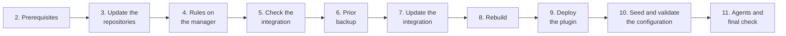

# Updating ENSFácil in an existing environment
[Español](02-updating-an-existing-environment.md)

[[_TOC_]]

## 1. Objective

This guide describes how to update ENSFácil when Wazuh and a previous version of the plugin are already installed and working, including the case where the new version brings new controls.

The procedure keeps the existing environment, applies only the pending integration changes and builds a new plugin artifact before deploying it.



> [!important]
> Order matters: the new plugin is deployed (section 9) **before** seeding the configuration of the new controls (section 10). The installed plugin validates the configuration document with its own rules, which do not know the new controls or parameter types: seeding first can leave the whole dashboard unable to load.

## 2. Prerequisites

The following conditions must be met before starting:

| Requirement |
|---|
| Wazuh Dashboard 4.14.7 installed. |
| Build tree available in `/opt/ensfacil/build`. |
| Wazuh plugin available in `/opt/ensfacil/build/plugins/main`. |
| ENSFácil repository available in `/opt/ensfacil/repo` and runbooks in `/opt/ensfacil/<runbook>`. |
| Node.js 18.19.0 and Yarn Classic 1.22.22 (or the Node.js shipped with Wazuh Dashboard, see [the installation guide, section 13.5](01-installation-from-scratch.en.md#135-build-and-validate-the-plugin)). |
| The Dashboard must be operational before starting the update. |

Check the initial state:

```bash
sudo systemctl is-active wazuh-dashboard
git -C /opt/ensfacil/repo status --short
git -C /opt/ensfacil/repo branch --show-current
sudo mkdir -p /opt/ensfacil/artifacts && sudo chown "$USER":root /opt/ensfacil/artifacts
```

> [!warning]
> Do not continue if Wazuh Dashboard is not active or if the repository has unidentified local changes.

## 3. Update the repositories

### 3.1 With GitLab access from the server

```bash
git -C /opt/ensfacil/repo pull --ff-only
git -C /opt/ensfacil/repo log -1 --oneline
```

### 3.2 Without GitLab access from the server

If the server cannot reach GitLab, the repository is carried in a `git bundle` from a workstation that can. On the workstation:

```bash
git -C plugin-wazuh-ens pull --ff-only
git -C plugin-wazuh-ens bundle create plugin-wazuh-ens.bundle main
git -C plugin-wazuh-ens rev-parse main          # note the hash
scp plugin-wazuh-ens/plugin-wazuh-ens.bundle <user>@<manager>:/opt/ensfacil/artifacts/
```

On the server:

```bash
B=/opt/ensfacil/artifacts/plugin-wazuh-ens.bundle
git -C /opt/ensfacil/repo bundle verify "$B"
git -C /opt/ensfacil/repo fetch "$B" main
git -C /opt/ensfacil/repo merge --ff-only FETCH_HEAD
git -C /opt/ensfacil/repo log -1 --oneline
```

The hash shown must match the one noted on the workstation. Runbooks are updated the same way, one bundle per repository.

> [!note]
> Keep the hash shown as the reference of the version being deployed.

### 3.3 New runbooks

If the version brings new controls, clone their runbooks next to the existing ones (or carry them by bundle with `git clone <bundle> /opt/ensfacil/<runbook>`) and add them to `/opt/ensfacil/runbooks.txt`. The full list of runbooks is in the [installation guide, section 10.3](01-installation-from-scratch.en.md#103-clone-the-ens-runbooks). mp.info.6 also has the Zimbra runbook (`zimbra/zimbra-mta/mp.info.6`), which the consistency check also reads: if it is missing, clone it into `/opt/ensfacil/zimbra-mta/mp.info.6` as in that section; it does not go into `runbooks.txt`.

## 4. Install the rules on the manager

mp.info.6 is installed in its own group, `ens-copias`. If the manager does not have it yet, create it first (`sudo /var/ossec/bin/agent_groups -a -g ens-copias -q`): without it, its `install-manager.sh` stops. If the `agent.conf` of the `ens` group still has the `<localfile>` of `/var/log/ensfacil/mp_info_6.json` from the previous version, remove it from there after the backup, or the agent will read the file twice.

Back up the manager configuration and run the `install-manager.sh` of every new or updated runbook. It is idempotent: a runbook without changes does not restart the manager.

```bash
sudo tar czf "/opt/ensfacil/artifacts/manager-$(date +%Y%m%d-%H%M%S).tar.gz" \
  -C /var/ossec etc/rules etc/decoders etc/shared/ens etc/shared/ens-copias etc/ossec.conf

sudo grep -c "<agent_config" /var/ossec/etc/shared/ens/agent.conf          # must be 1
sudo grep -c "<agent_config" /var/ossec/etc/shared/ens-copias/agent.conf   # must be 1

(
while read -r r; do
  echo "===== $r ====="
  sudo bash "/opt/ensfacil/$r/install-manager.sh" || { echo "ERROR: $r"; exit 1; }
done < /opt/ensfacil/runbooks.txt
)

sudo systemctl is-active wazuh-manager
cd /opt/ensfacil/repo && python3 tests/check-consistency.py | tail -1
```

The output must be `active` and `coherencia OK`. The rules each installer confirms are listed in the [installation guide, section 12.1](01-installation-from-scratch.en.md#121-validate-the-rule-installation).

> [!warning]
> If the `agent.conf` of the `ens` group (or the `ens-copias` one) has more than one `<agent_config>` block, the installers refuse to modify it: merge the blocks into one and validate it with `verify-agent-conf` before retrying. If an installer failed after copying its rules, the retry does not restart the manager: restart it by hand and check the rule with `wazuh-logtest`.

## 5. Check the existing integration

Define the working paths and verify the integrity of the integration package:

```bash
REPO=/opt/ensfacil/repo
TARGET=/opt/ensfacil/build/plugins/main
PKG=$REPO/integration/wazuh-dashboard

( cd "$PKG" && sha256sum -c SHA256SUMS )
"$PKG/check-integration.sh" "$TARGET"
```

The result must show `RESULTADO=COMPATIBLE`. The report may show patches already applied and others pending; this is normal during an update.

> [!warning]
> If conflicts appear or the result is not compatible, do not apply any change and see the compatibility and troubleshooting guides.

## 6. Create a prior backup

Back up the current ENS module, the last deployable ZIP and the active configuration document before changing anything:

```bash
STAMP=$(date +%Y%m%d-%H%M%S)
BACKUP=/opt/ensfacil/artifacts/update-$STAMP
sudo mkdir -p "$BACKUP"

sudo cp -a "$TARGET/public/components/overview/ens" "$BACKUP/ens"

test -f "$TARGET/build/wazuh-2.19.5.zip" && \
  sudo cp -a "$TARGET/build/wazuh-2.19.5.zip" "$BACKUP/"

sudo curl -sk --cert /etc/wazuh-indexer/certs/admin.pem --key /etc/wazuh-indexer/certs/admin-key.pem \
  https://127.0.0.1:9200/wazuh-ens-configuration/_doc/active | sudo tee "$BACKUP/active.json" >/dev/null

echo "BACKUP=$BACKUP"
```

> [!important]
> The previous ZIP and `active.json` must be kept until every validation of the new version has been completed.

## 7. Update the ENSFácil integration

First update the ENS module inside the build tree, and with it the requirements catalogue of the compliance view (it changes every time a control or a requirement is added):

```bash
DEST="$TARGET/public/components/overview/ens"
sudo rm -rf "$DEST"
sudo cp -a "$REPO/dashboard/ens" "$DEST"
sudo chown -R "$USER":"$USER" "$DEST"
sudo cp "$REPO/dashboard/ens-requirements.ts" "$TARGET/common/compliance-requirements/ens-requirements.ts"
sudo chown "$USER":"$USER" "$TARGET/common/compliance-requirements/ens-requirements.ts"
```

> [!note]
> Until 07/10/2026 that catalogue travelled inside the integration package, which does not replace it if it already exists: environments installed before kept the controls of their first installation, and the compliance view did not show the others. Since that date it is copied here, with the core.

Then apply only the pending changes of the integration package:

```bash
"$PKG/apply-integration.sh" "$TARGET"
```

The script creates its own backup of the modified files. It must end with `RESULTADO=INTEGRACION_APLICADA` and no `.rej` files.

Check the resulting state immediately:

```bash
"$PKG/check-integration.sh" "$TARGET"
```

After the update, all patches must appear as already applied, the additional files present, and the result must be `RESULTADO=COMPATIBLE`.

## 8. Rebuild the plugin

```bash
export NVM_DIR="$HOME/.nvm"
[ -s "$NVM_DIR/nvm.sh" ] && . "$NVM_DIR/nvm.sh"
nvm use 18.19.0
cd "$TARGET"

YARN_IGNORE_ENGINES=1 node ../../scripts/plugin_helpers build \
  --opensearch-dashboards-version=2.19.5 2>&1 | tee /opt/ensfacil/artifacts/build.log
```

If the tree belongs to `root` or the build uses the Node.js shipped with Wazuh Dashboard, use the variant with `--allow-root` and `yarn` in the `PATH` described in the [installation guide, section 13.5](01-installation-from-scratch.en.md#135-build-and-validate-the-plugin), with the log in `/opt/ensfacil/artifacts` and never in `/tmp`.

Validate the new artifact before installing it, including that it carries the new code (replace `op.exp.10` with the identifier of a control or a text that changed in this version):

```bash
test -f build/wazuh-2.19.5.zip && echo "ZIP_GENERADO=OK"
unzip -t build/wazuh-2.19.5.zip | tail -1
unzip -p build/wazuh-2.19.5.zip "*.js" | grep -c "op.exp.10"
```

> [!warning]
> Do not continue if the ZIP does not exist, the integrity check reports errors or the count is `0`.

## 9. Deploy the updated version

```bash
ZIP=/opt/ensfacil/build/plugins/main/build/wazuh-2.19.5.zip
sudo -u wazuh-dashboard test -r "$ZIP" && echo "ZIP_ACCESIBLE=OK"

sudo bash /opt/ensfacil/repo/config/deploy-plugin.sh "$ZIP"
```

`deploy-plugin.sh` replaces only the `wazuh` plugin and bumps the dashboard `build.number` so that browsers download the new version without having to clear their cache.

```bash
sudo systemctl is-active wazuh-dashboard
sudo -u wazuh-dashboard /usr/share/wazuh-dashboard/bin/opensearch-dashboards-plugin list
```

## 10. Seed and validate the configuration

With the new plugin deployed, seed the configuration blocks. The operation merges: it keeps the values already declared and adds the new parameters and controls. It uses the indexer administrator certificate, with no passwords:

```bash
cd /opt/ensfacil/repo/config
CERT="OS_CERT=/etc/wazuh-indexer/certs/admin.pem OS_KEY=/etc/wazuh-indexer/certs/admin-key.pem"
CONTROLS="mp.info.6 op.acc.1 op.acc.2 op.acc.3 op.acc.4 op.acc.5 op.acc.6 op.exp.1 op.exp.2 op.exp.3 op.exp.4 op.exp.5 op.exp.6 op.exp.7 op.exp.8 op.exp.9 op.exp.10"

for c in $CONTROLS; do echo "===== $c ====="; sudo env $CERT python3 inject-control.py "$c" || break; done
```

Review the plan (especially any `YA NO EXISTEN en el bloque y se pierden` line) and apply it:

```bash
for c in $CONTROLS; do echo "===== $c ====="; sudo env $CERT python3 inject-control.py "$c" --apply || break; done
```

Validate the whole document with the plugin validator:

```bash
sudo curl -sk --cert /etc/wazuh-indexer/certs/admin.pem --key /etc/wazuh-indexer/certs/admin-key.pem \
  https://127.0.0.1:9200/wazuh-ens-configuration/_doc/active -o /opt/ensfacil/artifacts/active-now.json
cd /opt/ensfacil/repo
npx --yes tsx config/validate-configuration.ts /opt/ensfacil/artifacts/active-now.json
```

The output must be `ESTRUCTURA VÁLIDA`. If it is invalid, restore `$BACKUP/active.json` as described in the [troubleshooting and rollback guide](04-troubleshooting-and-rollback.en.md#8-restore-the-ens-configuration). The alternatives for validating off the server and declaring values with `set-parameters.py` (which replaces the whole list of every parameter it names) are in the [installation guide, sections 14.4 and 14.5](01-installation-from-scratch.en.md#144-validate-the-whole-document).

If the version introduces op.exp.8, review the optional **Traceability level (T)** field in the global configuration.

## 11. Agents and final check

On each audited machine, update or install the runbooks that apply to it following their own guide. If any of them writes auditd rules (op.exp.5, op.exp.8, op.exp.10), load them at the end:

```bash
sudo augenrules --load
```

Finally check the integration and the consistency with the runbooks:

```bash
REPO=/opt/ensfacil/repo
TARGET=/opt/ensfacil/build/plugins/main
PKG=$REPO/integration/wazuh-dashboard

"$PKG/check-integration.sh" "$TARGET"
cd "$REPO"
python3 tests/check-consistency.py
```

Wazuh Dashboard must remain `active`, the `wazuh` plugin must appear installed and `check-integration.sh` must end with `RESULTADO=COMPATIBLE`.

Finally open ENSFácil in Wazuh Dashboard and confirm that:

- all controls appear, including the new ones;
- if there are controls measured on the manager (op.exp.7, op.exp.8, op.exp.9), the manager (agent `000`) appears in the scope and, after the first hourly run of its collectors, its row has data;
- no control shows «Sin datos del recolector desde …» on a machine that should be reporting.

If any validation fails, do not keep operating the new version and use the troubleshooting and rollback procedure.
