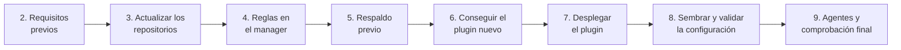

# Actualización de ENSFácil en un entorno existente
[English](02-updating-an-existing-environment.en.md)

[[_TOC_]]

## 1. Objetivo

Esta guía describe cómo actualizar ENSFácil cuando Wazuh y una versión anterior del plugin ya están instalados y funcionando, incluido el caso en que la nueva versión trae controles nuevos.

Hay dos casos:

| El entorno tiene | Qué seguir |
|---|---|
| El plugin `ensfacil` (la app «ENSFácil» del menú) | los apartados 2 a 9 |
| La versión integrada (el plugin de Wazuh modificado, con la app «ENS» del menú) | el apartado 10, [Transición desde la versión integrada](#10-transición-desde-la-versión-integrada) |



> [!important]
> El orden importa: el plugin nuevo se despliega (apartado 7) **antes** de sembrar la configuración de los controles nuevos (apartado 8). El plugin instalado valida el documento de configuración con sus propias reglas, que no conocen los controles ni los tipos de parámetro nuevos: sembrar antes puede dejar el panel entero sin cargar.

## 2. Requisitos previos

Antes de comenzar deben cumplirse estas condiciones:

| Requisito |
|---|
| Wazuh Dashboard 4.14.7 instalado y operativo. |
| Plugin `ensfacil` instalado. Si el entorno tiene la versión integrada, ir al apartado 10. |
| La release de la versión nueva ([Instalar desde una release](07-installing-from-a-release.md)). Solo si vas a compilar: el árbol de OpenSearch Dashboards 2.19.5 en `/opt/ensfacil/build`, Node.js 18.19.0 y Yarn Classic 1.22.22 ([Compilar desde el código fuente, apartado 3](08-building-from-source.md#3-compilar-con-el-árbol-de-opensearch-dashboards)). |
| Repositorio ENSFácil en `/opt/ensfacil/repo` y runbooks en `/opt/ensfacil/<runbook>`. |

Comprobar el estado inicial:

```bash
sudo systemctl is-active wazuh-dashboard
sudo -u wazuh-dashboard /usr/share/wazuh-dashboard/bin/opensearch-dashboards-plugin list
git -C /opt/ensfacil/repo status --short
git -C /opt/ensfacil/repo branch --show-current
sudo mkdir -p /opt/ensfacil/artifacts && sudo chown "$USER":root /opt/ensfacil/artifacts
```

Qué tiene que salir: `active`, `ensfacil@<versión>` en la lista de plugins y ningún cambio local en el repositorio.

> [!warning]
> No continuar si Wazuh Dashboard no está activo o si existen cambios locales no identificados en el repositorio.

## 3. Actualizar los repositorios

El repositorio hace falta aunque el plugin venga de una release: la siembra de la configuración (apartado 8) y la comprobación de coherencia usan sus herramientas.

### 3.1 Con acceso a GitLab desde el servidor

```bash
git -C /opt/ensfacil/repo pull --ff-only
git -C /opt/ensfacil/repo log -1 --oneline
```

### 3.2 Sin acceso a GitLab desde el servidor

Si el servidor no puede alcanzar GitLab, el repositorio se lleva en un `git bundle` desde un puesto que sí tenga acceso. En el puesto:

```bash
git -C plugin-wazuh-ens pull --ff-only
git -C plugin-wazuh-ens bundle create plugin-wazuh-ens.bundle main
git -C plugin-wazuh-ens rev-parse main          # anotar el hash
scp plugin-wazuh-ens/plugin-wazuh-ens.bundle <usuario>@<manager>:/opt/ensfacil/artifacts/
```

En el servidor:

```bash
B=/opt/ensfacil/artifacts/plugin-wazuh-ens.bundle
git -C /opt/ensfacil/repo bundle verify "$B"
git -C /opt/ensfacil/repo fetch "$B" main
git -C /opt/ensfacil/repo merge --ff-only FETCH_HEAD
git -C /opt/ensfacil/repo log -1 --oneline
```

El hash mostrado debe coincidir con el anotado en el puesto. Los runbooks se actualizan igual, un bundle por repositorio.

> [!note]
> Conservar el hash mostrado como referencia de la versión que se va a desplegar.

### 3.3 Runbooks nuevos

Si la versión trae controles nuevos, clonar sus runbooks junto a los existentes (o llevarlos por bundle con `git clone <bundle> /opt/ensfacil/<runbook>`) y añadirlos a `/opt/ensfacil/runbooks.txt`. La lista completa de runbooks está en la [guía de instalación, apartado 10.3](01-installation-from-scratch.md#103-clonar-los-runbooks-ens). mp.info.6 tiene además el runbook de Zimbra (`zimbra/zimbra-mta/mp.info.6`), que la comprobación de coherencia también lee: si no está, clonarlo en `/opt/ensfacil/zimbra-mta/mp.info.6` como en ese apartado; no va en `runbooks.txt`.

## 4. Instalar las reglas en el manager

mp.info.6 se instala en su propio grupo, `ens-copias`. Si el manager todavía no lo tiene, crearlo antes (`sudo /var/ossec/bin/agent_groups -a -g ens-copias -q`): sin él, su `install-manager.sh` se detiene. Si el `agent.conf` del grupo `ens` conserva el `<localfile>` de `/var/log/ensfacil/mp_info_6.json` de la versión anterior, quitarlo de ahí después de la copia, o el agente leerá el fichero dos veces.

Hacer una copia de la configuración del manager y ejecutar `install-manager.sh` de cada runbook nuevo o actualizado. Es idempotente: un runbook sin cambios no reinicia el manager.

```bash
sudo tar czf "/opt/ensfacil/artifacts/manager-$(date +%Y%m%d-%H%M%S).tar.gz" \
  -C /var/ossec etc/rules etc/decoders etc/shared/ens etc/shared/ens-copias etc/ossec.conf

sudo grep -c "<agent_config" /var/ossec/etc/shared/ens/agent.conf          # debe ser 1
sudo grep -c "<agent_config" /var/ossec/etc/shared/ens-copias/agent.conf   # debe ser 1

(
while read -r r; do
  echo "===== $r ====="
  sudo bash "/opt/ensfacil/$r/install-manager.sh" || { echo "ERROR: $r"; exit 1; }
done < /opt/ensfacil/runbooks.txt
)

sudo systemctl is-active wazuh-manager
cd /opt/ensfacil/repo && python3 tests/check-consistency.py | tail -1
```

Deben salir `active` y `coherencia OK`. Las reglas que confirma cada instalador están en la [guía de instalación, apartado 12.1](01-installation-from-scratch.md#121-validar-la-instalación-de-las-reglas).

> [!warning]
> Si el `agent.conf` del grupo `ens` (o el de `ens-copias`) tiene más de un bloque `<agent_config>`, los instaladores se niegan a modificarlo: fusionar los bloques en uno y validarlo con `verify-agent-conf` antes de repetir. Si un instalador falló después de copiar sus reglas, la repetición no reinicia el manager: reiniciarlo a mano y comprobar la regla con `wazuh-logtest`.

## 5. Crear un respaldo previo

Respaldar los plugins instalados, el zip compilado que está desplegado (si lo hay) y el documento de configuración activo antes de modificar nada:

```bash
STAMP=$(date +%Y%m%d-%H%M%S)
BACKUP=/opt/ensfacil/artifacts/update-$STAMP
sudo mkdir -p "$BACKUP"

sudo tar -C /usr/share/wazuh-dashboard -czf "$BACKUP/plugins-antes.tgz" plugins

ZIP=/opt/ensfacil/build/plugins/ensfacil/build/ensfacil-2.19.5.zip
test -f "$ZIP" && sudo cp -a "$ZIP" "$BACKUP/"

sudo curl -sk --cert /etc/wazuh-indexer/certs/admin.pem --key /etc/wazuh-indexer/certs/admin-key.pem \
  https://127.0.0.1:9200/wazuh-ens-configuration/_doc/active | sudo tee "$BACKUP/active.json" >/dev/null

ls -l "$BACKUP"
echo "BACKUP=$BACKUP"
```

Qué tiene que salir: `plugins-antes.tgz` y `active.json` dentro de `$BACKUP`, y `ensfacil-2.19.5.zip` si el plugin desplegado se compiló en este servidor.

> [!important]
> Si el plugin desplegado viene de una release, su zip ya está en la carpeta de su versión (`/opt/ensfacil/releases/<versión>`): consérvala. Si se compiló, `config/build-plugin.sh` borra `/opt/ensfacil/build/plugins/ensfacil` antes de compilar: el zip anterior solo se conserva si se copia aquí. Guardar el zip anterior y `active.json` hasta terminar todas las validaciones de la versión nueva.

## 6. Conseguir el plugin nuevo

Por defecto, el plugin nuevo es la release de la versión nueva (apartado 6.1). Si necesitas compilarlo, sigue el apartado 6.2. Los dos terminan con las variables `ZIP` y `DEPLOY` que usa el apartado 7.

### 6.1 Desde la release (por defecto)

Descarga la release nueva en su propia carpeta y compruébala, como en [Instalar desde una release](07-installing-from-a-release.md#6-descargar-desde-el-servidor-con-un-token-de-despliegue). Con el token guardado en el servidor, cambia `X.Y.Z` por la versión nueva:

```bash
V=X.Y.Z
R=/opt/ensfacil/releases/$V
API=https://gitlab.com/api/v4/projects/quersystem%2Fplugin-wazuh-ens/packages/generic/ensfacil/$V
sudo mkdir -p "$R"

for f in "ensfacil-$V-osd-2.19.5.zip" deploy-plugin.sh create-admin-role.sh SHA256SUMS; do
  sudo curl -fsS -K /etc/ensfacil/gitlab-descarga.curlrc -o "$R/$f" "$API/$f" || { echo "ERROR: $f"; break; }
done
cd "$R" && sha256sum -c SHA256SUMS
```

Qué tiene que salir: ninguna línea `ERROR` y `OK` en los tres ficheros. Sin el token guardado, o desde el navegador, sigue esa guía (apartados 4 a 7).

Lee las notas de la release: dicen si trae controles nuevos y con qué versiones es compatible.

```bash
ZIP=$R/ensfacil-$V-osd-2.19.5.zip
DEPLOY=$R/deploy-plugin.sh
```

> [!note]
> Conserva la carpeta de la versión que tienes instalada: es la vuelta atrás ([diagnóstico y rollback, apartado 4](04-troubleshooting-and-rollback.md#4-reinstalar-la-versión-anterior-de-ensfácil)).

### 6.2 Compilando desde el código fuente

Con el árbol de OpenSearch Dashboards y Node.js preparados ([Compilar desde el código fuente, apartado 3](08-building-from-source.md#3-compilar-con-el-árbol-de-opensearch-dashboards)):

```bash
export NVM_DIR="$HOME/.nvm"
[ -s "$NVM_DIR/nvm.sh" ] && . "$NVM_DIR/nvm.sh"
nvm use 18.19.0

YARN_BIN=$(dirname "$(command -v yarn)")
P=$YARN_BIN:/usr/local/sbin:/usr/local/bin:/usr/sbin:/usr/bin:/sbin:/bin

sudo env PATH="$P" bash /opt/ensfacil/repo/config/build-plugin.sh > /opt/ensfacil/artifacts/build.log 2>&1
tail -1 /opt/ensfacil/artifacts/build.log
```

Qué tiene que salir: `/opt/ensfacil/build/plugins/ensfacil/build/ensfacil-2.19.5.zip`. El registro se guarda en `/opt/ensfacil/artifacts`, nunca en `/tmp` (ver [Compilar desde el código fuente, apartado 3.3](08-building-from-source.md#33-compilar-el-plugin)). También puedes compilar con la imagen de compilación de CI y copiar el zip al servidor (apartado 4 de esa guía).

Validar el zip nuevo, incluido que lleva el código nuevo (sustituir `op.exp.10` por el identificador de un control o un texto que haya cambiado en esta versión):

```bash
ZIP=/opt/ensfacil/build/plugins/ensfacil/build/ensfacil-2.19.5.zip
DEPLOY=/opt/ensfacil/repo/config/deploy-plugin.sh
unzip -t "$ZIP" | tail -1
bash "$DEPLOY" --solo-id "$ZIP"
unzip -p "$ZIP" "*/target/public/*.js" | grep -c "op.exp.10"
```

Qué tiene que salir: `No errors detected…`, `ensfacil` y un número mayor que `0`.

> [!warning]
> No continuar si el zip no existe, la comprobación de integridad informa de errores o el recuento es `0`.

## 7. Desplegar la versión actualizada

Con `ZIP` y `DEPLOY` del apartado 6.1 o del 6.2:

```bash
sudo -u wazuh-dashboard test -r "$ZIP" && echo "ZIP_ACCESIBLE=OK"

sudo bash "$DEPLOY" "$ZIP"
```

`deploy-plugin.sh` sustituye únicamente el plugin `ensfacil` y sube el `build.number` del dashboard para que los navegadores descarguen la versión nueva sin necesidad de vaciar su caché. El plugin de Wazuh no se toca.

Antes de parar el dashboard, `deploy-plugin.sh` guarda el `ensfacil` instalado en `/var/backups/ensfacil/plugins-ensfacil-<fecha>.tgz`. La subcarpeta `ensfacil` la crea el propio script (de root, permisos 0700) si no existe, y nunca cambia los permisos de una carpeta que ya existía. Cuando el despliegue termina bien se quedan las 3 últimas copias; un despliegue que falla no borra ninguna. Van ahí y no junto al zip porque la compilación siguiente borra `/opt/ensfacil/build/plugins/ensfacil` entero. Para usar otra carpeta: `sudo env ENSFACIL_BACKUP_DIR=<carpeta> bash "$DEPLOY" "$ZIP"`, que guarda en `<carpeta>/ensfacil/`. Si algo falla con el dashboard ya parado, el script imprime cómo volver a como estaba y sale con error ([guía de diagnóstico, apartado 4.1](04-troubleshooting-and-rollback.md#41-si-deploy-pluginsh-falla-a-medias)).

```bash
sudo systemctl is-active wazuh-dashboard
sudo -u wazuh-dashboard /usr/share/wazuh-dashboard/bin/opensearch-dashboards-plugin list
curl -sk -o /dev/null -w '%{http_code}\n' https://localhost/api/ensfacil/configuration
```

Qué tiene que salir: `active`, `ensfacil@<versión nueva>` y `wazuh@4.14.7-01` en la lista, y `401`.

## 8. Sembrar y validar la configuración

Con el plugin nuevo ya desplegado, sembrar los bloques de configuración. La operación fusiona: conserva los valores ya declarados y añade los parámetros y controles nuevos. Se usa el certificado de administrador del indexer, sin contraseñas:

```bash
cd /opt/ensfacil/repo/config
CERT="OS_CERT=/etc/wazuh-indexer/certs/admin.pem OS_KEY=/etc/wazuh-indexer/certs/admin-key.pem"
CONTROLS="mp.info.6 op.acc.1 op.acc.2 op.acc.3 op.acc.4 op.acc.5 op.acc.6 op.exp.1 op.exp.2 op.exp.3 op.exp.4 op.exp.5 op.exp.6 op.exp.7 op.exp.8 op.exp.9 op.exp.10 op.mon.1 op.mon.2 op.mon.3 op.nub.1 op.cont.2 op.cont.3"

for c in $CONTROLS; do echo "===== $c ====="; sudo env $CERT python3 inject-control.py "$c" || break; done
```

Revisar el plan (en especial cualquier línea `YA NO EXISTEN en el bloque y se pierden`) y aplicarlo:

```bash
for c in $CONTROLS; do echo "===== $c ====="; sudo env $CERT python3 inject-control.py "$c" --apply || break; done
```

Validar el documento entero con el validador del plugin:

```bash
sudo curl -sk --cert /etc/wazuh-indexer/certs/admin.pem --key /etc/wazuh-indexer/certs/admin-key.pem \
  https://127.0.0.1:9200/wazuh-ens-configuration/_doc/active -o /opt/ensfacil/artifacts/active-now.json
cd /opt/ensfacil/repo
npx --yes tsx config/validate-configuration.ts /opt/ensfacil/artifacts/active-now.json
```

Debe salir `ESTRUCTURA VÁLIDA`. Si sale inválida, restaurar `$BACKUP/active.json` según la [guía de diagnóstico y rollback](04-troubleshooting-and-rollback.md#7-restaurar-la-configuración-ens). Las alternativas para validar fuera del servidor y la declaración de valores con `set-parameters.py` (que sustituye la lista entera de cada parámetro que nombra) están en la [guía de instalación, apartados 14.4 y 14.5](01-installation-from-scratch.md#144-validar-el-documento-entero).

Si el entorno viene de la 1.0.0, ajustar las réplicas del índice de configuración. Desde la 1.1.0 el plugin crea `wazuh-ens-configuration` con `auto_expand_replicas: 0-1`, pero solo cuando el índice no existe: uno creado por la 1.0.0 conserva su réplica y, en un indexer de un solo nodo, se queda en amarillo porque esa réplica no se puede asignar. El plugin no cambia un índice que ya existe; se hace una vez, a mano, con el certificado de administrador del indexer:

```bash
C=/etc/wazuh-indexer/certs
sudo curl -sk --cert $C/admin.pem --key $C/admin-key.pem -XPUT \
  https://127.0.0.1:9200/wazuh-ens-configuration/_settings \
  -H 'Content-Type: application/json' -d '{"index":{"auto_expand_replicas":"0-1"}}'; echo
sudo curl -sk --cert $C/admin.pem --key $C/admin-key.pem \
  "https://127.0.0.1:9200/_cat/indices/wazuh-ens-configuration?h=health,status,index,rep"
```

Qué tiene que salir: `{"acknowledged":true}` y, en la segunda orden, `green open wazuh-ens-configuration 0` (con varios nodos, `green` con `1` réplica). Si sale `yellow`, esperar unos segundos y repetir la segunda orden hasta que salga `green`. En un entorno instalado desde cero con la 1.1.0 o posterior no hace falta.

Si la versión introduce op.exp.8, revisar en la configuración global el campo opcional **Nivel de Trazabilidad (T)**.

## 9. Agentes y comprobación final

En cada máquina auditada, actualizar o instalar los runbooks que le correspondan siguiendo su propia guía. Si alguno de ellos escribe reglas de auditd (op.exp.5, op.exp.8, op.exp.10), cargarlas al terminar:

```bash
sudo augenrules --load
```

Comprobar la coherencia entre el plugin y los runbooks:

```bash
cd /opt/ensfacil/repo
python3 tests/check-consistency.py | tail -1
```

Debe salir `coherencia OK`.

Acceder finalmente a ENSFácil desde Wazuh Dashboard y confirmar que:

- aparecen todos los controles, incluidos los nuevos;
- si hay controles que se miden en el manager (op.exp.7, op.exp.8, op.exp.9, op.mon.1, op.mon.2, op.mon.3, op.nub.1, op.cont.3), el manager (agente `000`) aparece en el alcance y, tras la primera pasada de sus recolectores (horaria o cada 6 horas), su fila tiene datos;
- ningún control muestra «Sin datos del recolector desde …» en una máquina que debería estar informando.

Si alguna validación falla, no continuar operando con la nueva versión y utilizar el procedimiento de [diagnóstico y rollback](04-troubleshooting-and-rollback.md).

## 10. Transición desde la versión integrada

La versión integrada de ENSFácil iba dentro del plugin de Wazuh: se retiraba el plugin oficial `wazuh` y se instalaba uno modificado, con la app «ENS». Ahora ENSFácil es un plugin propio, `ensfacil`, y el plugin de Wazuh vuelve a ser el oficial.

La versión integrada ya no se mantiene ni se distribuye: este apartado solo sirve para un entorno que todavía la tiene instalada. No hace falta nada de ella: se instala ENSFácil, se comparan las dos y se reinstala el paquete oficial `wazuh-dashboard` 4.14.7.

La configuración no se migra: las dos versiones usan el mismo índice, `wazuh-ens-configuration`, y el mismo formato. Las reglas del manager y los runbooks tampoco cambian.

La transición tiene tres pasos: instalar ENSFácil junto a la versión integrada, comparar las dos y volver al plugin oficial de Wazuh.

### 10.1 Instalar ENSFácil junto a la versión integrada

Seguir los apartados 3 a 7 de esta guía, con el zip de la release y el `deploy-plugin.sh` de su carpeta (apartado 6.1). `deploy-plugin.sh`, con el zip de ENSFácil, solo instala `ensfacil`: el plugin integrado (`wazuh`) se queda como está. Si hace falta (es opcional: `admin`, con `all_access`, ya guarda la configuración), crear el rol `ensfacil_admin` y asignarlo con el `create-admin-role.sh` de la misma carpeta ([Instalar desde una release, apartado 9](07-installing-from-a-release.md#9-crear-el-rol-ensfacil_admin); el detalle, en la [guía de instalación, apartado 13.5](01-installation-from-scratch.md#135-crear-el-rol-ensfacil_admin)).

Qué tiene que salir: en la lista de plugins, `ensfacil` y `wazuh`; en el menú del dashboard, dos apps: «ENS» (la integrada) y «ENSFácil» (la nueva). Las dos leen la misma configuración y los mismos datos.

> [!warning]
> Mientras convivan, guardar la configuración solo desde «ENSFácil». Las dos apps escriben el mismo documento.

### 10.2 Comparar las dos versiones

Con la misma máquina y el mismo rango de fechas, comparar pantalla a pantalla: Panel, Controles, Detalle del control, Informes, Evidencias, Eventos y Configuración. Los porcentajes, los controles y el número de hechos tienen que coincidir.

Si algo no coincide, no seguir: anotar la pantalla, la máquina y el rango de fechas, y consultar a Quersystem.

### 10.3 Volver al plugin oficial de Wazuh

Cuando las dos versiones coincidan, se reinstala el paquete oficial `wazuh-dashboard` 4.14.7. Así vuelve el plugin oficial de Wazuh, desaparece la app «ENS» y queda solo «ENSFácil».

> [!important]
> Hacer este paso primero en un entorno de pruebas. Necesita el repositorio de paquetes de Wazuh (o el paquete `wazuh-dashboard` 4.14.7-1 descargado) y la carpeta de la release de ENSFácil que se instaló en el apartado 10.1 (`/opt/ensfacil/releases/<versión>`).

Anota antes cómo están los datos, para compararlos al final: los tres valores
del [apartado 10.1 de Instalar desde una release](07-installing-from-a-release.md#101-que-los-datos-siguen-ahí).

> [!warning]
> El repositorio de paquetes de Wazuh puede ofrecer ya una versión más nueva de
> `wazuh-dashboard` (por ejemplo, 4.14.8-1). ENSFácil 1.x es solo para 4.14.7:
> instala siempre con `=4.14.7-1`. Para que una actualización general del sistema
> no lo suba, retenlo con `sudo apt-mark hold wazuh-dashboard` (y
> `sudo apt-mark unhold wazuh-dashboard` cuando toque actualizar Wazuh a
> propósito, con una release de ENSFácil para esa versión).

Guardar lo que se va a sustituir:

```bash
T=/opt/ensfacil/artifacts/transicion-$(date +%Y%m%d-%H%M%S)
sudo mkdir -p "$T"
sudo tar -C /usr/share/wazuh-dashboard -czf "$T/plugins-antes.tgz" plugins
sudo cp -a /usr/share/wazuh-dashboard/package.json "$T/package.json"
sudo cp -a /etc/wazuh-dashboard "$T/etc-wazuh-dashboard"
echo "T=$T"
```

Apartar el plugin integrado y reinstalar el paquete oficial:

```bash
sudo systemctl stop wazuh-dashboard
sudo mv /usr/share/wazuh-dashboard/plugins/wazuh "$T/wazuh-integrado"
sudo apt-get install --reinstall -o Dpkg::Options::="--force-confold" wazuh-dashboard=4.14.7-1
```

`--force-confold` conserva la configuración del dashboard (`/etc/wazuh-dashboard`) sin preguntar. Qué tiene que salir: la reinstalación termina sin errores y existe de nuevo `/usr/share/wazuh-dashboard/plugins/wazuh`. Si falla, devolver el plugin integrado a su sitio (`sudo mv "$T/wazuh-integrado" /usr/share/wazuh-dashboard/plugins/wazuh`) y arrancar el dashboard.

La reinstalación devuelve el `build.number` del dashboard a su valor de fábrica, que los navegadores pueden tener asociado a ficheros de la versión integrada. Por eso se recupera el `package.json` de antes y se vuelve a desplegar ENSFácil, que sube el número:

```bash
V=1.1.0   # la versión de ENSFácil instalada en el apartado 10.1
R=/opt/ensfacil/releases/$V
sudo cp -a "$T/package.json" /usr/share/wazuh-dashboard/package.json
sudo bash "$R/deploy-plugin.sh" "$R/ensfacil-$V-osd-2.19.5.zip"
```

Comprobar:

```bash
sudo systemctl is-active wazuh-dashboard
sudo -u wazuh-dashboard /usr/share/wazuh-dashboard/bin/opensearch-dashboards-plugin list
curl -sk -o /dev/null -w '%{http_code}\n' https://localhost/api/ensfacil/configuration
```

Qué tiene que salir: `active`; en la lista, `wazuh@4.14.7-01` (el oficial) y `ensfacil@<versión>`; y `401`. En el menú ya no aparece «ENS» y sí «ENSFácil», con la configuración de siempre.

Compara después los datos con los que anotaste al principio: la configuración
(mismo `updatedAt`, mismos documentos) tiene que ser la misma, y los hechos, los
mismos o más. En las pruebas de este procedimiento, la configuración, su
historial, los hechos, el inventario de agentes y los índices de Wazuh salieron
idénticos antes y después.

Los enlaces guardados a la app «ENS» (`/app/ens#…`) dejan de funcionar. La dirección nueva es `/app/ensfacil`.

Para volver atrás, ver la [guía de diagnóstico y rollback, apartado 6](04-troubleshooting-and-rollback.md#6-volver-a-la-versión-integrada).
