# Actualización de ENSFácil en un entorno existente
[English](02-updating-an-existing-environment.en.md)

[[_TOC_]]

## 1. Objetivo

Esta guía describe cómo actualizar ENSFácil cuando Wazuh y una versión anterior del plugin ya están instalados y funcionando, incluido el caso en que la nueva versión trae controles nuevos.

El procedimiento conserva el entorno existente, aplica únicamente los cambios pendientes de la integración y genera un nuevo artefacto del plugin antes de desplegarlo.

```mermaid
flowchart LR
  A["2. Requisitos<br/>previos"] --> B["3. Actualizar los<br/>repositorios"]
  B --> C["4. Reglas en<br/>el manager"]
  C --> D["5. Comprobar la<br/>integración"]
  D --> E["6. Respaldo<br/>previo"]
  E --> F["7. Actualizar la<br/>integración"]
  F --> G["8. Recompilar"]
  G --> H["9. Desplegar<br/>el plugin"]
  H --> I["10. Sembrar y validar<br/>la configuración"]
  I --> J["11. Agentes y<br/>comprobación final"]
```



> [!important]
> El orden importa: el plugin nuevo se despliega (apartado 9) **antes** de sembrar la configuración de los controles nuevos (apartado 10). El plugin instalado valida el documento de configuración con sus propias reglas, que no conocen los controles ni los tipos de parámetro nuevos: sembrar antes puede dejar el panel entero sin cargar.

## 2. Requisitos previos

Antes de comenzar deben cumplirse estas condiciones:

| Requisito |
|---|
| Wazuh Dashboard 4.14.7 instalado. |
| Árbol de compilación disponible en `/opt/ensfacil/build`. |
| Plugin Wazuh disponible en `/opt/ensfacil/build/plugins/main`. |
| Repositorio ENSFácil disponible en `/opt/ensfacil/repo` y runbooks en `/opt/ensfacil/<runbook>`. |
| Node.js 18.19.0 y Yarn Classic 1.22.22 (o el Node.js incluido en Wazuh Dashboard, ver [la guía de instalación, apartado 13.5](01-installation-from-scratch.md#135-compilar-y-validar-el-plugin)). |
| El Dashboard debe estar operativo antes de iniciar la actualización. |

Comprobar el estado inicial:

```bash
sudo systemctl is-active wazuh-dashboard
git -C /opt/ensfacil/repo status --short
git -C /opt/ensfacil/repo branch --show-current
sudo mkdir -p /opt/ensfacil/artifacts && sudo chown "$USER":root /opt/ensfacil/artifacts
```

> [!warning]
> No continuar si Wazuh Dashboard no está activo o si existen cambios locales no identificados en el repositorio.

## 3. Actualizar los repositorios

### 3.1 Con acceso a GitLab desde el servidor

```bash
git -C /opt/ensfacil/repo pull --ff-only
git -C /opt/ensfacil/repo log -1 --oneline
```

### 3.2 Sin acceso a GitLab desde el servidor

Si el servidor no puede alcanzar GitLab, el repositorio se lleva en un `git bundle` desde un puesto que sí tenga acceso. En el puesto:

```bash
git -C plugin-wazuh-ens pull --ff-only
git -C plugin-wazuh-ens bundle create plugin-wazuh-ens.bundle main
git -C plugin-wazuh-ens rev-parse main          # anotar el hash
scp plugin-wazuh-ens/plugin-wazuh-ens.bundle <usuario>@<manager>:/opt/ensfacil/artifacts/
```

En el servidor:

```bash
B=/opt/ensfacil/artifacts/plugin-wazuh-ens.bundle
git -C /opt/ensfacil/repo bundle verify "$B"
git -C /opt/ensfacil/repo fetch "$B" main
git -C /opt/ensfacil/repo merge --ff-only FETCH_HEAD
git -C /opt/ensfacil/repo log -1 --oneline
```

El hash mostrado debe coincidir con el anotado en el puesto. Los runbooks se actualizan igual, un bundle por repositorio.

> [!note]
> Conservar el hash mostrado como referencia de la versión que se va a desplegar.

### 3.3 Runbooks nuevos

Si la versión trae controles nuevos, clonar sus runbooks junto a los existentes (o llevarlos por bundle con `git clone <bundle> /opt/ensfacil/<runbook>`) y añadirlos a `/opt/ensfacil/runbooks.txt`. La lista completa de runbooks está en la [guía de instalación, apartado 10.3](01-installation-from-scratch.md#103-clonar-los-runbooks-ens). mp.info.6 tiene además el runbook de Zimbra (`zimbra/zimbra-mta/mp.info.6`), que la comprobación de coherencia también lee: si no está, clonarlo en `/opt/ensfacil/zimbra-mta/mp.info.6` como en ese apartado; no va en `runbooks.txt`.

## 4. Instalar las reglas en el manager

mp.info.6 se instala en su propio grupo, `ens-copias`. Si el manager todavía no lo tiene, crearlo antes (`sudo /var/ossec/bin/agent_groups -a -g ens-copias -q`): sin él, su `install-manager.sh` se detiene. Si el `agent.conf` del grupo `ens` conserva el `<localfile>` de `/var/log/ensfacil/mp_info_6.json` de la versión anterior, quitarlo de ahí después de la copia, o el agente leerá el fichero dos veces.

Hacer una copia de la configuración del manager y ejecutar `install-manager.sh` de cada runbook nuevo o actualizado. Es idempotente: un runbook sin cambios no reinicia el manager.

```bash
sudo tar czf "/opt/ensfacil/artifacts/manager-$(date +%Y%m%d-%H%M%S).tar.gz" \
  -C /var/ossec etc/rules etc/decoders etc/shared/ens etc/shared/ens-copias etc/ossec.conf

sudo grep -c "<agent_config" /var/ossec/etc/shared/ens/agent.conf          # debe ser 1
sudo grep -c "<agent_config" /var/ossec/etc/shared/ens-copias/agent.conf   # debe ser 1

(
while read -r r; do
  echo "===== $r ====="
  sudo bash "/opt/ensfacil/$r/install-manager.sh" || { echo "ERROR: $r"; exit 1; }
done < /opt/ensfacil/runbooks.txt
)

sudo systemctl is-active wazuh-manager
cd /opt/ensfacil/repo && python3 tests/check-consistency.py | tail -1
```

Deben salir `active` y `coherencia OK`. Las reglas que confirma cada instalador están en la [guía de instalación, apartado 12.1](01-installation-from-scratch.md#121-validar-la-instalación-de-las-reglas).

> [!warning]
> Si el `agent.conf` del grupo `ens` (o el de `ens-copias`) tiene más de un bloque `<agent_config>`, los instaladores se niegan a modificarlo: fusionar los bloques en uno y validarlo con `verify-agent-conf` antes de repetir. Si un instalador falló después de copiar sus reglas, la repetición no reinicia el manager: reiniciarlo a mano y comprobar la regla con `wazuh-logtest`.

## 5. Comprobar la integración existente

Definir las rutas de trabajo y verificar la integridad del paquete de integración:

```bash
REPO=/opt/ensfacil/repo
TARGET=/opt/ensfacil/build/plugins/main
PKG=$REPO/integration/wazuh-dashboard

( cd "$PKG" && sha256sum -c SHA256SUMS )
"$PKG/check-integration.sh" "$TARGET"
```

El resultado debe indicar `RESULTADO=COMPATIBLE`. El informe puede mostrar parches ya aplicados y otros pendientes; esto es normal durante una actualización.

> [!warning]
> Si aparecen conflictos o el resultado no es compatible, no aplicar ningún cambio y consultar la guía de compatibilidad y diagnóstico.

## 6. Crear un respaldo previo

Respaldar el módulo ENS actual, el último ZIP desplegable y el documento de configuración activo antes de modificar nada:

```bash
STAMP=$(date +%Y%m%d-%H%M%S)
BACKUP=/opt/ensfacil/artifacts/update-$STAMP
sudo mkdir -p "$BACKUP"

sudo cp -a "$TARGET/public/components/overview/ens" "$BACKUP/ens"

test -f "$TARGET/build/wazuh-2.19.5.zip" && \
  sudo cp -a "$TARGET/build/wazuh-2.19.5.zip" "$BACKUP/"

sudo curl -sk --cert /etc/wazuh-indexer/certs/admin.pem --key /etc/wazuh-indexer/certs/admin-key.pem \
  https://127.0.0.1:9200/wazuh-ens-configuration/_doc/active | sudo tee "$BACKUP/active.json" >/dev/null

echo "BACKUP=$BACKUP"
```

> [!important]
> El ZIP anterior y `active.json` deben conservarse hasta completar todas las validaciones de la nueva versión.

## 7. Actualizar la integración ENSFácil

Actualizar primero el módulo ENS dentro del árbol de compilación:

```bash
DEST="$TARGET/public/components/overview/ens"
sudo rm -rf "$DEST"
sudo cp -a "$REPO/dashboard/ens" "$DEST"
sudo chown -R "$USER":"$USER" "$DEST"
```

Aplicar después únicamente los cambios pendientes del paquete de integración:

```bash
"$PKG/apply-integration.sh" "$TARGET"
```

El script crea su propio respaldo de los ficheros modificados. La ejecución debe finalizar con `RESULTADO=INTEGRACION_APLICADA` y sin ficheros `.rej`.

Comprobar inmediatamente el estado resultante:

```bash
"$PKG/check-integration.sh" "$TARGET"
```

Después de la actualización todos los parches deben aparecer ya aplicados, los ficheros adicionales presentes y el resultado debe ser `RESULTADO=COMPATIBLE`.

## 8. Recompilar el plugin

```bash
export NVM_DIR="$HOME/.nvm"
[ -s "$NVM_DIR/nvm.sh" ] && . "$NVM_DIR/nvm.sh"
nvm use 18.19.0
cd "$TARGET"

YARN_IGNORE_ENGINES=1 node ../../scripts/plugin_helpers build \
  --opensearch-dashboards-version=2.19.5 2>&1 | tee /opt/ensfacil/artifacts/build.log
```

Si el árbol pertenece a `root` o se compila con el Node.js incluido en Wazuh Dashboard, usar la variante con `--allow-root` y `yarn` en el `PATH` descrita en la [guía de instalación, apartado 13.5](01-installation-from-scratch.md#135-compilar-y-validar-el-plugin), con el registro en `/opt/ensfacil/artifacts` y nunca en `/tmp`.

Validar el nuevo artefacto antes de instalarlo, incluido que lleva el código nuevo (sustituir `op.exp.10` por el identificador de un control o un texto que haya cambiado en esta versión):

```bash
test -f build/wazuh-2.19.5.zip && echo "ZIP_GENERADO=OK"
unzip -t build/wazuh-2.19.5.zip | tail -1
unzip -p build/wazuh-2.19.5.zip "*.js" | grep -c "op.exp.10"
```

> [!warning]
> No continuar si el ZIP no existe, la comprobación de integridad informa de errores o el recuento es `0`.

## 9. Desplegar la versión actualizada

```bash
ZIP=/opt/ensfacil/build/plugins/main/build/wazuh-2.19.5.zip
sudo -u wazuh-dashboard test -r "$ZIP" && echo "ZIP_ACCESIBLE=OK"

sudo bash /opt/ensfacil/repo/config/deploy-plugin.sh "$ZIP"
```

`deploy-plugin.sh` sustituye únicamente el plugin `wazuh` y sube el `build.number` del dashboard para que los navegadores descarguen la versión nueva sin necesidad de vaciar su caché.

```bash
sudo systemctl is-active wazuh-dashboard
sudo -u wazuh-dashboard /usr/share/wazuh-dashboard/bin/opensearch-dashboards-plugin list
```

## 10. Sembrar y validar la configuración

Con el plugin nuevo ya desplegado, sembrar los bloques de configuración. La operación fusiona: conserva los valores ya declarados y añade los parámetros y controles nuevos. Se usa el certificado de administrador del indexer, sin contraseñas:

```bash
cd /opt/ensfacil/repo/config
CERT="OS_CERT=/etc/wazuh-indexer/certs/admin.pem OS_KEY=/etc/wazuh-indexer/certs/admin-key.pem"
CONTROLS="mp.info.6 op.acc.1 op.acc.2 op.acc.3 op.acc.4 op.acc.5 op.acc.6 op.exp.1 op.exp.2 op.exp.3 op.exp.4 op.exp.5 op.exp.6 op.exp.7 op.exp.8 op.exp.9 op.exp.10"

for c in $CONTROLS; do echo "===== $c ====="; sudo env $CERT python3 inject-control.py "$c" || break; done
```

Revisar el plan (en especial cualquier línea `YA NO EXISTEN en el bloque y se pierden`) y aplicarlo:

```bash
for c in $CONTROLS; do echo "===== $c ====="; sudo env $CERT python3 inject-control.py "$c" --apply || break; done
```

Validar el documento entero con el validador del plugin:

```bash
sudo curl -sk --cert /etc/wazuh-indexer/certs/admin.pem --key /etc/wazuh-indexer/certs/admin-key.pem \
  https://127.0.0.1:9200/wazuh-ens-configuration/_doc/active -o /opt/ensfacil/artifacts/active-now.json
cd /opt/ensfacil/repo
npx --yes tsx config/validate-configuration.ts /opt/ensfacil/artifacts/active-now.json
```

Debe salir `ESTRUCTURA VÁLIDA`. Si sale inválida, restaurar `$BACKUP/active.json` según la [guía de diagnóstico y rollback](04-troubleshooting-and-rollback.md#8-restaurar-la-configuración-ens). Las alternativas para validar fuera del servidor y la declaración de valores con `set-parameters.py` (que sustituye la lista entera de cada parámetro que nombra) están en la [guía de instalación, apartados 14.4 y 14.5](01-installation-from-scratch.md#144-validar-el-documento-entero).

Si la versión introduce op.exp.8, revisar en la configuración global el campo opcional **Nivel de Trazabilidad (T)**.

## 11. Agentes y comprobación final

En cada máquina auditada, actualizar o instalar los runbooks que le correspondan siguiendo su propia guía. Si alguno de ellos escribe reglas de auditd (op.exp.5, op.exp.8, op.exp.10), cargarlas al terminar:

```bash
sudo augenrules --load
```

Comprobar finalmente la integración y la coherencia con los runbooks:

```bash
REPO=/opt/ensfacil/repo
TARGET=/opt/ensfacil/build/plugins/main
PKG=$REPO/integration/wazuh-dashboard

"$PKG/check-integration.sh" "$TARGET"
cd "$REPO"
python3 tests/check-consistency.py
```

Wazuh Dashboard debe permanecer `active`, el plugin `wazuh` debe aparecer instalado y `check-integration.sh` debe finalizar con `RESULTADO=COMPATIBLE`.

Acceder finalmente a ENSFácil desde Wazuh Dashboard y confirmar que:

- aparecen todos los controles, incluidos los nuevos;
- si hay controles que se miden en el manager (op.exp.7, op.exp.8, op.exp.9), el manager (agente `000`) aparece en el alcance y, tras la primera pasada horaria de sus recolectores, su fila tiene datos;
- ningún control muestra «Sin datos del recolector desde …» en una máquina que debería estar informando.

Si alguna validación falla, no continuar operando con la nueva versión y utilizar el procedimiento de diagnóstico y rollback.
