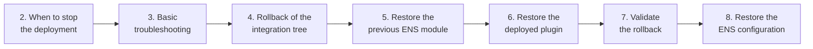

# ENSFácil troubleshooting and rollback
[Español](04-troubleshooting-and-rollback.md)

[[_TOC_]]

## 1. Objective

This guide describes the checks that must be performed when an ENSFácil
installation or update fails, and the procedures for returning to the
previous state in a controlled way.

> [!warning]
> A deployment must not continue if a prior validation has failed.



## 2. When to stop the deployment

Stop the procedure if any of these situations occurs:

| Situation |
|---|
| `check-integration.sh` returns `RESULTADO=NO_COMPATIBLE`. |
| an unvalidated Wazuh version is reported. |
| conflicts or `.rej` files appear when applying the integration. |
| the build does not generate `wazuh-2.19.5.zip`. |
| `unzip -t` reports errors. |
| Wazuh Dashboard does not return to `active` state after installing the plugin. |
| an `install-manager.sh` does not confirm its rule with `wazuh-logtest` or the manager does not stay `active`. |
| `config/validate-configuration.ts` reports `ESTRUCTURA INVÁLIDA`. |
| the dashboard shows «No se pudo cargar el entorno ENS». |

> [!important]
> Before modifying anything else, keep the output of the command that failed and locate the backups created during the procedure.

## 3. Basic troubleshooting

First check the status of the integration and the service:

```bash
REPO=/opt/ensfacil/repo
TARGET=/opt/ensfacil/build/plugins/main
PKG=$REPO/integration/wazuh-dashboard

"$PKG/check-integration.sh" "$TARGET"
sudo systemctl status wazuh-dashboard --no-pager
sudo journalctl -u wazuh-dashboard -n 50 --no-pager
```

If the problem appeared while applying the integration, also check whether
there are rejects:

```bash
find "$TARGET" -name "*.rej" -print
```

> [!warning]
> Do not attempt to manually fix the patches on the deployed environment without first identifying the cause.

## 4. Rollback of the integration tree

`apply-integration.sh` automatically creates a backup before modifying the
plugin tree. The path is shown in its output as `BACKUP=...`.

To locate the available backups:

```bash
ls -dt /opt/ensfacil/build/plugins/main-ensfacil-backup-* 2>/dev/null
```

Select the backup corresponding to the operation to be reverted and run:

```bash
REPO=/opt/ensfacil/repo
TARGET=/opt/ensfacil/build/plugins/main
PKG=$REPO/integration/wazuh-dashboard
BACKUP=/opt/ensfacil/build/plugins/main-ensfacil-backup-AAAAMMDD-HHMMSS

"$PKG/rollback-integration.sh" "$TARGET" "$BACKUP"
```

The rollback must end with:

```text
RESULTADO=ROLLBACK_OK
```

> [!warning]
> If it returns `RESULTADO=ROLLBACK_ERROR`, stop the procedure and review the output before continuing.

## 5. Restore the previous ENS module

> [!note]
> Rolling back the integration package does not, by itself, restore the `public/components/overview/ens` module, since it is updated independently.

Use the backup created before the update:

```bash
TARGET=/opt/ensfacil/build/plugins/main
UPDATE_BACKUP=/opt/ensfacil/artifacts/update-AAAAMMDD-HHMMSS

if test -d "$UPDATE_BACKUP/ens"; then
  sudo rm -rf "$TARGET/public/components/overview/ens"
  sudo cp -a "$UPDATE_BACKUP/ens" "$TARGET/public/components/overview/ens"
  sudo chown -R "$USER":"$USER" "$TARGET/public/components/overview/ens"
else
  echo "ERROR: backup ENS no encontrado"
fi
```

## 6. Restore the deployed plugin

If the new version was already installed on Wazuh Dashboard, reinstall the previous ZIP kept in the update backup with `config/deploy-plugin.sh`, which replaces only the `wazuh` plugin and bumps `build.number` so that browsers stop using the withdrawn version:

```bash
ZIP_ANTERIOR="$UPDATE_BACKUP/wazuh-2.19.5.zip"
if sudo -u wazuh-dashboard test -r "$ZIP_ANTERIOR"; then
  sudo bash /opt/ensfacil/repo/config/deploy-plugin.sh "$ZIP_ANTERIOR"
else
  echo "ERROR: ZIP anterior no accesible"
fi
```

> [!warning]
> If the plugin is removed by hand, do not use wildcards such as `wazuh*`: they would also delete `wazuhCore` and `wazuhCheckUpdates`.

> [!important]
> If the withdrawn version had seeded controls the previous one does not know, also restore the ENS configuration (section 8) with the copy made before the update.

## 7. Validate the rollback

Check the status of the service and the installed plugins:

```bash
sudo systemctl is-active wazuh-dashboard
sudo -u wazuh-dashboard /usr/share/wazuh-dashboard/bin/opensearch-dashboards-plugin list
```

Also check that the restored tree is left in a state recognized by the
integration package:

```bash
REPO=/opt/ensfacil/repo
TARGET=/opt/ensfacil/build/plugins/main
PKG=$REPO/integration/wazuh-dashboard

"$PKG/check-integration.sh" "$TARGET"
```

Wazuh Dashboard must be `active`, the `wazuh` plugin must appear installed,
and the integration check must show no conflicts.

Finally, access Wazuh Dashboard and confirm that ENSFácil is shown again
in the expected previous state.

> [!note]
> This procedure restores the code and the deployed plugin. It does not automatically revert data or configuration decisions stored outside the plugin tree.

## 8. Restore the ENS configuration

The ENS configuration lives in the `active` document of the `wazuh-ens-configuration` index. The installation and update guides keep a copy before every change (`/opt/ensfacil/artifacts/active-<date>.json` or `$BACKUP/active.json`). To restore it, the `_source` of that copy is written back, using the indexer administrator certificate:

```bash
COPIA=/opt/ensfacil/artifacts/active-AAAAMMDD-HHMMSS.json

sudo python3 -c "import json,sys; json.dump(json.load(open(sys.argv[1]))['_source'], open(sys.argv[2],'w'), ensure_ascii=False)" \
  "$COPIA" /opt/ensfacil/artifacts/active-restore.json

sudo curl -sk --cert /etc/wazuh-indexer/certs/admin.pem --key /etc/wazuh-indexer/certs/admin-key.pem \
  -H 'Content-Type: application/json' -X PUT \
  https://127.0.0.1:9200/wazuh-ens-configuration/_doc/active \
  --data-binary @/opt/ensfacil/artifacts/active-restore.json
```

The response must include `"result":"updated"`. Then validate the restored document with `config/validate-configuration.ts`, as in the [installation guide, section 14.4](01-installation-from-scratch.en.md#144-validate-the-whole-document), and reload the dashboard.

## 9. Known deployment problems

| Symptom | Cause | What to do |
|---|---|---|
| The dashboard shows «No se pudo cargar el entorno ENS» with `...parameters[M].value has an invalid value` | a parameter with `value: null`, a table with fewer columns than declared or an identifier column with commas or spaces | validate the document with `config/validate-configuration.ts`, fix the reported parameter or restore the copy (section 8). An empty parameter is the absent `value` key, never `null` |
| After deploying, the browser still shows the previous version | the ZIP was installed without bumping `build.number` | deploy with `config/deploy-plugin.sh` |
| The build ends after several minutes with `ENOENT: yarn install --production` | `yarn` is not in the `PATH` of the user building (common when building as `root`) | add the `yarn` directory to the `PATH` (see [installation, section 13.5](01-installation-from-scratch.en.md#135-build-and-validate-the-plugin)) |
| The build ends immediately with exit code 1 | the output is redirected as `root` to a `/tmp` file created by another user (`protected_regular`) | write the log to `/opt/ensfacil/artifacts` |
| `install-manager.sh`: «hay más de un bloque `<agent_config>`» | the `agent.conf` of the `ens` group has two blocks | merge everything into a single `<agent_config>`, validate with `verify-agent-conf` and retry |
| `install-manager.sh` ends fine but the rule does not match | a previous run failed after copying the rules and the retry does not restart the manager | `sudo systemctl restart wazuh-manager` and check with `wazuh-logtest` |
| auditd evidence not measured on a machine (op.exp.5, op.exp.8, op.exp.10) | `install.sh` wrote the rules to `/etc/audit/rules.d/` but they were not loaded | check that auditd is not immutable (`sudo auditctl -s`, `enabled` other than `2`) and run `sudo augenrules --load` |
| A control shows «Sin datos del recolector desde …» | the last heartbeat of that control's collector on that machine is older than 24 h | check the agent, the collector cron and connectivity; the control is judged again as soon as a new run arrives |
| op.exp.7, op.exp.8 or op.exp.9 without data on the manager row | the runbook's `install-manager.sh` is missing or its hourly cron has not run yet | check the manager's `/etc/cron.d/ensfacil-opexp*` and the `<localfile>` in its `ossec.conf` |
| An op.exp.1 rule appears on op.exp.10 events | op.exp.1 rules older than the fix, with the `ensfacil` field not anchored | update the op.exp.1 runbook and run its `install-manager.sh` again |
