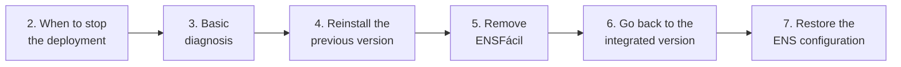

# ENSFácil troubleshooting and rollback
[Español](04-troubleshooting-and-rollback.md)

[[_TOC_]]

## 1. Objective

This guide describes the checks to run when an ENSFácil installation or update fails, and the procedures to go back to the previous state in a controlled way.

> [!warning]
> A deployment must not continue if a previous validation has failed.



## 2. When to stop the deployment

Stop the procedure if any of these situations occurs:

| Situation |
|---|
| `config/build-plugin.sh` does not end with the path of `ensfacil-2.19.5.zip`. |
| `sha256sum -c SHA256SUMS` says `FAILED` for a release file. |
| `unzip -t` reports errors, or `deploy-plugin.sh --solo-id` does not return `ensfacil`. |
| `config/deploy-plugin.sh` says «el zip no es de ENSFácil» (the zip is not ENSFácil) or «el zip es del plugin de Wazuh» (the zip is the Wazuh plugin). |
| Wazuh Dashboard does not return to `active` after installing the plugin. |
| `/api/ensfacil/configuration` returns `404`: the plugin did not load. |
| an `install-manager.sh` does not confirm its rule with `wazuh-logtest` or the manager does not stay `active`. |
| `config/validate-configuration.ts` reports `ESTRUCTURA INVÁLIDA`. |
| the dashboard shows «No se pudo cargar el entorno ENS». |

> [!important]
> Before changing anything else, keep the output of the command that failed and locate the backups created during the procedure.

## 3. Basic diagnosis

Check the service, the installed plugins and the plugin route:

```bash
sudo systemctl status wazuh-dashboard --no-pager
sudo -u wazuh-dashboard /usr/share/wazuh-dashboard/bin/opensearch-dashboards-plugin list
curl -sk -o /dev/null -w '%{http_code}\n' https://localhost/api/ensfacil/configuration
```

Check in the log that the dashboard loaded ENSFácil, and look for errors:

```bash
sudo journalctl -u wazuh-dashboard --since "-15 min" --no-pager \
  | grep -o 'Setting up \[[0-9]*\] plugins: \[[^]]*\]' | tail -1 | grep -c ensfacil
sudo journalctl -u wazuh-dashboard --since "-15 min" --no-pager | grep -iE '"level":"error"|fatal' | tail -20
```

What you should see:

| Check | Expected result |
|---|---|
| service | `active (running)` |
| plugins | `ensfacil` and `wazuh`, among others |
| `/api/ensfacil/configuration` | `401` (the route exists and asks for a session) |
| `Setting up … plugins` | `1` (ENSFácil is among the loaded plugins) |
| errors | none mentioning `ensfacil` |

> [!note]
> Error lines from client TLS connections (`bad certificate`, `ERR_SSL_…`) have nothing to do with the plugin.

## 4. Reinstall the previous ENSFácil version

Going back to the previous version means deploying its release again. `deploy-plugin.sh` replaces only `ensfacil` and bumps `build.number` so browsers stop using the removed version.

Use that version's folder (`/opt/ensfacil/releases/<version>`). If you no longer have it, download it again ([Installing from a release, section 6.3](07-installing-from-a-release.en.md#63-download-the-four-files), with that version in `V`). Replace `X.Y.Z` with the version you are going back to:

```bash
V=X.Y.Z
R=/opt/ensfacil/releases/$V
cd "$R" && sha256sum -c SHA256SUMS \
  && sudo bash deploy-plugin.sh "ensfacil-$V-osd-2.19.5.zip"
```

What you should see: `OK` for the three files and, at the end, `dashboard: active` and `ensfacil` in the plugin list. Then check as in section 3: the plugin list must show `ensfacil@<previous version>`.

If the previous version was built from source, the update guide keeps its zip in the backup (`/opt/ensfacil/artifacts/update-<date>/`). To go back to it, deploy it the same way, with `config/deploy-plugin.sh`:

```bash
UPDATE_BACKUP=/opt/ensfacil/artifacts/update-AAAAMMDD-HHMMSS
ZIP_ANTERIOR="$UPDATE_BACKUP/ensfacil-2.19.5.zip"

if sudo -u wazuh-dashboard test -r "$ZIP_ANTERIOR"; then
  sudo bash /opt/ensfacil/repo/config/deploy-plugin.sh "$ZIP_ANTERIOR"
else
  echo "ERROR: previous zip not accessible"
fi
```

What you should see: `dashboard: active` and `ensfacil` in the plugin list. Then check as in section 3.

> [!important]
> If the removed version had seeded controls the previous one does not know, also restore the ENS configuration (section 7) with the copy made before the update.

### 4.1 If `deploy-plugin.sh` fails halfway

Before stopping the dashboard, `deploy-plugin.sh` saves the installed `ensfacil` in `/var/backups/ensfacil/plugins-ensfacil-<date>.tgz`, or in `<folder>/ensfacil/` if `ENSFACIL_BACKUP_DIR=<folder>` is set. The script creates that subfolder (owned by root, permissions 0700) if it does not exist, and never changes the permissions of a folder that already existed. When the deployment finishes well, the last 3 copies are kept; a failed deployment deletes none, so the last good copy is still there even if it is retried. It does not leave them next to the zip: the next build deletes that folder.

If something fails once the dashboard is stopped, the script prints the commands to go back to how it was (remove the half-installed plugin, restore that copy, put back `package.json` if it had already changed it, and start the dashboard) and exits with an error. Run them in the order they are printed and check as in section 3.

| Exit code | What happened | State it leaves |
|---|---|---|
| `1` | wrong usage: no zip, two zips or an unknown option | untouched |
| `2` | the zip is not ENSFácil | untouched |
| `3` | the copy of the previous plugin could not be saved | untouched: the dashboard keeps running |
| `5` | installing the zip failed | dashboard stopped and without `ensfacil` |
| `6` | the dashboard was not active at the end | new plugin installed and dashboard not active: check `journalctl -u wazuh-dashboard` |
| `7` | another step failed with the dashboard stopped (removing the plugin, bumping `build.number`, starting) or it was interrupted | the message names the step |

To go back after a deployment that finished well, use the previous release or the previous zip (above): `deploy-plugin.sh` also bumps `build.number`, and restoring the copy by hand does not.

## 5. Remove ENSFácil

Removing ENSFácil touches neither the Wazuh plugin nor the data:

```bash
sudo systemctl stop wazuh-dashboard
sudo -u wazuh-dashboard /usr/share/wazuh-dashboard/bin/opensearch-dashboards-plugin remove ensfacil
sudo rm -rf /usr/share/wazuh-dashboard/plugins/ensfacil
sudo systemctl start wazuh-dashboard
```

Check:

```bash
sudo systemctl is-active wazuh-dashboard
sudo -u wazuh-dashboard /usr/share/wazuh-dashboard/bin/opensearch-dashboards-plugin list
curl -sk -o /dev/null -w '%{http_code}\n' https://localhost/api/ensfacil/configuration
```

What you should see: `active`, `wazuh` in the list and not `ensfacil`, and `404`.

> [!warning]
> Always remove by the exact name, `ensfacil`. Never with wildcards such as `wazuh*` or `*`: they would also take `wazuhCore` and `wazuhCheckUpdates`, and the dashboard would not start again.

The ENS configuration stays in the `wazuh-ens-configuration` index and the `ensfacil_admin` role stays in the security plugin (it grants no permission). When ENSFácil is installed again, everything is where it was.

### 5.1 Remove it completely

Only if ENSFácil is not going to be used again in this environment. This deletes
the ENS configuration and its history: first save a copy of the document
([Installing from a release, section 11](07-installing-from-a-release.en.md#11-update-to-a-newer-release),
step 2), and do not do it if another installation reads the same indexer.

```bash
C=/etc/wazuh-indexer/certs
ix() { sudo curl -s --cacert $C/root-ca.pem --cert $C/admin.pem --key $C/admin-key.pem "$@"; echo; }
ix -X DELETE https://127.0.0.1:9200/_plugins/_security/api/rolesmapping/ensfacil_admin
ix -X DELETE https://127.0.0.1:9200/_plugins/_security/api/roles/ensfacil_admin
ix -X DELETE https://127.0.0.1:9200/wazuh-ens-configuration
```

What you should see: `"status":"OK"` in the first two (in the first one,
`NOT_FOUND` if the role had no users) and `"acknowledged":true` in the last one.

The facts stay: they are Wazuh alerts in `wazuh-alerts-*` and expire with those
indices' retention. The manager rules and each machine's collectors are removed
with each runbook's `03-uninstall-and-troubleshooting` guide
([runbooks and registers](05-runbooks-and-registers.en.md#runbooks-per-control)).

## 6. Go back to the integrated version

Only for an environment that comes from the integrated version ([update guide, section 10](02-updating-an-existing-environment.en.md#10-transition-from-the-integrated-version)). The integrated version is no longer maintained: `config/deploy-plugin.sh` does not install its zip (`wazuh-2.19.5.zip`), and going back uses what section 10.3 of that guide kept.

**Before reinstalling the official Wazuh plugin** (section 10.3 of that guide), the integrated version is still installed. Removing ENSFácil is enough (section 5).

**After reinstalling the official Wazuh plugin**, the integrated plugin that section 10.3 moved to `$T/wazuh-integrado` is put back in place, and ENSFácil is deployed again, with the release installed in section 10.1 of that guide, so that it bumps `build.number` (browsers have the official plugin's files linked to the current number). This is only valid while the `wazuh-dashboard` package is still 4.14.7: the integrated plugin is built for that version, and with another one the dashboard does not start.

```bash
T=/opt/ensfacil/artifacts/transicion-AAAAMMDD-HHMMSS
P=/usr/share/wazuh-dashboard/plugins
V=1.0.0   # the installed ENSFácil version
R=/opt/ensfacil/releases/$V

if [ "$(dpkg-query -W -f='${Version}' wazuh-dashboard)" = 4.14.7-1 ] \
   && sudo test -d "$T/wazuh-integrado" && ! sudo test -e "$T/wazuh-oficial" \
   && test -f "$R/ensfacil-$V-osd-2.19.5.zip"; then
  sudo systemctl stop wazuh-dashboard \
    && sudo mv "$P/wazuh" "$T/wazuh-oficial" \
    && sudo mv "$T/wazuh-integrado" "$P/wazuh" \
    && sudo bash "$R/deploy-plugin.sh" "$R/ensfacil-$V-osd-2.19.5.zip"
else
  echo "NO: wazuh-dashboard is not 4.14.7-1, $T/wazuh-integrado or the zip in $R is missing, or $T/wazuh-oficial already exists"
fi
```

What you should see: at the end of the deployment, `dashboard: active`. The «ENS» app appears in the menu again, next to «ENSFácil». ENSFácil can stay installed or be removed (section 5). If it prints `NO: …`, nothing was touched.

To undo it and go back to the official plugin left in `$T/wazuh-oficial`:

```bash
sudo systemctl stop wazuh-dashboard
sudo mv "$P/wazuh" "$T/wazuh-integrado" && sudo mv "$T/wazuh-oficial" "$P/wazuh"
sudo bash "$R/deploy-plugin.sh" "$R/ensfacil-$V-osd-2.19.5.zip"
```

If `$T/wazuh-integrado` is missing, the integrated plugin is also in `$T/plugins-antes.tgz`, the whole `plugins` folder as it was before section 10.3. Extract only `plugins/wazuh` from it to that place and repeat the first block:

```bash
sudo mkdir -p "$T/desde-tgz"
sudo tar -xzf "$T/plugins-antes.tgz" -C "$T/desde-tgz" plugins/wazuh
sudo mv "$T/desde-tgz/plugins/wazuh" "$T/wazuh-integrado"
```

> [!note]
> The configuration does not need to be touched: both versions use the same document. If controls the integrated version does not know were seeded after the transition, restore the configuration (section 7).

## 7. Restore the ENS configuration

The ENS configuration lives in the `active` document of the `wazuh-ens-configuration` index. The installation and update guides keep a copy before every change (`/opt/ensfacil/artifacts/active-<date>.json` or `$BACKUP/active.json`). To restore it, the `_source` of that copy is written back, using the indexer administrator certificate:

```bash
COPIA=/opt/ensfacil/artifacts/active-AAAAMMDD-HHMMSS.json

sudo python3 -c "import json,sys; json.dump(json.load(open(sys.argv[1]))['_source'], open(sys.argv[2],'w'), ensure_ascii=False)" \
  "$COPIA" /opt/ensfacil/artifacts/active-restore.json

sudo curl -sk --cert /etc/wazuh-indexer/certs/admin.pem --key /etc/wazuh-indexer/certs/admin-key.pem \
  -H 'Content-Type: application/json' -X PUT \
  https://127.0.0.1:9200/wazuh-ens-configuration/_doc/active \
  --data-binary @/opt/ensfacil/artifacts/active-restore.json
```

The response must include `"result":"updated"`. Then validate the restored document with `config/validate-configuration.ts`, as in the [installation guide, section 14.4](01-installation-from-scratch.en.md#144-validate-the-whole-document), and reload the dashboard.

## 8. Known deployment problems

| Symptom | Cause | What to do |
|---|---|---|
| «No se pudo cargar el entorno ENS» with «No hay inventario de agentes: la monitorización de agentes de Wazuh (wazuh-monitoring-*) no está activa o este usuario no puede leerla.» (no agent inventory) | Wazuh is not storing the agents' state in `wazuh-monitoring-*`, or the user's role cannot read that index | count the documents: `sudo curl -sk --cert /etc/wazuh-indexer/certs/admin.pem --key /etc/wazuh-indexer/certs/admin-key.pem "https://127.0.0.1:9200/wazuh-monitoring-*/_count"`. If it is `0`, enable agent monitoring in the Wazuh app configuration (`wazuh.monitoring.enabled`); if there are documents, give the user's role read access to `wazuh-monitoring-*` |
| Warning «ENSFácil: inventario de agentes antiguo» (old agent inventory) | the latest `wazuh-monitoring-*` data is older than 1 hour: a recent addition or removal may not show | check that Wazuh agent monitoring is still enabled |
| In Controles or Eventos: «No existe el patrón de índice wazuh-alerts-*: créalo desde Wazuh (o Dashboards Management) para usar esta vista» (no index pattern) | the `wazuh-alerts-*` index pattern does not exist yet | open the Wazuh app once, which creates it in its initial check, or create it in Dashboards Management > Index patterns. The other tabs work without it |
| When saving the configuration: «Hace falta el rol ensfacil_admin o all_access para cambiar la configuración ENS o ver su historial.» (403 error) | the user has neither role | assign the role with `config/create-admin-role.sh --mapear <usuario>` ([installation, section 13.5](01-installation-from-scratch.en.md#135-create-the-ensfacil_admin-role)); if the user had a session open, log out and log in again |
| The screens show a permissions error when searching data | the user's role cannot read `wazuh-alerts-*` | give it read access to `wazuh-alerts-*`, the usual permission to see Wazuh data |
| «ENSFácil» does not appear in the menu and `/api/ensfacil/configuration` returns `404` | the plugin is not installed or did not load | check the plugin list and the log (section 3) and deploy again with `config/deploy-plugin.sh` |
| The dashboard does not start after updating Wazuh: `Failed to initialize plugins` and `ensfacil` | the new dashboard ships another OpenSearch Dashboards version and the plugin is built for `2.19.5` | remove ENSFácil (section 5) and get the zip for that version ([version compatibility](03-version-compatibility.en.md)) |
| The menu shows «ENS» and «ENSFácil» | the integrated version is still installed | normal during the transition; to keep only «ENSFácil», [update, section 10.3](02-updating-an-existing-environment.en.md#103-go-back-to-the-official-wazuh-plugin) |
| `deploy-plugin.sh`: «el zip no es de ENSFácil» or «el zip es del plugin de Wazuh» | `deploy-plugin.sh` only installs `ensfacil`; the Wazuh plugin (also the integrated version's `wazuh-2.19.5.zip`) comes with the official `wazuh-dashboard` package | use the ENSFácil zip: the release's `ensfacil-<version>-osd-2.19.5.zip`, or `ensfacil-2.19.5.zip` when built |
| When downloading the release, `curl: (22) … error: 401` or `403` | the deploy token is mistyped, expired, revoked or lacks `read_package_registry` | check the token in GitLab ([Installing from a release, section 6](07-installing-from-a-release.en.md#6-download-from-the-server-with-a-deploy-token)) |
| When downloading the release, `curl: (22) … error: 404` | that version is not published or is misspelled | check the version in *Deploy → Releases* |
| `sha256sum -c SHA256SUMS` says `FAILED` | the download is incomplete or the file is not the release's | do not install; delete the folder and download again |
| `build-plugin.sh`: «no es un árbol de OpenSearch Dashboards» or «el árbol es … ENSFácil 1.x se compila contra 2.19.5» | the build tree is not OpenSearch Dashboards `2.19.5` | prepare the tree as in [Building from source, section 3.2](08-building-from-source.en.md#32-prepare-the-opensearch-dashboards-2195-tree) |
| `build-plugin.sh` ends with `yarn: command not found`, or after building with `ENOENT: yarn install --production` | `yarn` is not in `root`'s `PATH` | build as in [Building from source, section 3.3](08-building-from-source.en.md#33-build-the-plugin), with `sudo env PATH=…` |
| `yarn install` stops with `Your lockfile needs to be updated` | `package.json` and `yarn.lock` do not match: there are local changes in the repository | do not touch the dependencies on the server; leave the repository as it is in GitLab (`git status`) |
| The build ends immediately with exit code 1 | the output is redirected as `root` to a `/tmp` file created by another user (`protected_regular`) | write the log to `/opt/ensfacil/artifacts` |
| After deploying, the browser still shows the previous version | the zip was installed without bumping `build.number` | deploy with `config/deploy-plugin.sh` |
| The dashboard shows «No se pudo cargar el entorno ENS» with `...parameters[M].value has an invalid value` | a parameter with `value: null`, a table with fewer columns than declared or an identifier column with commas or spaces | validate the document with `config/validate-configuration.ts`, fix the reported parameter or restore the copy (section 7). An empty parameter is the absent `value` key, never `null` |
| `install-manager.sh`: «hay más de un bloque `<agent_config>`» | the `agent.conf` of the `ens` group (or the `ens-copias` one, for mp.info.6) has two blocks | merge everything into a single `<agent_config>`, validate with `verify-agent-conf` and retry |
| `install-manager.sh` ends fine but the rule does not match | a previous run failed after copying the rules and the retry does not restart the manager | `sudo systemctl restart wazuh-manager` and check with `wazuh-logtest` |
| auditd evidence not measured on a machine (op.exp.5, op.exp.8, op.exp.10) | `install.sh` wrote the rules to `/etc/audit/rules.d/` but they were not loaded | check that auditd is not immutable (`sudo auditctl -s`, `enabled` other than `2`) and run `sudo augenrules --load` |
| A control shows «Sin datos del recolector desde …» | the last heartbeat of that control's collector on that machine is older than 24 h | check the agent, the collector cron and connectivity; the control is judged again as soon as a new run arrives |
| op.exp.7, op.exp.8 or op.exp.9 without data on the manager row | the runbook's `install-manager.sh` is missing or its hourly cron has not run yet | check the manager's `/etc/cron.d/ensfacil-opexp*` and the `<localfile>` in its `ossec.conf` |
| An op.exp.1 rule appears on op.exp.10 events | op.exp.1 rules older than the fix, with the `ensfacil` field not anchored | update the op.exp.1 runbook and run its `install-manager.sh` again |
