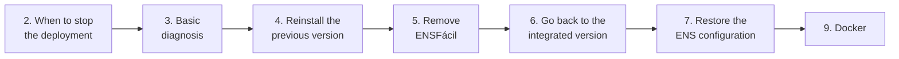

# ENSFácil troubleshooting and rollback
[Español](04-troubleshooting-and-rollback.md)

[[_TOC_]]

## 1. Objective

Checks after a failed ENSFácil installation or update, and rollback procedures.

> [!warning]
> A deployment must not continue if a previous validation has failed.

> [!note]
> The commands in sections 3 to 8 apply to the package installation (systemd,
> `/etc/wazuh-indexer/certs` and `https://127.0.0.1:9200`). For Wazuh in Docker,
> section 9 applies.



## 2. When to stop the deployment

Stop the procedure if any of these situations occurs:

| Situation |
|---|
| `config/build-plugin.sh` does not end with the path of `ensfacil-2.19.5.zip`. |
| `sha256sum -c SHA256SUMS` says `FAILED` for a release file. |
| `unzip -t` reports errors, or `deploy-plugin.sh --solo-id` does not return `ensfacil`. |
| `config/deploy-plugin.sh` says «the zip is not ENSFácil's» (the zip is not ENSFácil) or «the zip is the Wazuh plugin» (the zip is the Wazuh plugin). |
| Wazuh Dashboard does not return to `active` after installing the plugin. |
| `/api/ensfacil/configuration` returns `404`: the plugin did not load. |
| an `install-manager.sh` does not confirm its rule with `wazuh-logtest` or the manager does not stay `active`. |
| `config/validate-configuration.ts` reports `INVALID STRUCTURE`. |
| the dashboard shows «No se pudo cargar el entorno ENS». |

> [!important]
> Before changing anything else, keep the output of the command that failed and locate the backups created during the procedure.

## 3. Basic diagnosis

Check the service, the installed plugins and the plugin route:

```bash
sudo systemctl status wazuh-dashboard --no-pager
sudo -u wazuh-dashboard /usr/share/wazuh-dashboard/bin/opensearch-dashboards-plugin list
curl -sk -o /dev/null -w '%{http_code}\n' https://localhost/api/ensfacil/configuration
```

Check in the log that the dashboard loaded ENSFácil, and look for errors:

```bash
sudo journalctl -u wazuh-dashboard --since "-15 min" --no-pager \
  | grep -o 'Setting up \[[0-9]*\] plugins: \[[^]]*\]' | tail -1 | grep -c ensfacil
sudo journalctl -u wazuh-dashboard --since "-15 min" --no-pager | grep -iE '"level":"error"|fatal' | tail -20
```

Expected result:

| Check | Expected result |
|---|---|
| service | `active (running)` |
| plugins | `ensfacil` and `wazuh`, among others |
| `/api/ensfacil/configuration` | `401` (the route exists and asks for a session) |
| `Setting up … plugins` | `1` (ENSFácil is among the loaded plugins) |
| errors | none mentioning `ensfacil` |

> [!note]
> Error lines from client TLS connections (`bad certificate`, `ERR_SSL_…`) are not related to the plugin.

## 4. Reinstall the previous ENSFácil version

Deploy the previous release again: `deploy-plugin.sh` replaces only `ensfacil` and bumps `build.number`.

Use the folder of that version (`/opt/ensfacil/releases/<version>`). If it no longer exists, download the release again ([Installing from a release, section 6.3](07-installing-from-a-release.en.md#63-download-the-four-files), with that version in `V`). Replace `X.Y.Z` with the target version:

```bash
V=X.Y.Z
R=/opt/ensfacil/releases/$V
cd "$R" && sha256sum -c SHA256SUMS \
  && sudo bash deploy-plugin.sh "ensfacil-$V-osd-2.19.5.zip"
```

Expected result: `OK` for the three files and, at the end, `dashboard: active` and `ensfacil` in the plugin list. Then check as in section 3: the plugin list must show `ensfacil@<previous version>`.

If the previous version was built from source, the update guide keeps its zip in the backup (`/opt/ensfacil/artifacts/update-<date>/`). To go back to that zip, deploy it the same way, with `config/deploy-plugin.sh`:

```bash
UPDATE_BACKUP=/opt/ensfacil/artifacts/update-AAAAMMDD-HHMMSS
ZIP_ANTERIOR="$UPDATE_BACKUP/ensfacil-2.19.5.zip"

if sudo -u wazuh-dashboard test -r "$ZIP_ANTERIOR"; then
  sudo bash /opt/ensfacil/repo/config/deploy-plugin.sh "$ZIP_ANTERIOR"
else
  echo "ERROR: previous zip not accessible"
fi
```

Expected result: `dashboard: active` and `ensfacil` in the plugin list. Then check as in section 3.

> [!important]
> If the removed version had seeded controls the previous one does not know, also restore the ENS configuration (section 7) with the copy made before the update. To go back from 1.3.0 to 1.2.0 with its templates, or to 1.1.0 after «Repartir por agentes», restore the earlier version of the document ([Configuration by controls and templates, section 12](09-configuration-by-system.en.md#12-compatibility-and-rollback)).

### 4.1 If `deploy-plugin.sh` fails halfway

Before stopping the dashboard, `deploy-plugin.sh` saves the installed `ensfacil` in `/var/backups/ensfacil/plugins-ensfacil-<date>.tgz`, or in `<folder>/ensfacil/` if `ENSFACIL_BACKUP_DIR=<folder>` is set. The script creates that subfolder (root, 0700) if it does not exist and does not change the permissions of an existing folder. After a successful deployment the last 3 copies are kept; a failed deployment deletes none. The copies are not stored next to the zip: the next build deletes that folder.

If something fails once the dashboard is stopped, the script prints the commands to go back to how it was (remove the half-installed plugin, restore that copy, put back `package.json` if it had already changed it, and start the dashboard) and exits with an error. Run those commands in the order they are printed and check as in section 3.

| Exit code | What happened | State it leaves |
|---|---|---|
| `1` | wrong usage: no zip, two zips or an unknown option | untouched |
| `2` | the zip is not ENSFácil | untouched |
| `3` | the copy of the previous plugin could not be saved | untouched: the dashboard keeps running |
| `4` | the `wazuh-dashboard` user cannot read the temporary copy of the zip (the script places it in `${TMPDIR:-/tmp}`) | untouched: the dashboard keeps running; set another folder with `TMPDIR=<folder>` |
| `5` | installing the zip failed | dashboard stopped and without `ensfacil` |
| `6` | the dashboard was not active at the end | new plugin installed and dashboard not active: check `journalctl -u wazuh-dashboard` |
| `7` | another step failed with the dashboard stopped (removing the plugin, bumping `build.number`, starting) or it was interrupted | the message names the step |

After a successful deployment, go back with the previous release or zip (above), not by restoring the copy by hand: only `deploy-plugin.sh` bumps `build.number`.

## 5. Remove ENSFácil

Removing ENSFácil touches neither the Wazuh plugin nor the data:

```bash
sudo systemctl stop wazuh-dashboard
sudo -u wazuh-dashboard /usr/share/wazuh-dashboard/bin/opensearch-dashboards-plugin remove ensfacil
sudo rm -rf /usr/share/wazuh-dashboard/plugins/ensfacil
sudo systemctl start wazuh-dashboard
```

Check:

```bash
sudo systemctl is-active wazuh-dashboard
sudo -u wazuh-dashboard /usr/share/wazuh-dashboard/bin/opensearch-dashboards-plugin list
curl -sk -o /dev/null -w '%{http_code}\n' https://localhost/api/ensfacil/configuration
```

Expected result: `active`; `wazuh` in the list, without `ensfacil`; `404`.

> [!warning]
> Always remove by the exact name, `ensfacil`. Never with wildcards such as `wazuh*` or `*`: they would also take `wazuhCore` and `wazuhCheckUpdates`, and the dashboard would not start again.

The `wazuh-ens-configuration` index and the `ensfacil_admin` role (no permissions of its own) are kept.

### 5.1 Remove it completely

Only if ENSFácil will not be used again in this environment. This deletes the
ENS configuration and its history. Before running it, save a copy of the
document ([Installing from a release, section 11](07-installing-from-a-release.en.md#11-update-to-a-newer-release),
step 2). Do not run this step if another installation uses the same indexer.

```bash
C=/etc/wazuh-indexer/certs
ix() { sudo curl -s --cacert $C/root-ca.pem --cert $C/admin.pem --key $C/admin-key.pem "$@"; echo; }
ix -X DELETE https://127.0.0.1:9200/_plugins/_security/api/rolesmapping/ensfacil_admin
ix -X DELETE https://127.0.0.1:9200/_plugins/_security/api/roles/ensfacil_admin
ix -X DELETE https://127.0.0.1:9200/wazuh-ens-configuration
```

Expected result: `"status":"OK"` in the first two (in the first one,
`NOT_FOUND` if the role had no users) and `"acknowledged":true` in the last one.

The facts stay: they are Wazuh alerts in `wazuh-alerts-*` and expire with those
indices' retention. The manager rules and each machine's collectors are removed
with each runbook's `03-uninstall-and-troubleshooting` guide
([runbooks and registers](05-runbooks-and-registers.en.md#runbooks-per-control)).

## 6. Go back to the integrated version

Only for an environment that comes from the integrated version ([update guide, section 10](02-updating-an-existing-environment.en.md#10-transition-from-the-integrated-version)). `config/deploy-plugin.sh` does not install the integrated version's zip (`wazuh-2.19.5.zip`): going back uses what section 10.3 of that guide kept.

**Before reinstalling the official Wazuh plugin** (section 10.3 of that guide), the integrated version is still installed. Removing ENSFácil is enough (section 5).

**After reinstalling the official Wazuh plugin**, the integrated plugin that section 10.3 moved to `$T/wazuh-integrado` is put back in place, and ENSFácil is deployed again with the release from section 10.1 of that guide, to bump `build.number`. Valid only with `wazuh-dashboard` 4.14.7: with another version the dashboard does not start.

```bash
T=/opt/ensfacil/artifacts/transicion-AAAAMMDD-HHMMSS
P=/usr/share/wazuh-dashboard/plugins
V=1.2.0   # the installed ENSFácil version
R=/opt/ensfacil/releases/$V

if [ "$(dpkg-query -W -f='${Version}' wazuh-dashboard)" = 4.14.7-1 ] \
   && sudo test -d "$T/wazuh-integrado" && ! sudo test -e "$T/wazuh-oficial" \
   && test -f "$R/ensfacil-$V-osd-2.19.5.zip"; then
  sudo systemctl stop wazuh-dashboard \
    && sudo mv "$P/wazuh" "$T/wazuh-oficial" \
    && sudo mv "$T/wazuh-integrado" "$P/wazuh" \
    && sudo bash "$R/deploy-plugin.sh" "$R/ensfacil-$V-osd-2.19.5.zip"
else
  echo "NO: wazuh-dashboard is not 4.14.7-1, $T/wazuh-integrado or the zip in $R is missing, or $T/wazuh-oficial already exists"
fi
```

Expected result: at the end of the deployment, `dashboard: active`. The «ENS» app appears in the menu again, next to «ENSFácil». ENSFácil can stay installed or be removed (section 5). If it prints `NO: …`, nothing was touched.

To undo it and go back to the official plugin left in `$T/wazuh-oficial`:

```bash
sudo systemctl stop wazuh-dashboard
sudo mv "$P/wazuh" "$T/wazuh-integrado" && sudo mv "$T/wazuh-oficial" "$P/wazuh"
sudo bash "$R/deploy-plugin.sh" "$R/ensfacil-$V-osd-2.19.5.zip"
```

If `$T/wazuh-integrado` is missing, the integrated plugin is also in `$T/plugins-antes.tgz`, the whole `plugins` folder as it was before section 10.3. Extract only `plugins/wazuh` from it to that place and repeat the first block:

```bash
sudo mkdir -p "$T/desde-tgz"
sudo tar -xzf "$T/plugins-antes.tgz" -C "$T/desde-tgz" plugins/wazuh
sudo mv "$T/desde-tgz/plugins/wazuh" "$T/wazuh-integrado"
```

> [!note]
> The configuration does not need to be touched: both versions use the same document. If controls the integrated version does not know were seeded after the transition, restore the configuration (section 7).

## 7. Restore the ENS configuration

`active` document of the `wazuh-ens-configuration` index. Copies made before every change: `/opt/ensfacil/artifacts/active-<date>.json` or `$BACKUP/active.json`. Write the `_source` of the copy back with the indexer administrator certificate:

```bash
COPIA=/opt/ensfacil/artifacts/active-AAAAMMDD-HHMMSS.json

sudo python3 -c "import json,sys; json.dump(json.load(open(sys.argv[1]))['_source'], open(sys.argv[2],'w'), ensure_ascii=False)" \
  "$COPIA" /opt/ensfacil/artifacts/active-restore.json

sudo curl -sk --cert /etc/wazuh-indexer/certs/admin.pem --key /etc/wazuh-indexer/certs/admin-key.pem \
  -H 'Content-Type: application/json' -X PUT \
  https://127.0.0.1:9200/wazuh-ens-configuration/_doc/active \
  --data-binary @/opt/ensfacil/artifacts/active-restore.json
```

Expected result: the response includes `"result":"updated"`. Then validate the restored document with `config/validate-configuration.ts`, as in the [installation guide, section 14.4](01-installation-from-scratch.en.md#144-validate-the-whole-document), and reload the dashboard.

## 8. Known deployment problems

| Symptom | Cause | What to do |
|---|---|---|
| «No se pudo cargar el entorno ENS» with «No hay inventario de agentes: la monitorización de agentes de Wazuh (wazuh-monitoring-*) no está activa o este usuario no puede leerla.» (no agent inventory) | Wazuh is not storing the agents' state in `wazuh-monitoring-*`, or the user's role cannot read that index | count the documents: `sudo curl -sk --cert /etc/wazuh-indexer/certs/admin.pem --key /etc/wazuh-indexer/certs/admin-key.pem "https://127.0.0.1:9200/wazuh-monitoring-*/_count"`. If it is `0`, enable agent monitoring in the Wazuh app configuration (`wazuh.monitoring.enabled`); if there are documents, grant the user's role read access to `wazuh-monitoring-*` |
| Warning «ENSFácil: inventario de agentes antiguo» (old agent inventory) | the latest `wazuh-monitoring-*` data is older than 1 hour: a recent addition or removal may not show | check that Wazuh agent monitoring is still enabled |
| In Controles or Eventos: «No existe el patrón de índice wazuh-alerts-*: créalo desde Wazuh (o Dashboards Management) para usar esta vista» (no index pattern) | the `wazuh-alerts-*` index pattern does not exist yet | open the Wazuh app once, which creates it in its initial check, or create it in Dashboards Management > Index patterns. The other tabs work without it |
| When saving the configuration: «Hace falta el rol ensfacil_admin o all_access para cambiar la configuración ENS o ver su historial.» (403 error) | the user has neither role | assign the role with `config/create-admin-role.sh --mapear <usuario>` ([installation, section 13.5](01-installation-from-scratch.en.md#135-create-the-ensfacil_admin-role)); if the user had a session open, the user must log out and log in again |
| The screens show a permissions error when searching data | the user's role cannot read `wazuh-alerts-*` | grant the role read access to `wazuh-alerts-*`, the usual permission to see Wazuh data |
| «ENSFácil» does not appear in the menu and `/api/ensfacil/configuration` returns `404` | the plugin is not installed or did not load | check the plugin list and the log (section 3) and deploy again with `config/deploy-plugin.sh` |
| The dashboard does not start after updating Wazuh: `Failed to initialize plugins` and `ensfacil` | the new dashboard ships another OpenSearch Dashboards version and the plugin is built for `2.19.5` | remove ENSFácil (section 5) and get the zip for that version ([version compatibility](03-version-compatibility.en.md)) |
| The menu shows «ENS» and «ENSFácil» | the integrated version is still installed | normal during the transition; to keep only «ENSFácil», [update, section 10.3](02-updating-an-existing-environment.en.md#103-go-back-to-the-official-wazuh-plugin) |
| `deploy-plugin.sh`: «the zip is not ENSFácil's» or «the zip is the Wazuh plugin» | `deploy-plugin.sh` only installs `ensfacil`; the Wazuh plugin (also the integrated version's `wazuh-2.19.5.zip`) comes with the official `wazuh-dashboard` package | use the ENSFácil zip: the release's `ensfacil-<version>-osd-2.19.5.zip`, or `ensfacil-2.19.5.zip` when built |
| When downloading the release, `curl: (22) … error: 401` or `403` | the deploy token is mistyped, expired, revoked or lacks `read_package_registry` | check the token in GitLab ([Installing from a release, section 6](07-installing-from-a-release.en.md#6-download-from-the-server-with-a-deploy-token)) |
| When downloading the release, `curl: (22) … error: 404` | that version is not published or is misspelled | check the version in *Deploy → Releases* |
| `sha256sum -c SHA256SUMS` says `FAILED` | the download is incomplete or the file is not the release's | do not install; delete the folder and download again |
| `build-plugin.sh`: «not an OpenSearch Dashboards tree» or «the tree is … ENSFácil 1.x builds against 2.19.5» | the build tree is not OpenSearch Dashboards `2.19.5` | prepare the tree as in [Building from source, section 3.2](08-building-from-source.en.md#32-prepare-the-opensearch-dashboards-2195-tree) |
| `build-plugin.sh` ends with `yarn: command not found`, or after building with `ENOENT: yarn install --production` | `yarn` is not in `root`'s `PATH` | build as in [Building from source, section 3.3](08-building-from-source.en.md#33-build-the-plugin), with `sudo env PATH=…` |
| `yarn install` stops with `Your lockfile needs to be updated` | `package.json` and `yarn.lock` do not match: there are local changes in the repository | do not touch the dependencies on the server; leave the repository as it is in GitLab (`git status`) |
| The build ends immediately with exit code 1 | the output is redirected as `root` to a `/tmp` file created by another user (`protected_regular`) | write the log to `/opt/ensfacil/artifacts` |
| After deploying, the browser still shows the previous version | the zip was installed without bumping `build.number` | deploy with `config/deploy-plugin.sh` |
| The dashboard shows «No se pudo cargar el entorno ENS» with `...parameters[M].value has an invalid value` | a parameter with `value: null`, a table with fewer columns than declared or an identifier column with commas or spaces | validate the document with `config/validate-configuration.ts`, fix the reported parameter or restore the copy (section 7). An empty parameter is the absent `value` key, never `null` |
| `install-manager.sh`: «hay más de un bloque `<agent_config>`» | the `agent.conf` of the `ens` group (or the `ens-copias` one, for mp.info.6) has two blocks | merge everything into a single `<agent_config>`, validate with `verify-agent-conf` and retry |
| `install-manager.sh` ends fine but the rule does not match | a previous run failed after copying the rules and the retry does not restart the manager | `sudo systemctl restart wazuh-manager` and check with `wazuh-logtest` |
| auditd evidence not measured on a machine (op.acc.2, op.acc.3, op.acc.4, op.exp.3, op.exp.4, op.exp.5, op.exp.8, op.exp.10) | `install.sh` wrote the rules to `/etc/audit/rules.d/` but they were not loaded | check that auditd is not immutable (`sudo auditctl -s`, `enabled` other than `2`) and run `sudo augenrules --load` |
| «Datos incompletos: N de M shards fallaron al leer …» (incomplete data; error 503) | some indexer shard did not answer; the evaluation is neither made with partial data nor stored | check the cluster status (`_cluster/health`) and click «Reintentar» once it is `green` or `yellow` |
| «Demasiados hechos para evaluar … de una vez (más de 50.000)» (too many facts to evaluate at once) | a control has more facts in the window on one machine than the plugin server reads at once | shorten the evaluation period or the scope; check whether a collector emits more than usual |
| «No se pudo actualizar la evaluación: …» (the evaluation could not be updated), with the result computed earlier | the background recomputation failed; the screen shows the last correct result with its time | click «Reintentar»; the plugin also retries on its own, with growing waits from 30 s to 5 min. If it persists, check the dashboard log (section 3) |
| «Calculando la evaluación» or «Calculando la serie…» for minutes | each user's first load reads the whole window (about 20 s in the lab); with many machines or many facts it takes longer | wait: the computation continues even when switching tabs, and the screen completes on its own. If it does not finish, check the dashboard log (section 3) |
| A control shows «Sin datos del recolector desde …» | the last heartbeat of that control's collector on that machine is older than 24 h | check the agent, the collector cron and connectivity; the control is judged again as soon as a new run arrives |
| A control measured on the manager (op.exp.7, op.exp.8, op.exp.9, op.mon.1, op.mon.2, op.mon.3, op.nub.1, op.cont.3) without data on the manager row | the runbook's `install-manager.sh` is missing or its cron (hourly or every 6 hours, depending on the control) has not run yet | check the manager's `/etc/cron.d/ensfacil-op*` and the `<localfile>` in its `ossec.conf`. In Docker, section 9.3 |
| An op.exp.1 rule appears on op.exp.10 events | op.exp.1 rules older than the fix, with the `ensfacil` field not anchored | update the op.exp.1 runbook and run its `install-manager.sh` again |
| The dashboard restarts on its own and the log says `JavaScript heap out of memory` or `FATAL ERROR: … Allocation failed` | since 1.2.0 the dashboard server evaluates the controls, and in a large scope Node's default heap is too small | give the dashboard more heap (section 8.1) |

### 8.1 Dashboard memory

Since 1.2.0 the dashboard server evaluates the controls. Lab reference (6
machines, about 210,000 facts in 30 days): 470-550 MB in total.
Limits: 50,000 facts per read (about 85 MB), 4 reads at a time and result
memory of 64 to 256 MB depending on the scope (`server/README.md`, «Memoria»).

In a deployment larger than the lab (tens of machines or millions of facts in
the window), the dashboard's Node heap must be at least 2048 MB up to about 30
machines and 4096 MB above that, with at least twice that memory free on the
server. Node's default limit depends on the server's memory (about 2096 MB on
an 8 GB server): set a value only if the current one is lower.

1. Check the dashboard's Node options file and the limit Node assigns by
   default on this server (in MB):

   ```bash
   sudo cat /etc/wazuh-dashboard/node.options
   sudo -u wazuh-dashboard /usr/share/wazuh-dashboard/node/bin/node -e 'console.log(Math.round(require("v8").getHeapStatistics().heap_size_limit / 1048576))'
   ```

   Expected result: the file contents and a number. If the file already has
   `--max-old-space-size` with a value equal to or greater than the chosen one,
   or the number is greater than the chosen value, change nothing: a lower
   value reduces the dashboard's memory.

2. If the file exists, replace any previous `--max-old-space-size` with the
   chosen value:

   ```bash
   sudo sed -i '/--max-old-space-size=/d' /etc/wazuh-dashboard/node.options
   echo '--max-old-space-size=4096' | sudo tee -a /etc/wazuh-dashboard/node.options
   ```

   If it does not exist, set it on the service:

   ```bash
   sudo systemctl edit wazuh-dashboard
   ```

   with this content:

   ```ini
   [Service]
   Environment="NODE_OPTIONS=--max-old-space-size=4096"
   ```

3. Restart the dashboard and check that the process carries the option:

   ```bash
   sudo systemctl restart wazuh-dashboard
   pid=$(systemctl show -p MainPID --value wazuh-dashboard)
   sudo cat /proc/$pid/cmdline /proc/$pid/environ | tr '\0' '\n' | grep -o 'max-old-space-size=[0-9]*'
   ```

   Expected result: `max-old-space-size=4096`.

In Docker, the variable goes in the `wazuh.dashboard` service of
`docker-compose.yml` (`environment: - NODE_OPTIONS=--max-old-space-size=4096`),
and is applied with `docker compose up -d wazuh.dashboard`.

To revert, remove the line (or the `systemctl edit` file) and restart the
dashboard.

## 9. Docker

With Wazuh in Docker ([Wazuh in Docker](06-wazuh-in-docker.en.md)), diagnosis,
rollback and removal are done with `docker compose` and with the tag of the
dashboard image. `deploy-plugin.sh` and its backups in `/var/backups/ensfacil`
are not used. Run the commands from the folder of the official
`docker-compose.yml`; `ix` is the indexer query function of
[Wazuh in Docker, section 2.4](06-wazuh-in-docker.en.md#24-indexer-query-function).

### 9.1 Diagnosis in Docker

```bash
docker compose ps wazuh.dashboard
docker compose exec wazuh.dashboard /usr/share/wazuh-dashboard/bin/opensearch-dashboards-plugin list
curl -sk -o /dev/null -w '%{http_code}\n' https://localhost/api/ensfacil/configuration
docker compose logs wazuh.dashboard | grep -o 'Setting up \[[0-9]*\] plugins: \[[^]]*\]' | tail -1 | grep -c ensfacil
docker compose logs --since 15m wazuh.dashboard | grep -iE '"level":"error"|fatal' | tail -20
```

Expected result:

| Check | Expected result |
|---|---|
| `docker compose ps` | state `running`, with the image `wazuh-dashboard-ensfacil:<version>` |
| plugins | `ensfacil@<version>` and `wazuh@4.14.7-01`, among others |
| `/api/ensfacil/configuration` | `401`: the dashboard requires a session. Without a session, the response is `401` also without the plugin; the `Setting up … plugins` line confirms the load |
| `Setting up … plugins` | `1`: ENSFácil is among the loaded plugins |
| errors | none mentioning `ensfacil` |

In Docker, the indexer queries of section 8 are made with `ix`; for example,
`ix 'wazuh-monitoring-*/_count'`.

### 9.2 Rollback, removal and restore in Docker

| Operation | Procedure |
|---|---|
| Go back to the previous version | previous image tag and `docker compose up -d`: [Wazuh in Docker, section 12.2](06-wazuh-in-docker.en.md#122-go-back-to-the-previous-version) |
| Restore the ENS configuration | `ix` with the copy of the `active` document: [Wazuh in Docker, section 12.2](06-wazuh-in-docker.en.md#122-go-back-to-the-previous-version) |
| Remove ENSFácil | official image `wazuh/wazuh-dashboard:4.14.7` and `docker compose up -d`: [Wazuh in Docker, section 12.3](06-wazuh-in-docker.en.md#123-remove-ensfácil) |

### 9.3 Known problems in Docker

| Symptom | Cause | What to do |
|---|---|---|
| `docker compose up -d` fails with "error while creating mount source path … root-ca-manager.pem", after `generate-indexer-certs.yml` reported `Permission denied` when copying `root-ca-manager.pem` and `root-ca-manager.key` | the `wazuh-docker` certificate generator, on macOS hosts, does not copy those two files. It is not related to ENSFácil | in `config/wazuh_indexer_ssl_certs/`, copy `root-ca.pem` to `root-ca-manager.pem` and `root-ca.key` to `root-ca-manager.key`, and repeat `docker compose up -d` |
| From the host, curl or `create-admin-role.sh` with `https://127.0.0.1:9200` fail with "no alternative certificate subject name matches" | the indexer certificate is issued for `wazuh.indexer` | run from a container on the compose network ([Wazuh in Docker, sections 2.4 and 5](06-wazuh-in-docker.en.md#24-indexer-query-function)) |
| `docker run --network <project>_default` fails with "network … not found" | the network name is not the compose one | check `docker network ls`; the network is `<compose folder>_default` |
| `inject-control.py`: «no existe el documento 'active'…; guarda la configuración una vez y vuelve a ejecutar» (the `active` document does not exist) | the first save has not been done yet | save the configuration once from the screen ([Wazuh in Docker, section 6](06-wazuh-in-docker.en.md#6-first-save-of-the-configuration)) |
| The validation reports `configuration.scope.agentIds must be a string array` | a hand-written document without the `agentIds` and `groupIds` arrays in `scope` | add both arrays, even if empty, or save from the Configuración screen, which always writes them |
| After `docker compose up -d`, "ENSFácil" does not appear in the menu, or `/api/ensfacil/configuration` returns `404` with a session open (without a session, the response is always `401`) | the service still uses the official image, or the plugin did not load | check the image with `docker compose ps` and the log (section 9.1) |
| After a version change, the browser still shows the previous one | the image was built with an `ENSFACIL_VERSION` different from the zip version and repeats the `build.number` of another image | rebuild with the zip version and check the `build.number` ([Wazuh in Docker, section 3](06-wazuh-in-docker.en.md#3-build-the-dashboard-image-with-ensfácil)) |
| `install-manager.sh` fails when restarting the manager with `systemctl: command not found` and rolls back its change | the manager image has no systemd | run with `ENSFACIL_SYSTEMCTL=/var/ossec/bin/wazuh-control` ([Wazuh in Docker, section 13.5](06-wazuh-in-docker.en.md#135-groups-prior-backup-and-installers-without-systemd)) |
| The controls measured on the manager have no data after their container restarts | the start-up copies `wazuh_manager.conf` over `ossec.conf` and discards the installers' `<localfile>` entries | add the `<localfile>` block to `wazuh_manager.conf` ([Wazuh in Docker, section 13.4](06-wazuh-in-docker.en.md#134-the-localfile-entries-in-wazuh_managerconf)) |
| op.exp.8 EV-13 is `NO_CUMPLE` on the manager row | the container has no systemd and the collector emits `activo=desconocido` | known limitation ([Wazuh in Docker, section 14](06-wazuh-in-docker.en.md#14-known-limitations-in-a-container)) |
