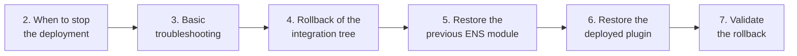

# ENSFácil troubleshooting and rollback
[Español](04-troubleshooting-and-rollback.md)

[[_TOC_]]

## 1. Objective

This guide describes the checks that must be performed when an ENSFácil
installation or update fails, and the procedures for returning to the
previous state in a controlled way.

> [!warning]
> A deployment must not continue if a prior validation has failed.



## 2. When to stop the deployment

Stop the procedure if any of these situations occurs:

| Situation |
|---|
| `check-integration.sh` returns `RESULTADO=NO_COMPATIBLE`. |
| an unvalidated Wazuh version is reported. |
| conflicts or `.rej` files appear when applying the integration. |
| the build does not generate `wazuh-2.19.5.zip`. |
| `unzip -t` reports errors. |
| Wazuh Dashboard does not return to `active` state after installing the plugin. |

> [!important]
> Before modifying anything else, keep the output of the command that failed and locate the backups created during the procedure.

## 3. Basic troubleshooting

First check the status of the integration and the service:

```bash
REPO=/opt/ensfacil/repo
TARGET=/opt/ensfacil/build/plugins/main
PKG=$REPO/integration/wazuh-dashboard

"$PKG/check-integration.sh" "$TARGET"
sudo systemctl status wazuh-dashboard --no-pager
sudo journalctl -u wazuh-dashboard -n 50 --no-pager
```

If the problem appeared while applying the integration, also check whether
there are rejects:

```bash
find "$TARGET" -name "*.rej" -print
```

> [!warning]
> Do not attempt to manually fix the patches on the deployed environment without first identifying the cause.

## 4. Rollback of the integration tree

`apply-integration.sh` automatically creates a backup before modifying the
plugin tree. The path is shown in its output as `BACKUP=...`.

To locate the available backups:

```bash
ls -dt /opt/ensfacil/build/plugins/main-ensfacil-backup-* 2>/dev/null
```

Select the backup corresponding to the operation to be reverted and run:

```bash
REPO=/opt/ensfacil/repo
TARGET=/opt/ensfacil/build/plugins/main
PKG=$REPO/integration/wazuh-dashboard
BACKUP=/opt/ensfacil/build/plugins/main-ensfacil-backup-AAAAMMDD-HHMMSS

"$PKG/rollback-integration.sh" "$TARGET" "$BACKUP"
```

The rollback must end with:

```text
RESULTADO=ROLLBACK_OK
```

> [!warning]
> If it returns `RESULTADO=ROLLBACK_ERROR`, stop the procedure and review the output before continuing.

## 5. Restore the previous ENS module

> [!note]
> Rolling back the integration package does not, by itself, restore the `public/components/overview/ens` module, since it is updated independently.

Use the backup created before the update:

```bash
TARGET=/opt/ensfacil/build/plugins/main
UPDATE_BACKUP=/opt/ensfacil/artifacts/update-AAAAMMDD-HHMMSS

test -d "$UPDATE_BACKUP/ens" || { echo "ERROR: backup ENS no encontrado"; exit 1; }

sudo rm -rf "$TARGET/public/components/overview/ens"
sudo cp -a "$UPDATE_BACKUP/ens" "$TARGET/public/components/overview/ens"
sudo chown -R "$USER":"$USER" "$TARGET/public/components/overview/ens"
```

## 6. Restore the deployed plugin

If the new version was already installed on Wazuh Dashboard, use the
previous ZIP kept in the update backup.

```bash
ZIP_ANTERIOR="$UPDATE_BACKUP/wazuh-2.19.5.zip"
sudo -u wazuh-dashboard test -r "$ZIP_ANTERIOR" || { echo "ERROR: ZIP anterior no accesible"; exit 1; }

sudo systemctl stop wazuh-dashboard

sudo -u wazuh-dashboard /usr/share/wazuh-dashboard/bin/opensearch-dashboards-plugin remove wazuh || true
sudo rm -rf /usr/share/wazuh-dashboard/plugins/wazuh
sudo rm -rf /usr/share/wazuh-dashboard/plugins/.plugin.installing

sudo -u wazuh-dashboard /usr/share/wazuh-dashboard/bin/opensearch-dashboards-plugin \
  install "file://$ZIP_ANTERIOR"

sudo systemctl start wazuh-dashboard
```

> [!warning]
> Do not use wildcards such as `wazuh*` while removing the plugin.

## 7. Validate the rollback

Check the status of the service and the installed plugins:

```bash
sudo systemctl is-active wazuh-dashboard
sudo -u wazuh-dashboard /usr/share/wazuh-dashboard/bin/opensearch-dashboards-plugin list
```

Also check that the restored tree is left in a state recognized by the
integration package:

```bash
REPO=/opt/ensfacil/repo
TARGET=/opt/ensfacil/build/plugins/main
PKG=$REPO/integration/wazuh-dashboard

"$PKG/check-integration.sh" "$TARGET"
```

Wazuh Dashboard must be `active`, the `wazuh` plugin must appear installed,
and the integration check must show no conflicts.

Finally, access Wazuh Dashboard and confirm that ENSFácil is shown again
in the expected previous state.

> [!note]
> This procedure restores the code and the deployed plugin. It does not automatically revert data or configuration decisions stored outside the plugin tree.
