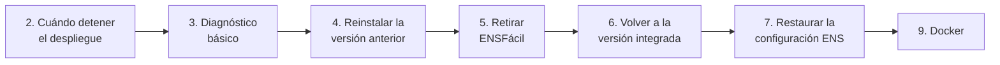

# Diagnóstico y rollback de ENSFácil
[English](04-troubleshooting-and-rollback.en.md)

[[_TOC_]]

## 1. Objetivo

Esta guía describe las comprobaciones que deben realizarse cuando una instalación o actualización de ENSFácil falla y los procedimientos para volver al estado anterior de forma controlada.

> [!warning]
> No debe continuarse con un despliegue si una validación previa ha fallado.

> [!note]
> Los comandos de los apartados 3 a 8 corresponden a la instalación por paquetes
> (systemd, `/etc/wazuh-indexer/certs` y `https://127.0.0.1:9200`). Con Wazuh en
> Docker se aplica el apartado 9.



## 2. Cuándo detener el despliegue

Detener el procedimiento si ocurre cualquiera de estas situaciones:

| Situación |
|---|
| `config/build-plugin.sh` no termina con la ruta de `ensfacil-2.19.5.zip`. |
| `sha256sum -c SHA256SUMS` dice `FAILED` en algún fichero de la release. |
| `unzip -t` informa de errores, o `deploy-plugin.sh --solo-id` no devuelve `ensfacil`. |
| `config/deploy-plugin.sh` dice «el zip no es de ENSFácil» o «el zip es del plugin de Wazuh». |
| Wazuh Dashboard no vuelve a estado `active` después de instalar el plugin. |
| `/api/ensfacil/configuration` devuelve `404`: el plugin no ha cargado. |
| un `install-manager.sh` no confirma su regla con `wazuh-logtest` o el manager no queda `active`. |
| `config/validate-configuration.ts` informa de `ESTRUCTURA INVÁLIDA`. |
| el panel muestra «No se pudo cargar el entorno ENS». |

> [!important]
> Antes de modificar nada más, conservar la salida del comando que ha fallado y localizar los backups creados durante el procedimiento.

## 3. Diagnóstico básico

Comprobar el servicio, los plugins instalados y la ruta del plugin:

```bash
sudo systemctl status wazuh-dashboard --no-pager
sudo -u wazuh-dashboard /usr/share/wazuh-dashboard/bin/opensearch-dashboards-plugin list
curl -sk -o /dev/null -w '%{http_code}\n' https://localhost/api/ensfacil/configuration
```

Comprobar en el registro que el dashboard ha cargado ENSFácil, y buscar errores:

```bash
sudo journalctl -u wazuh-dashboard --since "-15 min" --no-pager \
  | grep -o 'Setting up \[[0-9]*\] plugins: \[[^]]*\]' | tail -1 | grep -c ensfacil
sudo journalctl -u wazuh-dashboard --since "-15 min" --no-pager | grep -iE '"level":"error"|fatal' | tail -20
```

Resultado esperado:

| Comprobación | Resultado esperado |
|---|---|
| servicio | `active (running)` |
| plugins | `ensfacil` y `wazuh`, entre otros |
| `/api/ensfacil/configuration` | `401` (la ruta existe y pide sesión) |
| `Setting up … plugins` | `1` (ENSFácil está entre los plugins cargados) |
| errores | ninguno que mencione `ensfacil` |

> [!note]
> Las líneas de error de conexiones TLS de clientes (`bad certificate`, `ERR_SSL_…`) no están relacionadas con el plugin.

## 4. Reinstalar la versión anterior de ENSFácil

Volver a la versión anterior es desplegar de nuevo su release. `deploy-plugin.sh` sustituye solo `ensfacil` y sube el `build.number` para que los navegadores dejen de usar la versión retirada.

Se usa la carpeta de esa versión (`/opt/ensfacil/releases/<versión>`). Si ya no existe, descargar la release de nuevo ([Instalar desde una release, apartado 6.3](07-installing-from-a-release.md#63-descargar-los-cuatro-ficheros), con esa versión en `V`). Sustituir `X.Y.Z` por la versión de destino:

```bash
V=X.Y.Z
R=/opt/ensfacil/releases/$V
cd "$R" && sha256sum -c SHA256SUMS \
  && sudo bash deploy-plugin.sh "ensfacil-$V-osd-2.19.5.zip"
```

Resultado esperado: `OK` en los tres ficheros y, al final, `dashboard: active` y `ensfacil` en la lista de plugins. Comprobar después como en el apartado 3: la lista de plugins debe indicar `ensfacil@<versión anterior>`.

Si la versión anterior se compiló desde el código fuente, la guía de actualización guarda su zip en el respaldo (`/opt/ensfacil/artifacts/update-<fecha>/`). Para volver a ese zip, se despliega del mismo modo, con `config/deploy-plugin.sh`:

```bash
UPDATE_BACKUP=/opt/ensfacil/artifacts/update-AAAAMMDD-HHMMSS
ZIP_ANTERIOR="$UPDATE_BACKUP/ensfacil-2.19.5.zip"

if sudo -u wazuh-dashboard test -r "$ZIP_ANTERIOR"; then
  sudo bash /opt/ensfacil/repo/config/deploy-plugin.sh "$ZIP_ANTERIOR"
else
  echo "ERROR: zip anterior no accesible"
fi
```

Resultado esperado: `dashboard: active` y `ensfacil` en la lista de plugins. Comprobar después como en el apartado 3.

> [!important]
> Si la versión retirada había sembrado controles que la anterior no conoce, restaurar también la configuración ENS (apartado 7) con la copia hecha antes de la actualización. Para volver de la 1.2.0 a la 1.1.0 después de «Migrar a sistemas», restaurar la versión del documento anterior a la migración ([Configuración por sistema y plantillas, apartado 12](09-configuration-by-system.md#12-compatibilidad-y-vuelta-atrás)).

### 4.1 Si `deploy-plugin.sh` falla a medias

Antes de parar el dashboard, `deploy-plugin.sh` guarda el `ensfacil` instalado en `/var/backups/ensfacil/plugins-ensfacil-<fecha>.tgz`, o en `<carpeta>/ensfacil/` si se indica `ENSFACIL_BACKUP_DIR=<carpeta>`. Esa subcarpeta la crea el script (de root, permisos 0700) si no existe, y nunca cambia los permisos de una carpeta que ya existía. Cuando el despliegue termina bien se quedan las 3 últimas copias; un despliegue que falla no borra ninguna, así que la última copia buena sigue ahí aunque se repita. No las deja junto al zip: la compilación siguiente borra esa carpeta.

Si algo falla con el dashboard ya parado, el script imprime los comandos para volver a como estaba (quitar el plugin a medias, restaurar esa copia, devolver el `package.json` si ya lo había cambiado y arrancar el dashboard) y sale con error. Ejecutar esos comandos en el orden en que aparecen y comprobar como en el apartado 3.

| Código de salida | Qué ha pasado | Cómo queda |
|---|---|---|
| `1` | uso incorrecto: ningún zip, dos zips o una opción desconocida | sin tocar |
| `2` | el zip no es de ENSFácil | sin tocar |
| `3` | no se pudo guardar la copia del plugin anterior | sin tocar: el dashboard sigue en marcha |
| `4` | el usuario `wazuh-dashboard` no puede leer la copia temporal del zip (el script la deja en `${TMPDIR:-/tmp}`) | sin tocar: el dashboard sigue en marcha; indicar otra carpeta con `TMPDIR=<carpeta>` |
| `5` | falló la instalación del zip | dashboard parado y sin `ensfacil` |
| `6` | el dashboard no quedó activo al final | plugin nuevo instalado y dashboard no activo: revisar `journalctl -u wazuh-dashboard` |
| `7` | falló otro paso con el dashboard parado (retirar el plugin, subir el `build.number`, arrancar) o se interrumpió | el mensaje dice el paso |

Para volver atrás después de un despliegue que terminó bien, usar la release anterior o el zip anterior (arriba): `deploy-plugin.sh` sube además el `build.number`, y restaurar la copia a mano no.

## 5. Retirar ENSFácil

Retirar ENSFácil no toca el plugin de Wazuh ni los datos:

```bash
sudo systemctl stop wazuh-dashboard
sudo -u wazuh-dashboard /usr/share/wazuh-dashboard/bin/opensearch-dashboards-plugin remove ensfacil
sudo rm -rf /usr/share/wazuh-dashboard/plugins/ensfacil
sudo systemctl start wazuh-dashboard
```

Comprobar:

```bash
sudo systemctl is-active wazuh-dashboard
sudo -u wazuh-dashboard /usr/share/wazuh-dashboard/bin/opensearch-dashboards-plugin list
curl -sk -o /dev/null -w '%{http_code}\n' https://localhost/api/ensfacil/configuration
```

Resultado esperado: `active`; `wazuh` en la lista, sin `ensfacil`; `404`.

> [!warning]
> Retirar siempre por el nombre exacto, `ensfacil`. Nunca con comodines como `wazuh*` o `*`: se llevarían por delante `wazuhCore` y `wazuhCheckUpdates`, y el dashboard no vuelve a arrancar.

La configuración ENS se queda en el índice `wazuh-ens-configuration` y el rol `ensfacil_admin` se queda en el plugin de seguridad (no da ningún permiso). Al volver a instalar ENSFácil, todo sigue donde estaba.

### 5.1 Quitarlo del todo

Solo si ENSFácil no se va a volver a usar en este entorno. Esto borra la
configuración ENS y su historial. Antes de ejecutarlo, guardar una copia del
documento ([Instalar desde una release, apartado 11](07-installing-from-a-release.md#11-actualizar-a-una-release-nueva),
paso 2). No ejecutar este paso si otra instalación usa el mismo indexer.

```bash
C=/etc/wazuh-indexer/certs
ix() { sudo curl -s --cacert $C/root-ca.pem --cert $C/admin.pem --key $C/admin-key.pem "$@"; echo; }
ix -X DELETE https://127.0.0.1:9200/_plugins/_security/api/rolesmapping/ensfacil_admin
ix -X DELETE https://127.0.0.1:9200/_plugins/_security/api/roles/ensfacil_admin
ix -X DELETE https://127.0.0.1:9200/wazuh-ens-configuration
```

Resultado esperado: `"status":"OK"` en las dos primeras (en la primera,
`NOT_FOUND` si el rol no tenía usuarios) y `"acknowledged":true` en la última.

Los hechos se quedan: son alertas de Wazuh en `wazuh-alerts-*` y caducan con la
retención de esos índices. Las reglas del manager y los recolectores de cada
máquina se quitan con la guía `03-uninstall-and-troubleshooting` de cada runbook
([runbooks y registros](05-runbooks-and-registers.md#runbooks-por-control)).

## 6. Volver a la versión integrada

Solo para un entorno que viene de la versión integrada ([guía de actualización, apartado 10](02-updating-an-existing-environment.md#10-transición-desde-la-versión-integrada)). La versión integrada ya no se mantiene: `config/deploy-plugin.sh` no instala su zip (`wazuh-2.19.5.zip`), y la vuelta atrás usa lo que guardó el apartado 10.3 de esa guía.

**Antes de reinstalar el plugin oficial de Wazuh** (apartado 10.3 de esa guía), la versión integrada sigue instalada. Basta con retirar ENSFácil (apartado 5).

**Después de reinstalar el plugin oficial de Wazuh**, se devuelve a su sitio el plugin integrado que el apartado 10.3 apartó en `$T/wazuh-integrado`, y se vuelve a desplegar ENSFácil, con la release instalada en el apartado 10.1 de esa guía, para que suba el `build.number` (los navegadores tienen asociados al número actual los ficheros del plugin oficial). Solo vale mientras el paquete `wazuh-dashboard` siga siendo el 4.14.7: el plugin integrado está hecho para esa versión, y con otra el dashboard no arranca.

```bash
T=/opt/ensfacil/artifacts/transicion-AAAAMMDD-HHMMSS
P=/usr/share/wazuh-dashboard/plugins
V=1.2.0   # la versión de ENSFácil instalada
R=/opt/ensfacil/releases/$V

if [ "$(dpkg-query -W -f='${Version}' wazuh-dashboard)" = 4.14.7-1 ] \
   && sudo test -d "$T/wazuh-integrado" && ! sudo test -e "$T/wazuh-oficial" \
   && test -f "$R/ensfacil-$V-osd-2.19.5.zip"; then
  sudo systemctl stop wazuh-dashboard \
    && sudo mv "$P/wazuh" "$T/wazuh-oficial" \
    && sudo mv "$T/wazuh-integrado" "$P/wazuh" \
    && sudo bash "$R/deploy-plugin.sh" "$R/ensfacil-$V-osd-2.19.5.zip"
else
  echo "NO: wazuh-dashboard no es 4.14.7-1, falta $T/wazuh-integrado o el zip de $R, o ya existe $T/wazuh-oficial"
fi
```

Resultado esperado: al final del despliegue, `dashboard: active`. En el menú vuelve a aparecer «ENS», junto a «ENSFácil». ENSFácil puede quedarse instalado o retirarse (apartado 5). Si sale `NO: …`, no se ha tocado nada.

Para deshacerlo y volver al plugin oficial que quedó en `$T/wazuh-oficial`:

```bash
sudo systemctl stop wazuh-dashboard
sudo mv "$P/wazuh" "$T/wazuh-integrado" && sudo mv "$T/wazuh-oficial" "$P/wazuh"
sudo bash "$R/deploy-plugin.sh" "$R/ensfacil-$V-osd-2.19.5.zip"
```

Si falta `$T/wazuh-integrado`, el plugin integrado está también en `$T/plugins-antes.tgz`, la carpeta `plugins` entera tal como estaba antes del apartado 10.3. Extraer de ahí solo `plugins/wazuh` a ese sitio y repetir el primer bloque:

```bash
sudo mkdir -p "$T/desde-tgz"
sudo tar -xzf "$T/plugins-antes.tgz" -C "$T/desde-tgz" plugins/wazuh
sudo mv "$T/desde-tgz/plugins/wazuh" "$T/wazuh-integrado"
```

> [!note]
> La configuración no hay que tocarla: las dos versiones usan el mismo documento. Si después de la transición se sembraron controles que la versión integrada no conoce, restaurar la configuración (apartado 7).

## 7. Restaurar la configuración ENS

La configuración ENS vive en el documento `active` del índice `wazuh-ens-configuration`. Las guías de instalación y actualización guardan una copia antes de cada cambio (`/opt/ensfacil/artifacts/active-<fecha>.json` o `$BACKUP/active.json`). Para restaurarla se reescribe el `_source` de esa copia, usando el certificado de administrador del indexer:

```bash
COPIA=/opt/ensfacil/artifacts/active-AAAAMMDD-HHMMSS.json

sudo python3 -c "import json,sys; json.dump(json.load(open(sys.argv[1]))['_source'], open(sys.argv[2],'w'), ensure_ascii=False)" \
  "$COPIA" /opt/ensfacil/artifacts/active-restore.json

sudo curl -sk --cert /etc/wazuh-indexer/certs/admin.pem --key /etc/wazuh-indexer/certs/admin-key.pem \
  -H 'Content-Type: application/json' -X PUT \
  https://127.0.0.1:9200/wazuh-ens-configuration/_doc/active \
  --data-binary @/opt/ensfacil/artifacts/active-restore.json
```

Resultado esperado: la respuesta incluye `"result":"updated"`. Validar después el documento restaurado con `config/validate-configuration.ts`, como en la [guía de instalación, apartado 14.4](01-installation-from-scratch.md#144-validar-el-documento-entero), y recargar el panel.

## 8. Problemas conocidos del despliegue

| Síntoma | Causa | Qué hacer |
|---|---|---|
| «No se pudo cargar el entorno ENS» con «No hay inventario de agentes: la monitorización de agentes de Wazuh (wazuh-monitoring-*) no está activa o este usuario no puede leerla.» | Wazuh no está guardando el estado de los agentes en `wazuh-monitoring-*`, o el rol del usuario no puede leer ese índice | contar los documentos: `sudo curl -sk --cert /etc/wazuh-indexer/certs/admin.pem --key /etc/wazuh-indexer/certs/admin-key.pem "https://127.0.0.1:9200/wazuh-monitoring-*/_count"`. Si sale `0`, activar la monitorización de agentes en la configuración de la app de Wazuh (`wazuh.monitoring.enabled`); si hay documentos, conceder al rol del usuario lectura sobre `wazuh-monitoring-*` |
| Aviso «ENSFácil: inventario de agentes antiguo» | el último dato de `wazuh-monitoring-*` tiene más de 1 hora: un alta o una baja reciente puede no verse | comprobar que la monitorización de agentes de Wazuh sigue activa |
| En Controles o Eventos: «No existe el patrón de índice wazuh-alerts-*: créalo desde Wazuh (o Dashboards Management) para usar esta vista» | el patrón de índice `wazuh-alerts-*` no existe todavía | abrir una vez la app de Wazuh, que lo crea en su comprobación inicial, o crearlo en Dashboards Management > Index patterns. Las demás pestañas funcionan sin él |
| Al guardar la configuración: «Hace falta el rol ensfacil_admin o all_access para cambiar la configuración ENS o ver su historial.» (error 403) | el usuario no tiene ninguno de los dos roles | asignar el rol al usuario con `config/create-admin-role.sh --mapear <usuario>` ([instalación, apartado 13.5](01-installation-from-scratch.md#135-crear-el-rol-ensfacil_admin)); si el usuario tenía una sesión abierta, debe cerrar la sesión e iniciar otra |
| Las pantallas muestran un error de permisos al buscar datos | el rol del usuario no puede leer `wazuh-alerts-*` | conceder al rol lectura sobre `wazuh-alerts-*`, el permiso habitual para ver datos de Wazuh |
| No aparece «ENSFácil» en el menú y `/api/ensfacil/configuration` devuelve `404` | el plugin no está instalado o no ha cargado | revisar la lista de plugins y el registro (apartado 3) y desplegar de nuevo con `config/deploy-plugin.sh` |
| El dashboard no arranca después de actualizar Wazuh: `Failed to initialize plugins` y `ensfacil` | el dashboard nuevo lleva otra versión de OpenSearch Dashboards y el plugin está compilado para `2.19.5` | retirar ENSFácil (apartado 5) y conseguir el zip para esa versión ([compatibilidad de versiones](03-version-compatibility.md)) |
| En el menú aparecen «ENS» y «ENSFácil» | la versión integrada sigue instalada | normal durante la transición; para dejar solo «ENSFácil», [actualización, apartado 10.3](02-updating-an-existing-environment.md#103-volver-al-plugin-oficial-de-wazuh) |
| `deploy-plugin.sh`: «el zip no es de ENSFácil» o «el zip es del plugin de Wazuh» | `deploy-plugin.sh` solo instala `ensfacil`; el plugin de Wazuh (también el zip `wazuh-2.19.5.zip` de la versión integrada) va con el paquete oficial `wazuh-dashboard` | usar el zip de ENSFácil: `ensfacil-<versión>-osd-2.19.5.zip` de la release, o `ensfacil-2.19.5.zip` si se compila |
| Al descargar la release, `curl: (22) … error: 401` o `403` | el token de despliegue está mal copiado, caducado, revocado o sin `read_package_registry` | revisar el token en GitLab ([Instalar desde una release, apartado 6](07-installing-from-a-release.md#6-descargar-desde-el-servidor-con-un-token-de-despliegue)) |
| Al descargar la release, `curl: (22) … error: 404` | esa versión no está publicada o está mal escrita | comprobar la versión en *Deploy → Releases* |
| `sha256sum -c SHA256SUMS` dice `FAILED` | la descarga está incompleta o el fichero no es el de la release | no instalar; borrar la carpeta y descargar de nuevo |
| `build-plugin.sh`: «no es un árbol de OpenSearch Dashboards» o «el árbol es … ENSFácil 1.x se compila contra 2.19.5» | el árbol de compilación no es OpenSearch Dashboards `2.19.5` | preparar el árbol como en [Compilar desde el código fuente, apartado 3.2](08-building-from-source.md#32-preparar-el-árbol-de-opensearch-dashboards-2195) |
| `build-plugin.sh` termina con `yarn: command not found`, o tras compilar con `ENOENT: yarn install --production` | `yarn` no está en el `PATH` de `root` | compilar como en [Compilar desde el código fuente, apartado 3.3](08-building-from-source.md#33-compilar-el-plugin), con `sudo env PATH=…` |
| `yarn install` se para con `Your lockfile needs to be updated` | `package.json` y `yarn.lock` no cuadran: hay cambios locales en el repositorio | no tocar las dependencias en el servidor; dejar el repositorio como está en GitLab (`git status`) |
| La compilación termina al instante con código 1 | la salida se redirige como `root` a un fichero de `/tmp` creado por otro usuario (`protected_regular`) | llevar el registro a `/opt/ensfacil/artifacts` |
| Se despliega y el navegador sigue mostrando la versión anterior | se instaló el zip sin subir el `build.number` | desplegar con `config/deploy-plugin.sh` |
| El panel muestra «No se pudo cargar el entorno ENS» con `...parameters[M].value has an invalid value` | un parámetro con `value: null`, una tabla con menos columnas de las declaradas o una columna identificador con comas o espacios | validar el documento con `config/validate-configuration.ts`, corregir el parámetro indicado o restaurar la copia (apartado 7). Un parámetro vacío es la clave `value` ausente, nunca `null` |
| `install-manager.sh`: «hay más de un bloque `<agent_config>`» | el `agent.conf` del grupo `ens` (o el de `ens-copias`, en mp.info.6) tiene dos bloques | fusionar todo en un solo `<agent_config>`, validar con `verify-agent-conf` y repetir |
| `install-manager.sh` termina bien pero la regla no casa | una ejecución anterior falló tras copiar las reglas y la repetición no reinicia el manager | `sudo systemctl restart wazuh-manager` y comprobar con `wazuh-logtest` |
| Evidencias de auditd sin medir en una máquina (op.acc.2, op.acc.3, op.acc.4, op.exp.3, op.exp.4, op.exp.5, op.exp.8, op.exp.10) | el `install.sh` escribió las reglas en `/etc/audit/rules.d/` pero no se cargaron | comprobar que auditd no está en modo inmutable (`sudo auditctl -s`, `enabled` distinto de `2`) y ejecutar `sudo augenrules --load` |
| «Datos incompletos: N de M shards fallaron al leer …» (error 503) | algún shard del indexer no respondió; la evaluación no se hace con datos a medias ni se guarda | comprobar el estado del clúster (`_cluster/health`) y pulsar «Reintentar» cuando esté en `green` o `yellow` |
| «Demasiados hechos para evaluar … de una vez (más de 50.000)» | un control tiene en una máquina más hechos en la ventana de los que el servidor del plugin lee de una vez | acortar el periodo de evaluación o el alcance; revisar si un recolector emite más de lo habitual |
| «No se pudo actualizar la evaluación: …», con el resultado calculado antes | el recálculo en segundo plano falló; la pantalla muestra el último resultado correcto con su hora | pulsar «Reintentar»; el plugin también lo reintenta solo, con esperas crecientes de 30 s a 5 min. Si persiste, revisar el registro del dashboard (apartado 3) |
| «Calculando la evaluación» o «Calculando la serie…» durante minutos | la primera carga de cada usuario lee la ventana entera (en el laboratorio, unos 20 s); con muchas máquinas o muchos hechos tarda más | esperar: el cálculo sigue aunque se cambie de pestaña, y la pantalla se completa sola. Si no termina, revisar el registro del dashboard (apartado 3) |
| Un control muestra «Sin datos del recolector desde …» | el último latido del recolector de ese control en esa máquina tiene más de 24 h | comprobar el agente, el cron del recolector y la conectividad; el control vuelve a juzgarse en cuanto llega una pasada nueva |
| Un control medido en el manager (op.exp.7, op.exp.8, op.exp.9, op.mon.1, op.mon.2, op.mon.3, op.nub.1, op.cont.3) sin datos en la fila del manager | falta el `install-manager.sh` del runbook o su cron (horario o cada 6 horas, según el control) todavía no se ha ejecutado | revisar `/etc/cron.d/ensfacil-op*` del manager y el `<localfile>` en su `ossec.conf`. En Docker, el apartado 9.3 |
| Una regla de op.exp.1 aparece en eventos de op.exp.10 | reglas de op.exp.1 anteriores a la corrección, con el campo `ensfacil` sin anclar | actualizar el runbook de op.exp.1 y repetir su `install-manager.sh` |
| El dashboard se reinicia solo y el registro dice `JavaScript heap out of memory` o `FATAL ERROR: … Allocation failed` | desde la 1.2.0 el servidor del dashboard evalúa los controles, y en un alcance grande el montón por defecto de Node se queda corto | darle más montón al dashboard (apartado 8.1) |

### 8.1 Memoria del dashboard

Desde la 1.2.0 el servidor del dashboard evalúa los controles. En el
laboratorio (6 máquinas, unos 210.000 hechos en 30 días) eso añade unos 15 MB
por usuario tras la primera carga y unos 50 MB mientras se calcula; el proceso
del dashboard ocupa en total unos 470-550 MB. Lo acotan 50.000 hechos por
lectura (unos 85 MB), 4 lecturas a la vez (unos 340 MB en el peor caso) y una
memoria de resultados de 64 a 256 MB según el alcance (`server/README.md`,
apartado «Memoria»).

En un despliegue mayor que el laboratorio (decenas de máquinas o millones de
hechos en la ventana), fijar el montón de Node del dashboard: 2048 MB hasta
unas 30 máquinas y 4096 MB por encima, con al menos el doble de memoria libre
en el servidor.

1. Comprobar si el paquete trae el fichero de opciones de Node del dashboard:

   ```bash
   sudo cat /etc/wazuh-dashboard/node.options
   ```

2. Si existe, añadir la línea (o quitar el `#` de la que ya esté):

   ```bash
   echo '--max-old-space-size=2048' | sudo tee -a /etc/wazuh-dashboard/node.options
   ```

   Si no existe, ponerla en el servicio:

   ```bash
   sudo systemctl edit wazuh-dashboard
   ```

   con este contenido:

   ```ini
   [Service]
   Environment="NODE_OPTIONS=--max-old-space-size=2048"
   ```

3. Reiniciar el dashboard y comprobar que el proceso lleva la opción:

   ```bash
   sudo systemctl restart wazuh-dashboard
   pid=$(systemctl show -p MainPID --value wazuh-dashboard)
   sudo cat /proc/$pid/cmdline /proc/$pid/environ | tr '\0' '\n' | grep -o 'max-old-space-size=[0-9]*'
   ```

   Resultado esperado: `max-old-space-size=2048`.

En Docker, la variable va en el servicio `wazuh.dashboard` del
`docker-compose.yml` (`environment: - NODE_OPTIONS=--max-old-space-size=2048`),
y se aplica con `docker compose up -d wazuh.dashboard`.

Para revertir, quitar la línea (o el fichero de `systemctl edit`) y reiniciar el
dashboard.

## 9. Docker

Con Wazuh en Docker ([Wazuh en Docker](06-wazuh-in-docker.md)), el diagnóstico,
la vuelta atrás y la retirada se hacen con `docker compose` y con la etiqueta de
la imagen del dashboard. `deploy-plugin.sh` y sus copias en
`/var/backups/ensfacil` no se usan. Los comandos se ejecutan desde la carpeta
del `docker-compose.yml` oficial; `ix` es la función de consulta del indexer de
[Wazuh en Docker, apartado 2.4](06-wazuh-in-docker.md#24-función-de-consulta-del-indexer).

### 9.1 Diagnóstico en Docker

```bash
docker compose ps wazuh.dashboard
docker compose exec wazuh.dashboard /usr/share/wazuh-dashboard/bin/opensearch-dashboards-plugin list
curl -sk -o /dev/null -w '%{http_code}\n' https://localhost/api/ensfacil/configuration
docker compose logs wazuh.dashboard | grep -o 'Setting up \[[0-9]*\] plugins: \[[^]]*\]' | tail -1 | grep -c ensfacil
docker compose logs --since 15m wazuh.dashboard | grep -iE '"level":"error"|fatal' | tail -20
```

Resultado esperado:

| Comprobación | Resultado esperado |
|---|---|
| `docker compose ps` | estado `running`, con la imagen `wazuh-dashboard-ensfacil:<versión>` |
| plugins | `ensfacil@<versión>` y `wazuh@4.14.7-01`, entre otros |
| `/api/ensfacil/configuration` | `401`: el dashboard pide sesión. Sin sesión, la respuesta es `401` también sin el plugin; la carga la confirma la línea `Setting up … plugins` |
| `Setting up … plugins` | `1`: ENSFácil está entre los plugins cargados |
| errores | ninguno que mencione `ensfacil` |

Las consultas al indexer del apartado 8 se hacen en Docker con `ix`; por
ejemplo, `ix 'wazuh-monitoring-*/_count'`.

### 9.2 Vuelta atrás, retirada y restauración en Docker

| Operación | Procedimiento |
|---|---|
| Volver a la versión anterior | etiqueta anterior de la imagen y `docker compose up -d`: [Wazuh en Docker, apartado 12.2](06-wazuh-in-docker.md#122-volver-a-la-versión-anterior) |
| Restaurar la configuración ENS | `ix` con la copia del documento `active`: [Wazuh en Docker, apartado 12.2](06-wazuh-in-docker.md#122-volver-a-la-versión-anterior) |
| Retirar ENSFácil | imagen oficial `wazuh/wazuh-dashboard:4.14.7` y `docker compose up -d`: [Wazuh en Docker, apartado 12.3](06-wazuh-in-docker.md#123-retirar-ensfácil) |

### 9.3 Problemas conocidos en Docker

| Síntoma | Causa | Solución |
|---|---|---|
| `docker compose up -d` falla con «error while creating mount source path … root-ca-manager.pem», después de que `generate-indexer-certs.yml` informara de `Permission denied` al copiar `root-ca-manager.pem` y `root-ca-manager.key` | el generador de certificados de `wazuh-docker`, en hosts macOS, no copia esos dos ficheros. No está relacionado con ENSFácil | en `config/wazuh_indexer_ssl_certs/`, copiar `root-ca.pem` a `root-ca-manager.pem` y `root-ca.key` a `root-ca-manager.key`, y repetir `docker compose up -d` |
| Desde el host, curl o `create-admin-role.sh` con `https://127.0.0.1:9200` fallan con «no alternative certificate subject name matches» | el certificado del indexer está emitido para `wazuh.indexer` | ejecutar desde un contenedor de la red del compose ([Wazuh en Docker, apartados 2.4 y 5](06-wazuh-in-docker.md#24-función-de-consulta-del-indexer)) |
| `docker run --network <proyecto>_default` falla con «network … not found» | el nombre de la red no es el del compose | consultar `docker network ls`; la red es `<carpeta del compose>_default` |
| `inject-control.py`: «no existe el documento 'active'…; guarda la configuración una vez y vuelve a ejecutar» | todavía no se ha hecho el primer guardado | guardar la configuración una vez desde la pantalla ([Wazuh en Docker, apartado 6](06-wazuh-in-docker.md#6-primer-guardado-de-la-configuración)) |
| La validación indica `configuration.scope.agentIds must be a string array` | un documento escrito a mano sin las listas `agentIds` y `groupIds` en `scope` | añadir las dos listas, aunque estén vacías, o guardar desde la pantalla de Configuración, que siempre las escribe |
| Después de `docker compose up -d`, «ENSFácil» no aparece en el menú, o `/api/ensfacil/configuration` devuelve `404` con una sesión iniciada (sin sesión, la respuesta es siempre `401`) | el servicio usa todavía la imagen oficial, o el plugin no ha cargado | comprobar la imagen con `docker compose ps` y el registro (apartado 9.1) |
| Después de cambiar de versión, el navegador sigue mostrando la anterior | la imagen se construyó con un `ENSFACIL_VERSION` distinto de la versión del zip y repite el `build.number` de otra imagen | reconstruir con la versión del zip y comprobar el `build.number` ([Wazuh en Docker, apartado 3](06-wazuh-in-docker.md#3-construir-la-imagen-del-dashboard-con-ensfácil)) |
| `install-manager.sh` falla al reiniciar el manager con `systemctl: command not found` y deshace su cambio | la imagen del manager no tiene systemd | ejecutar con `ENSFACIL_SYSTEMCTL=/var/ossec/bin/wazuh-control` ([Wazuh en Docker, apartado 13.5](06-wazuh-in-docker.md#135-grupos-copia-previa-e-instaladores-sin-systemd)) |
| Los controles medidos en el manager se quedan sin datos después de reiniciar su contenedor | el arranque copia `wazuh_manager.conf` sobre `ossec.conf` y descarta los `<localfile>` de los instaladores | añadir el bloque de `<localfile>` a `wazuh_manager.conf` ([Wazuh en Docker, apartado 13.4](06-wazuh-in-docker.md#134-los-localfile-en-wazuh_managerconf)) |
| op.exp.8 EV-13 sale `NO_CUMPLE` en la fila del manager | el contenedor no tiene systemd y el recolector emite `activo=desconocido` | limitación conocida ([Wazuh en Docker, apartado 14](06-wazuh-in-docker.md#14-limitaciones-conocidas-en-contenedor)) |
