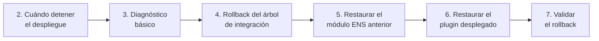

# Diagnóstico y rollback de ENSFácil
[English](04-troubleshooting-and-rollback.en.md)

[[_TOC_]]

## 1. Objetivo

Esta guía describe las comprobaciones que deben realizarse cuando una instalación o actualización de ENSFácil falla y los procedimientos para volver al estado anterior de forma controlada.

> [!warning]
> No debe continuarse con un despliegue si una validación previa ha fallado.



## 2. Cuándo detener el despliegue

Detener el procedimiento si ocurre cualquiera de estas situaciones:

| Situación |
|---|
| `check-integration.sh` devuelve `RESULTADO=NO_COMPATIBLE`. |
| se informa de una versión de Wazuh no validada. |
| aparecen conflictos o ficheros `.rej` al aplicar la integración. |
| la compilación no genera `wazuh-2.19.5.zip`. |
| `unzip -t` informa de errores. |
| Wazuh Dashboard no vuelve a estado `active` después de instalar el plugin. |

> [!important]
> Antes de modificar nada más, conservar la salida del comando que ha fallado y localizar los backups creados durante el procedimiento.

## 3. Diagnóstico básico

Comprobar primero el estado de la integración y del servicio:

```bash
REPO=/opt/ensfacil/repo
TARGET=/opt/ensfacil/build/plugins/main
PKG=$REPO/integration/wazuh-dashboard

"$PKG/check-integration.sh" "$TARGET"
sudo systemctl status wazuh-dashboard --no-pager
sudo journalctl -u wazuh-dashboard -n 50 --no-pager
```

Si el problema apareció durante la aplicación de la integración, comprobar también si existen rechazos:

```bash
find "$TARGET" -name "*.rej" -print
```

> [!warning]
> No intentar corregir manualmente los parches sobre el entorno desplegado sin identificar primero la causa.

## 4. Rollback del árbol de integración

`apply-integration.sh` crea automáticamente un backup antes de modificar el árbol del plugin. La ruta se muestra en su salida como `BACKUP=...`.

Para localizar los backups disponibles:

```bash
ls -dt /opt/ensfacil/build/plugins/main-ensfacil-backup-* 2>/dev/null
```

Seleccionar el backup correspondiente a la operación que se quiere revertir y ejecutar:

```bash
REPO=/opt/ensfacil/repo
TARGET=/opt/ensfacil/build/plugins/main
PKG=$REPO/integration/wazuh-dashboard
BACKUP=/opt/ensfacil/build/plugins/main-ensfacil-backup-AAAAMMDD-HHMMSS

"$PKG/rollback-integration.sh" "$TARGET" "$BACKUP"
```

El rollback debe terminar con:

```text
RESULTADO=ROLLBACK_OK
```

> [!warning]
> Si devuelve `RESULTADO=ROLLBACK_ERROR`, detener el procedimiento y revisar la salida antes de continuar.

## 5. Restaurar el módulo ENS anterior

> [!note]
> El rollback del paquete de integración no restaura por sí solo el módulo `public/components/overview/ens`, ya que este se actualiza de forma independiente.

Utilizar el backup creado antes de la actualización:

```bash
TARGET=/opt/ensfacil/build/plugins/main
UPDATE_BACKUP=/opt/ensfacil/artifacts/update-AAAAMMDD-HHMMSS

test -d "$UPDATE_BACKUP/ens" || { echo "ERROR: backup ENS no encontrado"; exit 1; }

sudo rm -rf "$TARGET/public/components/overview/ens"
sudo cp -a "$UPDATE_BACKUP/ens" "$TARGET/public/components/overview/ens"
sudo chown -R "$USER":"$USER" "$TARGET/public/components/overview/ens"
```

## 6. Restaurar el plugin desplegado

Si la nueva versión ya fue instalada en Wazuh Dashboard, utilizar el ZIP anterior conservado en el backup de actualización.

```bash
ZIP_ANTERIOR="$UPDATE_BACKUP/wazuh-2.19.5.zip"
sudo -u wazuh-dashboard test -r "$ZIP_ANTERIOR" || { echo "ERROR: ZIP anterior no accesible"; exit 1; }

sudo systemctl stop wazuh-dashboard

sudo -u wazuh-dashboard /usr/share/wazuh-dashboard/bin/opensearch-dashboards-plugin remove wazuh || true
sudo rm -rf /usr/share/wazuh-dashboard/plugins/wazuh
sudo rm -rf /usr/share/wazuh-dashboard/plugins/.plugin.installing

sudo -u wazuh-dashboard /usr/share/wazuh-dashboard/bin/opensearch-dashboards-plugin \
  install "file://$ZIP_ANTERIOR"

sudo systemctl start wazuh-dashboard
```

> [!warning]
> No utilizar comodines como `wazuh*` durante la retirada del plugin.

## 7. Validar el rollback

Comprobar el estado del servicio y los plugins instalados:

```bash
sudo systemctl is-active wazuh-dashboard
sudo -u wazuh-dashboard /usr/share/wazuh-dashboard/bin/opensearch-dashboards-plugin list
```

Comprobar también que el árbol restaurado queda en un estado reconocido por el paquete de integración:

```bash
REPO=/opt/ensfacil/repo
TARGET=/opt/ensfacil/build/plugins/main
PKG=$REPO/integration/wazuh-dashboard

"$PKG/check-integration.sh" "$TARGET"
```

Wazuh Dashboard debe quedar `active`, el plugin `wazuh` debe aparecer instalado y la comprobación de integración no debe mostrar conflictos.

Acceder finalmente a Wazuh Dashboard y confirmar que ENSFácil vuelve a mostrarse en el estado anterior esperado.

> [!note]
> Este procedimiento restaura el código y el plugin desplegado. No revierte automáticamente datos o decisiones de configuración almacenados fuera del árbol del plugin.
