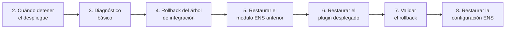

# Diagnóstico y rollback de ENSFácil
[English](04-troubleshooting-and-rollback.en.md)

[[_TOC_]]

## 1. Objetivo

Esta guía describe las comprobaciones que deben realizarse cuando una instalación o actualización de ENSFácil falla y los procedimientos para volver al estado anterior de forma controlada.

> [!warning]
> No debe continuarse con un despliegue si una validación previa ha fallado.



## 2. Cuándo detener el despliegue

Detener el procedimiento si ocurre cualquiera de estas situaciones:

| Situación |
|---|
| `check-integration.sh` devuelve `RESULTADO=NO_COMPATIBLE`. |
| se informa de una versión de Wazuh no validada. |
| aparecen conflictos o ficheros `.rej` al aplicar la integración. |
| la compilación no genera `wazuh-2.19.5.zip`. |
| `unzip -t` informa de errores. |
| Wazuh Dashboard no vuelve a estado `active` después de instalar el plugin. |
| un `install-manager.sh` no confirma su regla con `wazuh-logtest` o el manager no queda `active`. |
| `config/validate-configuration.ts` informa de `ESTRUCTURA INVÁLIDA`. |
| el panel muestra «No se pudo cargar el entorno ENS». |

> [!important]
> Antes de modificar nada más, conservar la salida del comando que ha fallado y localizar los backups creados durante el procedimiento.

## 3. Diagnóstico básico

Comprobar primero el estado de la integración y del servicio:

```bash
REPO=/opt/ensfacil/repo
TARGET=/opt/ensfacil/build/plugins/main
PKG=$REPO/integration/wazuh-dashboard

"$PKG/check-integration.sh" "$TARGET"
sudo systemctl status wazuh-dashboard --no-pager
sudo journalctl -u wazuh-dashboard -n 50 --no-pager
```

Si el problema apareció durante la aplicación de la integración, comprobar también si existen rechazos:

```bash
find "$TARGET" -name "*.rej" -print
```

> [!warning]
> No intentar corregir manualmente los parches sobre el entorno desplegado sin identificar primero la causa.

## 4. Rollback del árbol de integración

`apply-integration.sh` crea automáticamente un backup antes de modificar el árbol del plugin. La ruta se muestra en su salida como `BACKUP=...`.

Para localizar los backups disponibles:

```bash
ls -dt /opt/ensfacil/build/plugins/main-ensfacil-backup-* 2>/dev/null
```

Seleccionar el backup correspondiente a la operación que se quiere revertir y ejecutar:

```bash
REPO=/opt/ensfacil/repo
TARGET=/opt/ensfacil/build/plugins/main
PKG=$REPO/integration/wazuh-dashboard
BACKUP=/opt/ensfacil/build/plugins/main-ensfacil-backup-AAAAMMDD-HHMMSS

"$PKG/rollback-integration.sh" "$TARGET" "$BACKUP"
```

El rollback debe terminar con:

```text
RESULTADO=ROLLBACK_OK
```

> [!warning]
> Si devuelve `RESULTADO=ROLLBACK_ERROR`, detener el procedimiento y revisar la salida antes de continuar.

## 5. Restaurar el módulo ENS anterior

> [!note]
> El rollback del paquete de integración no restaura por sí solo el módulo `public/components/overview/ens`, ya que este se actualiza de forma independiente.

Utilizar el backup creado antes de la actualización:

```bash
TARGET=/opt/ensfacil/build/plugins/main
UPDATE_BACKUP=/opt/ensfacil/artifacts/update-AAAAMMDD-HHMMSS

if test -d "$UPDATE_BACKUP/ens"; then
  sudo rm -rf "$TARGET/public/components/overview/ens"
  sudo cp -a "$UPDATE_BACKUP/ens" "$TARGET/public/components/overview/ens"
  sudo chown -R "$USER":"$USER" "$TARGET/public/components/overview/ens"
else
  echo "ERROR: backup ENS no encontrado"
fi
```

## 6. Restaurar el plugin desplegado

Si la nueva versión ya fue instalada en Wazuh Dashboard, reinstalar el ZIP anterior conservado en el backup de actualización con `config/deploy-plugin.sh`, que sustituye solo el plugin `wazuh` y sube el `build.number` para que los navegadores dejen de usar la versión retirada:

```bash
ZIP_ANTERIOR="$UPDATE_BACKUP/wazuh-2.19.5.zip"
if sudo -u wazuh-dashboard test -r "$ZIP_ANTERIOR"; then
  sudo bash /opt/ensfacil/repo/config/deploy-plugin.sh "$ZIP_ANTERIOR"
else
  echo "ERROR: ZIP anterior no accesible"
fi
```

> [!warning]
> Si se retira el plugin a mano, no utilizar comodines como `wazuh*`: eliminarían también `wazuhCore` y `wazuhCheckUpdates`.

> [!important]
> Si la versión retirada había sembrado controles que la anterior no conoce, restaurar también la configuración ENS (apartado 8) con la copia hecha antes de la actualización.

## 7. Validar el rollback

Comprobar el estado del servicio y los plugins instalados:

```bash
sudo systemctl is-active wazuh-dashboard
sudo -u wazuh-dashboard /usr/share/wazuh-dashboard/bin/opensearch-dashboards-plugin list
```

Comprobar también que el árbol restaurado queda en un estado reconocido por el paquete de integración:

```bash
REPO=/opt/ensfacil/repo
TARGET=/opt/ensfacil/build/plugins/main
PKG=$REPO/integration/wazuh-dashboard

"$PKG/check-integration.sh" "$TARGET"
```

Wazuh Dashboard debe quedar `active`, el plugin `wazuh` debe aparecer instalado y la comprobación de integración no debe mostrar conflictos.

Acceder finalmente a Wazuh Dashboard y confirmar que ENSFácil vuelve a mostrarse en el estado anterior esperado.

> [!note]
> Este procedimiento restaura el código y el plugin desplegado. No revierte automáticamente datos o decisiones de configuración almacenados fuera del árbol del plugin.

## 8. Restaurar la configuración ENS

La configuración ENS vive en el documento `active` del índice `wazuh-ens-configuration`. Las guías de instalación y actualización guardan una copia antes de cada cambio (`/opt/ensfacil/artifacts/active-<fecha>.json` o `$BACKUP/active.json`). Para restaurarla se reescribe el `_source` de esa copia, usando el certificado de administrador del indexer:

```bash
COPIA=/opt/ensfacil/artifacts/active-AAAAMMDD-HHMMSS.json

sudo python3 -c "import json,sys; json.dump(json.load(open(sys.argv[1]))['_source'], open(sys.argv[2],'w'), ensure_ascii=False)" \
  "$COPIA" /opt/ensfacil/artifacts/active-restore.json

sudo curl -sk --cert /etc/wazuh-indexer/certs/admin.pem --key /etc/wazuh-indexer/certs/admin-key.pem \
  -H 'Content-Type: application/json' -X PUT \
  https://127.0.0.1:9200/wazuh-ens-configuration/_doc/active \
  --data-binary @/opt/ensfacil/artifacts/active-restore.json
```

La respuesta debe incluir `"result":"updated"`. Validar después el documento restaurado con `config/validate-configuration.ts`, como en la [guía de instalación, apartado 14.4](01-installation-from-scratch.md#144-validar-el-documento-entero), y recargar el panel.

## 9. Problemas conocidos del despliegue

| Síntoma | Causa | Qué hacer |
|---|---|---|
| El panel muestra «No se pudo cargar el entorno ENS» con `...parameters[M].value has an invalid value` | un parámetro con `value: null`, una tabla con menos columnas de las declaradas o una columna identificador con comas o espacios | validar el documento con `config/validate-configuration.ts`, corregir el parámetro indicado o restaurar la copia (apartado 8). Un parámetro vacío es la clave `value` ausente, nunca `null` |
| Se despliega y el navegador sigue mostrando la versión anterior | se instaló el ZIP sin subir el `build.number` | desplegar con `config/deploy-plugin.sh` |
| La compilación termina tras varios minutos con `ENOENT: yarn install --production` | `yarn` no está en el `PATH` del usuario que compila (habitual al compilar como `root`) | añadir el directorio de `yarn` al `PATH` (ver [instalación, apartado 13.5](01-installation-from-scratch.md#135-compilar-y-validar-el-plugin)) |
| La compilación termina al instante con código 1 | la salida se redirige como `root` a un fichero de `/tmp` creado por otro usuario (`protected_regular`) | llevar el registro a `/opt/ensfacil/artifacts` |
| `install-manager.sh`: «hay más de un bloque `<agent_config>`» | el `agent.conf` del grupo `ens` tiene dos bloques | fusionar todo en un solo `<agent_config>`, validar con `verify-agent-conf` y repetir |
| `install-manager.sh` termina bien pero la regla no casa | una ejecución anterior falló tras copiar las reglas y la repetición no reinicia el manager | `sudo systemctl restart wazuh-manager` y comprobar con `wazuh-logtest` |
| Evidencias de auditd sin medir en una máquina (op.exp.5, op.exp.8, op.exp.10) | el `install.sh` escribió las reglas en `/etc/audit/rules.d/` pero no se cargaron | comprobar que auditd no está en modo inmutable (`sudo auditctl -s`, `enabled` distinto de `2`) y ejecutar `sudo augenrules --load` |
| Un control muestra «Sin datos del recolector desde …» | el último latido del recolector de ese control en esa máquina tiene más de 24 h | comprobar el agente, el cron del recolector y la conectividad; el control vuelve a juzgarse en cuanto llega una pasada nueva |
| op.exp.7, op.exp.8 u op.exp.9 sin datos en la fila del manager | falta el `install-manager.sh` del runbook o su cron horario todavía no se ha ejecutado | revisar `/etc/cron.d/ensfacil-opexp*` del manager y el `<localfile>` en su `ossec.conf` |
| Una regla de op.exp.1 aparece en eventos de op.exp.10 | reglas de op.exp.1 anteriores a la corrección, con el campo `ensfacil` sin anclar | actualizar el runbook de op.exp.1 y repetir su `install-manager.sh` |
