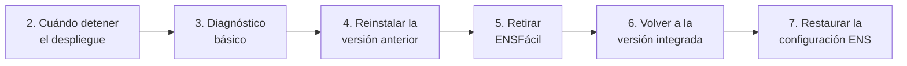

# Diagnóstico y rollback de ENSFácil
[English](04-troubleshooting-and-rollback.en.md)

[[_TOC_]]

## 1. Objetivo

Esta guía describe las comprobaciones que deben realizarse cuando una instalación o actualización de ENSFácil falla y los procedimientos para volver al estado anterior de forma controlada.

> [!warning]
> No debe continuarse con un despliegue si una validación previa ha fallado.



## 2. Cuándo detener el despliegue

Detener el procedimiento si ocurre cualquiera de estas situaciones:

| Situación |
|---|
| `config/build-plugin.sh` no termina con la ruta de `ensfacil-2.19.5.zip`. |
| `unzip -t` informa de errores, o `deploy-plugin.sh --solo-id` no devuelve `ensfacil`. |
| `config/deploy-plugin.sh` dice «el zip no es de un plugin conocido». |
| Wazuh Dashboard no vuelve a estado `active` después de instalar el plugin. |
| `/api/ensfacil/configuration` devuelve `404`: el plugin no ha cargado. |
| un `install-manager.sh` no confirma su regla con `wazuh-logtest` o el manager no queda `active`. |
| `config/validate-configuration.ts` informa de `ESTRUCTURA INVÁLIDA`. |
| el panel muestra «No se pudo cargar el entorno ENS». |

> [!important]
> Antes de modificar nada más, conservar la salida del comando que ha fallado y localizar los backups creados durante el procedimiento.

## 3. Diagnóstico básico

Comprobar el servicio, los plugins instalados y la ruta del plugin:

```bash
sudo systemctl status wazuh-dashboard --no-pager
sudo -u wazuh-dashboard /usr/share/wazuh-dashboard/bin/opensearch-dashboards-plugin list
curl -sk -o /dev/null -w '%{http_code}\n' https://localhost/api/ensfacil/configuration
```

Comprobar en el registro que el dashboard ha cargado ENSFácil, y buscar errores:

```bash
sudo journalctl -u wazuh-dashboard --since "-15 min" --no-pager \
  | grep -o 'Setting up \[[0-9]*\] plugins: \[[^]]*\]' | tail -1 | grep -c ensfacil
sudo journalctl -u wazuh-dashboard --since "-15 min" --no-pager | grep -iE '"level":"error"|fatal' | tail -20
```

Qué tiene que salir:

| Comprobación | Resultado esperado |
|---|---|
| servicio | `active (running)` |
| plugins | `ensfacil` y `wazuh`, entre otros |
| `/api/ensfacil/configuration` | `401` (la ruta existe y pide sesión) |
| `Setting up … plugins` | `1` (ENSFácil está entre los plugins cargados) |
| errores | ninguno que mencione `ensfacil` |

> [!note]
> Las líneas de error de conexiones TLS de clientes (`bad certificate`, `ERR_SSL_…`) no tienen que ver con el plugin.

## 4. Reinstalar la versión anterior de ENSFácil

La guía de actualización guarda el zip anterior en el respaldo (`/opt/ensfacil/artifacts/update-<fecha>/`). Para volver a él, desplegarlo con `config/deploy-plugin.sh`, que sustituye solo `ensfacil` y sube el `build.number` para que los navegadores dejen de usar la versión retirada:

```bash
UPDATE_BACKUP=/opt/ensfacil/artifacts/update-AAAAMMDD-HHMMSS
ZIP_ANTERIOR="$UPDATE_BACKUP/ensfacil-2.19.5.zip"

if sudo -u wazuh-dashboard test -r "$ZIP_ANTERIOR"; then
  sudo bash /opt/ensfacil/repo/config/deploy-plugin.sh "$ZIP_ANTERIOR"
else
  echo "ERROR: zip anterior no accesible"
fi
```

Qué tiene que salir: `dashboard: active` y `ensfacil` en la lista de plugins. Comprobarlo después como en el apartado 3.

> [!important]
> Si la versión retirada había sembrado controles que la anterior no conoce, restaurar también la configuración ENS (apartado 7) con la copia hecha antes de la actualización.

## 5. Retirar ENSFácil

Retirar ENSFácil no toca el plugin de Wazuh ni los datos:

```bash
sudo systemctl stop wazuh-dashboard
sudo -u wazuh-dashboard /usr/share/wazuh-dashboard/bin/opensearch-dashboards-plugin remove ensfacil
sudo rm -rf /usr/share/wazuh-dashboard/plugins/ensfacil
sudo systemctl start wazuh-dashboard
```

Comprobar:

```bash
sudo systemctl is-active wazuh-dashboard
sudo -u wazuh-dashboard /usr/share/wazuh-dashboard/bin/opensearch-dashboards-plugin list
curl -sk -o /dev/null -w '%{http_code}\n' https://localhost/api/ensfacil/configuration
```

Qué tiene que salir: `active`, `wazuh` en la lista y no `ensfacil`, y `404`.

> [!warning]
> Retirar siempre por el nombre exacto, `ensfacil`. Nunca con comodines como `wazuh*` o `*`: se llevarían por delante `wazuhCore` y `wazuhCheckUpdates`, y el dashboard no vuelve a arrancar.

La configuración ENS se queda en el índice `wazuh-ens-configuration` y el rol `ensfacil_admin` se queda en el plugin de seguridad (no da ningún permiso). Al volver a instalar ENSFácil, todo sigue donde estaba.

## 6. Volver a la versión integrada

Solo durante la transición desde la versión integrada ([guía de actualización, apartado 10](02-updating-an-existing-environment.md#10-transición-desde-la-versión-integrada)).

**Antes de reinstalar el plugin oficial de Wazuh** (apartado 10.3 de esa guía), la versión integrada sigue instalada. Basta con retirar ENSFácil (apartado 5).

**Después de reinstalar el plugin oficial de Wazuh**, hay que volver a instalar el zip de la versión integrada (`wazuh-2.19.5.zip`). `config/deploy-plugin.sh` lo acepta mientras dure la transición: retira solo el plugin `wazuh`, instala el integrado y sube el `build.number`. Usar el zip con el que se instaló la versión integrada:

```bash
ZIP_INTEGRADO=/opt/ensfacil/build/plugins/main/build/wazuh-2.19.5.zip

bash /opt/ensfacil/repo/config/deploy-plugin.sh --solo-id "$ZIP_INTEGRADO"
sudo -u wazuh-dashboard test -r "$ZIP_INTEGRADO" && sudo bash /opt/ensfacil/repo/config/deploy-plugin.sh "$ZIP_INTEGRADO"
```

Qué tiene que salir: `wazuh` (el zip es de la versión integrada) y, al final del despliegue, `dashboard: active`. En el menú vuelve a aparecer «ENS». ENSFácil puede quedarse instalado o retirarse (apartado 5).

> [!note]
> La configuración no hay que tocarla: las dos versiones usan el mismo documento. Si después de la transición se sembraron controles que la versión integrada no conoce, restaurar la configuración (apartado 7).

## 7. Restaurar la configuración ENS

La configuración ENS vive en el documento `active` del índice `wazuh-ens-configuration`. Las guías de instalación y actualización guardan una copia antes de cada cambio (`/opt/ensfacil/artifacts/active-<fecha>.json` o `$BACKUP/active.json`). Para restaurarla se reescribe el `_source` de esa copia, usando el certificado de administrador del indexer:

```bash
COPIA=/opt/ensfacil/artifacts/active-AAAAMMDD-HHMMSS.json

sudo python3 -c "import json,sys; json.dump(json.load(open(sys.argv[1]))['_source'], open(sys.argv[2],'w'), ensure_ascii=False)" \
  "$COPIA" /opt/ensfacil/artifacts/active-restore.json

sudo curl -sk --cert /etc/wazuh-indexer/certs/admin.pem --key /etc/wazuh-indexer/certs/admin-key.pem \
  -H 'Content-Type: application/json' -X PUT \
  https://127.0.0.1:9200/wazuh-ens-configuration/_doc/active \
  --data-binary @/opt/ensfacil/artifacts/active-restore.json
```

La respuesta debe incluir `"result":"updated"`. Validar después el documento restaurado con `config/validate-configuration.ts`, como en la [guía de instalación, apartado 14.4](01-installation-from-scratch.md#144-validar-el-documento-entero), y recargar el panel.

## 8. Problemas conocidos del despliegue

| Síntoma | Causa | Qué hacer |
|---|---|---|
| «No se pudo cargar el entorno ENS» con «No hay inventario de agentes: la monitorización de agentes de Wazuh (wazuh-monitoring-*) no está activa o este usuario no puede leerla.» | Wazuh no está guardando el estado de los agentes en `wazuh-monitoring-*`, o el rol del usuario no puede leer ese índice | contar los documentos: `sudo curl -sk --cert /etc/wazuh-indexer/certs/admin.pem --key /etc/wazuh-indexer/certs/admin-key.pem "https://127.0.0.1:9200/wazuh-monitoring-*/_count"`. Si sale `0`, activar la monitorización de agentes en la configuración de la app de Wazuh (`wazuh.monitoring.enabled`); si hay documentos, dar al rol del usuario lectura sobre `wazuh-monitoring-*` |
| Aviso «ENSFácil: inventario de agentes antiguo» | el último dato de `wazuh-monitoring-*` tiene más de 1 hora: un alta o una baja reciente puede no verse | comprobar que la monitorización de agentes de Wazuh sigue activa |
| En Controles o Eventos: «No existe el patrón de índice wazuh-alerts-*: créalo desde Wazuh (o Dashboards Management) para usar esta vista» | el patrón de índice `wazuh-alerts-*` no existe todavía | abrir una vez la app de Wazuh, que lo crea en su comprobación inicial, o crearlo en Dashboards Management > Index patterns. Las demás pestañas funcionan sin él |
| Al guardar la configuración: «Hace falta el rol ensfacil_admin o all_access para cambiar la configuración ENS o ver su historial.» (error 403) | el usuario no tiene ninguno de los dos roles | asignarle el rol con `config/create-admin-role.sh --mapear <usuario>` ([instalación, apartado 13.5](01-installation-from-scratch.md#135-crear-el-rol-ensfacil_admin)); si tenía la sesión abierta, cerrar la sesión y volver a entrar |
| Las pantallas muestran un error de permisos al buscar datos | el rol del usuario no puede leer `wazuh-alerts-*` | darle lectura sobre `wazuh-alerts-*`, el permiso habitual para ver datos de Wazuh |
| No aparece «ENSFácil» en el menú y `/api/ensfacil/configuration` devuelve `404` | el plugin no está instalado o no ha cargado | revisar la lista de plugins y el registro (apartado 3) y desplegar de nuevo con `config/deploy-plugin.sh` |
| El dashboard no arranca después de actualizar Wazuh: `Failed to initialize plugins` y `ensfacil` | el dashboard nuevo lleva otra versión de OpenSearch Dashboards y el plugin está compilado para `2.19.5` | retirar ENSFácil (apartado 5) y conseguir el zip para esa versión ([compatibilidad de versiones](03-version-compatibility.md)) |
| En el menú aparecen «ENS» y «ENSFácil» | la versión integrada sigue instalada | normal durante la transición; para dejar solo «ENSFácil», [actualización, apartado 10.3](02-updating-an-existing-environment.md#103-volver-al-plugin-oficial-de-wazuh) |
| `deploy-plugin.sh`: «el zip no es de un plugin conocido» | el zip no es de ENSFácil (ni, durante la transición, el de la versión integrada) | usar `ensfacil-2.19.5.zip` |
| `build-plugin.sh`: «no es un árbol de OpenSearch Dashboards» o «el árbol es … ENSFácil 1.x se compila contra 2.19.5» | el árbol de compilación no es OpenSearch Dashboards `2.19.5` | preparar el árbol como en la [instalación, apartado 13.2](01-installation-from-scratch.md#132-preparar-el-árbol-de-opensearch-dashboards-2195) |
| `build-plugin.sh` termina con `yarn: command not found`, o tras compilar con `ENOENT: yarn install --production` | `yarn` no está en el `PATH` de `root` | compilar como en la [instalación, apartado 13.3](01-installation-from-scratch.md#133-compilar-y-validar-el-plugin), con `sudo env PATH=…` |
| `yarn install` se para con `Your lockfile needs to be updated` | `package.json` y `yarn.lock` no cuadran: hay cambios locales en el repositorio | no tocar las dependencias en el servidor; dejar el repositorio como está en GitLab (`git status`) |
| La compilación termina al instante con código 1 | la salida se redirige como `root` a un fichero de `/tmp` creado por otro usuario (`protected_regular`) | llevar el registro a `/opt/ensfacil/artifacts` |
| Se despliega y el navegador sigue mostrando la versión anterior | se instaló el zip sin subir el `build.number` | desplegar con `config/deploy-plugin.sh` |
| El panel muestra «No se pudo cargar el entorno ENS» con `...parameters[M].value has an invalid value` | un parámetro con `value: null`, una tabla con menos columnas de las declaradas o una columna identificador con comas o espacios | validar el documento con `config/validate-configuration.ts`, corregir el parámetro indicado o restaurar la copia (apartado 7). Un parámetro vacío es la clave `value` ausente, nunca `null` |
| `install-manager.sh`: «hay más de un bloque `<agent_config>`» | el `agent.conf` del grupo `ens` (o el de `ens-copias`, en mp.info.6) tiene dos bloques | fusionar todo en un solo `<agent_config>`, validar con `verify-agent-conf` y repetir |
| `install-manager.sh` termina bien pero la regla no casa | una ejecución anterior falló tras copiar las reglas y la repetición no reinicia el manager | `sudo systemctl restart wazuh-manager` y comprobar con `wazuh-logtest` |
| Evidencias de auditd sin medir en una máquina (op.exp.5, op.exp.8, op.exp.10) | el `install.sh` escribió las reglas en `/etc/audit/rules.d/` pero no se cargaron | comprobar que auditd no está en modo inmutable (`sudo auditctl -s`, `enabled` distinto de `2`) y ejecutar `sudo augenrules --load` |
| Un control muestra «Sin datos del recolector desde …» | el último latido del recolector de ese control en esa máquina tiene más de 24 h | comprobar el agente, el cron del recolector y la conectividad; el control vuelve a juzgarse en cuanto llega una pasada nueva |
| op.exp.7, op.exp.8 u op.exp.9 sin datos en la fila del manager | falta el `install-manager.sh` del runbook o su cron horario todavía no se ha ejecutado | revisar `/etc/cron.d/ensfacil-opexp*` del manager y el `<localfile>` en su `ossec.conf` |
| Una regla de op.exp.1 aparece en eventos de op.exp.10 | reglas de op.exp.1 anteriores a la corrección, con el campo `ensfacil` sin anclar | actualizar el runbook de op.exp.1 y repetir su `install-manager.sh` |
