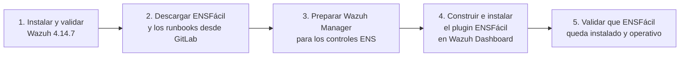

# Instalación completa de ENSFácil desde cero

[[_TOC_]]

## 1. Objetivo

Esta guía describe el procedimiento para desplegar ENSFácil partiendo de una
máquina limpia, sin depender de ningún servidor ENSFácil previamente preparado.

El objetivo es que el entorno pueda reproducirse utilizando únicamente los
repositorios autorizados de GitLab, la documentación del proyecto y los
artefactos versionados necesarios para el despliegue.

## 2. Punto de partida

Esta ruta parte de una instalación de Ubuntu Server que dispone únicamente de:

- acceso administrativo mediante `sudo`;
- conectividad de red;
- acceso a Internet cuando sea necesario;
- acceso autorizado a los repositorios GitLab del proyecto.

No se presupone que estén previamente instalados o preparados Wazuh, ENSFácil,
el árbol de compilación de Wazuh Dashboard, Node.js, Yarn, las reglas ENS, el
grupo `ens` ni la configuración inicial de ENSFácil.

## 3. Resultado esperado

Al finalizar esta guía deben quedar instalados, integrados y validados Wazuh y
ENSFácil, incluyendo las reglas del manager, la integración con Wazuh Dashboard,
el plugin compilado e instalado y la configuración inicial necesaria para que
ENSFácil pueda funcionar.

## 4. Principio de reproducibilidad

Una instalación se considera reproducible cuando puede completarse desde una
máquina limpia utilizando únicamente GitLab y esta documentación.

No debe ser necesario copiar manualmente ficheros desde otro servidor ENSFácil
ni depender de una máquina previamente configurada.

## 5. Versiones y compatibilidad

ENSFácil debe desplegarse únicamente sobre combinaciones de versiones que hayan sido validadas.

La combinación utilizada durante la validación inicial de esta guía es:

| Componente | Versión |
|---|---|
| Wazuh | `4.14.7` |
| OpenSearch Dashboards | `2.19.5` |
| Node.js para compilación | `18.19.0` |

La matriz de compatibilidad se mantiene en:

[`docs/despliegue/03-COMPATIBILIDAD-DE-VERSIONES.md`](03-COMPATIBILIDAD-DE-VERSIONES.md)

> [!note]
> Una nueva versión de Wazuh no debe considerarse compatible automáticamente. Antes de utilizarla deben comprobarse los puntos de integración de ENSFácil, recompilar el plugin y ejecutar las validaciones definidas para el despliegue.

## 6. Flujo completo de instalación

La instalación de ENSFácil se organiza en cinco bloques principales:



1. Instalar y validar Wazuh 4.14.7.
2. Descargar ENSFácil y los runbooks desde GitLab.
3. Preparar Wazuh Manager para los controles ENS.
4. Construir e instalar el plugin ENSFácil en Wazuh Dashboard.
5. Validar que ENSFácil queda instalado y operativo.

Los apartados siguientes desarrollan los comandos y comprobaciones necesarios para cada bloque.

## 7. Regla de validación

Un paso no se considera terminado únicamente porque el comando haya finalizado sin errores.

Cada fase debe incluir una comprobación objetiva que confirme que el resultado esperado existe y funciona.

> [!important]
> Si una validación falla, el despliegue debe detenerse en ese punto. No se continuará con las fases posteriores hasta identificar y resolver la causa.

Siempre que corresponda, cada fase documentará:

- prerrequisitos;
- comandos que deben ejecutarse;
- resultado esperado;
- comprobación de validación;
- acciones recomendadas si la validación falla;
- procedimiento de vuelta atrás cuando exista riesgo de modificar un entorno operativo.

## 8. Preparar y validar la máquina base

### 8.1 Entorno utilizado para validar esta guía

La instalación inicial de esta guía se ha validado sobre el siguiente entorno de laboratorio:

| Recurso | Valor |
|---|---|
| Sistema operativo | Ubuntu Server `24.04.4 LTS` |
| Arquitectura | `x86_64` |
| CPU | 4 CPU lógicas |
| Memoria | 7,8 GiB de RAM |
| Disco | 80 GB de disco virtual |
| Red | conectividad a Internet |
| Acceso | acceso administrativo mediante `sudo` |

> [!note]
> Estos valores describen el entorno de validación y no deben interpretarse como requisitos mínimos de ENSFácil.

La topología de red del laboratorio tampoco es un requisito del producto. La máquina utilizada durante la validación dispone de una interfaz NAT y una interfaz de red de laboratorio.

### 8.2 Comprobaciones previas

Antes de comenzar el despliegue, comprobar el sistema operativo, arquitectura, recursos disponibles, conectividad y herramientas básicas:

```bash
cat /etc/os-release
uname -m
nproc
free -h
df -h /
ip -br addr
ip route
getent hosts gitlab.com
curl -Is --max-time 10 https://gitlab.com | head -1
command -v sudo apt git curl wget python3
```

> [!warning]
> La instalación no debe continuar si no existe acceso administrativo o si la máquina no dispone de la conectividad necesaria para obtener los repositorios y paquetes del despliegue.

## 9. Instalar y validar Wazuh 4.14.7

ENSFácil necesita una instalación funcional y validada de Wazuh antes de continuar con la integración del plugin.

Si Wazuh 4.14.7 todavía no está instalado, seguir primero la [Guía de instalación de Wazuh 4.14.7](https://gitlab.com/quersystem2/wazuh4-installation-capacity-guide), completando los pasos 1 a 4.

Después de completar los pasos 1 a 4 de la guía de Wazuh, volver a este procedimiento y comprobar que la plataforma central está instalada y operativa antes de continuar con ENSFácil.

### 9.1 Validar la instalación de Wazuh

Comprobar las versiones instaladas:

```bash
dpkg-query -W -f='${Package} ${Version}\n' wazuh-manager wazuh-indexer wazuh-dashboard
```

Comprobar que los servicios principales están activos:

```bash
sudo systemctl is-active wazuh-manager wazuh-indexer wazuh-dashboard filebeat
```

Los cuatro servicios deben devolver `active` antes de continuar.

Para la combinación validada en esta guía, `wazuh-manager`, `wazuh-indexer` y `wazuh-dashboard` deben corresponder a Wazuh `4.14.7` (paquetes `4.14.7-1`). Además, los cuatro servicios anteriores deben estar en estado `active` y el acceso al Dashboard debe haber sido validado según el paso 4 de la guía de instalación de Wazuh.

> [!warning]
> Si alguna de estas comprobaciones falla, no continuar con la instalación de ENSFácil hasta resolver la causa.

## 10. Configurar el acceso autorizado a GitLab

Antes de clonar ENSFácil y los runbooks, comprobar que el servidor dispone de acceso autorizado a los repositorios del proyecto en GitLab.

### 10.1 Validar el acceso al repositorio principal

Comprobar que Git puede acceder mediante SSH al repositorio principal de ENSFácil:

```bash
git ls-remote git@gitlab.com:quersystem2/Wazuh-ENS.git HEAD
```

La comprobación debe devolver un hash seguido de `HEAD`. Si Git solicita autenticación y no puede acceder al repositorio, no continuar hasta disponer de acceso autorizado.

### 10.2 Clonar el repositorio de ENSFácil

Crear el directorio base de ENSFácil y asignarlo al usuario administrativo que realizará el despliegue:

```bash
sudo mkdir -p /opt/ensfacil
sudo chown "$USER":root /opt/ensfacil
sudo chmod 755 /opt/ensfacil
git clone git@gitlab.com:quersystem2/Wazuh-ENS.git /opt/ensfacil/repo
```

Después de la clonación, comprobar el repositorio y su remoto:

```bash
git -C /opt/ensfacil/repo remote -v
git -C /opt/ensfacil/repo branch --show-current
git -C /opt/ensfacil/repo status --short
```

### 10.3 Clonar los runbooks ENS

En el servidor Wazuh Manager, clonar en el directorio personal del usuario administrativo los cinco runbooks utilizados por ENSFácil:

```bash
cd ~
BASE=git@gitlab.com:quersystem2/ens-controls-runbook/linux
git clone $BASE/op.acc.1-identificacion.git
git clone $BASE/op.acc.2-requisitos-de-acceso.git
git clone $BASE/op.acc.3-segregacion-de-funciones-y-tareas.git
git clone $BASE/op.acc.4-proceso-de-gestion-de-derechos-de-acceso.git
git clone $BASE/mp.info.6-proxmox-backup-runbook.git
```

### 10.4 Validar los runbooks clonados

Comprobar que los cinco repositorios existen y apuntan al remoto esperado:

```bash
for r in op.acc.1-identificacion op.acc.2-requisitos-de-acceso op.acc.3-segregacion-de-funciones-y-tareas op.acc.4-proceso-de-gestion-de-derechos-de-acceso mp.info.6-proxmox-backup-runbook; do
  echo "=== $r ==="
  git -C "$HOME/$r" remote get-url origin
done
```

Los cinco repositorios deben devolver una URL bajo `git@gitlab.com:quersystem2/ens-controls-runbook/linux/` antes de continuar.

## 11. Crear y validar el grupo ENS

Antes de instalar las reglas de los controles, crear el grupo compartido `ens` en Wazuh Manager:

```bash
sudo /var/ossec/bin/agent_groups -a -g ens -q
```

Comprobar que Wazuh ha creado la estructura compartida del grupo:

```bash
sudo test -d /var/ossec/etc/shared/ens && echo "GRUPO_ENS=OK"
sudo test -f /var/ossec/etc/shared/ens/agent.conf && echo "AGENT_CONF_ENS=OK"
```

> [!warning]
> La instalación de las reglas ENS no debe continuar si el grupo `ens` o su `agent.conf` no existen.

## 12. Instalar y validar las reglas ENS en el Manager

Con el grupo `ens` creado y los cinco runbooks clonados, ejecutar sus instaladores del Manager. El proceso debe detenerse si cualquiera de ellos falla:

```bash
(
for r in op.acc.1-identificacion op.acc.2-requisitos-de-acceso op.acc.3-segregacion-de-funciones-y-tareas op.acc.4-proceso-de-gestion-de-derechos-de-acceso mp.info.6-proxmox-backup-runbook; do
  sudo bash "$HOME/$r/install-manager.sh" || { echo "ERROR: $r"; exit 1; }
done
)
```

### 12.1 Validar la instalación de las reglas

Cada `install-manager.sh` realiza una comprobación bloqueante con `wazuh-logtest`. La instalación se considera correcta cuando se validan las siguientes reglas:

| Control | Regla |
|---|---|
| `op.acc.1` | `106873` |
| `op.acc.2` | `106902` |
| `op.acc.3` | `107001` |
| `op.acc.4` | `107106` |
| `mp.info.6` | `106650` |

Después de ejecutar los cinco instaladores, comprobar también que Wazuh Manager permanece activo:

```bash
sudo systemctl is-active wazuh-manager
```

> [!warning]
> El resultado debe ser `active`. Si cualquiera de los instaladores falla, no confirma su regla esperada o el Manager no queda activo, detener el despliegue antes de continuar.

## 13. Construir e instalar el plugin ENSFácil

La compilación del plugin debe realizarse con Node.js `18.19.0` y Yarn Classic `1.22.22`.

### 13.1 Preparar Node.js y Yarn

Antes de preparar el árbol de compilación, comprobar las versiones disponibles:

```bash
curl -o- https://raw.githubusercontent.com/nvm-sh/nvm/v0.40.7/install.sh | bash

export NVM_DIR="$HOME/.nvm"
[ -s "$NVM_DIR/nvm.sh" ] && . "$NVM_DIR/nvm.sh"

nvm install 18.19.0
nvm use 18.19.0
npm install --global yarn@1.22.22
```

Validar las versiones antes de continuar:

```bash
node --version
yarn --version
```

El resultado esperado es Node.js `v18.19.0` y Yarn `1.22.22`. Si las versiones no coinciden, no continuar con la compilación.

### 13.2 Preparar el árbol de Wazuh Dashboard 4.14.7

Clonar la versión validada de Wazuh Dashboard en el directorio de compilación:

```bash
sudo mkdir -p /opt/ensfacil/build
sudo chown "$USER":root /opt/ensfacil/build
git clone --branch v4.14.7 --depth 1 https://github.com/wazuh/wazuh-dashboard.git /opt/ensfacil/build
```

Comprobar que se ha obtenido exactamente la versión esperada:

```bash
git -C /opt/ensfacil/build rev-parse HEAD
git -C /opt/ensfacil/build describe --tags --exact-match HEAD
```

El tag debe ser `v4.14.7`.

Instalar las dependencias y preparar el árbol de OpenSearch Dashboards:

```bash
cd /opt/ensfacil/build
yarn osd bootstrap
```

El proceso debe finalizar mostrando `bootstrap complete`. Los avisos de dependencias que no detengan el proceso no se consideran por sí solos un fallo.

### 13.3 Incorporar el plugin oficial de Wazuh 4.14.7

Clonar la misma versión del repositorio oficial de plugins de Wazuh:

```bash
git clone --branch v4.14.7 --depth 1 https://github.com/wazuh/wazuh-dashboard-plugins.git /opt/ensfacil/build/plugins/wazuh-dashboard-plugins
```

Comprobar la versión obtenida:

```bash
git -C /opt/ensfacil/build/plugins/wazuh-dashboard-plugins describe --tags --exact-match HEAD
```

El resultado debe ser `v4.14.7`.

Copiar el plugin principal al árbol de compilación:

```bash
cp -a /opt/ensfacil/build/plugins/wazuh-dashboard-plugins/plugins/main /opt/ensfacil/build/plugins/main
```

Instalar las dependencias declaradas por el plugin utilizando su lockfile:

```bash
cd /opt/ensfacil/build/plugins/main
YARN_IGNORE_ENGINES=1 yarn install --frozen-lockfile
```

La instalación debe finalizar sin errores antes de continuar.

### 13.4 Integrar ENSFácil en el plugin Wazuh

Definir las rutas utilizadas durante la integración:

```bash
REPO=/opt/ensfacil/repo
TARGET=/opt/ensfacil/build/plugins/main
PKG=$REPO/integration/wazuh-dashboard
```

Validar primero la integridad del paquete de integración:

```bash
( cd "$PKG" && sha256sum -c SHA256SUMS )
```

Incorporar el núcleo ENS al plugin:

```bash
mkdir -p "$TARGET/public/components/overview"
cp -a "$REPO/dashboard/ens" "$TARGET/public/components/overview/"
```

Comprobar la compatibilidad antes de realizar cambios:

```bash
"$PKG/check-integration.sh" "$TARGET"
```

Para una instalación limpia de Wazuh 4.14.7 deben aparecer `PATCHES_APLICABLES=10`, `FICHEROS_AUSENTES=7`, ausencia de conflictos y `RESULTADO=COMPATIBLE`.

Aplicar la integración ENSFácil:

```bash
"$PKG/apply-integration.sh" "$TARGET"
```

El proceso debe finalizar con `RESULTADO=INTEGRACION_APLICADA` y `REJECTS=0`.

Comprobar nuevamente el estado de la integración:

```bash
"$PKG/check-integration.sh" "$TARGET"
```

Después de la integración deben aparecer `PATCHES_YA_APLICADOS=10`, `FICHEROS_YA_PRESENTES=7`, ausencia de conflictos y `RESULTADO=COMPATIBLE`.

### 13.5 Compilar y validar el plugin

Seleccionar la versión de Node.js validada y compilar el plugin:

```bash
nvm use 18.19.0
cd /opt/ensfacil/build/plugins/main

YARN_IGNORE_ENGINES=1 node ../../scripts/plugin_helpers build \
  --opensearch-dashboards-version=2.19.5
```

La compilación debe finalizar generando el fichero `build/wazuh-2.19.5.zip`.

Validar que el artefacto existe y que el ZIP no contiene errores:

```bash
test -f build/wazuh-2.19.5.zip && echo "ZIP_GENERADO=OK"
unzip -t build/wazuh-2.19.5.zip | tail -1
sha256sum build/wazuh-2.19.5.zip
```

El resultado de `unzip -t` debe indicar que no se han detectado errores. El hash SHA-256 puede conservarse como referencia de integridad del artefacto generado.

> [!warning]
> Si el ZIP no existe o la comprobación de integridad falla, no continuar con la instalación en Wazuh Dashboard.

### 13.6 Instalar el plugin en Wazuh Dashboard

Definir el artefacto generado y comprobar que el usuario del servicio puede leerlo:

```bash
ZIP=/opt/ensfacil/build/plugins/main/build/wazuh-2.19.5.zip
sudo -u wazuh-dashboard test -r "$ZIP" && echo "ZIP_ACCESIBLE=OK"
```

Parar Wazuh Dashboard, sustituir únicamente el plugin `wazuh` e instalar el artefacto compilado:

```bash
sudo systemctl stop wazuh-dashboard

sudo -u wazuh-dashboard /usr/share/wazuh-dashboard/bin/opensearch-dashboards-plugin remove wazuh || true
sudo rm -rf /usr/share/wazuh-dashboard/plugins/wazuh
sudo rm -rf /usr/share/wazuh-dashboard/plugins/.plugin.installing

sudo -u wazuh-dashboard /usr/share/wazuh-dashboard/bin/opensearch-dashboards-plugin \
  install "file://$ZIP"

sudo systemctl start wazuh-dashboard
```

> [!warning]
> No utilizar comodines como `wazuh*` al retirar el plugin, ya que podrían eliminar también `wazuhCore` y `wazuhCheckUpdates`.

Comprobar que el servicio vuelve a quedar activo y consultar el inventario de plugins:

```bash
sudo systemctl is-active wazuh-dashboard
sudo -u wazuh-dashboard /usr/share/wazuh-dashboard/bin/opensearch-dashboards-plugin list
```

Wazuh Dashboard debe devolver `active` y el plugin `wazuh` debe aparecer instalado antes de continuar.

## 14. Sembrar la configuración inicial

### 14.1 Sembrar los controles ENS

La configuración inicial debe sembrarse para que los controles aparezcan en la pantalla de Configuración de ENSFácil.

```bash
cd /opt/ensfacil/repo/config
export OS_USER=admin
read -rsp "Clave del indexer: " OS_PASS && export OS_PASS && echo

for c in mp.info.6 op.acc.1 op.acc.2 op.acc.3 op.acc.4; do
  python3 inject-control.py "$c" --apply || exit 1
done
```

La operación fusiona la configuración existente y añade los bloques necesarios para los controles ENS.
