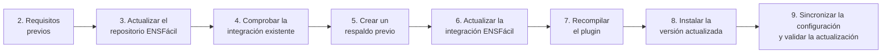

# Actualización de ENSFácil en un entorno existente

[[_TOC_]]

## 1. Objetivo

Esta guía describe cómo actualizar ENSFácil cuando Wazuh y una versión anterior del plugin ya están instalados y funcionando.

El procedimiento conserva el entorno existente, aplica únicamente los cambios pendientes de la integración y genera un nuevo artefacto del plugin antes de desplegarlo.



## 2. Requisitos previos

Antes de comenzar deben cumplirse estas condiciones:

| Requisito |
|---|
| Wazuh Dashboard 4.14.7 instalado. |
| Árbol de compilación disponible en `/opt/ensfacil/build`. |
| Plugin Wazuh disponible en `/opt/ensfacil/build/plugins/main`. |
| Repositorio ENSFácil disponible en `/opt/ensfacil/repo`. |
| Node.js 18.19.0 y Yarn Classic 1.22.22. |
| El Dashboard debe estar operativo antes de iniciar la actualización. |

Comprobar el estado inicial:

```bash
sudo systemctl is-active wazuh-dashboard
git -C /opt/ensfacil/repo status --short
git -C /opt/ensfacil/repo branch --show-current
```

> [!warning]
> No continuar si Wazuh Dashboard no está activo o si existen cambios locales no identificados en el repositorio.

## 3. Actualizar el repositorio ENSFácil

Actualizar la rama actualmente utilizada por el despliegue:

```bash
git -C /opt/ensfacil/repo pull --ff-only
git -C /opt/ensfacil/repo log -1 --oneline
```

> [!note]
> Conservar el hash mostrado como referencia de la versión que se va a desplegar.

## 4. Comprobar la integración existente

Definir las rutas de trabajo y verificar la integridad del paquete de integración:

```bash
REPO=/opt/ensfacil/repo
TARGET=/opt/ensfacil/build/plugins/main
PKG=$REPO/integration/wazuh-dashboard

( cd "$PKG" && sha256sum -c SHA256SUMS )
"$PKG/check-integration.sh" "$TARGET"
```

El resultado debe indicar `RESULTADO=COMPATIBLE`. El informe puede mostrar parches ya aplicados y otros pendientes; esto es normal durante una actualización.

> [!warning]
> Si aparecen conflictos o el resultado no es compatible, no aplicar ningún cambio y consultar la guía de compatibilidad y diagnóstico.

## 5. Crear un respaldo previo

Respaldar el módulo ENS actual y el último ZIP desplegable antes de modificar el árbol de compilación:

```bash
STAMP=$(date +%Y%m%d-%H%M%S)
BACKUP=/opt/ensfacil/artifacts/update-$STAMP
sudo mkdir -p "$BACKUP"

sudo cp -a "$TARGET/public/components/overview/ens" "$BACKUP/ens"

test -f "$TARGET/build/wazuh-2.19.5.zip" && \
  sudo cp -a "$TARGET/build/wazuh-2.19.5.zip" "$BACKUP/"

echo "BACKUP=$BACKUP"
```

> [!important]
> El ZIP anterior debe conservarse hasta completar todas las validaciones de la nueva versión.

## 6. Actualizar la integración ENSFácil

Actualizar primero el módulo ENS dentro del árbol de compilación:

```bash
DEST="$TARGET/public/components/overview/ens"
sudo rm -rf "$DEST"
sudo cp -a "$REPO/dashboard/ens" "$DEST"
sudo chown -R "$USER":"$USER" "$DEST"
```

Aplicar después únicamente los cambios pendientes del paquete de integración:

```bash
"$PKG/apply-integration.sh" "$TARGET"
```

El script crea su propio respaldo de los ficheros modificados. La ejecución debe finalizar con `RESULTADO=INTEGRACION_APLICADA` y sin ficheros `.rej`.

Comprobar inmediatamente el estado resultante:

```bash
"$PKG/check-integration.sh" "$TARGET"
```

Después de la actualización todos los parches deben aparecer ya aplicados, los ficheros adicionales presentes y el resultado debe ser `RESULTADO=COMPATIBLE`.

## 7. Recompilar el plugin

```bash
export NVM_DIR="$HOME/.nvm"
[ -s "$NVM_DIR/nvm.sh" ] && . "$NVM_DIR/nvm.sh"
nvm use 18.19.0
cd "$TARGET"

YARN_IGNORE_ENGINES=1 node ../../scripts/plugin_helpers build \
  --opensearch-dashboards-version=2.19.5
```

Validar el nuevo artefacto antes de instalarlo:

```bash
test -f build/wazuh-2.19.5.zip && echo "ZIP_GENERADO=OK"
unzip -t build/wazuh-2.19.5.zip | tail -1
```

> [!warning]
> No continuar si el ZIP no existe o la comprobación de integridad informa de errores.

## 8. Instalar la versión actualizada

Definir el nuevo artefacto y comprobar que puede ser leído por el usuario de Wazuh Dashboard:

```bash
ZIP=/opt/ensfacil/build/plugins/main/build/wazuh-2.19.5.zip
sudo -u wazuh-dashboard test -r "$ZIP" && echo "ZIP_ACCESIBLE=OK"
```

Parar Wazuh Dashboard y sustituir únicamente el plugin `wazuh`:

```bash
sudo systemctl stop wazuh-dashboard

sudo -u wazuh-dashboard /usr/share/wazuh-dashboard/bin/opensearch-dashboards-plugin remove wazuh || true
sudo rm -rf /usr/share/wazuh-dashboard/plugins/wazuh
sudo rm -rf /usr/share/wazuh-dashboard/plugins/.plugin.installing

sudo -u wazuh-dashboard /usr/share/wazuh-dashboard/bin/opensearch-dashboards-plugin \
  install "file://$ZIP"

sudo systemctl start wazuh-dashboard
```

> [!warning]
> No utilizar comodines como `wazuh*`. Deben conservarse los plugins `wazuhCore` y `wazuhCheckUpdates`.

## 9. Sincronizar la configuración y validar la actualización

Actualizar los bloques de configuración ENS. La operación es fusionable y conserva los valores ya declarados:

```bash
cd /opt/ensfacil/repo/config
export OS_USER=admin
read -rsp "Clave del indexer: " OS_PASS && export OS_PASS && echo

for c in mp.info.6 op.acc.1 op.acc.2 op.acc.3 op.acc.4; do
  python3 inject-control.py "$c" --apply || exit 1
done
```

Comprobar el servicio y el inventario de plugins:

```bash
sudo systemctl is-active wazuh-dashboard
sudo -u wazuh-dashboard /usr/share/wazuh-dashboard/bin/opensearch-dashboards-plugin list
```

Comprobar finalmente la integración y la coherencia con los runbooks:

```bash
REPO=/opt/ensfacil/repo
TARGET=/opt/ensfacil/build/plugins/main
PKG=$REPO/integration/wazuh-dashboard

"$PKG/check-integration.sh" "$TARGET"
cd "$REPO"
python3 tests/check-coherencia.py
```

Wazuh Dashboard debe permanecer `active`, el plugin `wazuh` debe aparecer instalado y `check-integration.sh` debe finalizar con `RESULTADO=COMPATIBLE`.

Acceder finalmente a ENSFácil desde Wazuh Dashboard y confirmar que la interfaz y los controles siguen disponibles. Si alguna validación falla, no continuar operando con la nueva versión y utilizar el procedimiento de diagnóstico y rollback.
